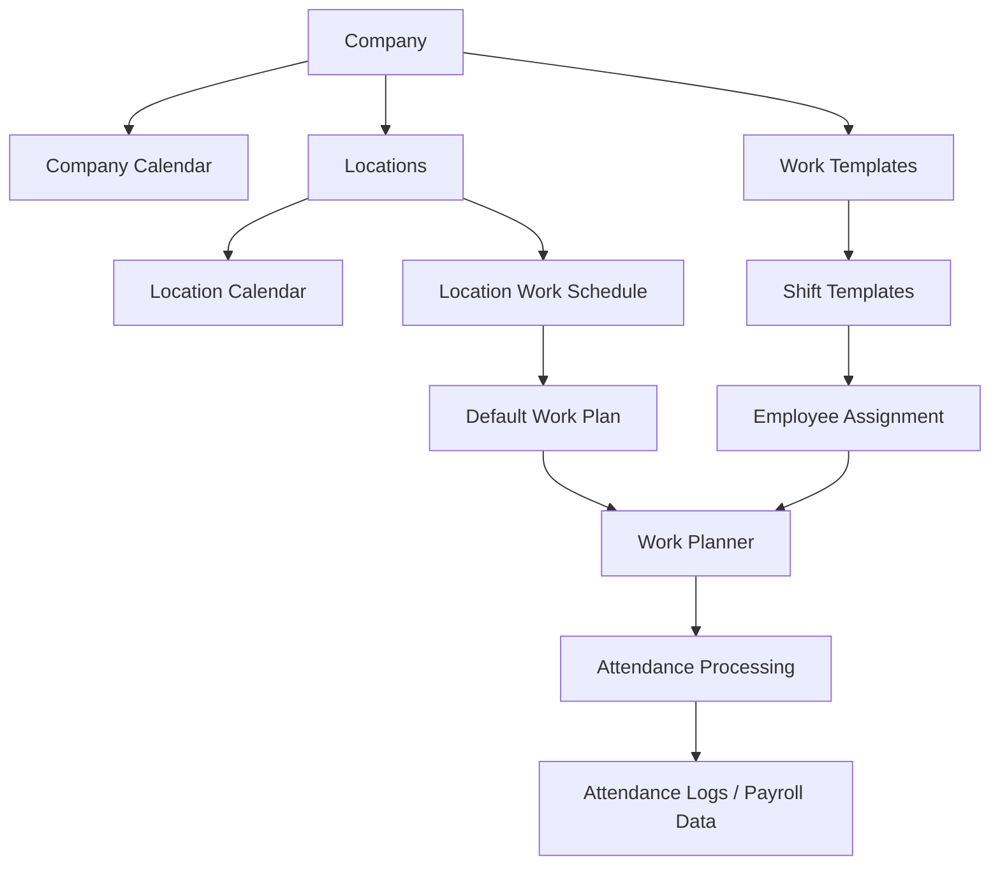
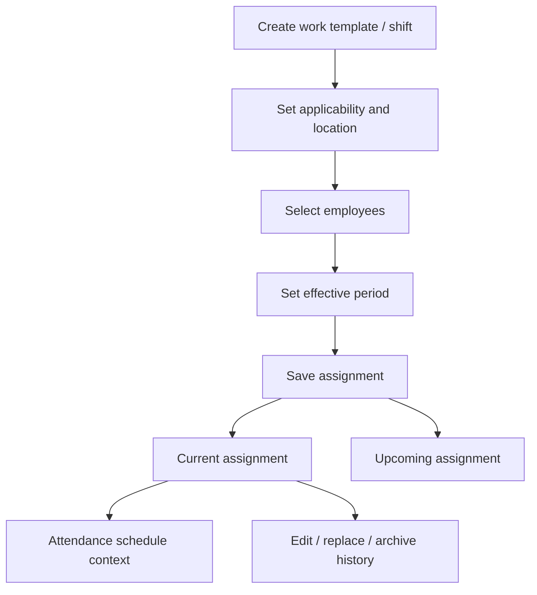
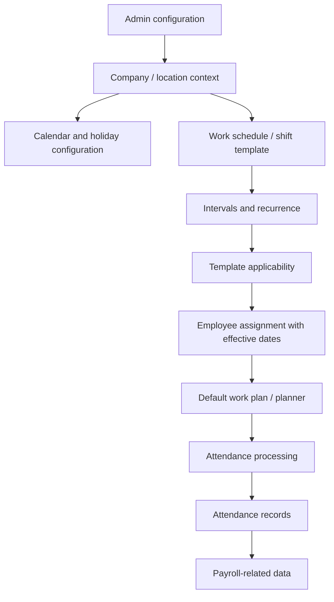

# Attendance KT — Backend & Design Analysis

**Source:** `Meeting in Attendance KT.docx`  
**Meeting title:** Meeting in Attendance KT-20261023_110601-Meeting Recording  
**Date shown:** 23 October 2026  
**Duration:** 1 hour, 24 minutes, 36 seconds  
**Primary speaker shown:** Velraj Ramachandran  
**Transcript captured by:** Syed Mohamed

> **Source-quality note:** This analysis is based on the uploaded 15-page DOCX transcript. The transcript appears to be automatic speech recognition and contains unclear/corrupted phrases. Important details are labelled as confirmed, inferred, or requiring confirmation. No API routes, DTO names, database tables/collections, or code components are invented.
>
> **Video cross-check:** The separately uploaded MP4s are named Attendance KT – 26 Oct 2026 and Call with Shivam – 20 Oct 2026. The DOCX transcript is dated 23 Oct 2026. The MP4 audio has not been independently transcribed in this run, so this document does not claim those recordings were watched or verified against this transcript. Confirm which recording corresponds to this DOCX.

## 1. Executive summary

The transcript is primarily a functional/design walkthrough of attendance configuration and work planning. Topics include:

- Company calendars and location calendars.
- Work schedules and yearly/holiday calendars.
- Fixed, flexible, and split shifts.
- Multiple shift intervals and break periods.
- Weekly and monthly recurrence, including selected weekdays and ordinal Mondays/Saturdays.
- Company-level and location-level configuration.
- Seasonal/date-effective schedules, including examples referring to summer timing and Ramadan.
- Regular and rotation work templates.
- Employee-to-template/shift assignments and effective periods.
- Default work plans, work planners, and employee groups/sections.
- The relationship between schedules, attendance logs, and payroll data.

The transcript provides functional requirements and examples, but not implementation-level backend architecture.

## 2. Functional scope and evidence

| Area | Transcript discussion | Evidence |
|---|---|---|
| Company calendar | Create and maintain company calendar | Pages 1, 6–8 |
| Location calendar | Location-specific calendar/configuration and updates | Pages 3–8 |
| Work schedule | Working days and working hours | Pages 1–5 |
| Shift types | Fixed, flexible, split | Pages 2, 5, 9 |
| Shift intervals | Multiple intervals and breaks | Pages 2, 4–5 |
| Recurrence | Weekly patterns; first/second/third/fourth Monday or Saturday | Pages 3–5 |
| Holiday configuration | Company/location holiday lists and holiday policy | Pages 7–8 |
| Work templates | Regular and rotation templates | Pages 8–10 |
| Employee assignment | Assign employees to shifts/templates/plans; effective periods/history | Pages 10–12 |
| Default work plan | Default plan/template at company or location level | Pages 10–12 |
| Work planner | Plans, employee selection, groups/sections | Pages 11–15 |
| Attendance/payroll | Attendance logs and payroll data are mentioned | Pages 8, 13 |

## 3. Design analysis

### 3.1 Configuration hierarchy

**Transcript-supported points**
- Company-level calendar configuration is discussed.
- Location-level calendar and schedule configuration are discussed.
- A default calendar/work template is mentioned.
- Publishing or updating configuration should reflect changes in the relevant location context.
- Notifications/update reflection are mentioned around publishing.

**Conceptual interpretation (inferred, not verified architecture):**



This is a functional relationship map, not a verified database or runtime architecture.

### 3.2 Calendar design

The transcript refers to company calendars, location calendars, work schedules, holiday lists, yearly calendars, calendar updates, and publishing.

Questions to confirm:
- Does a location calendar inherit company holidays?
- Can a location override company-level working days or holidays?
- Is publishing a separate state from saving?
- Are calendar changes versioned?
- What notification is generated after publishing?

### 3.3 Work schedule and shift design

| Shift type | Transcript-supported description | Evidence |
|---|---|---|
| Fixed | Defined start/end time and maintained working hours | Pages 2–3 |
| Flexible | Flexible timing with daily/weekly working-hour expectations | Page 5 |
| Split | Multiple intervals with gaps/breaks between intervals | Pages 2, 4–5 |

**Fixed shift**
- Examples include 9:00–5:00, 9:00–6:00, and 10:00–6:00.
- Timing may differ by company/location or for a specific period.
- A summer-time schedule example is discussed.

**Flexible shift**
- Daily and weekly working-hour expectations are discussed.
- Examples around 9 hours daily and weekly totals such as 40/44/45/48 hours appear in the transcript.
- The exact threshold, calculation, and validation are unclear; do not treat these numbers as confirmed rules.

**Split shift**
- Multiple intervals can form one shift.
- Morning, afternoon, and evening intervals are discussed.
- Lunch and short tea/snack breaks are mentioned.
- A default of one interval and differing interval handling for some days are discussed, but the exact default needs confirmation.

### 3.4 Interval and break examples

Examples in the transcript include:
- Morning interval around 8:00–12:00.
- Afternoon interval around 12:00–16:00.
- Other afternoon/evening timings.
- Lunch break examples around one hour.
- Short breaks around 15 minutes.

These are meeting examples, not confirmed system defaults.

| Potential configuration field | Meaning | Evidence status |
|---|---|---|
| Shift type | Fixed / Flexible / Split | Explicitly discussed |
| Start/end time | Shift or interval boundaries | Explicitly discussed |
| Interval count | Number of split-shift intervals | Explicitly discussed |
| Break duration/timing | Break definition | Breaks discussed; data structure unknown |
| Working hours | Daily/weekly expected hours | Discussed; exact calculation unknown |
| Applicable days | Days on which the shift applies | Explicitly discussed |
| Recurrence | Weekly/monthly schedule pattern | Explicitly discussed |

### 3.5 Recurrence and working-day patterns

The transcript discusses weekly recurrence, selecting weekdays, first/second/third/fourth Monday patterns, first/fourth Saturday examples, different timings on selected weekdays, and working-day applicability.

**Inferred requirement:** the schedule configuration likely needs recurrence rules and day-specific timing. The exact recurrence model and supported combinations are not stated.

### 3.6 Seasonal and effective-dated schedules

A different schedule for a particular period is discussed, including summer-time and Saudi/Ramadan examples. The transcript refers to normal hours, alternate templates, effective periods, and assigning templates to employees.

**Inferred requirement:** schedule/template assignment should support effective-from and effective-to dates. The transcript does not define overlap precedence or how historical attendance is protected.

### 3.7 Holiday configuration

The meeting discusses company-level holidays, location-level holidays, general/company holiday lists, holiday policy, and publishing/configuration.

Not specified: holiday entity fields, country-specific holiday sources, API behaviour, or how holidays affect shift calculations.

### 3.8 Work templates and rotation

The transcript distinguishes regular and rotation templates, shift configuration inside templates, location applicability, multiple shifts for a location, and employee assignment.

A template already used by employees is discussed differently from an unused template; archiving/history is mentioned. The exact delete/archive rule needs confirmation.

### 3.9 Employee assignment lifecycle

The functional flow discussed is:
1. Create a shift or work template.
2. Configure applicability/location.
3. Select employees.
4. Set an effective period.
5. Save the assignment.
6. Review current/upcoming assignments.
7. Edit assignments while retaining relevant history.



This is an interpretation of the discussed workflow. Exact statuses and transitions are not stated.

### 3.10 Default work plan and planner

The transcript discusses a default work plan, company/location defaults, creating plans, adding employees, plan names, multiple plans (Plan A/Plan B examples), and grouping employees into sections (support/inspection examples).

**Inferred requirement:** the planner supports named plans/sections and employee membership. The exact relationship among work plan, work template, shift, and planner section needs confirmation.

## 4. Backend analysis

### 4.1 Backend capabilities implied by the workflows

These are derived functional requirements, not confirmed service implementations.

| Capability | Implied responsibility | Confidence |
|---|---|---|
| Company calendar management | Create/update company calendar configuration | High |
| Location calendar management | Maintain location-specific calendar settings | High |
| Work schedule management | Maintain workdays and timing | High |
| Shift template management | Fixed/flexible/split definitions | High |
| Interval management | Multiple intervals and breaks | High |
| Recurrence management | Weekly/monthly workday patterns | Medium |
| Effective-dated configuration | Apply templates for date ranges | Medium |
| Holiday management | Company/location holiday configuration | High |
| Template applicability | Associate templates with locations/employees | High |
| Employee assignment | Create/update employee-plan assignments | High |
| Assignment history | Retain prior/current/upcoming assignment context | Medium |
| Default work plan | Resolve company/location default plan | High |
| Work planner | Manage plans/sections and employee membership | High |
| Attendance integration | Make schedule data available to attendance | Medium |
| Payroll relationship | Attendance/payroll relationship is mentioned, details absent | Low |

### 4.2 Conceptual backend flow



The transcript does not identify actual services, controllers, repositories, queues, or database boundaries.

### 4.3 API catalogue — not present in transcript

No endpoint paths, HTTP methods, request/response DTO names, or status codes are clearly provided. Do not infer API routes from the UI/workflow discussion.

| Feature | Method | Endpoint | Request/response DTO | Validation | Status |
|---|---|---|---|---|---|
| Company calendar | TBD | TBD | TBD | TBD | Not in transcript |
| Location calendar | TBD | TBD | TBD | TBD | Not in transcript |
| Work schedule | TBD | TBD | TBD | TBD | Not in transcript |
| Shift template | TBD | TBD | TBD | TBD | Not in transcript |
| Holiday configuration | TBD | TBD | TBD | TBD | Not in transcript |
| Employee assignment | TBD | TBD | TBD | TBD | Not in transcript |
| Work plan/planner | TBD | TBD | TBD | TBD | Not in transcript |

### 4.4 Database design — conceptual only

The transcript does not identify a database technology, schema, table, collection, field, key, or index. The following are conceptual business entities only, not confirmed physical tables/collections.

| Conceptual entity | Reason it may be needed | Evidence |
|---|---|---|
| CompanyCalendar | Company calendar configuration | Pages 1, 6–8 |
| LocationCalendar | Location calendar settings | Pages 3–8 |
| Holiday / HolidayPolicy | Holiday configuration | Pages 7–8 |
| WorkSchedule | Working days and hours | Pages 1–5 |
| ShiftTemplate | Fixed/flexible/split shift | Pages 2, 8–10 |
| ShiftInterval | Split-shift periods | Pages 2, 4–5 |
| WorkTemplate | Regular/rotation template | Pages 8–10 |
| TemplateApplicability | Location/employee applicability | Pages 8–11 |
| EmployeeWorkAssignment | Employee assignment and effective period | Pages 10–12 |
| WorkPlan | Named/default work plan | Pages 11–15 |
| WorkPlanSection | Employee group/section | Pages 13–14 |

Do not create migrations or tests against these names until confirmed from backend source code or the database.

### 4.5 Backend questions for the developer

1. Which service owns company and location calendars?
2. Are work schedules, shift templates, and work plans in one service or separate services?
3. What are the actual API routes and DTO contracts for create/update/publish/assign/archive?
4. How is company/location scope enforced?
5. What is the precedence between company defaults and location overrides?
6. How are effective-from/effective-to dates validated?
7. What happens when employee assignments overlap?
8. How are recurring weekdays and ordinal weekdays persisted?
9. How are split-shift intervals and breaks represented?
10. How is the default work plan resolved for employees assigned to multiple locations?
11. How does attendance consume the assigned schedule?
12. What attendance data is passed to payroll?
13. Is assignment history immutable, versioned, or overwritten?
14. What are the delete/archive rules for templates already in use?

## 5. QA test coverage derived from the transcript

These are suggested test ideas, not evidence that the product currently implements each behaviour.

### 5.1 Calendar and location
- Create a company calendar.
- Configure calendars for multiple locations.
- Verify company and location settings remain in the correct scope.
- Update/publish a calendar and verify the intended location reflects it.
- Verify company/location holiday configuration.
- Verify behaviour when a location has no calendar.

### 5.2 Shift configuration
- Create fixed, flexible, and split shifts.
- Validate start/end time ordering.
- Validate split interval count and ordering.
- Validate breaks and interval gaps.
- Validate daily/weekly hours against confirmed rules.
- Verify selected weekdays and day-specific timings.
- Verify ordinal Monday/Saturday recurrence if supported.

### 5.3 Effective dates and seasonal schedules
- Create normal and temporary templates.
- Verify correct template before/during/after the effective period.
- Validate start date is not after end date.
- Verify overlap handling based on the confirmed rule.
- Clarify Ramadan/summer-time behaviour before asserting expected values.

### 5.4 Employee assignment and history
- Assign one employee and multiple employees.
- Verify location applicability.
- Verify current and upcoming assignments.
- Verify past effective-date handling.
- Edit an assignment and verify history.
- Attempt to delete a template already in use.
- Verify archive behaviour and employee impact.

### 5.5 Work planner
- Create regular and rotation work plans.
- Set a default work plan.
- Add/remove employees.
- Create multiple plans and sections.
- Verify employee membership after edit.
- Verify current/upcoming plan views.

### 5.6 Attendance/payroll
- Verify attendance uses the employee's effective schedule.
- Verify fixed/flexible/split schedules are interpreted correctly.
- Verify holidays and weekly off days.
- Verify schedule changes do not incorrectly rewrite historical attendance.
- Confirm the payroll integration contract before testing downstream calculations.

## 6. Transcript page reference index

The DOCX provides page references, not reliable per-utterance timestamps.

| Topic | Pages | Discussion |
|---|---:|---|
| Calendar, work schedule, holiday list, yearly calendar | 1 | Initial configuration areas |
| Fixed/flexible/split shifts, intervals and breaks | 2 | Shift types and examples |
| Weekday and ordinal Monday/Saturday patterns | 3 | Recurrence |
| Company/location timing and seasonal periods | 3–4 | Location schedule and effective periods |
| Flexible weekly hours and publishing/configuration | 5–6 | Hours and company/location setup |
| Company/location calendar and holiday configuration | 6–8 | Calendar publishing and holiday policy |
| Work templates, regular/rotation, shift configuration | 8–10 | Template design and applicability |
| Employee assignment, template use, archive/history | 10–11 | Assignment and lifecycle |
| Default work plan and employee addition | 11–12 | Default plan |
| Past/current/future dates and attendance/payroll relationship | 12–13 | Effective dates and downstream data |
| Work planner, employee groups/sections, plan editing | 13–15 | Plans and sections |

## 7. Confirmed facts, inferences, and gaps

### Supported by transcript
- Fixed, flexible, and split shift types are discussed.
- Split shifts can have multiple intervals and breaks.
- Working days and day-specific timings are configurable topics.
- Company and location calendar configuration are discussed.
- Holiday lists and holiday policy are discussed.
- Regular and rotation work templates are discussed.
- Employee assignment to shifts/templates/plans is discussed.
- Default work plan and work planner concepts are discussed.
- Employee groups/sections within plans are discussed.
- Past/current/future date contexts are discussed.
- Attendance logs and payroll data are mentioned.

### Inferences requiring confirmation
- Exact hierarchy/inheritance between company and location settings.
- Exact database entities and relationships.
- Exact API/service architecture.
- Exact recurrence schema and supported patterns.
- Exact shift-hour calculations and weekly thresholds.
- Effective-date conflict resolution.
- Template versioning/archive behaviour.
- Attendance/payroll integration flow.

### Not provided by this transcript
- API endpoints and HTTP methods.
- Request/response JSON.
- DTO/model class names.
- Database technology, table/collection names, and field definitions.
- Controller/service/repository names.
- Authentication/authorization implementation.
- Event names, queues, cron jobs, retry rules.
- Figma links or screenshots.

## 8. Additional materials needed

To complete implementation-level documentation, provide:
1. The correct MP4 corresponding to the 23 October 2026 transcript, or its full timestamped transcript.
2. Transcripts for the separate 20 October and 26 October recordings if they are in scope.
3. Figma file/link or exported screenshots.
4. Swagger/OpenAPI documentation.
5. Relevant backend repository/service names or source files.
6. Database schema/sample documents for calendars, shifts, templates, assignments, and plans.

## 9. Suggested documentation package

```text
Attendance_KT/
├── Attendance_KT_Backend_Design_Analysis.md
├── api-catalogue.md
├── database-design.md
├── ui-figma-screen-mapping.md
└── qa-test-scenarios.md
```

**Conclusion:** The transcript is a useful functional design walkthrough for attendance calendars, work schedules, shift templates, employee assignments, and work planning. It is not sufficient by itself to establish the actual backend architecture, API contracts, or database schema. Verify those details against the matching recording, Figma, Swagger, and backend source code.
