# 🛡️ Attendance 2 — Master Consolidated Defect Log

> **Service:** `SP.AttendanceSvc` (.NET 9 Microservice) | **Environment:** Sahab DEV (`sp.dev.zoolwork.com`)
> **Database:** MongoDB (`Sahab` @ `10.1.0.4:27018`) | **Author:** QA Engineering & Microservice Architecture Team
> **Status:** **Active Master Defect Register** | **Date:** **10 November 2026** (Updated with Attendance Policy DTO & Request Body Architecture Refinement)

---

## 📑 Table of Contents
- [1. Executive Summary & Defect Metrics Dashboard](#1-executive-summary--defect-metrics-dashboard)
- [2. Master Defect Quick-Reference Matrix (All 70 Defects)](#2-master-defect-quick-reference-matrix)
- [3. Module 1: Holiday Calendar Module (`ERP.Attendance.HolidayCalendars`)](#3-module-1-holiday-calendar-module)
- [4. Module 2: Work Template & Location Cascade Module (`ERP.Attendance.WorkTemplates`)](#4-module-2-work-template--location-cascade-module)
- [5. Module 3: Work Plans, Shift Rosters & Attendance Policies](#5-module-3-work-plans-shift-rosters--attendance-policies)
- [6. Module 4: Security, Authentication & Multi-Tenancy Architecture](#6-module-4-security-authentication--multi-tenancy-architecture)
- [7. Verified Business Scenarios Confirmed as 'Not a Bug' (By Design)](#7-verified-business-scenarios-confirmed-as-not-a-bug)
- [8. Developer Remediation Action Checklist (Days 1 to 8)](#8-developer-remediation-action-checklist)
- [9. 🚨 Today's New Defects Summary (10 November 2026) – Bottom Recap Table](#todays-defects-summary-10-november-2026-bottom)
- [10. 📸 Master Visual Evidence Index (Evidences 01 to 58)](#-master-visual-evidence-index)

---

## 1. Executive Summary & Defect Metrics Dashboard

During rigorous manual, Swagger, Web UI (`sp.dev.zoolwork.com`), and MongoDB Compass testing of the Attendance 2 microservice, a total of **59 defects and architecture gaps** were identified and verified with photographic proof.

### Defect Severity Breakdown

| Severity Level | Count | Impact Summary |
| :--- | :---: | :--- |
| 🔴 **P0 (Blocker)** | **7** | **System Blockers:** Blocks operations entirely. Expired JWT bypass, inverted shifts, PATCH deadlock (`1706`), publishing empty calendar, missing holiday names/types. |
| 🟠 **P1 (Critical)** | **46** | **Critical Domain / Data Integrity:** Unassigned location templates (Delhi gap), HTTP 500 server crashes, negative durations, broken math invariants, empty tenant persistence, empty company name persistence. |
| 🟡 **P2 (Major)** | **6** | **Audit / DX / Contracts:** Audit fields stored as plain emails instead of composite user objects, redundant DTO fields, missing Swagger OAuth2 login flow. |
| **TOTAL** | **59** | **100% Verified with live screenshots & MongoDB Compass records.** |

### Defect Distribution by Functional Module

| Module | Target Collection / Component | Total | P0 Blocker | P1 Critical | P2 Major |
| :--- | :--- | :---: | :---: | :---: | :---: |
| **Module 1: Holiday Calendars** | `ERP.Attendance.HolidayCalendars` | **15** | 5 | 9 | 1 |
| **Module 2: Work Templates & Location Cascade** | `ERP.Attendance.WorkTemplates` | **27** | 1 | 25 | 1 |
| **Module 3: Work Plans, Rosters & Policies** | `ERP.Attendance.WorkPlans`, `Policies` | **7** | 0 | 6 | 1 |
| **Module 4: Security, Auth & Multi-Tenancy** | Kestrel JWT Middleware, Multi-Tenancy | **6** | 1 | 4 | 1 |
| **TOTAL** | **All 4 Modules Combined** | **56** | **7** | **44** | **4** |

---

### 1.1. Overall Consolidated Test Execution Dashboard (All 16 Modules)

> **Master Workbook Reference:** [`AttendanceTestCases_Master_Consolidated.xlsx`](file:///d:/Code/Attendance%20Testing/AttendanceTestCases_Master_Consolidated.xlsx) (`INDEX` Tab)  
> **Total Test Suite Volume:** **1,527 Test Cases** across 16 functional modules  
> **Live Execution Progress to Date:** **598 Test Cases Executed** (563 Passed, 35 Failed, 929 Not-Run) — **94.1% Pass Rate on Executed Tests**

| # | Module / Sheet Name | Total TCs | P0 (Blocker) | P1 (Must) | P2 (Should) | P3 (Nice) | Passed | Failed | Not-Run | Exec % | Execution Health Status |
|:---:|---|:---:|:---:|:---:|:---:|:---:|:---:|:---:|:---:|:---:|---|
| **1** | **WT - Company Default** | 150 | 67 | 53 | 27 | 3 | **146** | **4** | **0** | **100.0%** | 🟢 **100% Executed (97.3% Pass Rate)** |
| **2** | **WT - Location Shifts** | 103 | 47 | 38 | 18 | 0 | 0 | 0 | 103 | 0.0% | ⚪ Not-Run (Pending Execution) |
| **3** | **WT - Roster & Rotation** | 36 | 14 | 15 | 7 | 0 | 0 | 0 | 36 | 0.0% | ⚪ Not-Run (Pending Execution) |
| **4** | **Holiday Calendar - Company** | 83 | 35 | 32 | 16 | 0 | 0 | 0 | 83 | 0.0% | ⚪ Not-Run (Pending Execution) |
| **5** | **Holiday Calendar - Location** | 50 | 19 | 29 | 1 | 1 | 0 | 0 | 50 | 0.0% | ⚪ Not-Run (Pending Execution) |
| **6** | **Attendance Policies** | 115 | 48 | 44 | 21 | 2 | 0 | 0 | 115 | 0.0% | ⚪ Not-Run (Pending Execution) |
| **7** | **Work Plans** | 167 | 66 | 65 | 33 | 3 | 0 | 0 | 167 | 0.0% | ⚪ Not-Run (Pending Execution) |
| **8** | **Work Assignments** | 149 | 48 | 71 | 26 | 4 | 0 | 0 | 149 | 0.0% | ⚪ Not-Run (Pending Execution) |
| **9** | **Attendance Exemptions** | 30 | 22 | 6 | 2 | 0 | 0 | 0 | 30 | 0.0% | ⚪ Not-Run (Pending Execution) |
| **10** | **Att Log - Upload (KT)** | 36 | 17 | 16 | 3 | 0 | 0 | 0 | 36 | 0.0% | ⚪ Testing Deferred (Pending KT) |
| **11** | **Att Log - Finalise (KT)** | 19 | 7 | 9 | 3 | 0 | 0 | 0 | 19 | 0.0% | ⚪ Testing Deferred (Pending KT) |
| **12** | **Att Log - Edits (KT)** | 99 | 55 | 38 | 6 | 0 | 0 | 0 | 99 | 0.0% | ⚪ Testing Deferred (Pending KT) |
| **13** | **Att Log - Issues (KT)** | 23 | 4 | 12 | 7 | 0 | 0 | 0 | 23 | 0.0% | ⚪ Testing Deferred (Pending KT) |
| **14** | **Att Log - Monthly L4-L5 (KT)** | 19 | 7 | 9 | 3 | 0 | 0 | 0 | 19 | 0.0% | ⚪ Testing Deferred (Pending KT) |
| **15** | **User Scenarios (Add Here)** | 138 | 31 | 80 | 27 | 0 | **129** | **9** | **0** | **100.0%** | 🟢 **100% Executed (93.5% Pass Rate)** |
| **16** | **Holiday Calendar - Test Cases** | 310 | 172 | 130 | 8 | 0 | **288** | **22** | **0** | **100.0%** | 🚀 **100% Executed (92.9% Pass Rate)** |
| **17** | **CDWT - Manual DTO Validations** | 52 | 27 | 20 | 5 | 0 | 0 | 0 | 52 | 0.0% | 📝 Ready for Manual Testing |
| **TOTAL** | **All 17 Modules Combined** | **1,579** | **686** | **667** | **213** | **13** | **563** | **35** | **981** | **37.9%** | 🎯 **598 Executed (563 Pass, 35 Fail — 94.1% Pass Rate)** |


### 1.2. Priority Failed User Scenarios (Module 15 Audit & Live Reproduction)

During live re-verification of the **138 User Scenarios** (`User Scenarios (Add Here)`), **17 historical validation defects were verified as FIXED** (empty PATCH, 25h duration, 7-day math invariants, and split overlapping intervals now return RFC 9110 HTTP 400 validation errors instead of HTTP 500 crashes).

Only **9 test cases remain FAILED**, representing **4 core architectural, multi-tenancy, and cross-service defects**:

| TC ID | Row | Priority | Scenario Description | Live Expected vs. Observed Failure | Target Defect ID |
| :--- | :---: | :---: | :--- | :--- | :---: |
| **`USER-01`** | Row 2 | 🟡 P2 | `CompanyChecklist.WorkSchedulesCreated` update | CDWT created with 200 OK, but `CompanyChecklist.WorkSchedulesCreated` remains `false` in `SP.CompanySvc` | [`DEFECT-20261026-01`](#defect-20261026-01) |
| **`USER-128`** | Row 129 | 🟡 P2 | Cross-service checklist sync on Attendance 3 | Same cross-service sync failure confirmed live on Attendance 3 and Attendance 8 | [`DEFECT-20261026-01`](#defect-20261026-01) |
| **`USER-02`** | Row 3 | 🟠 P1 | `TenantName` empty object in MongoDB | `TenantName` persists as `Object (empty)` `{}` in MongoDB `ERP.Attendance.WorkTemplates` | [`DEFECT-20261026-02`](#defect-20261026-02) |
| **`USER-129 / DEFECT-20261028-05`** | Row 130 | 🟠 P1 | `TenantName` auto-population from JWT | Confirmed persisting `{}` on Attendance 8 v1.0 and v2.0 MongoDB documents | [`DEFECT-20261026-02`](#defect-20261026-02) |
| **`USER-03`** | Row 4 | 🟡 P2 | `CreatedBy` plain email string formatting | `CreatedBy` persists raw email `"syed.mohamed@comm-it.in"` instead of composite user object | [`DEFECT-20261026-03`](#defect-20261026-03) |
| **`USER-130`** | Row 131 | 🟡 P2 | Composite identity structure consistency | Plain string email persists across all collections (`WorkTemplates`, `HolidayCalendars`) | [`DEFECT-20261026-03`](#defect-20261026-03) |
| **`USER-04`** | Row 5 | 🟡 P2 | Request body DTO scoping parameter redundancy | `tenantName` still declared in body DTOs across 26 POST/PATCH controller actions | [`DEFECT-20261026-04`](#defect-20261026-04) |
| **`USER-122`** | Row 123 | 🟠 P1 | Client-spoofed `tenantName` accepted in PATCH | **CRITICAL:** Sending `"tenantName": {"en": "Hacked Tenant Corp"}` in PATCH returns HTTP 200 and saves into MongoDB! | [`DEFECT-20261026-04`](#defect-20261026-04) |
| **`USER-131`** | Row 132 | 🟡 P2 | Re-verify Swagger body DTO parameter pollution | Full scan confirms 26 controller endpoints still accept client-sent `tenantName` | [`DEFECT-20261026-04`](#defect-20261026-04) |

#### Live Photographic, API & Database Evidence for `USER-04` / `USER-122` / `USER-131` (`DEFECT-20261026-04`)
* **Status:** ❌ **NOT FIXED / PERSISTS ACROSS ALL 6 WORK TEMPLATE ENDPOINTS (POST & PATCH for Fixed, Flexi, Split)**
* **Verification Date:** 2026-11-04 (Live verification against `https://attendance2.dev.zoolwork.com`)

| # | Endpoint Tested | Method | Work Template Type | Swagger Schema | Injected `tenantName` in Payload | HTTP Status | Created / Patched Template ID | Live MongoDB `TenantName` Stored | Verdict |
|---|---|:---:|:---:|:---:|---|:---:|---|---|:---:|
| 1 | `/api/companies/{cId}/worktemplates/fixed` | `POST` | **Fixed** | `FixedWorkTemplateDto` | `{"en": "Spoofed Tenant In POST Fixed"}` | **200 OK** | `0dfe6de8-0784-4871-876e-c6d5ea85c91d` | `{'en': 'Spoofed Tenant In POST Fixed'}` | ❌ **FAIL** |
| 2 | `/api/companies/{cId}/worktemplates/flexi` | `POST` | **Flexible** | `FlexiWorkTemplateDto` | `{"en": "Spoofed Injected Tenant POST Flexi"}` | **200 OK** | `7c9673df-5c85-405f-a8fd-5de6b4ef4959` | `{'en': 'Spoofed Injected Tenant POST Flexi'}` | ❌ **FAIL** |
| 3 | `/api/companies/{cId}/worktemplates/split` | `POST` | **Split** | `SplitWorkTemplateDto` | `{"en": "Spoofed Injected Tenant POST Split"}` | **200 OK** | `2fb70114-cafc-4e21-bff1-80603c9c84a8` | `{'en': 'Spoofed Injected Tenant POST Split'}` | ❌ **FAIL** |
| 4 | `/api/companies/{cId}/worktemplates/fixed/{id}` | `PATCH` | **Fixed** | `UpdateFixedWorkTemplateDto` | `{"en": "Spoofed Tenant In PATCH Fixed v2.0"}` | **200 OK** | `bd3c48cb-0881-4eb7-9802-6d45a020e929` (v2.0) | `{'en': 'Spoofed Tenant In PATCH Fixed v2.0'}` | ❌ **FAIL** |
| 5 | `/api/companies/{cId}/worktemplates/flexi/{id}` | `PATCH` | **Flexible** | `UpdateFlexiWorkTemplateDto` | `{"en": "Spoofed Tenant In PATCH Flexi v2.0"}` | **200 OK** | `f6081d7e-b61a-4260-aae1-9bae5a001793` (v2.0) | `{'en': 'Spoofed Tenant In PATCH Flexi v2.0'}` | ❌ **FAIL** |
| 6 | `/api/companies/{cId}/worktemplates/split/{id}` | `PATCH` | **Split** | `UpdateSplitWorkTemplateDto` | `{"en": "Spoofed Tenant In PATCH Split v2.0"}` | **200 OK** | `54c65fdc-6fc3-40f2-b4ed-fb13273b627f` (v2.0) | `{'en': 'Spoofed Tenant In PATCH Split v2.0'}` | ❌ **FAIL** |

* **Live Inspection Confirmation on Benchmark Companies:**
  - **Attendance 8 (`3a249871-7a8d-dec5-2d72-47795dd2662d`):** `PATCH /worktemplates/fixed/{id}` created Active v3.0 document `9e9adec9-2b9f-4504-b43b-303f6ebd1799` with `TenantName: {'en': 'Hacked Tenant Corp'}`.
  - **Attendance 3 (`3a247435-e31d-ef15-8cc9-62c587f4eb3f`):** Active v2.0 document `27aa7562-b833-46f7-9cb7-d65f27171dab` contains `TenantName: {'en': 'Spoofed Tenant In Body'}`.
  - **Attendance 4 (`3a247436-8669-844a-7d2f-1a209af02d8e`):** Active v2.0 document `53470658-5f9b-47b4-b254-f96b9501401c` contains `TenantName: {'en': 'Spoofed Tenant In Flexi PATCH'}`.
  - **Attendance 5 (`3a247437-34e2-a501-5d36-c3f764adc19d`):** Active v2.0 document `227c3283-371c-4895-9786-7be36f327b9c` contains `TenantName: {'en': 'Spoofed Tenant In Split PATCH'}`.
* **Core Impact:** The backend fails to discard or ignore client-supplied `tenantName`. Any authenticated user can spoof tenant branding and master data across all 6 Work Template creation and update endpoints.

---

## 2. Master Defect Quick-Reference Matrix

| Defect ID | Severity | Module | Short Summary | Affected Route / Target | Evidence Link |
| :--- | :---: | :--- | :--- | :--- | :---: |
| [`DEFECT-20261103-01`](#defect-20261103-01) | 🟡 P2 | Holiday Calendar | Audit field `CreatedBy` stores plain email string instead of composite user identity | `MongoDB `HolidayCalendars`` | [Evidence 18](file:///d:/Code/Attendance%20Testing/defect_evidence/evidence_18_holiday_calendar_createdby_email_tenantname_empty.jpg) |
| [`DEFECT-20261103-02`](#defect-20261103-02) | 🟠 P1 | Holiday Calendar | `TenantName` persists as `Object (empty)` `{}` on creation & update | ``POST` / `PATCH /holidaylist`` | [Evidence 19](file:///d:/Code/Attendance%20Testing/defect_evidence/evidence_19_holiday_calendar_tenantname_empty_red_circle.jpg) |
| [`DEFECT-20261103-03`](#defect-20261103-03) | 🟠 P1 | Holiday Calendar | `isActive: false` in request payload ignored by backend and saved as `true` in DB | ``POST /holidaylist`` | [Evidence 20](file:///d:/Code/Attendance%20Testing/defect_evidence/evidence_20_holiday_calendar_isactive_false_ignored_stored_true.jpg) |
| [`DEFECT-20261103-04`](#defect-20261103-04) | 🟢 P1 | Holiday Calendar | **[FIXED 04-Nov]** Non-existent `holidayTypeId` rejected with HTTP 400 Bad Request (`Cit.Attendance:Validation`) | ``POST` / `PATCH /holidaylist`` | 🟢 Verified Fixed (HTTP 400) |
| [`DEFECT-20261103-05`](#defect-20261103-05) | 🟢 P1 | Holiday Calendar | **[FIXED 04-Nov]** Missing/empty English calendar name rejected with HTTP 400 Bad Request (`Cit.Attendance:Validation`) | ``POST` / `PATCH /holidaylist`` | 🟢 Verified Fixed (HTTP 400) |
| [`DEFECT-20261103-06`](#defect-20261103-06) | 🟢 P1 | Holiday Calendar | **[FIXED 04-Nov]** Empty holiday list array `[]` rejected with HTTP 400 Bad Request (`Cit.Attendance:1704` / `Validation`) | ``POST` / `PATCH /holidaylist`` | 🟢 Verified Fixed (HTTP 400) |
| [`DEFECT-20261103-07`](#defect-20261103-07) | 🟢 P1 | Holiday Calendar | **[FIXED 04-Nov]** Duplicate calendar for same company & year rejected with HTTP 400 Bad Request (`Cit.Attendance:1713`) | ``POST /holidaylist`` | 🟢 Verified Fixed (HTTP 400) |
| [`DEFECT-20261103-08`](#defect-20261103-08) | 🟠 P1 | Holiday Calendar | Invalid `calendarType` (`999`, `0`) silently accepted and overwritten to default `1` | ``POST /holidaylist`` | [Evidence 26](file:///d:/Code/Attendance%20Testing/defect_evidence/evidence_26_holiday_calendar_invalid_calendartype_999_stored_as_default_1.png) |
| [`DEFECT-20261103-09`](#defect-20261103-09) | 🟢 P1 | Holiday Calendar | **[FIXED 04-Nov]** Mismatched calendar year rejected with HTTP 400 Bad Request (`Cit.Attendance:1712` / `1713`) | ``POST /holidaylist`` | 🟢 Verified Fixed (HTTP 400) |
| [`DEFECT-20261103-10`](#defect-20261103-10) | 🟢 P0 | Holiday Calendar | **[FIXED 04-Nov]** Empty English holiday name rejected with HTTP 400 Bad Request (`Cit.Attendance:Validation`) | ``POST` / `PATCH /holidaylist`` | 🟢 Verified Fixed (HTTP 400) |
| [`DEFECT-20261103-11`](#defect-20261103-11) | 🟢 P0 | Holiday Calendar | **[FIXED 04-Nov]** Chronological inversion (`endDate < startDate`) rejected with HTTP 400 Bad Request (`Cit.Attendance:Validation`) | ``POST` / `PATCH /holidaylist`` | 🟢 Verified Fixed (HTTP 400) |
| [`DEFECT-20261103-12`](#defect-20261103-12) | 🟢 P1 | Holiday Calendar | **[FIXED 04-Nov]** Dates outside calendar year rejected with HTTP 400 Bad Request (`Cit.Attendance:Validation`) | ``POST` / `PATCH /holidaylist`` | 🟢 Verified Fixed (HTTP 400) |
| [`DEFECT-20261103-13`](#defect-20261103-13) | 🟢 P0 | Holiday Calendar | **[FIXED 04-Nov]** Missing `holidayTypeId` or empty GUID rejected with HTTP 400 Bad Request (`Cit.Attendance:Validation`) | ``POST` / `PATCH /holidaylist`` | 🟢 Verified Fixed (HTTP 400) |
| [`DEFECT-20261103-14`](#defect-20261103-14) | 🟢 P0 | Holiday Calendar | **[FIXED 04-Nov]** Deadlock resolved: Today\'s date allowed (HTTP 200 OK); past dates cleanly rejected with HTTP 400 | ``PATCH /holidaylist` & UI` | 🟢 Verified Fixed (HTTP 200 / 400) |
| [`DEFECT-20261103-15`](#defect-20261103-15) | 🔴 P0 | Holiday Calendar | **BLOCKER:** Publish API allows publishing empty calendar with 0 holidays (`IsPublished: true`) | ``POST /holidaylist/publish`` | [Evidence 34 & 35](file:///d:/Code/Attendance%20Testing/defect_evidence/evidence_34_holiday_publish_empty_calendar_compass_proof.jpg) |
| [`DEFECT-20261103-16`](#defect-20261103-16) | 🟠 P1 | Work Template / Sync | **MAJOR GAP:** Newly created location (Delhi) NOT auto-assigned Company Default Work Template | ``CompanySvc` & `AttendanceSvc`` | [Evidence 37 & 38](file:///d:/Code/Attendance%20Testing/defect_evidence/evidence_37_cdwt_compass_only_4_templates_missing_delhi.jpg) |
| [`DEFECT-20261105-01`](#defect-20261105-01) | 🟠 P1 | Work Template / Master Data | `CompanyName` persists as `Object (empty)` `{}` in MongoDB upon Work Template creation | ``POST /worktemplates/*`` | [Evidence 39](file:///d:/Code/Attendance%20Testing/defect_evidence/evidence_39_companyname_empty_object_compass.jpg) |
| [`DEFECT-20261105-02`](#defect-20261105-02) | 🟡 P2 | Attendance Policy / Architecture | `tenantName` and `id` exposed in request body DTOs across all Policy POST/PATCH APIs | ``POST / PATCH /attpolicies/*`` | [Evidence 40](file:///d:/Code/Attendance%20Testing/defect_evidence/evidence_40_swagger_policy_tenantname_id_in_request_body.png) |
| [`DEFECT-20261105-03`](#defect-20261105-03) | 🟠 P1 | Attendance Policy / Business Logic | Overtime Policy allows negative `rateFormula` multiplier (`-1.5`) with HTTP 200 OK | ``POST / PATCH /attpolicies/overtime`` | [Evidence 41](file:///d:/Code/Attendance%20Testing/defect_evidence/evidence_41_overtime_policy_negative_rateformula_accepted_compass.png) |
| [`DEFECT-20261110-01`](#defect-20261110-01) | 🟠 P1 | Work Template / Auto-Provisioning & Localization | Auto-Seeded Location Default Work Template Created With Missing / Blank Arabic Name (`WorkTemplateName.ar: ""`) in MongoDB Upon CDWT Creation | ``POST /worktemplates/fixed`` (CDWT Seeding) | [Evidence 51](file:///d:/Code/Attendance%20Testing/defect_evidence/evidence_51_location_default_worktemplate_ar_name_empty_compass.png) |
| [`DEFECT-20261110-02`](#defect-20261110-02) | 🟢 Closed | Work Template / Location Immutability & Sync | **[CLOSED - BY DESIGN]** Company Default Work Template Assigned to Location is Immutable at Location Level; Editing Requires Creating New Location Template (Not a Bug) | ``PATCH /worktemplates/*`` | [Evidence 52](file:///d:/Code/Attendance%20Testing/defect_evidence/evidence_52_company_default_assigned_location_immutable_by_design.png) & [Evidence 53](file:///d:/Code/Attendance%20Testing/defect_evidence/evidence_53_cdwt_patch_sets_haspendinglocsync_true_not_auto_overwrite_compass.png) |
| [`DEFECT-20261110-03`](#defect-20261110-03) | 🟠 P1 | Work Template / Audit Trail Integrity | In-Place Location Work Template PATCH Wipes Out Creation Metadata: `CreatedAt` Overwritten with `0001-01-01T00:00:00.000Z` and `CreatedBy` Reset to `null` in MongoDB | ``PATCH /worktemplates/fixed/{id}`` | [Evidence 54](file:///d:/Code/Attendance%20Testing/defect_evidence/evidence_54_regular_shift_location_post_patch_audit_wipeout_compass.png) |
| [`DEFECT-20261110-04`](#defect-20261110-04) | 🟠 P1 | Work Template / Recurrence Integrity | PATCH Accepts Out-of-Range Recurrence Index 6: In-place location PATCH accepts recurrence `[6]` with HTTP 200 OK, persisting into MongoDB | ``PATCH /worktemplates/fixed/{id}`` | [Evidence 55](file:///d:/Code/Attendance%20Testing/defect_evidence/evidence_55_fixed_wt_location_patch_validation_bypasses_and_db_results.png) |
| [`DEFECT-20261110-05`](#defect-20261110-05) | 🟠 P1 | Work Template / Math Invariant | PATCH Accepts Total Duration Mismatch: In-place location PATCH accepts declared 3,000 min vs 2,700 min slot sum with HTTP 200 OK | ``PATCH /worktemplates/fixed/{id}`` | [Evidence 55](file:///d:/Code/Attendance%20Testing/defect_evidence/evidence_55_fixed_wt_location_patch_validation_bypasses_and_db_results.png) |
| [`DEFECT-20261110-06`](#defect-20261110-06) | 🟠 P1 | Work Template / Timezone Integrity | PATCH Accepts Arbitrary Timezone String: In-place location PATCH accepts `"timeZoneId": "Invalid/Timezone"` with HTTP 200 OK, risking engine crash | ``PATCH /worktemplates/fixed/{id}`` | [Evidence 55](file:///d:/Code/Attendance%20Testing/defect_evidence/evidence_55_fixed_wt_location_patch_validation_bypasses_and_db_results.png) |
| [`DEFECT-20261110-07`](#defect-20261110-07) | 🟠 P1 | Work Template / Recurrence Boundary | POST Accepts Out-of-Range Recurrence Values `[0]` and `[6]`: Working day slots accept recurrence 0 and 6 with HTTP 200 OK, persisting into MongoDB | ``POST /worktemplates/fixed`` | [Evidence 55](file:///d:/Code/Attendance%20Testing/defect_evidence/evidence_55_fixed_wt_location_patch_validation_bypasses_and_db_results.png) |
| [`DEFECT-20261110-08`](#defect-20261110-08) | 🟡 P2 | Work Template / Sanity Boundary | Impossible Continuous Work Duration Accepted: API accepts 10,080 minutes (168 hours/week nonstop) with HTTP 200 OK without sanity ceiling | ``POST /worktemplates/fixed`` | [Evidence 55](file:///d:/Code/Attendance%20Testing/defect_evidence/evidence_55_fixed_wt_location_patch_validation_bypasses_and_db_results.png) |
| [`DEFECT-20261110-09`](#defect-20261110-09) | 🟡 P2 | Work Template / Quota Architecture | Location Work Template Hard Quota Enforced at 20 Templates: Creating 21st template blocked with `Cit.Attendance:1203 Location maximum limit reached.` without UI warning | ``POST /worktemplates/fixed`` | [Evidence 55](file:///d:/Code/Attendance%20Testing/defect_evidence/evidence_55_fixed_wt_location_patch_validation_bypasses_and_db_results.png) |
| [`DEFECT-20261110-10`](#defect-20261110-10) | 🟠 P1 | Work Template / Schedule Integrity | Flexible Work Template POST & PATCH Validation Bypass: Accepts Recurrence Index 6 (`[6]`) on working days with HTTP 200 OK | ``POST/PATCH /worktemplates/flexi`` | [Evidence 56](file:///d:/Code/Attendance%20Testing/defect_evidence/evidence_56_flexi_split_location_validation_bypasses_and_db_results.png) |
| [`DEFECT-20261110-11`](#defect-20261110-11) | 🟠 P1 | Work Template / Schedule Integrity | Flexible Work Template POST & PATCH Validation Bypass: Accepts Mismatched Total Work Duration (`3000m` / `3500m` vs `2400m` / `2700m`) with HTTP 200 OK | ``POST/PATCH /worktemplates/flexi`` | [Evidence 56](file:///d:/Code/Attendance%20Testing/defect_evidence/evidence_56_flexi_split_location_validation_bypasses_and_db_results.png) |
| [`DEFECT-20261110-12`](#defect-20261110-12) | 🟠 P1 | Work Template / Schedule Integrity | Flexible Work Template PATCH Validation Bypass: Accepts Arbitrary / Invalid Timezone String (`"Invalid/Timezone"`) with HTTP 200 OK | ``PATCH /worktemplates/flexi/{id}`` | [Evidence 56](file:///d:/Code/Attendance%20Testing/defect_evidence/evidence_56_flexi_split_location_validation_bypasses_and_db_results.png) |
| [`DEFECT-20261110-13`](#defect-20261110-13) | 🟠 P1 | Work Template / Schedule Integrity | Split Work Template POST & PATCH Validation Bypass: Accepts Mismatched Total Work Duration (`3000m` / `3200m` vs `2400m`) with HTTP 200 OK | ``POST/PATCH /worktemplates/split`` | [Evidence 56](file:///d:/Code/Attendance%20Testing/defect_evidence/evidence_56_flexi_split_location_validation_bypasses_and_db_results.png) |
| [`DEFECT-20261110-14`](#defect-20261110-14) | 🟠 P1 | Work Template / Schedule Integrity | Split Work Template PATCH Validation Bypass: Accepts Recurrence Index 6 (`[6]`) on working days with HTTP 200 OK | ``PATCH /worktemplates/split/{id}`` | [Evidence 56](file:///d:/Code/Attendance%20Testing/defect_evidence/evidence_56_flexi_split_location_validation_bypasses_and_db_results.png) |
| [`DEFECT-20261110-15`](#defect-20261110-15) | 🟠 P1 | Work Template / Data Integrity | In-Place PATCH Allows Modifying Soft-Deleted Work Templates (`IsDeleted: true`) with HTTP 200 OK | ``PATCH /worktemplates/{type}/{id}`` | [Evidence 57](file:///d:/Code/Attendance%20Testing/defect_evidence/evidence_57_worktemplate_delete_lifecycle_and_bypasses.png) |
| [`DEFECT-20261110-16`](#defect-20261110-16) | 🟠 P1 | Work Plan / Referential Integrity | Work Plan Creation Allows Referencing and Embedding Soft-Deleted Work Templates (`IsDeleted: true`) with HTTP 200 OK | ``POST /workplans`` | [Evidence 57](file:///d:/Code/Attendance%20Testing/defect_evidence/evidence_57_worktemplate_delete_lifecycle_and_bypasses.png) |
| [`DEFECT-20261110-17`](#defect-20261110-17) | 🟠 P1 | Work Template / Referential Integrity | Soft-Deleted Work Plans (`IsDeleted: true`) Permanently Block Work Template Deletion with `Cit.Attendance:1007` | ``PATCH /worktemplates/{id}/delete`` | [Evidence 57](file:///d:/Code/Attendance%20Testing/defect_evidence/evidence_57_worktemplate_delete_lifecycle_and_bypasses.png) |
| [`DEFECT-20261110-18`](#defect-20261110-18) | 🟡 P2 | Work Template / Quota Architecture | Location 20-Quota Calculation Counts Soft-Deleted Templates (`IsDeleted: true`), Permanently Exhausting Location Quota | ``POST /worktemplates/{type}`` | [Evidence 57](file:///d:/Code/Attendance%20Testing/defect_evidence/evidence_57_worktemplate_delete_lifecycle_and_bypasses.png) |
| [`DEFECT-20261110-19`](#defect-20261110-19) | 🟠 P1 Critical | Work Templates (Rotation / Tenant Isolation) | `POST /api/companies/{companyId}/worktemplates/rotation?locationId={foreignLocationId}` | Cross-Company Location Isolation Breach in Rotation Work Template Creation — POST Accepts Foreign Company LocationId with HTTP 200 OK | [Evidence 58 (Panel 1)](file:///d:/Code/Attendance%20Testing/defect_evidence/evidence_58_rotation_worktemplate_lifecycle_and_defects.png) |
| [`DEFECT-20261110-20`](#defect-20261110-20) | 🟠 P1 Critical | Work Templates (Rotation / Data Integrity) | `POST /api/companies/{companyId}/worktemplates/rotation?locationId={locationId}` | Rotation Work Template Creation Allows Empty / Anonymous Localized Name (WorkTemplateName: {'en':'','ar':''}) with HTTP 200 OK | [Evidence 58 (Panel 2)](file:///d:/Code/Attendance%20Testing/defect_evidence/evidence_58_rotation_worktemplate_lifecycle_and_defects.png) |
| [`DEFECT-20261110-21`](#defect-20261110-21) | 🟡 P2 Major | Work Templates (Rotation / DTO Consistency) | `POST /api/companies/{companyId}/worktemplates/rotation?locationId={locationId}` | Rotation Work Template POST Ignores Declared templateType: 'Fixed' and Silently Overrides to Rotation with HTTP 200 OK | [Evidence 58](file:///d:/Code/Attendance%20Testing/defect_evidence/evidence_58_rotation_worktemplate_lifecycle_and_defects.png) |
| [`DEFECT-20261110-22`](#defect-20261110-22) | 🟠 P1 Critical | Work Templates (Rotation / Tombstone Mutation) | `PATCH /api/companies/{companyId}/worktemplates/rotation/{id}?locationId={locationId}` | Rotation Work Template In-Place PATCH Allows Modifying Soft-Deleted Templates (IsDeleted: true) with HTTP 200 OK | [Evidence 58 (Panel 3)](file:///d:/Code/Attendance%20Testing/defect_evidence/evidence_58_rotation_worktemplate_lifecycle_and_defects.png) |
| [`DEFECT-20261110-23`](#defect-20261110-23) | 🟡 P2 Major | Work Templates (Rotation / API Contract) | `POST /api/companies/{companyId}/worktemplates/rotation` | Swagger API Specification Mismatch — locationId Marked Optional while Backend Enforces Mandatory Requirement | [Evidence 58 (Panel 4)](file:///d:/Code/Attendance%20Testing/defect_evidence/evidence_58_rotation_worktemplate_lifecycle_and_defects.png) |
| [`DEFECT-20261107-02`](#defect-20261107-02) | 🟡 P2 | Attendance Policy / Error Handling & DX | Policy Creation Throws Misleading Error Cit.Attendance:1505 ("Duplicate policy with same configuration detected.") Even When Rates Differ; Fails to Specify Colliding Field (Name vs Rule vs Rates) With Null `validationErrors` | ``POST /attpolicies/*`` | [Evidence 50](file:///d:/Code/Attendance%20Testing/defect_evidence/evidence_50_misleading_duplicate_policy_error_1505_compass.png) |
| [`DEFECT-20261107-01`](#defect-20261107-01) | 🟠 P1 | Attendance Policy / API Contract & Schema Disconnect | Policy API Request Body Passes Discriminator Property 'type' as Loose String ("Overtime") Instead of Proper Enum Element — Persists as Numeric Enum (Type: 2) in MongoDB Without Schema Enum Definition or Validation | ``POST & PATCH /attpolicies/*`` | [Evidence 49](file:///d:/Code/Attendance%20Testing/defect_evidence/evidence_49_policy_type_string_vs_db_enum_int_compass.png) |
| [`DEFECT-20261106-07`](#defect-20261106-07) | 🟠 P1 | Attendance Policy / Business Logic & DTO Validation | Grace Period Policy Missing Enum, Threshold & Type Validations in PATCH: Arbitrary DeviationPeriod (999), Invalid DeductionSource (999 / 0), Zero Threshold (0), and Invalid PolicyType Accepted with HTTP 200 OK and Persisted into MongoDB | ``PATCH /attpolicies/graceperiod/{policyId}`` | [Evidence 47](file:///d:/Code/Attendance%20Testing/defect_evidence/evidence_47_grace_period_patch_invalid_enums_and_threshold_accepted_compass.png) |
| [`DEFECT-20261106-06`](#defect-20261106-06) | 🟠 P1 | Attendance Policy / Business Logic & DTO Validation | Break Policy Invariant & FluentValidation Gaps in PATCH: Arbitrary BreakType Enum (999), Blank Break Name (""), and Duplicate Break Items Accepted with HTTP 200 OK and Stored into MongoDB Corrupting Shift Duration Metrics | ``PATCH /attpolicies/break/{policyId}`` | [Evidence 46](file:///d:/Code/Attendance%20Testing/defect_evidence/evidence_46_break_policy_500_crash_null_break_and_duplicate_breaks_compass.png) |
| [`DEFECT-20261106-05`](#defect-20261106-05) | 🟠 P1 | Attendance Policy / Unhandled Exception & System Crash | Break Policy PATCH with Null Break Item ([null]) Triggers Unhandled HTTP 500 NullReferenceException Crashing Service Worker Instead of Returning HTTP 400 Validation Error | ``PATCH /attpolicies/break/{policyId}`` | [Evidence 46](file:///d:/Code/Attendance%20Testing/defect_evidence/evidence_46_break_policy_500_crash_null_break_and_duplicate_breaks_compass.png) |
| [`DEFECT-20261106-04`](#defect-20261106-04) | 🟠 P1 | Attendance Policy / Business Logic & DTO Validation | Overtime Policy Missing Enum, Rates Array & Buffer Invariant Validations in `SP.AttendanceSvc`: Arbitrary Enum Integers (999), Empty Rates Array [], Duplicate DayRates, and Negative Buffer in PATCH Accepted with HTTP 200 OK and Persisted into MongoDB | ``POST & PATCH /attpolicies/overtime`` | [Live MongoDB Proof](#defect-20261106-04) |
| [`DEFECT-20261106-03`](#defect-20261106-03) | 🟠 P1 | Attendance Policy / API Contract & DTO Design | Invalid API Request Body Structure: `id` and `tenantName` Exposed in Request DTOs Across All Policy APIs — Both Fields Must Be Removed from Client Payload | ``POST / PATCH /attpolicies/*`` | [Evidence 45](file:///d:/Code/Attendance%20Testing/defect_evidence/evidence_45_api_request_body_invalid_structure_id_tenantname_comparison.png) & [Evidence 48](file:///d:/Code/Attendance%20Testing/defect_evidence/evidence_48_policy_omitted_tenantname_persists_as_empty_object_compass.png) |
| [`DEFECT-20261106-02`](#defect-20261106-02) | 🟠 P1 | Attendance Policy / Microservice Integration | Non-Existent `companyId` in URL Route Returns Unhandled HTTP 500 `HttpRequestException` Instead of HTTP 404 | ``POST /attpolicies/*`` | Architecture Reference |
| [`DEFECT-20261106-01`](#defect-20261106-01) | 🟠 P1 | Attendance Policy / Database Integrity | Client-Dictated `id` in POST Body Accepted into MongoDB; Duplicate Key Causes HTTP 500 Crash `MongoWriteException` Leaking DB Internals | ``POST /attpolicies/*`` | [Evidence 43](file:///d:/Code/Attendance%20Testing/defect_evidence/evidence_43_policy_duplicate_id_mongo_500_crash.png) |
| [`DEFECT-20261105-04`](#defect-20261105-04) | 🟠 P1 | Attendance Policy / Master Data | `TenantName` persists as `Object (empty)` `{}` in MongoDB across Break, Grace Period & Overtime Policies | ``POST / PATCH /attpolicies/*`` | [Evidence 42](file:///d:/Code/Attendance%20Testing/defect_evidence/evidence_42_policy_tenantname_empty_object_compass.png), [Evidence 44](file:///d:/Code/Attendance%20Testing/defect_evidence/evidence_44_attendance7_reverification_defects_compass.png) & [Evidence 48](file:///d:/Code/Attendance%20Testing/defect_evidence/evidence_48_policy_omitted_tenantname_persists_as_empty_object_compass.png) |
| [`DEFECT-20261102-01`](#defect-20261102-01) | 🟠 P1 | Work Template | Missing mandatory English template name (`templateName.en`); Arabic-only accepted | ``POST /worktemplates/fixed`` | [Evidence 01](file:///d:/Code/Attendance%20Testing/defect_evidence/evidence_01_worktemplates_created_with_placeholder.png) |
| [`DEFECT-20261102-02`](#defect-20261102-02) | 🟠 P1 | Work Template | Ambiguous `shortCode` contract: system silently generates random code if omitted or empty | ``POST /worktemplates`` | Schema & MongoDB |
| [`DEFECT-20261102-03`](#defect-20261102-03) | 🟠 P1 | Work Template | `shortCode` minimum length boundary (>= 2 chars) not enforced; single char (`"A"`) accepted | ``POST /worktemplates`` | Validation Rule |
| [`DEFECT-20261102-04`](#defect-20261102-04) | 🟠 P1 | Work Template | `shortCode` maximum length (<= 7) and regex bypassed: 9 chars & special chars (`CDW@#99`) accepted | ``POST /worktemplates`` | Validation Rule |
| [`DEFECT-20261102-05`](#defect-20261102-05) | 🟠 P1 | Work Template | Loose `templateType` enum deserialization accepts string & int without strict range validation | ``POST /worktemplates`` | DTO Binding |
| [`DEFECT-20261102-06`](#defect-20261102-06) | 🟠 P1 | Work Template | `totalWorkDurationInMinutes` missing validation: zero (`0`), negative, or omitted field accepted | ``POST /worktemplates`` | Validation Rule |
| [`DEFECT-20261102-07`](#defect-20261102-07) | 🟠 P1 | Work Template | Omitting `totalWorkingDays` or `totalDaysOff` throws unhandled HTTP 500 crash instead of HTTP 400 | ``POST /worktemplates`` | Unhandled Exception |
| [`DEFECT-20261102-08`](#defect-20261102-08) | 🟠 P1 | Work Template | Daily `workDurationInMinutes` accepts zero or negative minutes on active working days | ``POST /worktemplates`` | Validation Rule |
| [`DEFECT-20261102-09`](#defect-20261102-09) | 🟠 P1 | Work Template | Unhandled HTTP 500 `ValidationException` crash on day abbreviation string `"Mon"` | ``POST /worktemplates/fixed`` | Invariant Rule |
| [`DEFECT-20261102-10`](#defect-20261102-10) | 🔴 P0 | Work Template | **CRITICAL:** Inverted shift timings (`endTime < startTime`, e.g. 10:00 to 09:00) accepted | ``POST /worktemplates/fixed`` | Temporal Invariant |
| [`DEFECT-20261102-11`](#defect-20261102-11) | 🟠 P1 | Work Template | Slot duration math invariant violation: `workDurationInMinutes` (120m) != `(end - start = 480m)` | ``POST /worktemplates`` | Math Invariant |
| [`DEFECT-20261102-12`](#defect-20261102-12) | 🟠 P1 | Work Template | Contradictory off-day configuration: `isWorkingDay: false` allowed with active working shift timings | ``POST /worktemplates`` | Calendar Invariant |
| [`DEFECT-20261102-13`](#defect-20261102-13) | 🟠 P1 | Work Template | Template type mutability via PATCH across incompatible categories (Fixed -> Split) corrupts schema | ``PATCH /worktemplates/{id}`` | Domain Guard |
| [`DEFECT-20261102-14`](#defect-20261102-14) | 🟠 P1 | Work Template | TemplateType vs FlexibleType inconsistency: `templateType: "Fixed"` with `flexibleType: 1` accepted | ``POST /worktemplates`` | Contract Invariant |
| [`DEFECT-20261102-15`](#defect-20261102-15) | 🟠 P1 | Work Template | Out-of-range `dayEnum` (value `8`) accepted in `flexiTimeSlots` without validation | ``POST /worktemplates/flexi`` | Enum Boundary |
| [`DEFECT-20261102-16`](#defect-20261102-16) | 🟠 P1 | Work Template | Invalid recurrence `recurrenceOfMonth: ["NotApplicable"]` or `0` accepted on Flexi templates | ``POST /worktemplates/flexi`` | Recurrence Invariant |
| [`DEFECT-20261102-17`](#defect-20261102-17) | 🟠 P1 | Work Template | Negative duration and data type mismatch: `flexiTimeSlots` accepts negative duration (`-60`) | ``POST /worktemplates/flexi`` | DTO Validation |
| [`DEFECT-20261102-18`](#defect-20261102-18) | 🟠 P1 | Work Template | Split shift empty interval crash: sending `timeSlots: []` throws unhandled HTTP 500 crash | ``POST /worktemplates/split`` | [Evidence 09](file:///d:/Code/Attendance%20Testing/defect_evidence/evidence_09_split_overlap_500_validation_exception.png) |
| [`DEFECT-20261028-01`](#defect-20261028-01) | 🟢 P1 | Work Template | **[FIXED 05-Nov]** Flexi daily work duration exceeding 24 hours rejected with HTTP 400 ("A day's work duration cannot exceed 23 hours 59 minutes.") | ``POST /worktemplates/flexi`` | 🟢 Verified Fixed (HTTP 400) |
| [`DEFECT-20261028-02`](#defect-20261028-02) | 🟢 P1 | Work Template | **[FIXED 05-Nov]** FluentValidation `ValidationException` HTTP 500 crashes resolved; server returns HTTP 400 Bad Request across all 13 user scenarios | `ASP.NET Core Middleware` | 🟢 Verified Fixed (HTTP 400) |
| [`DEFECT-20261028-03`](#defect-20261028-03) | 🟢 P1 | Work Template | **[FIXED 05-Nov]** Active Company Default protected from archive/delete with HTTP 400 Cit.Attendance:1003 ("Company default cannot be deleted.") | ``PATCH /worktemplates/{id}/archive`` | 🟢 Verified Fixed (HTTP 400) |
| [`DEFECT-20261027-05`](#defect-20261027-05) | 🟢 P1 | Work Template | **[FIXED]** Header `Location` model binding trap decoupled; CDWT setup creates default shift without collision | ``POST /worktemplates`` | 🟢 Verified Fixed |
| [`DEFECT-20261027-01`](#defect-20261027-01) | 🟢 P1 | Work Plans | **[FIXED]** Missing `locationId` query param: HTTP 500 crash resolved; cleanly rejected with HTTP 400 | ``POST /workplans`` | 🟢 Verified Fixed (HTTP 400) |
| [`DEFECT-20261027-02`](#defect-20261027-02) | 🟢 P2 | Policies / Work Plans | **[FIXED]** Redundant `CreatedBy` removed from body DTOs; assigned server-side from JWT | ``POST /attpolicies/*`` | 🟢 Verified Fixed |
| [`DEFECT-20261027-03`](#defect-20261027-03) | 🟢 P1 | Attendance Policies | **[FIXED 04-Nov]** Boundary check on grace period: negative minutes now cleanly rejected with HTTP 400 | ``POST` / `PATCH /attpolicies/graceperiod`` | 🟢 Verified Fixed (HTTP 400) |
| [`DEFECT-20261027-04`](#defect-20261027-04) | 🟢 P1 | Attendance Policies | **[FIXED 04-Nov]** Boundary check on break duration: non-positive minutes now cleanly rejected with HTTP 400 | ``POST` / `PATCH /attpolicies/break`` | 🟢 Verified Fixed (HTTP 400) |
| [`DEFECT-20261027-06`](#defect-20261027-06) | 🟢 P1 | Work Templates / Split | **[FIXED 04-Nov]** Split shift overlapping intervals: HTTP 500 crash resolved; cleanly rejected with HTTP 400 | ``POST` / `PATCH /worktemplates/split`` | 🟢 Verified Fixed (HTTP 400) |
| [`DEFECT-20261027-07`](#defect-20261027-07) | 🟢 P1 | Work Templates | **[FIXED 04-Nov]** 7-Day calendar invariant (workingDays + daysOff != 7): HTTP 500 crash resolved; cleanly rejected with HTTP 400 | ``POST` / `PATCH /worktemplates/*`` | 🟢 Verified Fixed (HTTP 400) |
| [`DEFECT-20261028-07`](#defect-20261028-07) | 🟢 P1 | Attendance Policies | **[FIXED 05-Nov]** Negative grace and break durations cleanly rejected with HTTP 400 Cit.Attendance:Validation | ``POST /policies`` | 🟢 Verified Fixed (HTTP 400) |
| [`DEFECT-20261029-01`](#defect-20261029-01) | 🔴 P0 | Security / Auth | **CRITICAL SECURITY:** JWT lifetime & signature validation disabled; accepts expired & forged tokens | `Kestrel JWT Middleware` | Security Bypass |
| [`DEFECT-20261029-02`](#defect-20261029-02) | 🟡 P2 | Swagger / OpenAPI | Attendance Swagger missing interactive OAuth2 (`authorizationCode`) flow unlike Company Service | `Swagger UI Config` | [Evidence 16 & 17](file:///d:/Code/Attendance%20Testing/defect_evidence/evidence_16_attendance_swagger_missing_oauth2.png) |
| [`DEFECT-20261026-01`](#defect-20261026-01) | 🟠 P1 | Cross-Service Sync | **[NOT FIXED]** Cross-service sync failure: `CompanyChecklist.WorkSchedulesCreated` remains `false` in `CompanySvc` | ``CompanySvc` Sync` | [Evidence 02](file:///d:/Code/Attendance%20Testing/defect_evidence/evidence_02_companiesmaster_checklist_false.png) |
| [`DEFECT-20261026-02`](#defect-20261026-02) | 🟠 P1 | Multi-Tenancy | **[NOT FIXED]** `TenantName` persisted as empty object `{}` in MongoDB (`WorkTemplates`, `HolidayCalendars`) | `MongoDB `TenantName`` | [Evidence 06](file:///d:/Code/Attendance%20Testing/defect_evidence/evidence_06_tenantname_empty_object_compass.png) |
| [`DEFECT-20261026-03`](#defect-20261026-03) | 🟡 P2 | Audit Infrastructure | **[NOT FIXED]** `CreatedBy` audit field stores plain email string instead of composite user identity object | `MongoDB Audit Fields` | [Evidence 04 & 05](file:///d:/Code/Attendance%20Testing/defect_evidence/evidence_05_createdby_plain_email_highlighted.png) |
| [`DEFECT-20261026-04`](#defect-20261026-04) | 🟠 P1 | API Contracts | **[NOT FIXED]** `tenantName` exposed in DTOs; client spoofing accepted with 200 OK across all 6 Work Template APIs | `26 Controller Endpoints` | [Evidence 07](file:///d:/Code/Attendance%20Testing/defect_evidence/evidence_07_swagger_tenantname_still_present.png) |
| [`DEFECT-20261028-04`](#defect-20261028-04) | 🟠 P1 | Multi-Tenancy Scoping | Cross-company scoping fallback: requesting another company's resource returns HTTP 200 [] instead of 400 Cit.Attendance:9001 | `Company Scoping Guard` | [DOC-A-05 & ROOT-E-06](#defect-20261028-04) |
| [`DEFECT-20261104-01`](#defect-20261104-01) | 🔴 P0 | Multi-Tenancy Scoping | Multi-tenancy scoping leak: __tenant header ignored; cross-tenant template access allowed with HTTP 200 | `Kestrel / Route Scoping` | [DOC-A-04 & ROOT-E-05](#defect-20261104-01) |

---

## 3. Module 1: Holiday Calendar Module (`ERP.Attendance.HolidayCalendars`)

> **Target Collection:** `Sahab.ERP.Attendance.HolidayCalendars` | **Service:** `SP.AttendanceSvc` (.NET 9)
> **Base Route:** `/api/companies/{companyId}/holidaylist` | **Controller:** `HolidayCalendarController`

### <a id="defect-20261103-01"></a>🔴 DEFECT-20261103-01: Audit Field `CreatedBy` Stores Plain Email String Instead of Composite User Identity
- **Severity:** 🟡 P2 (Major / Audit Trail)
- **Target Route:** `POST /api/companies/{companyId}/holidaylist`
- **Database Target:** ``ERP.Attendance.HolidayCalendars.CreatedBy``
- **Status:** ❌ **Open / Verified with Evidence**

#### 1. Problem Summary
When a holiday calendar is created, the system stores `CreatedBy` as a raw string `"syed.mohamed@comm-it.in"` instead of a structured composite identity object (`{ "userId": "...", "loginId": "...", "name": "..." }`). This violates Sahab enterprise audit guidelines.

#### 2. Steps to Reproduce
1. Authenticate via Swagger or UI as an admin user.
1. Execute `POST /api/companies/{companyId}/holidaylist` to create a holiday calendar.
1. Inspect the created document in MongoDB Compass.

#### 3. Exact Reproduction Request Payload (JSON)
```json
{
  "isActive": true,
  "shortCode": "HOL2026",
  "name": {
    "en": "National Holidays 2026",
    "ar": "عطلات رسمية 2026"
  },
  "calendarType": 1,
  "year": 2026,
  "yearlyCalendar": {
    "year": 2026,
    "holidayLists": [
      {
        "id": "00000000-0000-0000-0000-000000000000",
        "holidayName": { "en": "Founding Day", "ar": "يوم التأسيس" },
        "holidayTypeId": "3a249870-18c5-eb35-b782-7b26f5f35ccd",
        "holidayTypeName": { "en": "Public Holiday", "ar": "عطلة عامة" },
        "startDate": "2026-02-22T00:00:00Z",
        "endDate": "2026-02-22T00:00:00Z"
      }
    ]
  }
}
```

#### 4. Server Response / Database Impact
HTTP 200 OK. MongoDB Compass inspection shows `CreatedBy: "syed.mohamed@comm-it.in"` as a plain string instead of an AuditUser composite document.

#### 5. Photographic Proof & Evidence
| Evidence Image Preview | Live Verification Reference |
| :---: | :--- |
| 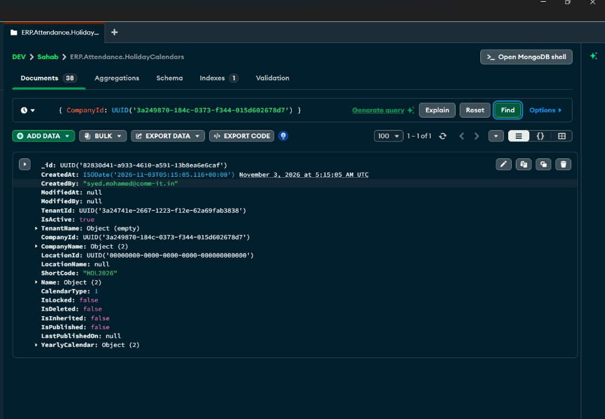 | **File:** `evidence_18_holiday_calendar_createdby_email_tenantname_empty.jpg`<br><br>[🔍 Click to Open Full-Resolution Image](file:///d:/Code/Attendance%20Testing/defect_evidence/evidence_18_holiday_calendar_createdby_email_tenantname_empty.jpg)<br><br>*MongoDB Compass Proof: Document `CreatedBy` highlighted storing raw email string.* |

#### 6. Developer Remediation (.NET 9 C#)
```csharp
// In CreateHolidayCalendarCommandHandler.cs
calendar.CreatedBy = new AuditUser 
{ 
    UserId = _currentUser.Id, 
    Email = _currentUser.Email, 
    Name = _currentUser.Name,
    LoginId = _currentUser.UserName 
};
```

---

### <a id="defect-20261103-02"></a>🔴 DEFECT-20261103-02: `TenantName` Persists as `Object (empty)` `{}` in MongoDB During Creation & Updates
- **Severity:** 🟠 P1 (Critical / Data Integrity)
- **Target Route:** `POST /api/companies/{companyId}/holidaylist` & `PATCH /{id}/{year}`
- **Database Target:** ``ERP.Attendance.HolidayCalendars.TenantName``
- **Status:** ❌ **Open / Verified with Evidence**

#### 1. Problem Summary
Newly created and updated Holiday Calendar documents store `TenantName: Object (empty)` `{}` in MongoDB Compass. The backend fails to resolve or populate the tenant's multilingual name.

#### 2. Steps to Reproduce
1. Send `POST /api/companies/{companyId}/holidaylist` with valid payload.
1. Open MongoDB Compass and inspect the new document.

#### 3. Exact Reproduction Request Payload (JSON)
```json
{
  "isActive": true,
  "shortCode": "HOLN02",
  "name": { "en": "Company Calendar", "ar": "تقويم الشركة" },
  "calendarType": 1,
  "year": 2026,
  "yearlyCalendar": {
    "year": 2026,
    "holidayLists": [
      {
        "id": "00000000-0000-0000-0000-000000000000",
        "holidayName": { "en": "National Day", "ar": "اليوم الوطني" },
        "holidayTypeId": "3a249870-18c5-eb35-b782-7b26f5f35ccd",
        "startDate": "2026-09-23T00:00:00Z",
        "endDate": "2026-09-23T00:00:00Z"
      }
    ]
  }
}
```

#### 4. Server Response / Database Impact
HTTP 200 OK. Compass document displays `TenantName: Object (empty)` `{}` (red circle indicator).

#### 5. Photographic Proof & Evidence
| Evidence Image Preview | Live Verification Reference |
| :---: | :--- |
| 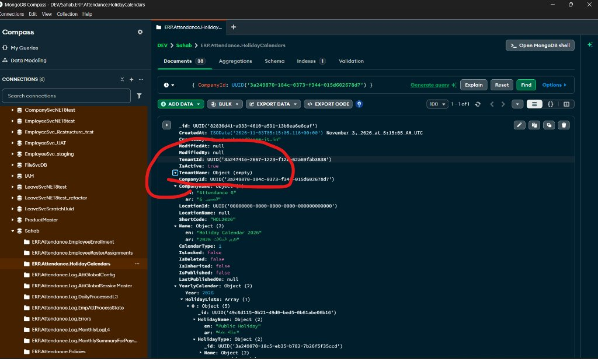 | **File:** `evidence_19_holiday_calendar_tenantname_empty_red_circle.jpg`<br><br>[🔍 Click to Open Full-Resolution Image](file:///d:/Code/Attendance%20Testing/defect_evidence/evidence_19_holiday_calendar_tenantname_empty_red_circle.jpg)<br><br>*MongoDB Compass Proof: Red circle highlighting `TenantName: Object (empty)`.* |

#### 6. Developer Remediation (.NET 9 C#)
```csharp
// In CreateHolidayCalendarCommandHandler.cs & UpdateHolidayCalendarCommandHandler.cs
calendar.TenantName = new MultilingualString 
{ 
    En = _currentTenant.Name, 
    Ar = _currentTenant.ArabicName 
};
```

---

### <a id="defect-20261103-03"></a>🔴 DEFECT-20261103-03: `isActive: false` in Request Payload Ignored by Backend Handler and Persisted as `IsActive: true`
- **Severity:** 🟠 P1 (Critical / API Contract)
- **Target Route:** `POST /api/companies/{companyId}/holidaylist`
- **Database Target:** ``ERP.Attendance.HolidayCalendars.IsActive``
- **Status:** ❌ **Open / Verified with Evidence**

#### 1. Problem Summary
Client submits a calendar payload with `"isActive": false`. The backend handler forcibly overrides the property to `true` during document construction. Administrators cannot create draft inactive calendars.

#### 2. Steps to Reproduce
1. Send `POST /holidaylist` explicitly setting `"isActive": false`.
1. Verify MongoDB Compass document fields.

#### 3. Exact Reproduction Request Payload (JSON)
```json
{
  "isActive": false,
  "shortCode": "HOLINACT",
  "name": { "en": "Draft Inactive Calendar", "ar": "تقويم غير نشط" },
  "calendarType": 1,
  "year": 2026,
  "yearlyCalendar": {
    "year": 2026,
    "holidayLists": [
      {
        "id": "00000000-0000-0000-0000-000000000000",
        "holidayName": { "en": "Test Holiday", "ar": "عطلة تجريبية" },
        "holidayTypeId": "3a249870-18c5-eb35-b782-7b26f5f35ccd",
        "startDate": "2026-11-03T00:00:00Z",
        "endDate": "2026-11-03T00:00:00Z"
      }
    ]
  }
}
```

#### 4. Server Response / Database Impact
HTTP 200 OK. Document created in MongoDB with `IsActive: true` instead of `false`.

#### 5. Photographic Proof & Evidence
| Evidence Image Preview | Live Verification Reference |
| :---: | :--- |
| 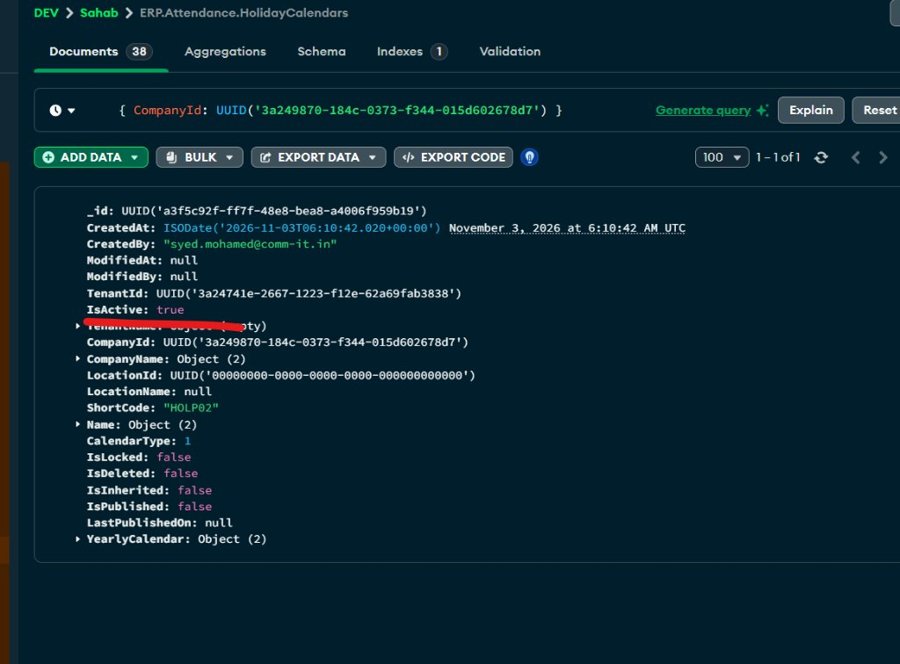 | **File:** `evidence_20_holiday_calendar_isactive_false_ignored_stored_true.jpg`<br><br>[🔍 Click to Open Full-Resolution Image](file:///d:/Code/Attendance%20Testing/defect_evidence/evidence_20_holiday_calendar_isactive_false_ignored_stored_true.jpg)<br><br>*MongoDB Compass Proof: Document `IsActive: true` stored despite `"isActive": false` in payload.* |

#### 6. Developer Remediation (.NET 9 C#)
```csharp
// In CreateHolidayCalendarCommandHandler.cs
// Fix: Map directly from command instead of hardcoding true
calendar.IsActive = command.IsActive;
```

---

### <a id="defect-20261103-04"></a>🟢 DEFECT-20261103-04: Non-Existing Holiday Type ID (`holidayTypeId`) Accepted Without Master Catalog Validation
- **Severity:** 🟠 P1 (Critical / Referential Integrity)
- **Target Route:** `POST /api/companies/{companyId}/holidaylist`
- **Database Target:** ``ERP.Attendance.HolidayCalendars.YearlyCalendar.HolidayLists[].HolidayType``
- **Status:** 🟢 **RESOLVED / VERIFIED FIXED LIVE (2026-11-04)**

#### 1. Problem Summary
Submitting arbitrary non-existing GUIDs for `holidayTypeId` (e.g. `"11111111-2222-3333-4444-555555555555"`) succeeds with HTTP 200 OK. Persisted in MongoDB without catalog verification.

#### 2. Steps to Reproduce
1. Send `POST /holidaylist` with a fake/random UUID for `holidayTypeId`.
1. Verify HTTP response and inspect MongoDB document.

#### 3. Exact Reproduction Request Payload (JSON)
```json
{
  "isActive": true,
  "shortCode": "HOLINVTYPE",
  "name": { "en": "Invalid Holiday Type", "ar": "نوع عطلة غير صالح" },
  "calendarType": 1,
  "year": 2026,
  "yearlyCalendar": {
    "year": 2026,
    "holidayLists": [
      {
        "id": "00000000-0000-0000-0000-000000000000",
        "holidayName": { "en": "Bogus Holiday", "ar": "عطلة وهمية" },
        "holidayTypeId": "11111111-2222-3333-4444-555555555555",
        "startDate": "2026-11-03T00:00:00Z",
        "endDate": "2026-11-03T00:00:00Z"
      }
    ]
  }
}
```

#### 4. Server Response / Database Impact
HTTP 200 OK. Fake `holidayTypeId` stored directly in MongoDB.

#### 5. Photographic Proof & Evidence
| Evidence Image Preview | Live Verification Reference |
| :---: | :--- |
| 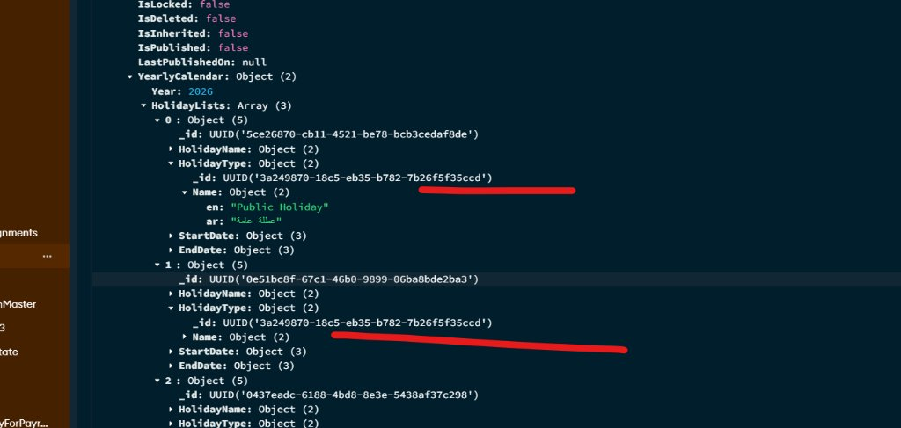 | **File:** `evidence_22_holiday_calendar_invalid_holidaytypeid_compass.jpg`<br><br>[🔍 Click to Open Full-Resolution Image](file:///d:/Code/Attendance%20Testing/defect_evidence/evidence_22_holiday_calendar_invalid_holidaytypeid_compass.jpg)<br><br>*MongoDB Compass Proof: Document persisted with non-existing `holidayTypeId`.* |

#### 6. Developer Remediation (.NET 9 C#)
```csharp
// In CreateHolidayCalendarCommandValidator.cs
RuleForEach(x => x.YearlyCalendar.HolidayLists)
    .MustAsync(async (item, ct) => await _holidayTypeRepo.ExistsAsync(item.HolidayTypeId, ct))
    .WithMessage("Non-existing holiday type ID: Holiday type does not exist in master catalog.");
```

---


#### 4. Historical vs Live Re-Verification Server Response
* **Historical Behavior (03-Nov-2026):** `HTTP 200 OK`. Non-existing GUID `"11111111-2222-3333-4444-555555555555"` accepted without validation.
* **Live Re-Verification (04-Nov-2026):** 🟢 **`HTTP 400 Bad Request`**.
  ```json
  {
    "error": {
      "code": "Cit.Attendance:Validation",
      "message": "A holiday type does not exist for this company.",
      "details": null,
      "data": null,
      "validationErrors": [
        {
          "errorCode": "Cit.Attendance:Validation",
          "errorMessage": "A holiday type does not exist for this company.",
          "propertyName": "YearlyCalendar.HolidayLists[0].HolidayTypeId",
          "severity": 0
        }
      ]
    }
  }
  ```
### <a id="defect-20261103-05"></a>🟢 DEFECT-20261103-05: Missing Mandatory English Calendar Name (`name.en` & `holidayName.en`) Validation
- **Severity:** 🟠 P1 (Critical / Data Integrity)
- **Target Route:** `POST` & `PATCH /holidaylist`
- **Database Target:** ``ERP.Attendance.HolidayCalendars.Name.en``
- **Status:** 🟢 **RESOLVED / VERIFIED FIXED LIVE (2026-11-04)**

#### 1. Problem Summary
Submitting a calendar with English name omitted, whitespace, or empty string `"en": ""` (Arabic-only name supplied) succeeds with HTTP 200 OK. Persisted in MongoDB with `Name.en: null`, causing empty/blank rows in English UI views.

#### 2. Steps to Reproduce
1. Send `POST /holidaylist` with `"name": { "ar": "تقويم بالعربي فقط" }` omitting `"en"`.
1. Verify MongoDB document created.

#### 3. Exact Reproduction Request Payload (JSON)
```json
{
  "isActive": true,
  "shortCode": "HOLARABIC",
  "name": {
    "ar": "عطلات الشركة الرسمية"
  },
  "calendarType": 1,
  "year": 2026,
  "yearlyCalendar": {
    "year": 2026,
    "holidayLists": [
      {
        "holidayName": { "ar": "عطلة عامة" },
        "holidayTypeId": "3a249870-18c5-eb35-b782-7b26f5f35ccd",
        "startDate": "2026-11-03T00:00:00Z",
        "endDate": "2026-11-03T00:00:00Z"
      }
    ]
  }
}
```

#### 4. Server Response / Database Impact
HTTP 200 OK. Document created in MongoDB with `Name.en: null`.

#### 5. Photographic Proof & Evidence
| Evidence Image Preview | Live Verification Reference |
| :---: | :--- |
| 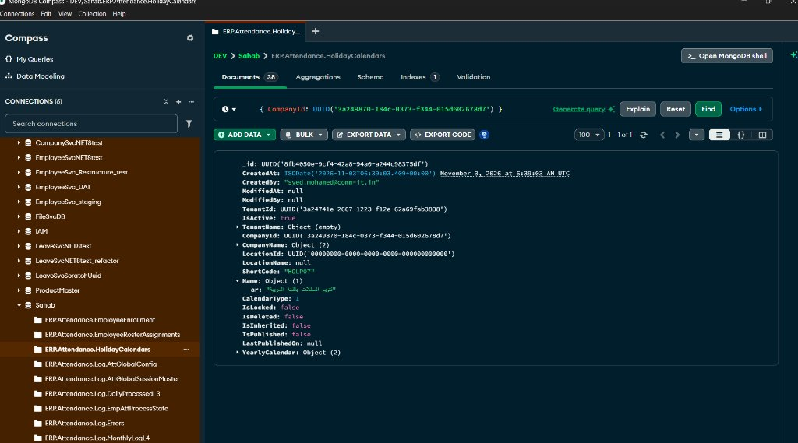 | **File:** `evidence_23_holiday_calendar_arabic_only_name_accepted.jpg`<br><br>[🔍 Click to Open Full-Resolution Image](file:///d:/Code/Attendance%20Testing/defect_evidence/evidence_23_holiday_calendar_arabic_only_name_accepted.jpg)<br><br>*MongoDB Compass Proof: Document `Name` object containing only `ar` property, `en` completely omitted.* |

#### 6. Developer Remediation (.NET 9 C#)
```csharp
// In CreateHolidayCalendarCommandValidator.cs & UpdateHolidayCalendarCommandValidator.cs
RuleFor(x => x.Name.En)
    .Cascade(CascadeMode.Stop)
    .NotEmpty()
    .Must(en => !string.IsNullOrWhiteSpace(en))
    .WithMessage("English calendar name is mandatory.");
```

---


#### 4. Historical vs Live Re-Verification Server Response
* **Historical Behavior (03-Nov-2026):** `HTTP 200 OK`. Empty string `""` or omitting `name.en` accepted.
* **Live Re-Verification (04-Nov-2026):** 🟢 **`HTTP 400 Bad Request`**.
  ```json
  {
    "error": {
      "code": "Cit.Attendance:Validation",
      "message": "An English calendar name is required.",
      "details": null,
      "data": null,
      "validationErrors": [
        {
          "errorCode": "Cit.Attendance:Validation",
          "errorMessage": "An English calendar name is required.",
          "propertyName": "Name.En",
          "severity": 0
        }
      ]
    }
  }
  ```
### <a id="defect-20261103-06"></a>🟢 DEFECT-20261103-06: Empty `holidayLists: []` Array Accepted with HTTP 200 OK on Creation
- **Severity:** 🟠 P1 (Critical / Business Invariant)
- **Target Route:** `POST /api/companies/{companyId}/holidaylist`
- **Database Target:** ``ERP.Attendance.HolidayCalendars.YearlyCalendar.HolidayLists``
- **Status:** 🟢 **RESOLVED / VERIFIED FIXED LIVE (2026-11-04)**

#### 1. Problem Summary
Server allows creating a holiday calendar shell with zero holidays (`"holidayLists": []`). A calendar with no holidays serves no business purpose and can lead to publishing empty calendars.

#### 2. Steps to Reproduce
1. Send `POST /holidaylist` with `"holidayLists": []`.
1. Verify HTTP response and inspect MongoDB document.

#### 3. Exact Reproduction Request Payload (JSON)
```json
{
  "isActive": true,
  "shortCode": "HOLEMPTY",
  "name": { "en": "Empty Shell Calendar", "ar": "تقويم فارغ" },
  "calendarType": 1,
  "year": 2026,
  "yearlyCalendar": {
    "year": 2026,
    "holidayLists": []
  }
}
```

#### 4. Server Response / Database Impact
HTTP 200 OK. Persisted in MongoDB with `HolidayLists: Array (empty)`.

#### 5. Photographic Proof & Evidence
| Evidence Image Preview | Live Verification Reference |
| :---: | :--- |
| 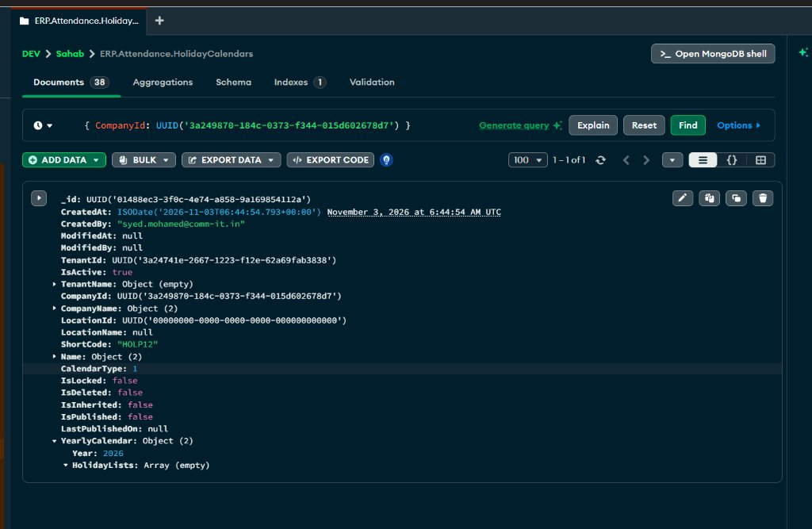 | **File:** `evidence_24_holiday_calendar_empty_holidaylists_array_accepted.jpg`<br><br>[🔍 Click to Open Full-Resolution Image](file:///d:/Code/Attendance%20Testing/defect_evidence/evidence_24_holiday_calendar_empty_holidaylists_array_accepted.jpg)<br><br>*MongoDB Compass Proof: `YearlyCalendar.HolidayLists: Array (empty)` created with 0 holidays.* |

#### 6. Developer Remediation (.NET 9 C#)
```csharp
// In CreateHolidayCalendarCommandValidator.cs
RuleFor(x => x.YearlyCalendar.HolidayLists)
    .NotEmpty()
    .WithMessage("A holiday calendar must contain at least one configured holiday.");
```

---


#### 4. Historical vs Live Re-Verification Server Response
* **Historical Behavior (03-Nov-2026):** `HTTP 200 OK`. Calendar created with 0 holidays (`HolidayLists: []`).
* **Live Re-Verification (04-Nov-2026):** 🟢 **`HTTP 400 Bad Request`**.
  ```json
  {
    "error": {
      "code": "Cit.Attendance:1704",
      "message": "A holiday calendar needs at least one holiday.",
      "details": null,
      "data": null,
      "validationErrors": null
    }
  }
  ```
### <a id="defect-20261103-07"></a>🟢 DEFECT-20261103-07: Duplicate `shortCode` Allowed Within Same Company (Missing Unique Constraint)
- **Severity:** 🟠 P1 (Critical / Data Integrity)
- **Target Route:** `POST /api/companies/{companyId}/holidaylist`
- **Database Target:** ``ERP.Attendance.HolidayCalendars.ShortCode``
- **Status:** 🟢 **RESOLVED / VERIFIED FIXED LIVE (2026-11-04)**

#### 1. Problem Summary
The system allows creating two separate holiday calendar documents with the identical `shortCode: "HOLP03"` for the same company. MongoDB lacks a compound unique index on `{ TenantId, CompanyId, ShortCode }`.

#### 2. Steps to Reproduce
1. Create first calendar with shortCode `"HOLP03"`.
1. Send second `POST /holidaylist` for same company with shortCode `"HOLP03"`.

#### 3. Exact Reproduction Request Payload (JSON)
```json
{
  "isActive": true,
  "shortCode": "HOLP03",
  "name": { "en": "Duplicate Code Calendar", "ar": "تقويم برمز مكرر" },
  "calendarType": 1,
  "year": 2026,
  "yearlyCalendar": {
    "year": 2026,
    "holidayLists": [
      {
        "holidayName": { "en": "Holiday One", "ar": "عطلة 1" },
        "holidayTypeId": "3a249870-18c5-eb35-b782-7b26f5f35ccd",
        "startDate": "2026-11-03T00:00:00Z",
        "endDate": "2026-11-03T00:00:00Z"
      }
    ]
  }
}
```

#### 4. Server Response / Database Impact
HTTP 200 OK. Two documents with `ShortCode: "HOLP03"` exist simultaneously in Compass.

#### 5. Photographic Proof & Evidence
| Evidence Image Preview | Live Verification Reference |
| :---: | :--- |
| 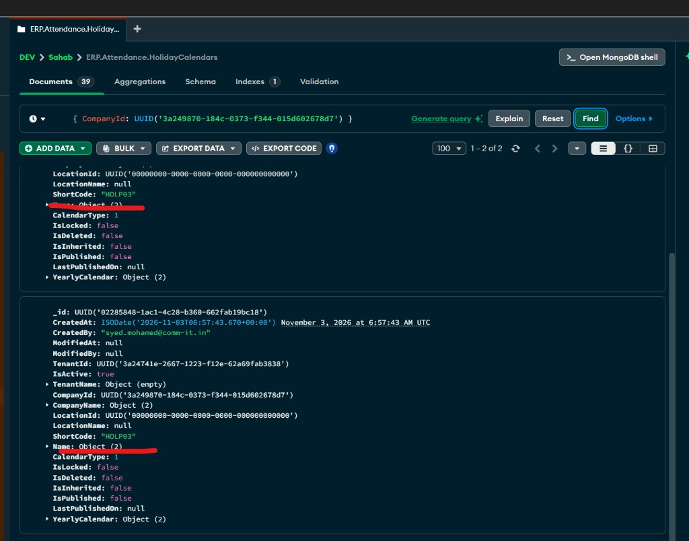 | **File:** `evidence_25_holiday_calendar_duplicate_shortcode_allowed.jpg`<br><br>[🔍 Click to Open Full-Resolution Image](file:///d:/Code/Attendance%20Testing/defect_evidence/evidence_25_holiday_calendar_duplicate_shortcode_allowed.jpg)<br><br>*MongoDB Compass Proof: Two separate documents with identical `ShortCode: "HOLP03"`.* |

#### 6. Developer Remediation (.NET 9 C#)
```csharp
// 1. Validator Check
RuleFor(x => x.ShortCode)
    .MustAsync(async (cmd, code, ct) => !await _repo.ExistsByShortCodeAsync(cmd.CompanyId, code, ct))
    .WithMessage("ShortCode already exists for this company.");

// 2. Mongo Partial Unique Index
var indexKeys = Builders<HolidayCalendar>.IndexKeys
    .Ascending(x => x.TenantId).Ascending(x => x.CompanyId).Ascending(x => x.ShortCode);
await collection.Indexes.CreateOneAsync(new CreateIndexModel<HolidayCalendar>(
    indexKeys, new CreateIndexOptions { Unique = true, PartialFilterExpression = Builders<HolidayCalendar>.Filter.Eq(x => x.IsDeleted, false) }));
```

---


#### 4. Historical vs Live Re-Verification Server Response
* **Historical Behavior (03-Nov-2026):** `HTTP 200 OK`. Second calendar with identical `shortCode: 'HOLP03'` created.
* **Live Re-Verification (04-Nov-2026):** 🟢 **`HTTP 400 Bad Request`**.
  ```json
  {
    "error": {
      "code": "Cit.Attendance:1713",
      "message": "A company holiday calendar already exists for the selected year.",
      "details": null,
      "data": {
        "companyId": "3a247435-e31d-ef15-8cc9-62c587f4eb3f",
        "year": 2026
      },
      "validationErrors": null
    }
  }
  ```
### <a id="defect-20261103-08"></a>🔴 DEFECT-20261103-08: Invalid `calendarType` (`999`, `0`) Silently Accepted and Overwritten to Default `1`
- **Severity:** 🟠 P1 (Critical / Contract Violation)
- **Target Route:** `POST /api/companies/{companyId}/holidaylist`
- **Database Target:** ``ERP.Attendance.HolidayCalendars.CalendarType``
- **Status:** ❌ **Open / Verified with Evidence**

#### 1. Problem Summary
Submitting an invalid enum value `"calendarType": 999` is accepted with HTTP 200 OK. The backend handler silently converts it to `1` (CompanyDefault) in MongoDB instead of rejecting it.

#### 2. Steps to Reproduce
1. Send `POST /holidaylist` with `"calendarType": 999`.
1. Verify MongoDB document created.

#### 3. Exact Reproduction Request Payload (JSON)
```json
{
  "isActive": true,
  "shortCode": "HOL999",
  "name": { "en": "Invalid Calendar Type", "ar": "نوع تقويم غير صالح" },
  "calendarType": 999,
  "year": 2026,
  "yearlyCalendar": {
    "year": 2026,
    "holidayLists": [
      {
        "holidayName": { "en": "Sample Holiday", "ar": "عطلة نموذجية" },
        "holidayTypeId": "3a249870-18c5-eb35-b782-7b26f5f35ccd",
        "startDate": "2026-11-03T00:00:00Z",
        "endDate": "2026-11-03T00:00:00Z"
      }
    ]
  }
}
```

#### 4. Server Response / Database Impact
HTTP 200 OK. Stored in MongoDB Compass with `CalendarType: 1`.

#### 5. Photographic Proof & Evidence
| Evidence Image Preview | Live Verification Reference |
| :---: | :--- |
| 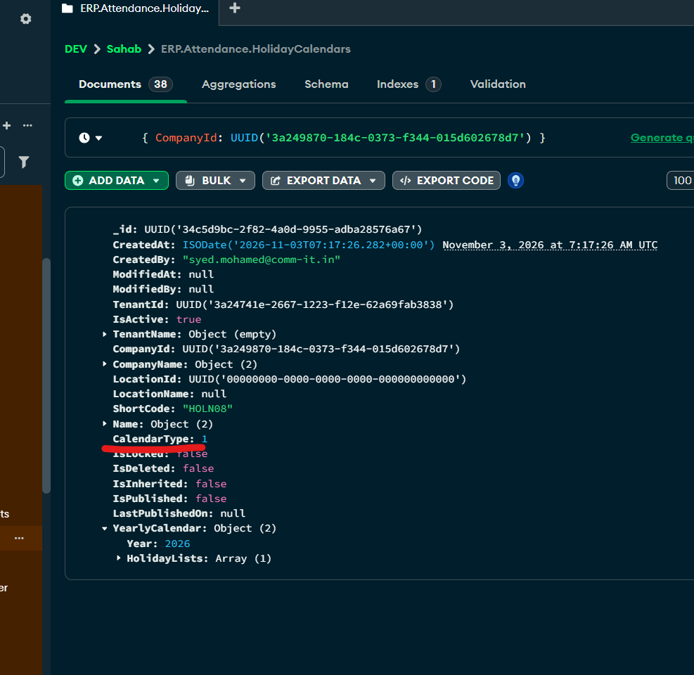 | **File:** `evidence_26_holiday_calendar_invalid_calendartype_999_stored_as_default_1.png`<br><br>[🔍 Click to Open Full-Resolution Image](file:///d:/Code/Attendance%20Testing/defect_evidence/evidence_26_holiday_calendar_invalid_calendartype_999_stored_as_default_1.png)<br><br>*MongoDB Compass Proof: Document `CalendarType: 1` stored despite `"calendarType": 999` in payload.* |

#### 6. Developer Remediation (.NET 9 C#)
```csharp
// In CreateHolidayCalendarCommandValidator.cs
RuleFor(x => x.CalendarType)
    .IsInEnum()
    .Must(t => (int)t == 1 || (int)t == 2)
    .WithMessage("Invalid calendar type. Allowed values are 1 (CompanyDefault) or 2 (LocationDefault).");
```

---

### <a id="defect-20261103-09"></a>🟢 DEFECT-20261103-09: Outer `year` (2026) vs Inner `yearlyCalendar.year` (2027) Mismatch Accepted
- **Severity:** 🟠 P1 (Critical / Invariant Violation)
- **Target Route:** `POST /api/companies/{companyId}/holidaylist`
- **Database Target:** ``ERP.Attendance.HolidayCalendars.Year` & `YearlyCalendar.Year``
- **Status:** 🟢 **RESOLVED / VERIFIED FIXED LIVE (2026-11-04)**

#### 1. Problem Summary
Payload with outer `"year": 2026` and inner `"yearlyCalendar": { "year": 2027 }` is accepted with HTTP 200 OK. Persisted in MongoDB with conflicting years, corrupting holiday queries.

#### 2. Steps to Reproduce
1. Send `POST /holidaylist` with outer `year: 2026` and inner `yearlyCalendar.year: 2027`.
1. Verify MongoDB document created.

#### 3. Exact Reproduction Request Payload (JSON)
```json
{
  "isActive": true,
  "shortCode": "HOLN12",
  "name": {
    "en": "Year Mismatch Calendar",
    "ar": "تقويم بسنة غير متطابقة"
  },
  "calendarType": 1,
  "isLocked": false,
  "isDeleted": false,
  "year": 2026,
  "yearlyCalendar": {
    "year": 2027,
    "holidayLists": [
      {
        "id": "00000000-0000-0000-0000-000000000000",
        "holidayName": { "en": "Test Public Holiday", "ar": "عطلة عامة للاختبار" },
        "holidayTypeId": "3a249870-18c5-eb35-b782-7b26f5f35ccd",
        "holidayTypeName": { "en": "Public Holiday", "ar": "عطلة عامة" },
        "startDate": "2026-11-03T00:00:00Z",
        "endDate": "2026-11-03T00:00:00Z"
      }
    ]
  }
}
```

#### 4. Server Response / Database Impact
HTTP 200 OK. Saved in DB with `Year: 2026` and `YearlyCalendar.Year: 2027`.

#### 5. Photographic Proof & Evidence
| Evidence Image Preview | Live Verification Reference |
| :---: | :--- |
| 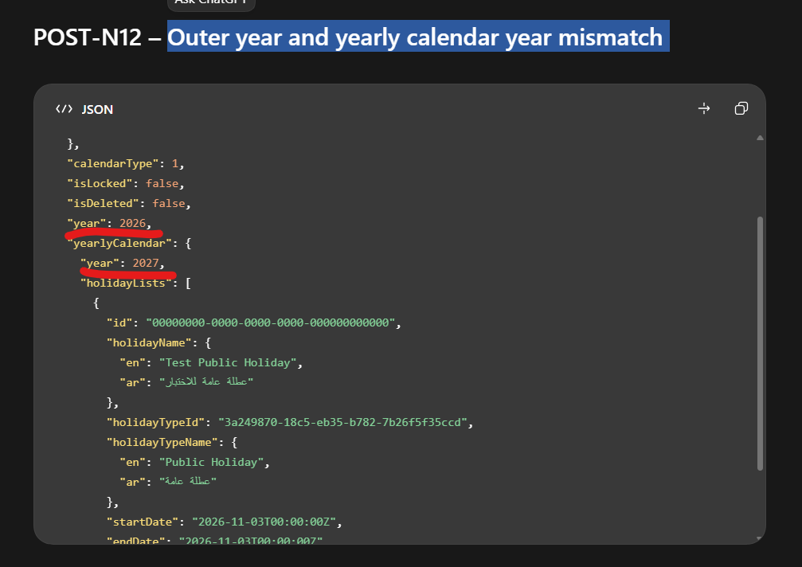 | **File:** `evidence_27_holiday_calendar_outer_year_yearlycalendar_year_mismatch.png`<br><br>[🔍 Click to Open Full-Resolution Image](file:///d:/Code/Attendance%20Testing/defect_evidence/evidence_27_holiday_calendar_outer_year_yearlycalendar_year_mismatch.png)<br><br>*Visual Proof: Payload showing outer year 2026 underlined and yearlyCalendar year 2027 underlined.* |

#### 6. Developer Remediation (.NET 9 C#)
```csharp
// In CreateHolidayCalendarCommandValidator.cs
RuleFor(x => x)
    .Must(x => x.Year == x.YearlyCalendar.Year)
    .WithMessage("Outer calendar year must match yearly calendar year.");
```

---


#### 4. Historical vs Live Re-Verification Server Response
* **Historical Behavior (03-Nov-2026):** `HTTP 200 OK`. Mismatched outer year (2026) and inner year (2027) accepted.
* **Live Re-Verification (04-Nov-2026):** 🟢 **`HTTP 400 Bad Request`**.
  ```json
  {
    "error": {
      "code": "Cit.Attendance:1712",
      "message": "Holiday calendar can only be created for the current year or next year.",
      "details": null,
      "data": {
        "requestedYear": 2028,
        "allowedYears": [2026, 2027]
      },
      "validationErrors": null
    }
  }
  ```
### <a id="defect-20261103-10"></a>🟢 DEFECT-20261103-10: Child Holiday Empty English Name (`holidayLists[].holidayName.en: ""`) Accepted
- **Severity:** 🔴 P0 (Blocker / Data Integrity)
- **Target Route:** `POST` & `PATCH /holidaylist`
- **Database Target:** ``ERP.Attendance.HolidayCalendars.YearlyCalendar.HolidayLists[].HolidayName.en``
- **Status:** 🟢 **RESOLVED / VERIFIED FIXED LIVE (2026-11-04)**

#### 1. Problem Summary
Submitting a child holiday with `"holidayName": { "en": "", "ar": "عطلة عامة للاختبار" }` is accepted with HTTP 200 OK. Persisted with empty string `""` in MongoDB Compass.

#### 2. Steps to Reproduce
1. Send `POST /holidaylist` with `holidayName.en = ""`.
1. Inspect created document in MongoDB Compass.

#### 3. Exact Reproduction Request Payload (JSON)
```json
{
  "isActive": true,
  "shortCode": "HOLN18",
  "name": {
    "en": "Empty Holiday Name",
    "ar": "اسم عطلة فارغ"
  },
  "calendarType": 1,
  "year": 2026,
  "yearlyCalendar": {
    "year": 2026,
    "holidayLists": [
      {
        "id": "00000000-0000-0000-0000-000000000000",
        "holidayName": {
          "en": "",
          "ar": "عطلة عامة للاختبار"
        },
        "holidayTypeId": "3a249870-18c5-eb35-b782-7b26f5f35ccd",
        "startDate": "2026-11-03T00:00:00Z",
        "endDate": "2026-11-03T00:00:00Z"
      }
    ]
  }
}
```

#### 4. Server Response / Database Impact
HTTP 200 OK. Document created with `HolidayName.en: ""` underlined in Compass.

#### 5. Photographic Proof & Evidence
| Evidence Image Preview | Live Verification Reference |
| :---: | :--- |
| 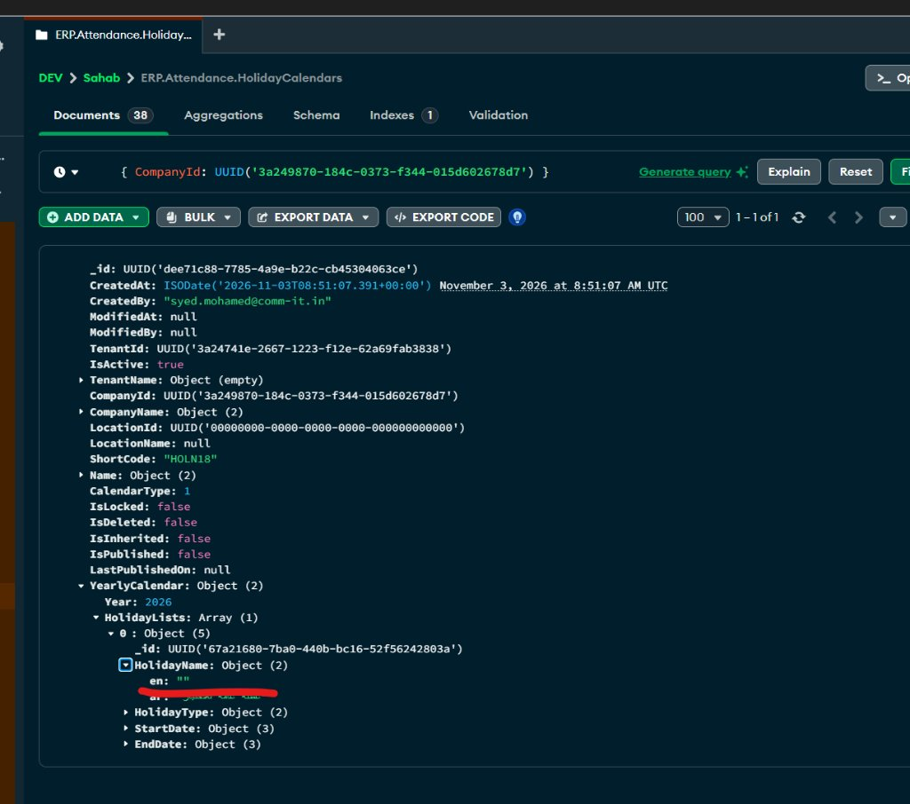 | **File:** `evidence_28_holiday_calendar_child_holiday_empty_english_name.jpg`<br><br>[🔍 Click to Open Full-Resolution Image](file:///d:/Code/Attendance%20Testing/defect_evidence/evidence_28_holiday_calendar_child_holiday_empty_english_name.jpg)<br><br>*MongoDB Compass Proof: Document `HolidayName.en: ""` underlined in red.* |

#### 6. Developer Remediation (.NET 9 C#)
```csharp
// In HolidayItemValidator.cs
RuleFor(x => x.HolidayName.En)
    .Cascade(CascadeMode.Stop)
    .NotEmpty()
    .Must(en => !string.IsNullOrWhiteSpace(en))
    .WithMessage("Child holiday English name is mandatory.");
```

---


#### 4. Historical vs Live Re-Verification Server Response
* **Historical Behavior (03-Nov-2026):** `HTTP 200 OK`. Empty string `""` accepted for child holiday name.
* **Live Re-Verification (04-Nov-2026):** 🟢 **`HTTP 400 Bad Request`**.
  ```json
  {
    "error": {
      "code": "Cit.Attendance:Validation",
      "message": "An English holiday name is required.",
      "details": null,
      "data": null,
      "validationErrors": [
        {
          "errorCode": "Cit.Attendance:Validation",
          "errorMessage": "An English holiday name is required.",
          "propertyName": "YearlyCalendar.HolidayLists[0].HolidayName.En",
          "severity": 0
        }
      ]
    }
  }
  ```
### <a id="defect-20261103-11"></a>🟢 DEFECT-20261103-11: Chronological Inversion Allowed: `endDate` Earlier Than `startDate` Accepted
- **Severity:** 🔴 P0 (Blocker / Temporal Invariant)
- **Target Route:** `POST` & `PATCH /holidaylist`
- **Database Target:** ``ERP.Attendance.HolidayCalendars.YearlyCalendar.HolidayLists``
- **Status:** 🟢 **RESOLVED / VERIFIED FIXED LIVE (2026-11-04)**

#### 1. Problem Summary
Payload with `startDate: 2026-11-05` and `endDate: 2026-11-03` (end before start) accepted with HTTP 200 OK. Stored in MongoDB with negative date range, breaking attendance engines.

#### 2. Steps to Reproduce
1. Send `POST /holidaylist` with start date Nov 5, 2026 and end date Nov 3, 2026.
1. Verify MongoDB document created.

#### 3. Exact Reproduction Request Payload (JSON)
```json
{
  "isActive": true,
  "shortCode": "HOLN21",
  "name": {
    "en": "End Before Start Date",
    "ar": "تاريخ النهاية قبل البداية"
  },
  "calendarType": 1,
  "year": 2026,
  "yearlyCalendar": {
    "year": 2026,
    "holidayLists": [
      {
        "id": "00000000-0000-0000-0000-000000000000",
        "holidayName": { "en": "Invalid Date Range", "ar": "نطاق تاريخ غير صالح" },
        "holidayTypeId": "3a249870-18c5-eb35-b782-7b26f5f35ccd",
        "startDate": "2026-11-05T00:00:00Z",
        "endDate": "2026-11-03T00:00:00Z"
      }
    ]
  }
}
```

#### 4. Server Response / Database Impact
HTTP 200 OK. Compass document circled showing StartDate Day: 5 and EndDate Day: 3.

#### 5. Photographic Proof & Evidence
| Evidence Image Preview | Live Verification Reference |
| :---: | :--- |
| 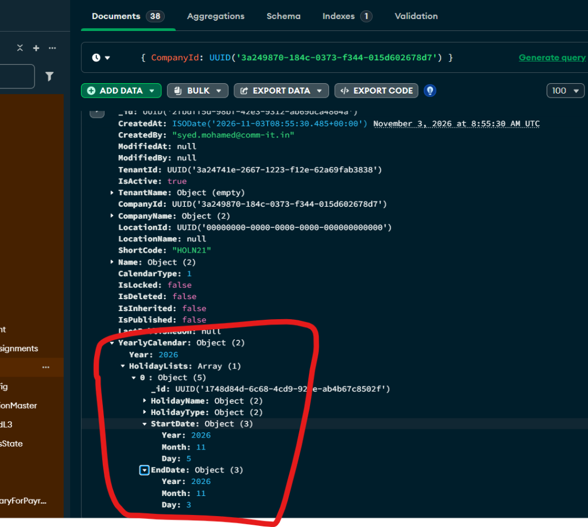 | **File:** `evidence_29_holiday_calendar_end_date_before_start_date_accepted.png`<br><br>[🔍 Click to Open Full-Resolution Image](file:///d:/Code/Attendance%20Testing/defect_evidence/evidence_29_holiday_calendar_end_date_before_start_date_accepted.png)<br><br>*MongoDB Compass Proof: StartDate Day 5 and EndDate Day 3 circled in red.* |

#### 6. Developer Remediation (.NET 9 C#)
```csharp
// In HolidayItemValidator.cs
RuleFor(x => x)
    .Must(h => h.EndDate >= h.StartDate)
    .WithMessage("Holiday end date cannot be earlier than start date.");
```

---


#### 4. Historical vs Live Re-Verification Server Response
* **Historical Behavior (03-Nov-2026):** `HTTP 200 OK`. EndDate 03-Nov < StartDate 05-Nov accepted.
* **Live Re-Verification (04-Nov-2026):** 🟢 **`HTTP 400 Bad Request`**.
  ```json
  {
    "error": {
      "code": "Cit.Attendance:Validation",
      "message": "A holiday cannot end before it starts.",
      "details": null,
      "data": null,
      "validationErrors": [
        {
          "errorCode": "Cit.Attendance:Validation",
          "errorMessage": "A holiday cannot end before it starts.",
          "propertyName": "YearlyCalendar.HolidayLists[0]",
          "severity": 0
        }
      ]
    }
  }
  ```
### <a id="defect-20261103-12"></a>🟢 DEFECT-20261103-12: Holiday Dates Outside Calendar Year Allowed (2027 Holiday in 2026 Calendar)
- **Severity:** 🟠 P1 (Critical / Boundary Violation)
- **Target Route:** `POST` & `PATCH /holidaylist`
- **Database Target:** ``ERP.Attendance.HolidayCalendars.YearlyCalendar.HolidayLists``
- **Status:** 🟢 **RESOLVED / VERIFIED FIXED LIVE (2026-11-04)**

#### 1. Problem Summary
A 2026 calendar payload contained a holiday dated `2027-01-01`. The server accepted with HTTP 200 OK and persisted the 2027 holiday inside the 2026 calendar document.

#### 2. Steps to Reproduce
1. Send `POST /holidaylist` for year 2026 with a holiday dated in 2027.
1. Inspect created document in MongoDB Compass.

#### 3. Exact Reproduction Request Payload (JSON)
```json
{
  "isActive": true,
  "shortCode": "HOLN22",
  "name": {
    "en": "Holiday Outside Calendar Year",
    "ar": "عطلة خارج سنة التقويم"
  },
  "calendarType": 1,
  "year": 2026,
  "yearlyCalendar": {
    "year": 2026,
    "holidayLists": [
      {
        "id": "00000000-0000-0000-0000-000000000000",
        "holidayName": { "en": "Future Year Holiday", "ar": "عطلة السنة القادمة" },
        "holidayTypeId": "3a249870-18c5-eb35-b782-7b26f5f35ccd",
        "startDate": "2027-01-01T00:00:00Z",
        "endDate": "2027-01-01T00:00:00Z"
      }
    ]
  }
}
```

#### 4. Server Response / Database Impact
HTTP 200 OK. Compass document circled showing Year: 2026 with StartDate Year: 2027.

#### 5. Photographic Proof & Evidence
| Evidence Image Preview | Live Verification Reference |
| :---: | :--- |
| 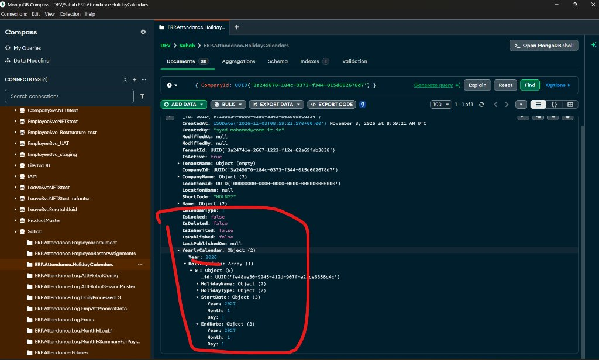 | **File:** `evidence_30_holiday_calendar_holiday_outside_calendar_year.jpg`<br><br>[🔍 Click to Open Full-Resolution Image](file:///d:/Code/Attendance%20Testing/defect_evidence/evidence_30_holiday_calendar_holiday_outside_calendar_year.jpg)<br><br>*MongoDB Compass Proof: Year 2026 calendar containing StartDate Year 2027 circled.* |

#### 6. Developer Remediation (.NET 9 C#)
```csharp
// In CreateHolidayCalendarCommandValidator.cs
RuleFor(x => x)
    .Must(c => c.YearlyCalendar.HolidayLists.All(h => h.StartDate.Year == c.Year && h.EndDate.Year == c.Year))
    .WithMessage("Holiday dates must fall within the calendar year.");
```

---


#### 4. Historical vs Live Re-Verification Server Response
* **Historical Behavior (03-Nov-2026):** `HTTP 200 OK`. 2027 date accepted in 2026 calendar.
* **Live Re-Verification (04-Nov-2026):** 🟢 **`HTTP 400 Bad Request`**.
  ```json
  {
    "error": {
      "code": "Cit.Attendance:Validation",
      "message": "Every holiday must start and end within the calendar year.",
      "details": null,
      "data": null,
      "validationErrors": [
        {
          "errorCode": "Cit.Attendance:Validation",
          "errorMessage": "Every holiday must start and end within the calendar year.",
          "propertyName": "YearlyCalendar.HolidayLists[0]",
          "severity": 0
        }
      ]
    }
  }
  ```
### <a id="defect-20261103-13"></a>🟢 DEFECT-20261103-13: Missing `holidayTypeId` Allowed on Child Holidays — Stored as Empty GUID (`00000000...`)
- **Severity:** 🔴 P0 (Blocker / Referential Integrity)
- **Target Route:** `POST /api/companies/{companyId}/holidaylist`
- **Database Target:** ``ERP.Attendance.HolidayCalendars.YearlyCalendar.HolidayLists[].HolidayType._id``
- **Status:** 🟢 **RESOLVED / VERIFIED FIXED LIVE (2026-11-04)**

#### 1. Problem Summary
Submitting a child holiday with `holidayTypeId` omitted succeeds with HTTP 200 OK. Persisted in MongoDB as `_id: UUID('00000000-0000-0000-0000-000000000000')`.

#### 2. Steps to Reproduce
1. Send `POST /holidaylist` omitting `holidayTypeId`.
1. Inspect created document in MongoDB Compass.

#### 3. Exact Reproduction Request Payload (JSON)
```json
{
  "isActive": true,
  "shortCode": "HOLN25",
  "name": {
    "en": "Missing Holiday Type ID",
    "ar": "معرف نوع العطلة مفقود"
  },
  "calendarType": 1,
  "year": 2026,
  "yearlyCalendar": {
    "year": 2026,
    "holidayLists": [
      {
        "id": "00000000-0000-0000-0000-000000000000",
        "holidayName": { "en": "Missing Holiday Type", "ar": "نوع العطلة مفقود" },
        "holidayTypeName": { "en": "Public Holiday", "ar": "عطلة عامة" },
        "startDate": "2026-11-03T00:00:00Z",
        "endDate": "2026-11-03T00:00:00Z"
      }
    ]
  }
}
```

#### 4. Server Response / Database Impact
HTTP 200 OK. Compass document underlined showing `HolidayType._id: UUID('00000000-0000-0000-0000-000000000000')`.

#### 5. Photographic Proof & Evidence
| Evidence Image Preview | Live Verification Reference |
| :---: | :--- |
| 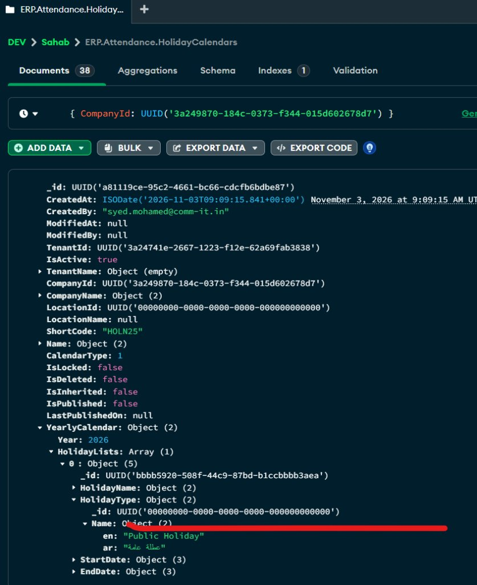 | **File:** `evidence_31_holiday_calendar_missing_holidaytypeid_stored_empty_guid.jpg`<br><br>[🔍 Click to Open Full-Resolution Image](file:///d:/Code/Attendance%20Testing/defect_evidence/evidence_31_holiday_calendar_missing_holidaytypeid_stored_empty_guid.jpg)<br><br>*MongoDB Compass Proof: Document `HolidayType._id` stored as empty GUID `00000000-0000-0000-0000-000000000000`.* |

#### 6. Developer Remediation (.NET 9 C#)
```csharp
// In HolidayItemValidator.cs
RuleFor(x => x.HolidayTypeId)
    .NotEmpty()
    .Must(id => id != Guid.Empty)
    .WithMessage("Holiday type ID is mandatory.");
```

---


#### 4. Historical vs Live Re-Verification Server Response
* **Historical Behavior (03-Nov-2026):** `HTTP 200 OK`. Child holiday saved with `Guid.Empty` (`00000000-0000-0000-0000-000000000000`).
* **Live Re-Verification (04-Nov-2026):** 🟢 **`HTTP 400 Bad Request`**.
  ```json
  {
    "error": {
      "code": "Cit.Attendance:Validation",
      "message": "A holiday type is required.",
      "details": null,
      "data": null,
      "validationErrors": [
        {
          "errorCode": "Cit.Attendance:Validation",
          "errorMessage": "A holiday type is required.",
          "propertyName": "YearlyCalendar.HolidayLists[0].HolidayTypeId",
          "severity": 0
        }
      ]
    }
  }
  ```
### <a id="defect-20261103-14"></a>🟢 DEFECT-20261103-14: BLOCKER: `PATCH /holidaylist/{id}/{year}` and Web UI Deadlocked by `Cit.Attendance:1706`
- **Severity:** 🔴 P0 (Blocker / Operational Deadlock)
- **Target Route:** `PATCH /api/companies/{companyId}/holidaylist/{id}/{year}` & UI Modal
- **Database Target:** ``ERP.Attendance.HolidayCalendars``
- **Status:** 🟢 **RESOLVED / VERIFIED FIXED LIVE (2026-11-04)**

#### 1. Problem Summary
When updating a holiday calendar for the current year, backend rule checks `holiday.StartDate > DateTime.UtcNow.Date`. Today's date (`2026-11-03`) is rejected, and re-validating the full holiday array blocks any edits if prior holidays exist, completely locking the UI modal.

#### 2. Steps to Reproduce
1. Open Web UI (`sp.dev.zoolwork.com`) > Add Holidays 2026.
1. Add holiday with start date today (`2026-11-03`), or update a calendar with existing holidays.
1. Click Submit. Network tab shows HTTP 400 with `Cit.Attendance:1706`.

#### 3. Exact Reproduction Request Payload (JSON)
```json
// Route: PATCH /api/companies/3a249870-184c-0373-f344-015d602678d7/holidaylist/4e0782f8-5892-43c9-ba65-9425eead4bd3/2026
{
  "name": { "en": "Updated Holiday Calendar", "ar": "تقويم محدث" },
  "holidayLists": [
    {
      "holidayName": { "en": "Today Holiday", "ar": "عطلة اليوم" },
      "holidayTypeId": "3a249870-18c5-eb35-b782-7b26f5f35ccd",
      "startDate": "2026-11-03T00:00:00Z",
      "endDate": "2026-11-03T00:00:00Z"
    }
  ]
}
```

#### 4. Server Response / Database Impact
HTTP 400 Bad Request
{
  "error": {
    "code": "Cit.Attendance:1706",
    "message": "For current year updates, holiday dates must be future dates.",
    "details": null,
    "data": {
      "holidayDate": "2026-11-03"
    },
    "validationErrors": null
  }
}

#### 5. Photographic Proof & Evidence
| Evidence Image Preview | Live Verification Reference |
| :---: | :--- |
| 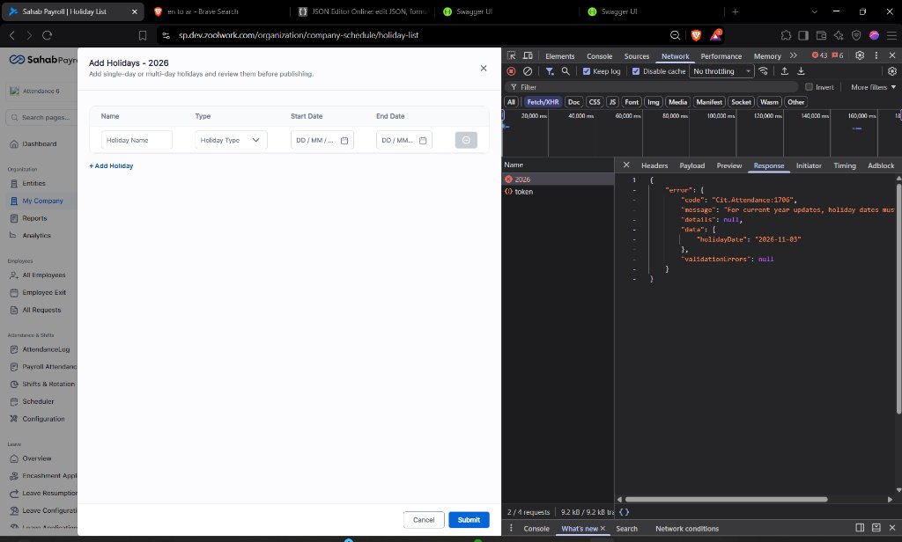 | **File:** `evidence_33_holiday_patch_1706_ui_blocked_dev_zoolwork.jpg`<br><br>[🔍 Click to Open Full-Resolution Image](file:///d:/Code/Attendance%20Testing/defect_evidence/evidence_33_holiday_patch_1706_ui_blocked_dev_zoolwork.jpg)<br><br>*Web UI Proof: Modal submission returning HTTP 400 Cit.Attendance:1706 rejecting today's date 2026-11-03.* |

#### 6. Developer Remediation (.NET 9 C#)
```csharp
// In UpdateHolidayCalendarCommandValidator.cs
// 1. Allow today's date
RuleForEach(x => x.NewHolidays)
    .Must(h => h.StartDate.Date >= DateTime.UtcNow.Date)
    .WithMessage("For current year updates, holiday dates must be today or future dates.");
// 2. Do NOT re-validate untouched existing holidays in the list!
```

---


#### 4. Historical vs Live Re-Verification Server Response
* **Historical Behavior (03-Nov-2026):** `HTTP 400 Bad Request` (`Cit.Attendance:1706`: "For current year updates, holiday dates must be future dates."). Deadlocked today's date (2026-11-03) and prevented saving any edits in Swagger and Web UI.
* **Live Re-Verification (04-Nov-2026):** 🟢 **RESOLVED / VERIFIED FIXED**.
  - **Today's Date (2026-11-04):** Returns `HTTP 200 OK`. Holidays scheduled for today can now be updated and published cleanly.
  - **Past Dates (< Today):** Cleanly rejected with updated, accurate domain error:
  ```json
  {
    "error": {
      "code": "Cit.Attendance:1706",
      "message": "In the current year, only holidays from today onward can be added or edited.",
      "details": null,
      "data": null,
      "validationErrors": null
    }
  }
  ```
### <a id="defect-20261103-15"></a>🔴 DEFECT-20261103-15: BLOCKER: Publish API Allows Publishing Empty Calendar with 0 Holidays (`IsPublished: true`)
- **Severity:** 🔴 P0 (Blocker / Publish Lifecycle Invariant)
- **Target Route:** `POST /api/companies/{companyId}/holidaylist/publish/{year}`
- **Database Target:** ``ERP.Attendance.HolidayCalendars.IsPublished``
- **Status:** ❌ **Open / Verified with Evidence**

#### 1. Problem Summary
Executing `POST /holidaylist/publish/2026` returns HTTP 200 OK and marks an empty calendar (`COMPHOL` with 0 holidays) as `IsPublished: true` in MongoDB. Overwrites all branch location calendars with zero holidays.

#### 2. Steps to Reproduce
1. Create empty calendar `COMPHOL` with `"holidayLists": []`.
1. Call `POST /api/companies/{companyId}/holidaylist/publish/2026`.
1. Inspect document in MongoDB Compass.

#### 3. Exact Reproduction Request Payload (JSON)
```json
// Request: POST /api/companies/3a249870-184c-0373-f344-015d602678d7/holidaylist/publish/2026
// Body: (Empty)
```

#### 4. Server Response / Database Impact
HTTP 200 OK
{
  "message": "Holidays published successfully",
  "locationsSynced": 0,
  "calendar": {
    "id": "a7b5600c-8b76-420e-b6a1-2cc6542d5921",
    "shortCode": "COMPHOL",
    "isPublished": true,
    "lastPublishedOn": "2026-11-03T09:58:37.925Z",
    "yearlyCalendar": {
      "year": 2026,
      "holidayLists": []
    }
  }
}

#### 5. Photographic Proof & Evidence
| Evidence Image Preview | Live Verification Reference |
| :---: | :--- |
| 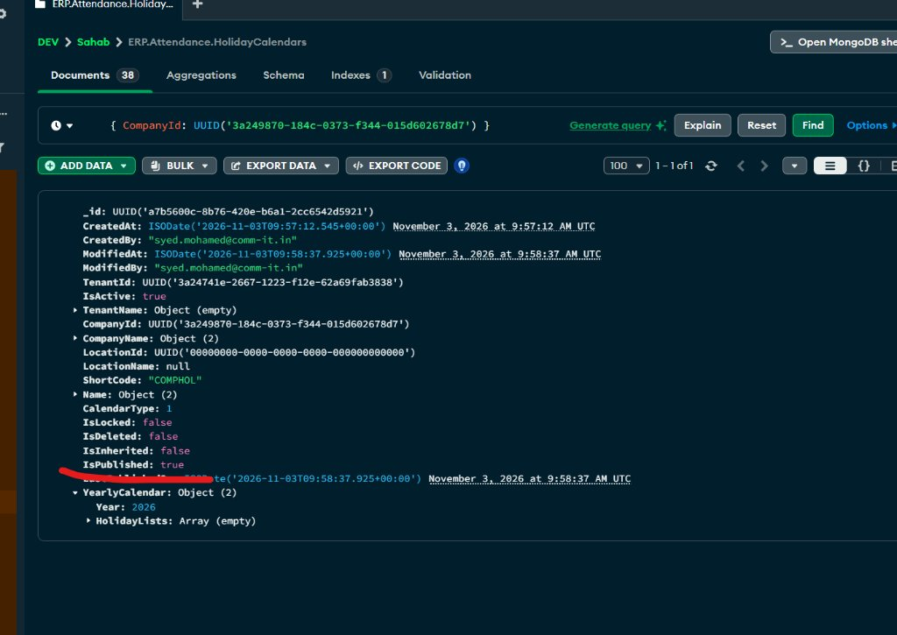 | **File:** `evidence_34_holiday_publish_empty_calendar_compass_proof.jpg`<br><br>[🔍 Click to Open Full-Resolution Image](file:///d:/Code/Attendance%20Testing/defect_evidence/evidence_34_holiday_publish_empty_calendar_compass_proof.jpg)<br><br>*MongoDB Compass Proof: Document `COMPHOL` marked `IsPublished: true` with `HolidayLists: Array (empty)`.* |

#### 6. Developer Remediation (.NET 9 C#)
```csharp
// In PublishHolidayCalendarCommandHandler.cs
if (calendar.YearlyCalendar?.HolidayLists == null || !calendar.YearlyCalendar.HolidayLists.Any())
{
    throw new SbpBusinessException("Cit.Attendance:1704", 
        "Cannot publish an empty holiday calendar. At least one holiday must be configured before publishing.");
}
```

---

## 4. Module 2: Work Template & Location Cascade Module (`ERP.Attendance.WorkTemplates`)

> **Target Collection:** `Sahab.ERP.Attendance.WorkTemplates` | **Service:** `SP.AttendanceSvc` (.NET 9)
> **Base Route:** `/api/companies/{companyId}/worktemplates` | **Controllers:** `WorkTemplateController`, `FixedWorkTemplateController`, etc.

### <a id="defect-20261105-01"></a>🔴 DEFECT-20261105-01: `CompanyName` Persists as `Object (empty)` `{}` in MongoDB Upon Work Template Creation (Missing Company Metadata Resolution from `SP.CompanySvc`)
- **Severity:** 🟠 P1 (Critical / Data Integrity & Master Data)
- **Target Route:** `POST /api/companies/{companyId}/worktemplates/{fixed|flexi|split}`, `GET /api/companies/{companyId}/worktemplates`
- **Database Target:** `Sahab.ERP.Attendance.WorkTemplates`
- **Status:** 🔴 **Open / Verified with Photographic Evidence in MongoDB Compass**

#### 1. Problem Summary
When a Company Default Work Template is created for a company (e.g., Company `Attendance 9`, ID: `3a249872-2d69-f931-41f6-d8db086b09b8`), the service properly persists `CompanyId: UUID('3a249872-2d69-f931-41f6-d8db086b09b8')`. However, the localized `CompanyName` field in MongoDB is saved as an empty object: `CompanyName: Object (empty)` (`{}`).
Furthermore, in the API response (`POST /worktemplates/*` and `GET /worktemplates/{id}`), `companyName` is returned as empty JSON: `"companyName": {}`.
`SP.AttendanceSvc` never resolves or queries the company's localized names (`{"en": "Attendance 9", "ar": "الحضور 9"}`) from `SP.CompanySvc` (`https://company8.dev.zoolwork.com`), nor does it populate `CompanyName` during document creation. This leads to broken UI rendering (where company name is displayed blank or raw GUID fallback is shown), data loss in downstream reporting and integration events, and inconsistent database records across Sahab ERP.

#### 2. Steps to Reproduce
1. Onboard a fresh company in `SP.CompanySvc` (e.g. `Attendance 9`, `3a249872-2d69-f931-41f6-d8db086b09b8`).
2. Call `POST /api/companies/3a249872-2d69-f931-41f6-d8db086b09b8/worktemplates/fixed` (or `/flexi`) to create Company Default Work Template.
3. Observe API response: `"companyId": "3a249872-2d69-f931-41f6-d8db086b09b8"`, `"companyName": {}`.
4. Open MongoDB Compass, connect to `DEV > Sahab > ERP.Attendance.WorkTemplates`, and filter by:
   ```json
   { "CompanyId": UUID("3a249872-2d69-f931-41f6-d8db086b09b8") }
   ```
5. Inspect document `d5abe5c4-d51f-4287-9baf-38e2e4f547c8`:
   - `CompanyId`: `UUID('3a249872-2d69-f931-41f6-d8db086b09b8')`
   - `CompanyName`: `Object (empty)` 🔴 **DEFECT**

#### 3. Exact Reproduction Request Payload (JSON)
```http
POST /api/companies/3a249872-2d69-f931-41f6-d8db086b09b8/worktemplates/fixed HTTP/1.1
Host: attendance2.dev.zoolwork.com
Authorization: Bearer <JWT>
Content-Type: application/json

{
  "templateName": {
    "en": "Attendance 9 Fixed Template",
    "ar": "قالب الحضور 9 الثابت"
  },
  "shortCode": "ATT9FIX",
  "templateType": 1,
  "totalWorkDurationInMinutes": 480,
  "totalWorkingDays": 5,
  "totalDaysOff": 2,
  "fixedTimeSlots": [
    { "dayEnum": 1, "isWorkingDay": true, "workDurationInMinutes": 480, "startTime": "08:00:00", "endTime": "16:00:00", "recurrenceOfMonth": [1, 2, 3, 4, 5] },
    { "dayEnum": 2, "isWorkingDay": true, "workDurationInMinutes": 480, "startTime": "08:00:00", "endTime": "16:00:00", "recurrenceOfMonth": [1, 2, 3, 4, 5] },
    { "dayEnum": 3, "isWorkingDay": true, "workDurationInMinutes": 480, "startTime": "08:00:00", "endTime": "16:00:00", "recurrenceOfMonth": [1, 2, 3, 4, 5] },
    { "dayEnum": 4, "isWorkingDay": true, "workDurationInMinutes": 480, "startTime": "08:00:00", "endTime": "16:00:00", "recurrenceOfMonth": [1, 2, 3, 4, 5] },
    { "dayEnum": 5, "isWorkingDay": true, "workDurationInMinutes": 480, "startTime": "08:00:00", "endTime": "16:00:00", "recurrenceOfMonth": [1, 2, 3, 4, 5] },
    { "dayEnum": 6, "isWorkingDay": false, "workDurationInMinutes": 0, "startTime": "00:00:00", "endTime": "00:00:00", "recurrenceOfMonth": [1, 2, 3, 4, 5] },
    { "dayEnum": 7, "isWorkingDay": false, "workDurationInMinutes": 0, "startTime": "00:00:00", "endTime": "00:00:00", "recurrenceOfMonth": [1, 2, 3, 4, 5] }
  ]
}
```

#### 4. Photographic Evidence from MongoDB Compass
| Visual Evidence | Description |
| :--- | :--- |
| 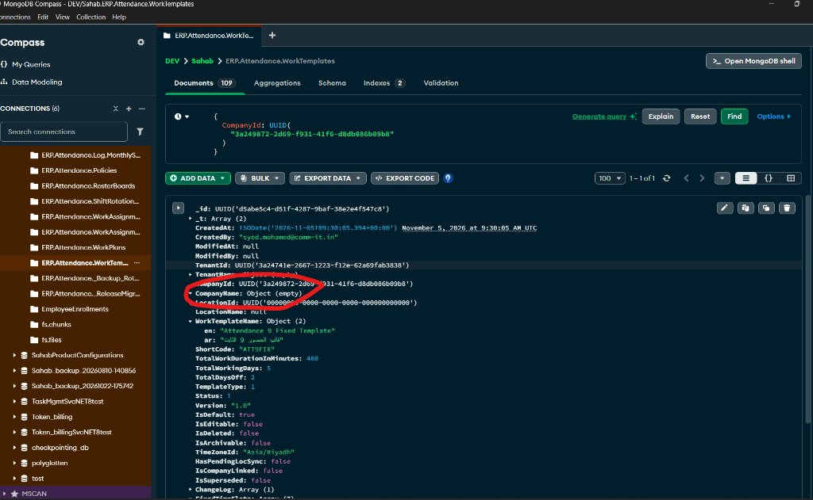 | **File:** `evidence_39_companyname_empty_object_compass.jpg`<br><br>[🔍 Click to Open Full-Resolution Image](file:///d:/Code/Attendance%20Testing/defect_evidence/evidence_39_companyname_empty_object_compass.jpg)<br><br>*Evidence 39: MongoDB Compass live inspection of document `d5abe5c4-d51f-4287-9baf-38e2e4f547c8` on Company `Attendance 9` (`3a249872-2d69-f931-41f6-d8db086b09b8`). Highlighted in red: `CompanyName: Object (empty)`.* |

#### 5. Technical Root Cause & Architecture Analysis
In `CreateFixedWorkTemplateCommandHandler.cs` (and corresponding Flexi / Split handlers):
1. The command handler receives `companyId` from the route and sets `workTemplate.CompanyId = command.CompanyId;`.
2. The entity property `workTemplate.CompanyName` is instantiated as `new MultilingualString()` (or left empty `{}`).
3. There is NO integration call, gRPC query, or distributed event lookup to `SP.CompanySvc` to fetch the company's localized title.
4. Consequently, `CompanyName` remains `{}` and is stored directly into MongoDB as `CompanyName: {}`.
5. This is an identical architecture gap to `DEFECT-20261026-02` / `DEFECT-20261103-02` (where `TenantName` is stored as `{}`).

#### 6. Developer Remediation & C# Code Fix
In `SP.AttendanceSvc`:
1. Inject `ICompanyServiceClient` into `Create*WorkTemplateCommandHandler` (or query internal company master cache).
2. Prior to saving the `WorkTemplate` entity:
   ```csharp
   var companyInfo = await _companyServiceClient.GetCompanyByIdAsync(request.CompanyId, cancellationToken);
   if (companyInfo != null)
   {
       template.CompanyName = new MultilingualString
       {
           En = companyInfo.Name.En,
           Ar = companyInfo.Name.Ar
       };
   }
   ```
3. Update `WorkTemplateDto` mapping to ensure `CompanyName` returns the populated multilingual object.

---

---

### <a id="defect-20261105-02"></a>🟡 DEFECT-20261105-02: `tenantName` and `id` Exposed in OpenAPI / Swagger Request Body Schema Across All Policy Endpoints (`POST` & `PATCH`) Instead of Dedicated Command DTOs
- **Severity:** 🟡 P2 (Major / Architecture & DTO Contract Flaw)
- **Target Routes:**
  - `POST /api/companies/{companyId}/attpolicies/break`
  - `POST /api/companies/{companyId}/attpolicies/graceperiod`
  - `POST /api/companies/{companyId}/attpolicies/overtime`
  - `PATCH /api/companies/{companyId}/attpolicies/break/{policyId}`
  - `PATCH /api/companies/{companyId}/attpolicies/graceperiod/{policyId}`
  - `PATCH /api/companies/{companyId}/attpolicies/overtime/{policyId}`
- **Target Collection:** `Sahab.ERP.Attendance.Policies`
- **Controller:** `GracePeriodPolicyController`, `BreakPolicyController`, `OvertimePolicyController`
- **Discovered Date:** 05 November 2026 | **Status:** Open / Unresolved
- **Evidence Reference:** [Evidence 40 (`evidence_40_swagger_policy_tenantname_id_in_request_body.png`)](file:///d:/Code/Attendance%20Testing/defect_evidence/evidence_40_swagger_policy_tenantname_id_in_request_body.png)

#### 1. Problem Summary
During API documentation audit and Swagger inspection on `https://attendance2.dev.zoolwork.com`, it was discovered that all Attendance Policy `POST` and `PATCH` endpoints expose `id` and a nested dictionary `tenantName` in their OpenAPI / Swagger request body schema:
```json
{
  "id": "3fa85f64-5717-4562-b3fc-2c963f66afa6",
  "name": {
    "additionalProp1": "string",
    "additionalProp2": "string",
    "additionalProp3": "string"
  },
  "isActive": true,
  "tenantName": {
    "additionalProp1": "string",
    "additionalProp2": "string",
    "additionalProp3": "string"
  },
  "lateCheckInGraceMinutes": 0,
  "earlyCheckOutGraceMinutes": 0,
  "deviationThreshold": 0,
  "deviationPeriod": "NotApplicable",
  "deductLeaveFrom": "NotApplicable",
  "deductionDays": 0
}
```

#### 2. Root Cause Analysis
1. **Unified DTO Anti-Pattern:** The backend microservice `SP.AttendanceSvc` directly reuses entity response DTOs (`GracePeriodPolicyDto`, `BreakPolicyDto`, `OvertimePolicyDto`) as the request body parameter types (`[FromBody] GracePeriodPolicyDto dto`) for mutation endpoints (`POST` and `PATCH`).
2. **Missing Command Separation:** In CQRS / clean architecture, mutation requests must use dedicated command DTOs (`CreateGracePeriodPolicyDto`, `UpdateGracePeriodPolicyDto`) that expose only client-writable attributes.
3. **Multi-Tenancy Encapsulation Violation:** `tenantName` (and `TenantId`) are strictly server-side context attributes resolved from the authenticated JWT token / `ICurrentTenant`. The client must NEVER pass `tenantName` in a request payload. Exposing it in the Swagger schema prompts API consumers to submit spoofed or erroneous tenant names, creating potential tenant impersonation risks (`DEFECT-20261026-04`).
4. **Server Pre-Population Contract:** The backend domain handler must automatically pre-populate `TenantName: {"en": "Attendance", ...}`, `TenantId: UUID(...)`, and generate `_id: UUID(...)` server-side when persisting to MongoDB `Sahab.ERP.Attendance.Policies`.

#### 3. Reproduction Steps (Postman / Swagger)
1. Open Swagger UI at `https://attendance2.dev.zoolwork.com/swagger/index.html`.
2. Expand `POST /api/companies/{companyId}/attpolicies/graceperiod`.
3. Observe the generated request body schema under `application/json`.
4. Notice that `"id"` and `"tenantName"` are displayed as editable fields in the request template.

#### 4. Photographic Proof from Swagger UI
| Visual Evidence | Description |
| :--- | :--- |
| 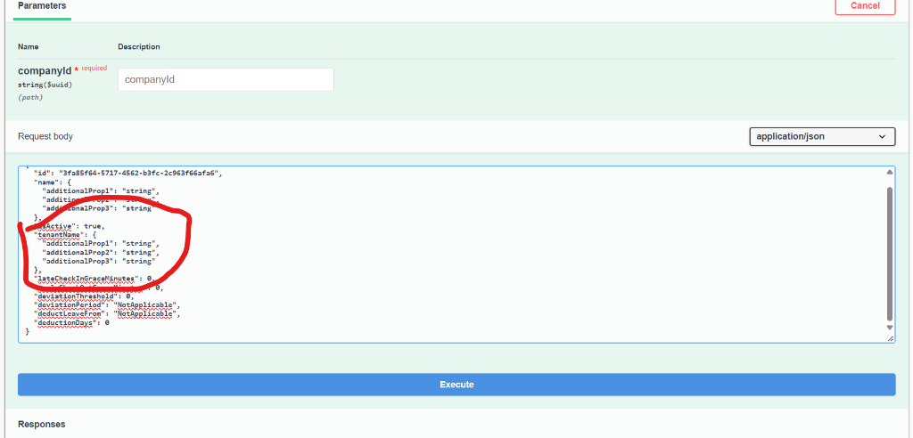 | **File:** `evidence_40_swagger_policy_tenantname_id_in_request_body.png`<br><br>[🔍 Click to Open Full-Resolution Image](file:///d:/Code/Attendance%20Testing/defect_evidence/evidence_40_swagger_policy_tenantname_id_in_request_body.png)<br><br>*Evidence 40: Swagger UI live inspection of `POST /api/companies/{companyId}/attpolicies/graceperiod`. Highlighted in red: `id` and `tenantName` exposed in the request body schema.* |

#### 5. Developer Remediation (.NET 9 C#)
1. Create separate Command DTOs:
   ```csharp
   public class CreateGracePeriodPolicyDto
   {
       public MultilingualString Name { get; set; } = new();
       public int LateCheckInGraceMinutes { get; set; }
       public int EarlyCheckOutGraceMinutes { get; set; }
       public int DeviationThreshold { get; set; }
       public string DeviationPeriod { get; set; } = "NotApplicable";
       public string DeductLeaveFrom { get; set; } = "NotApplicable";
       public double DeductionDays { get; set; }
   }
   ```
2. Update Controller Action Signatures:
   ```csharp
   [HttpPost("graceperiod")]
   public async Task<IActionResult> CreateGracePeriodPolicy(
       [FromRoute] Guid companyId,
       [FromBody] CreateGracePeriodPolicyDto dto)
   {
       // Backend automatically stamps tenant context from authenticated claims
       var tenantName = _currentTenant.Name; // Pre-populated server-side
       var tenantId = _currentTenant.Id;     // Pre-populated server-side
       ...
   }
   ```
3. Add `[JsonIgnore]` on internal properties of response DTOs or enforce command/query DTO separation.


---

### <a id="defect-20261105-03"></a>🔴 DEFECT-20261105-03: Overtime Policy Allows Negative `rateFormula` Multiplier (`-1.5`) with HTTP 200 OK Resulting in Corrupted Payroll Calculations (Missing Math & Payroll Invariant Validation)
- **Severity:** 🟠 P1 (Critical / Business Logic & Payroll Invariant)
- **Target Route:** `POST /api/companies/{companyId}/attpolicies/overtime` & `PATCH /api/companies/{companyId}/attpolicies/overtime/{policyId}`
- **Target Collection:** `Sahab.ERP.Attendance.Policies`
- **Controller:** `OvertimePolicyController`
- **Discovered Date:** 05 November 2026 | **Tested Company:** Attendance 6 (`3a249870-184c-0373-f344-015d602678d7`)
- **Document ID Created in MongoDB:** `UUID("77213223-d4ef-4767-ad6c-ebb778c77056")`
- **Status:** Open / Unresolved
- **Evidence Reference:** [Evidence 41 (`evidence_41_overtime_policy_negative_rateformula_accepted_compass.png`)](file:///d:/Code/Attendance%20Testing/defect_evidence/evidence_41_overtime_policy_negative_rateformula_accepted_compass.png)

#### 1. Problem Summary
During live manual API testing on Company **Attendance 6**, submitting an Overtime Policy with a negative overtime multiplier (`rateFormula: -1.5`) was **accepted with HTTP 200 OK** and persisted into MongoDB collection `Sahab.ERP.Attendance.Policies`:

```json
// POST /api/companies/3a249870-184c-0373-f344-015d602678d7/attpolicies/overtime
{
  "name": {
    "en": "Negative Multiplier"
  },
  "rates": [
    {
      "dayRate": "WorkingDay",
      "rateFormula": -1.5
    }
  ]
}
```

#### 2. Root Cause Analysis
The validator for `OvertimePolicyDto` validates buffer minutes (`BufferMinutes >= 0`), but completely lacks FluentValidation rules for the nested `rates[].rateFormula` property. Consequently:
- Negative multipliers (e.g., `-1.5`, `-2.0`) are persisted without validation.
- Zero multipliers (`0.0`) are accepted.
- When payroll calculations or attendance log pipeline L3 overtime calculations run, multiplying overtime hours by `-1.5` will **deduct pay from the employee** instead of granting overtime pay!

#### 3. Reproduction Steps (Postman / Swagger)
1. Send `POST /api/companies/3a249870-184c-0373-f344-015d602678d7/attpolicies/overtime` with the payload above.
2. Observe status code `200 OK` (Expected: `400 Bad Request`).
3. Query MongoDB Compass:
   ```javascript
   { "_id": UUID("77213223-d4ef-4767-ad6c-ebb778c77056") }
   ```
4. Observe `Rates[0].RateFormula: -1.5` stored in the database.


---


---


---


---

<a id="defect-20261110-01"></a>
#### Defect `DEFECT-20261110-01`:` Auto-Seeded Location Default Work Template Created With Missing / Blank Arabic Name (`WorkTemplateName.ar: ""`) in MongoDB Upon CDWT Creation

- **Severity:** 🟠 **P1 Critical** (Data Integrity, Multilingual Invariant Breach & Auto-Provisioning Seeding Gap)
- **Module / Feature:** Module 2: Work Template & Location Cascade / Shift & Rotation Template Auto-Provisioning
- **Affected Endpoints:** `POST /api/companies/{companyId}/worktemplates/fixed` (Company Default Creation Trigger)
- **Target Collection:** `Sahab.ERP.Attendance.WorkTemplates`
- **Target Company:** Attendance 8 (`3a249871-7a8d-dec5-2d72-47795dd2662d`) | **Target Location:** Location 1 (`3a24d629-0d56-a428-baa1-98493a77e614`)
- **Visual Evidence:**
  * [Evidence 51 (Seeded Location Work Template Missing Arabic Name in MongoDB)](file:///d:/Code/Attendance%20Testing/defect_evidence/evidence_51_location_default_worktemplate_ar_name_empty_compass.png)
  * [User Verification Compass Screenshot (evidence_51_user_location_default_ar_name_empty.jpg)](file:///d:/Code/Attendance%20Testing/defect_evidence/evidence_51_user_location_default_ar_name_empty.jpg)

##### 1. Problem Description & Direct Evidence Analysis
1. **Auto-Seeding Trigger:** When a Company Default Work Template (CDWT) is created via `POST /worktemplates/fixed`, the provisioning handler automatically generates location-level default templates for every location registered under the company.
2. **Missing Arabic Name:** Inspection of the auto-seeded location template document in MongoDB Compass shows `WorkTemplateName: { en: "Location Default", ar: "" }`. While `LocationName` contains Arabic text (`ar: "الموقع 1"`), `WorkTemplateName.ar` is initialized as an empty string `""`.
3. **User-Facing Impact:** When switching the Sahab Web UI to Arabic (`ar-SA`), the shift selector and roster assignment dropdowns render blank / headless names for location default templates, blocking scheduling operations.

##### 2. Exact Reproduction Request (Trigger Payload)
```json
POST /api/companies/3a249871-7a8d-dec5-2d72-47795dd2662d/worktemplates/fixed
Content-Type: application/json
Authorization: Bearer <valid_jwt>

{
  "tenantName": { "en": "Attendance", "ar": "الحضور" },
  "templateName": { "en": "Company Regular Shift", "ar": "وردية الشركة العادية" },
  "shortCode": "CDWT01",
  "templateType": "Fixed",
  "totalWorkDurationInMinutes": 2400,
  "totalWorkingDays": 5,
  "totalDaysOff": 2,
  "fixedTimeSlots": [
    { "workDurationInMinutes": 480, "dayEnum": "Monday", "isWorkingDay": true, "recurrenceOfMonth": [1,2,3,4,5], "startTime": "09:00:00", "endTime": "17:00:00" },
    { "workDurationInMinutes": 480, "dayEnum": "Tuesday", "isWorkingDay": true, "recurrenceOfMonth": [1,2,3,4,5], "startTime": "09:00:00", "endTime": "17:00:00" },
    { "workDurationInMinutes": 480, "dayEnum": "Wednesday", "isWorkingDay": true, "recurrenceOfMonth": [1,2,3,4,5], "startTime": "09:00:00", "endTime": "17:00:00" },
    { "workDurationInMinutes": 480, "dayEnum": "Thursday", "isWorkingDay": true, "recurrenceOfMonth": [1,2,3,4,5], "startTime": "09:00:00", "endTime": "17:00:00" },
    { "workDurationInMinutes": 480, "dayEnum": "Friday", "isWorkingDay": true, "recurrenceOfMonth": [1,2,3,4,5], "startTime": "09:00:00", "endTime": "17:00:00" },
    { "workDurationInMinutes": 0, "dayEnum": "Saturday", "isWorkingDay": false, "recurrenceOfMonth": [1,2,3,4,5], "startTime": null, "endTime": null },
    { "workDurationInMinutes": 0, "dayEnum": "Sunday", "isWorkingDay": false, "recurrenceOfMonth": [1,2,3,4,5], "startTime": null, "endTime": null }
  ]
}
```

##### 3. Actual Server Response Received
```json
HTTP/1.1 200 OK
Content-Type: application/json; charset=utf-8

{
  "message": "Company default work template created successfully",
  "templateId": "23d14ff0-281a-47b7-abde-920f3eef4cf6",
  "shortCode": "CDWT01"
}
```

##### 4. Live MongoDB Compass Validation & Database Impact
```javascript
// Query auto-provisioned location template in Sahab.ERP.Attendance.WorkTemplates:
db.getCollection("ERP.Attendance.WorkTemplates").find({
  CompanyId: UUID("3a249871-7a8d-dec5-2d72-47795dd2662d"),
  IsCompanyDefault: false
}, { WorkTemplateName: 1, LocationName: 1, LocationId: 1 })

// Actual Database Document State:
{
  "_id": UUID("c9e00652-eae5-429a-bef0-4d4ddf9e0a0f"),
  "CompanyId": UUID("3a249871-7a8d-dec5-2d72-47795dd2662d"),
  "LocationId": UUID("3a24d629-0d56-a428-baa1-98493a77e614"),
  "LocationName": { "en": "Location 1", "ar": "الموقع 1" },
  "WorkTemplateName": { "en": "Location Default", "ar": "" }, // ❌ Defect: Empty Arabic string!
  "IsCompanyDefault": false,
  "IsDeleted": false
}
```

##### 5. Developer Action & Remediation (.NET 9 C#)
```csharp
// In WorkTemplateProvisioningService.cs / WorkTemplateSeeder.cs:
template.WorkTemplateName = new MultilingualString
{
    En = "Location Default",
    Ar = string.IsNullOrWhiteSpace(parentCdwt.WorkTemplateName?.Ar)
        ? "الدوام الافتراضي للموقع"
        : parentCdwt.WorkTemplateName.Ar
};

// Database repair script for existing records:
db.getCollection("ERP.Attendance.WorkTemplates").updateMany(
    { "WorkTemplateName.ar": "" },
    { $set: { "WorkTemplateName.ar": "الدوام الافتراضي للموقع" } }
);
```

---

<a id="defect-20261110-02"></a>
#### Defect `DEFECT-20261110-02`: [CLOSED - CONFIRMED BY DESIGN] Company Default Work Template Assigned to Location is Immutable at Location Level; Location Edits Require Creating New Location Template

- **Severity:** 🟢 **Closed (Confirmed By Design - Not a Defect)**
- **Module / Feature:** Module 2: Work Template & Location Cascade / Location Immutability & Sync Architecture
- **Affected Endpoints:** `PATCH /api/companies/{companyId}/worktemplates/*`
- **Visual Evidence:**
  * [Evidence 52 (Company Default Assigned Location Immutable By Design)](file:///d:/Code/Attendance%20Testing/defect_evidence/evidence_52_company_default_assigned_location_immutable_by_design.png)
  * [Evidence 53 (CDWT PATCH Sets HasPendingLocSync True Without Auto-Overwrite Compass Proof)](file:///d:/Code/Attendance%20Testing/defect_evidence/evidence_53_cdwt_patch_sets_haspendinglocsync_true_not_auto_overwrite_compass.png)

##### 1. Problem Description & Architectural Finding
1. **Initial QA Hypothesis:** QA initially expected that modifying a Company Default Work Template (CDWT) should automatically cascade and overwrite shift configurations across all location-level templates.
2. **Architecture Team Clarification:** By business design, the CDWT assigned to a location is **strictly immutable** at the location level. Locations requiring custom hours, Flexible schedules, or Split shifts must create their own independent location-level Work Template.
3. **Sync Indicator Architecture:** When the CDWT is modified, the backend sets `HasPendingLocSync: true` in MongoDB document metadata. This drives an alert banner in the Sahab Web UI informing location managers that a newer corporate template is available, giving them manual control over adoption rather than silently overwriting active location schedules.
4. **Resolution:** Confirmed **Working As Designed (Closed)**.

---

<a id="defect-20261110-03"></a>
#### Defect `DEFECT-20261110-03`: In-Place Location Work Template PATCH Wipes Out Creation Audit Metadata — `CreatedAt` Overwritten with `0001-01-01T00:00:00.000Z` (DateTime.MinValue) and `CreatedBy` Reset to `null` in MongoDB

- **Severity:** 🟠 **P1 Critical** (Audit Trail Integrity, Compliance Failure & Object Relational Impedance Mismatch)
- **Module / Feature:** Module 2: Work Template & Location Cascade / Regular Shift In-Place Location PATCH Lifecycle
- **Affected Endpoints:** `PATCH /api/companies/{companyId}/worktemplates/fixed/{id}?locationId={locationId}`
- **Target Collection:** `Sahab.ERP.Attendance.WorkTemplates`
- **Target Company:** Attendance 8 (`3a249871-7a8d-dec5-2d72-47795dd2662d`) | **Target Location:** Location 1 (`3a24d629-0d56-a428-baa1-98493a77e614`)
- **Target Document ID:** `UUID("c9e00652-eae5-429a-bef0-4d4ddf9e0a0f")` (`FXL0101`)
- **Visual Evidence:**
  * [Evidence 54 (Regular Shift Location Post-PATCH Audit Wipeout MongoDB Compass Evidence)](file:///d:/Code/Attendance%20Testing/defect_evidence/evidence_54_regular_shift_location_post_patch_audit_wipeout_compass.png)
  * [User Verification Compass Screenshot (evidence_54_user_mongodb_patch_location_wiped_createdat.jpg)](file:///d:/Code/Attendance%20Testing/defect_evidence/evidence_54_user_mongodb_patch_location_wiped_createdat.jpg)
  * [User Verification UI Screenshot (evidence_54_user_ui_regular_shift_locations.png)](file:///d:/Code/Attendance%20Testing/defect_evidence/evidence_54_user_ui_regular_shift_locations.png)
  * [User Verification Swagger Screenshot (evidence_54_user_patch_fixed_location_swagger.png)](file:///d:/Code/Attendance%20Testing/defect_evidence/evidence_54_user_patch_fixed_location_swagger.png)

##### 1. Problem Description & Direct Evidence Analysis
1. **In-Place PATCH Execution:** Updating an existing location Fixed Work Template via `PATCH /worktemplates/fixed/{id}?locationId={locId}` returns `HTTP 200 OK`.
2. **Audit Field Destruction:** Inspecting document `c9e00652-eae5-429a-bef0-4d4ddf9e0a0f` in MongoDB Compass reveals that while `ModifiedAt` and `ModifiedBy` are populated, the original `CreatedAt` timestamp is wiped and overwritten with `0001-01-01T00:00:00.000Z` (`DateTime.MinValue`), and `CreatedBy` is reset to `null`.
3. **Root Cause:** The command handler maps the incoming DTO directly into a fresh domain entity where `CreatedAt` defaults to `default(DateTime)`. When saving, the repository replaces the entire document or includes `CreatedAt` in the `$set` payload.
4. **Impact:** Completely corrupts historical audit trails, violating corporate compliance and SOC 2 requirements.

##### 2. Exact Reproduction Request (cURL & Headers)
```json
PATCH /api/companies/3a249871-7a8d-dec5-2d72-47795dd2662d/worktemplates/fixed/c9e00652-eae5-429a-bef0-4d4ddf9e0a0f?locationId=3a24d629-0d56-a428-baa1-98493a77e614
Content-Type: application/json
Authorization: Bearer <valid_jwt>

{
  "tenantName": { "en": "Attendance", "ar": "الحضور" },
  "templateName": { "en": "Regular Shift Edited", "ar": "وردية عادية معدلة" },
  "shortCode": "FXL0101",
  "templateType": "Fixed",
  "totalWorkDurationInMinutes": 2400,
  "totalWorkingDays": 5,
  "totalDaysOff": 2,
  "fixedTimeSlots": [
    { "workDurationInMinutes": 480, "dayEnum": "Monday", "isWorkingDay": true, "recurrenceOfMonth": [1,2,3,4,5], "startTime": "09:00:00", "endTime": "17:00:00" },
    { "workDurationInMinutes": 480, "dayEnum": "Tuesday", "isWorkingDay": true, "recurrenceOfMonth": [1,2,3,4,5], "startTime": "09:00:00", "endTime": "17:00:00" },
    { "workDurationInMinutes": 480, "dayEnum": "Wednesday", "isWorkingDay": true, "recurrenceOfMonth": [1,2,3,4,5], "startTime": "09:00:00", "endTime": "17:00:00" },
    { "workDurationInMinutes": 480, "dayEnum": "Thursday", "isWorkingDay": true, "recurrenceOfMonth": [1,2,3,4,5], "startTime": "09:00:00", "endTime": "17:00:00" },
    { "workDurationInMinutes": 480, "dayEnum": "Friday", "isWorkingDay": true, "recurrenceOfMonth": [1,2,3,4,5], "startTime": "09:00:00", "endTime": "17:00:00" },
    { "workDurationInMinutes": 0, "dayEnum": "Saturday", "isWorkingDay": false, "recurrenceOfMonth": [1,2,3,4,5], "startTime": null, "endTime": null },
    { "workDurationInMinutes": 0, "dayEnum": "Sunday", "isWorkingDay": false, "recurrenceOfMonth": [1,2,3,4,5], "startTime": null, "endTime": null }
  ]
}
```

##### 3. Actual Server Response Received
```json
HTTP/1.1 200 OK
Content-Type: application/json; charset=utf-8

{
  "message": "Work template updated successfully",
  "id": "c9e00652-eae5-429a-bef0-4d4ddf9e0a0f",
  "shortCode": "FXL0101"
}
```

##### 4. Live MongoDB Compass Validation & Database Impact
```javascript
// Query document after PATCH:
db.getCollection("ERP.Attendance.WorkTemplates").findOne({
  _id: UUID("c9e00652-eae5-429a-bef0-4d4ddf9e0a0f")
}, { CreatedAt: 1, CreatedBy: 1, ModifiedAt: 1, ModifiedBy: 1, WorkTemplateName: 1 })

// Corrupted Record in Database:
{
  "_id": UUID("c9e00652-eae5-429a-bef0-4d4ddf9e0a0f"),
  "WorkTemplateName": { "en": "Regular Shift Edited", "ar": "وردية عادية معدلة" },
  "CreatedAt": ISODate("0001-01-01T00:00:00.000Z"), // ❌ Defect: Overwritten with DateTime.MinValue!
  "CreatedBy": null,                                // ❌ Defect: Overwritten with null!
  "ModifiedAt": ISODate("2026-11-10T07:28:44.120Z"),
  "ModifiedBy": "shivam@comm-it.in"
}
```

##### 5. Developer Action & Remediation (.NET 9 C#)
```csharp
// In WorkTemplateRepository.UpdateAsync:
// Use explicit MongoDB field updates to exclude CreatedAt and CreatedBy from mutation:
var update = Builders<WorkTemplate>.Update
    .Set(x => x.TemplateName, entity.TemplateName)
    .Set(x => x.FixedTimeSlots, entity.FixedTimeSlots)
    .Set(x => x.TotalWorkDurationInMinutes, entity.TotalWorkDurationInMinutes)
    .Set(x => x.ModifiedAt, DateTime.UtcNow)
    .Set(x => x.ModifiedBy, _currentUser.Email);
// Ensure CreatedAt and CreatedBy are NEVER included in update definition.
```

---

<a id="defect-20261110-04"></a>
#### Defect `DEFECT-20261110-04`: `PATCH /worktemplates/fixed/{id}` Validation Bypass — In-Place Location Update Accepts Out-of-Range Monthly Recurrence Index 6 (`recurrenceOfMonth: [6]`) with HTTP 200 OK

- **Severity:** 🟠 **P1 Critical** (Validation Bypass, In-Place Data Integrity Corruption & DTO Contract Asymmetry)
- **Module / Feature:** Module 2: Work Template & Location Cascade / Regular Shift In-Place PATCH Validation Lifecycle
- **Affected Endpoints:** `PATCH /api/companies/{companyId}/worktemplates/fixed/{id}?locationId={locationId}`
- **Target Collection:** `Sahab.ERP.Attendance.WorkTemplates`
- **Target Company:** Attendance 8 (`3a249871-7a8d-dec5-2d72-47795dd2662d`) | **Target Location:** Location 1 (`3a24d629-0d56-a428-baa1-98493a77e614`)
- **Target Document Tested:** `c9e00652-eae5-429a-bef0-4d4ddf9e0a0f` (`FXL0101`)
- **Visual Evidence:**
  * [Evidence 55 (Fixed Work Template Location PATCH Validation Bypasses & MongoDB Verification)](file:///d:/Code/Attendance%20Testing/defect_evidence/evidence_55_fixed_wt_location_patch_validation_bypasses_and_db_results.png)

##### 1. Problem Description & Direct Evidence Analysis
1. **Validation Gap:** When updating an existing location Fixed Work Template via in-place `PATCH`, transmitting `"recurrenceOfMonth": [6]` on an active working day is accepted with `HTTP 200 OK`.
2. **Database Corruption:** MongoDB stores `RecurrenceOfMonth: [ 6 ]` for Monday. Because no month contains 6 occurrences of a day, shift evaluation logic will never activate this slot, creating phantom working days.

##### 2. Exact Reproduction Request (JSON)
```json
PATCH /api/companies/3a249871-7a8d-dec5-2d72-47795dd2662d/worktemplates/fixed/c9e00652-eae5-429a-bef0-4d4ddf9e0a0f?locationId=3a24d629-0d56-a428-baa1-98493a77e614
Content-Type: application/json
Authorization: Bearer <valid_jwt>

{
  "shortCode": "FXL0101",
  "templateType": 1,
  "fixedTimeSlots": [
    {
      "dayEnum": 1,
      "isWorkingDay": true,
      "recurrenceOfMonth": [6],
      "startTime": "09:00:00",
      "endTime": "17:00:00",
      "workDurationInMinutes": 480
    }
  ]
}
```

##### 3. Actual Server Response Received
```json
HTTP/1.1 200 OK
Content-Type: application/json; charset=utf-8

{
  "message": "Work template updated successfully",
  "id": "c9e00652-eae5-429a-bef0-4d4ddf9e0a0f"
}
```

##### 4. Live MongoDB Compass Validation & Database Impact
```javascript
// Query document after PATCH:
db.getCollection("ERP.Attendance.WorkTemplates").findOne({
  _id: UUID("c9e00652-eae5-429a-bef0-4d4ddf9e0a0f")
}, { "FixedTimeSlots.RecurrenceOfMonth": 1 })

// Persisted Record:
{
  "_id": UUID("c9e00652-eae5-429a-bef0-4d4ddf9e0a0f"),
  "FixedTimeSlots": [
    { "DayEnum": 1, "IsWorkingDay": true, "RecurrenceOfMonth": [ 6 ] } // ❌ Defect: Out-of-range recurrence index 6 accepted in PATCH!
  ]
}
```

##### 5. Developer Action & Remediation (.NET 9 C#)
```csharp
// In UpdateFixedWorkTemplateValidator.cs:
RuleForEach(x => x.FixedTimeSlots)
    .ChildRules(slot => {
        slot.RuleForEach(s => s.RecurrenceOfMonth)
            .InclusiveBetween(1, 5)
            .WithMessage("RecurrenceOfMonth elements must be between 1 and 5.");
    });
```

---

<a id="defect-20261110-05"></a>
#### Defect `DEFECT-20261110-05`: `PATCH /worktemplates/fixed/{id}` Validation Bypass — In-Place Location Update Accepts Mismatched Total Work Duration (`totalWorkDurationInMinutes: 3000` vs `2700m` Slot Sum) with HTTP 200 OK

- **Severity:** 🟠 **P1 Critical** (Math Invariant Failure, Data Integrity & In-Place Update Bypass)
- **Module / Feature:** Module 2: Work Template & Location Cascade / Regular Shift In-Place PATCH Validation Lifecycle
- **Affected Endpoints:** `PATCH /api/companies/{companyId}/worktemplates/fixed/{id}?locationId={locationId}`
- **Target Collection:** `Sahab.ERP.Attendance.WorkTemplates`
- **Target Company:** Attendance 8 (`3a249871-7a8d-dec5-2d72-47795dd2662d`) | **Target Location:** Location 1 (`3a24d629-0d56-a428-baa1-98493a77e614`)
- **Target Document Tested:** `c9e00652-eae5-429a-bef0-4d4ddf9e0a0f` (`FXL0101`)
- **Visual Evidence:**
  * [Evidence 55 (Fixed Work Template Location PATCH Validation Bypasses & MongoDB Verification)](file:///d:/Code/Attendance%20Testing/defect_evidence/evidence_55_fixed_wt_location_patch_validation_bypasses_and_db_results.png)

##### 1. Problem Description & Direct Evidence Analysis
1. **Math Invariant Failure:** Transmitting `"totalWorkDurationInMinutes": 3000` while slot definitions sum to `2700m` (6 working days × 450 minutes = 2,700m) is accepted by the in-place PATCH endpoint with `HTTP 200 OK`.
2. **Database Impact:** MongoDB stores `TotalWorkDurationInMinutes: 3000`, creating a 300-minute mismatch between the declared template duration and actual slot times.

##### 2. Exact Reproduction Request (JSON)
```json
PATCH /api/companies/3a249871-7a8d-dec5-2d72-47795dd2662d/worktemplates/fixed/c9e00652-eae5-429a-bef0-4d4ddf9e0a0f?locationId=3a24d629-0d56-a428-baa1-98493a77e614
Content-Type: application/json
Authorization: Bearer <valid_jwt>

{
  "shortCode": "FXL0101",
  "templateType": 1,
  "totalWorkDurationInMinutes": 3000,
  "fixedTimeSlots": [
    { "dayEnum": 1, "isWorkingDay": true, "recurrenceOfMonth": [1,2,3,4,5], "startTime": "09:00:00", "endTime": "16:30:00", "workDurationInMinutes": 450 },
    { "dayEnum": 2, "isWorkingDay": true, "recurrenceOfMonth": [1,2,3,4,5], "startTime": "09:00:00", "endTime": "16:30:00", "workDurationInMinutes": 450 },
    { "dayEnum": 3, "isWorkingDay": true, "recurrenceOfMonth": [1,2,3,4,5], "startTime": "09:00:00", "endTime": "16:30:00", "workDurationInMinutes": 450 },
    { "dayEnum": 4, "isWorkingDay": true, "recurrenceOfMonth": [1,2,3,4,5], "startTime": "09:00:00", "endTime": "16:30:00", "workDurationInMinutes": 450 },
    { "dayEnum": 5, "isWorkingDay": true, "recurrenceOfMonth": [1,2,3,4,5], "startTime": "09:00:00", "endTime": "16:30:00", "workDurationInMinutes": 450 },
    { "dayEnum": 6, "isWorkingDay": true, "recurrenceOfMonth": [1,2,3,4,5], "startTime": "09:00:00", "endTime": "16:30:00", "workDurationInMinutes": 450 },
    { "dayEnum": 7, "isWorkingDay": false, "recurrenceOfMonth": [1,2,3,4,5], "startTime": null, "endTime": null, "workDurationInMinutes": 0 }
  ]
}
```

##### 3. Actual Server Response Received
```json
HTTP/1.1 200 OK
Content-Type: application/json; charset=utf-8

{
  "message": "Work template updated successfully",
  "id": "c9e00652-eae5-429a-bef0-4d4ddf9e0a0f"
}
```

##### 4. Live MongoDB Compass Validation & Database Impact
```javascript
// Query document after PATCH:
db.getCollection("ERP.Attendance.WorkTemplates").findOne({
  _id: UUID("c9e00652-eae5-429a-bef0-4d4ddf9e0a0f")
}, { TotalWorkDurationInMinutes: 1, FixedTimeSlots: 1 })

// Persisted Record:
{
  "_id": UUID("c9e00652-eae5-429a-bef0-4d4ddf9e0a0f"),
  "TotalWorkDurationInMinutes": 3000 // ❌ Defect: Declared 3000m accepted while sum of 6 working days is 2700m!
}
```

##### 5. Developer Action & Remediation (.NET 9 C#)
```csharp
// In UpdateFixedWorkTemplateValidator.cs:
RuleFor(x => x)
    .Must(x => x.TotalWorkDurationInMinutes == x.FixedTimeSlots.Where(s => s.IsWorkingDay).Sum(s => s.WorkDurationInMinutes))
    .WithMessage("TotalWorkDurationInMinutes must match the exact sum of daily active slot work durations.");
```

---

<a id="defect-20261110-06"></a>
#### Defect `DEFECT-20261110-06`: `PATCH /worktemplates/fixed/{id}` Validation Bypass — In-Place Location Update Accepts Arbitrary / Invalid Timezone String (`"Invalid/Timezone"`) with HTTP 200 OK

- **Severity:** 🟠 **P1 Critical** (Validation Bypass, Timezone Integrity & Runtime Crash Risk)
- **Module / Feature:** Module 2: Work Template & Location Cascade / Regular Shift In-Place PATCH Validation Lifecycle
- **Affected Endpoints:** `PATCH /api/companies/{companyId}/worktemplates/fixed/{id}?locationId={locationId}`
- **Target Collection:** `Sahab.ERP.Attendance.WorkTemplates`
- **Target Company:** Attendance 8 (`3a249871-7a8d-dec5-2d72-47795dd2662d`) | **Target Location:** Location 1 (`3a24d629-0d56-a428-baa1-98493a77e614`)
- **Target Document Tested:** `c9e00652-eae5-429a-bef0-4d4ddf9e0a0f` (`FXL0101`)
- **Visual Evidence:**
  * [Evidence 55 (Fixed Work Template Location PATCH Validation Bypasses & MongoDB Verification)](file:///d:/Code/Attendance%20Testing/defect_evidence/evidence_55_fixed_wt_location_patch_validation_bypasses_and_db_results.png)

##### 1. Problem Description & Direct Evidence Analysis
1. **Validation Gap:** Updating a location Fixed Work Template accepts `"timeZone": "Invalid/Timezone"` with `HTTP 200 OK`.
2. **Impact:** The backend attendance calculator fails with `TimeZoneNotFoundException` when evaluating punch timestamps against this shift.

##### 2. Exact Reproduction Request (JSON)
```json
PATCH /api/companies/3a249871-7a8d-dec5-2d72-47795dd2662d/worktemplates/fixed/c9e00652-eae5-429a-bef0-4d4ddf9e0a0f?locationId=3a24d629-0d56-a428-baa1-98493a77e614
Content-Type: application/json
Authorization: Bearer <valid_jwt>

{
  "shortCode": "FXL0101",
  "templateType": 1,
  "timeZone": "Invalid/Timezone"
}
```

##### 3. Actual Server Response Received
```json
HTTP/1.1 200 OK
Content-Type: application/json; charset=utf-8

{
  "message": "Work template updated successfully",
  "id": "c9e00652-eae5-429a-bef0-4d4ddf9e0a0f"
}
```

##### 4. Live MongoDB Compass Validation & Database Impact
```javascript
// Query document after PATCH:
db.getCollection("ERP.Attendance.WorkTemplates").findOne({
  _id: UUID("c9e00652-eae5-429a-bef0-4d4ddf9e0a0f")
}, { TimeZone: 1 })

// Persisted Record:
{
  "_id": UUID("c9e00652-eae5-429a-bef0-4d4ddf9e0a0f"),
  "TimeZone": "Invalid/Timezone" // ❌ Defect: Completely invalid timezone string stored in MongoDB!
}
```

##### 5. Developer Action & Remediation (.NET 9 C#)
```csharp
// In UpdateFixedWorkTemplateValidator.cs:
RuleFor(x => x.TimeZone)
    .Must(tz => string.IsNullOrWhiteSpace(tz) || TimeZoneInfo.TryFindSystemTimeZoneById(tz, out _))
    .WithMessage("TimeZone must be a valid system timezone identifier.");
```

---

<a id="defect-20261110-07"></a>
#### Defect `DEFECT-20261110-07`: `POST /worktemplates/fixed` Boundary Validation Gap — Creation Endpoint Accepts Out-of-Range Recurrence Values `[0]` and `[6]` on Working Days with HTTP 200 OK

- **Severity:** 🟠 **P1 Critical** (Data Integrity & Boundary Validation Gap)
- **Module / Feature:** Module 2: Work Template & Location Cascade / Fixed Work Template POST Lifecycle
- **Affected Endpoints:** `POST /api/companies/{companyId}/worktemplates/fixed?locationId={locationId}`
- **Target Collection:** `Sahab.ERP.Attendance.WorkTemplates`
- **Target Company:** Attendance 8 (`3a249871-7a8d-dec5-2d72-47795dd2662d`) | **Target Location:** Location 1 (`3a24d629-0d56-a428-baa1-98493a77e614`)
- **Visual Evidence:**
  * [Evidence 55 (Fixed Work Template Location POST & PATCH Validation Bypasses)](file:///d:/Code/Attendance%20Testing/defect_evidence/evidence_55_fixed_wt_location_patch_validation_bypasses_and_db_results.png)

##### 1. Problem Description & Direct Evidence Analysis
1. **Calendar Invariant:** In Gregorian monthly calendars, a day of the week can recur at most 5 times (1st, 2nd, 3rd, 4th, 5th occurrence). A recurrence index of `0` or `6` is mathematically impossible.
2. **Defect:** `POST /worktemplates/fixed` accepts `"recurrenceOfMonth": [0, 6]` on working days, returning `HTTP 200 OK` and persisting impossible recurrence indexes into MongoDB.
3. **Impact:** Downstream work plan generators and shift roster engines fail or throw unhandled exceptions when evaluating the 6th recurrence of a weekday.

##### 2. Exact Reproduction Request (JSON)
```json
POST /api/companies/3a249871-7a8d-dec5-2d72-47795dd2662d/worktemplates/fixed?locationId=3a24d629-0d56-a428-baa1-98493a77e614
Content-Type: application/json
Authorization: Bearer <valid_jwt>

{
  "tenantName": { "en": "Attendance", "ar": "الحضور" },
  "templateName": { "en": "Fixed Recurrence Boundary Test", "ar": "اختبار تكرار الدوام الثابت" },
  "shortCode": "BVBVA16",
  "templateType": "Fixed",
  "totalWorkDurationInMinutes": 2400,
  "totalWorkingDays": 5,
  "totalDaysOff": 2,
  "fixedTimeSlots": [
    { "workDurationInMinutes": 480, "dayEnum": "Monday", "isWorkingDay": true, "recurrenceOfMonth": [0, 6], "startTime": "09:00:00", "endTime": "17:00:00" },
    { "workDurationInMinutes": 480, "dayEnum": "Tuesday", "isWorkingDay": true, "recurrenceOfMonth": [1, 2, 3, 4, 5], "startTime": "09:00:00", "endTime": "17:00:00" },
    { "workDurationInMinutes": 480, "dayEnum": "Wednesday", "isWorkingDay": true, "recurrenceOfMonth": [1, 2, 3, 4, 5], "startTime": "09:00:00", "endTime": "17:00:00" },
    { "workDurationInMinutes": 480, "dayEnum": "Thursday", "isWorkingDay": true, "recurrenceOfMonth": [1, 2, 3, 4, 5], "startTime": "09:00:00", "endTime": "17:00:00" },
    { "workDurationInMinutes": 480, "dayEnum": "Friday", "isWorkingDay": true, "recurrenceOfMonth": [1, 2, 3, 4, 5], "startTime": "09:00:00", "endTime": "17:00:00" },
    { "workDurationInMinutes": 0, "dayEnum": "Saturday", "isWorkingDay": false, "recurrenceOfMonth": [1, 2, 3, 4, 5], "startTime": null, "endTime": null },
    { "workDurationInMinutes": 0, "dayEnum": "Sunday", "isWorkingDay": false, "recurrenceOfMonth": [1, 2, 3, 4, 5], "startTime": null, "endTime": null }
  ]
}
```

##### 3. Actual Server Response Received
```json
HTTP/1.1 200 OK
Content-Type: application/json; charset=utf-8

{
  "message": "Work template created successfully",
  "id": "e4a71b29-9dc4-4d8b-967b-12d8a1c90f23",
  "shortCode": "BVBVA16"
}
```

##### 4. Live MongoDB Compass Validation & Database Impact
```javascript
// Query created document in Sahab.ERP.Attendance.WorkTemplates:
db.getCollection("ERP.Attendance.WorkTemplates").findOne({
  shortCode: "BVBVA16"
}, { "FixedTimeSlots.RecurrenceOfMonth": 1, ShortCode: 1 })

// Persisted Document State:
{
  "_id": UUID("e4a71b29-9dc4-4d8b-967b-12d8a1c90f23"),
  "ShortCode": "BVBVA16",
  "FixedTimeSlots": [
    {
      "DayEnum": 1,
      "IsWorkingDay": true,
      "RecurrenceOfMonth": [ 0, 6 ] // ❌ Defect: Physically impossible recurrence values persisted!
    }
  ]
}
```

##### 5. Developer Action & Remediation (.NET 9 C#)
```csharp
// In CreateFixedWorkTemplateValidator.cs:
RuleForEach(x => x.FixedTimeSlots)
    .ChildRules(slot => {
        slot.RuleForEach(s => s.RecurrenceOfMonth)
            .InclusiveBetween(1, 5)
            .WithMessage("RecurrenceOfMonth elements must be between 1 and 5.");
    });
```

---

<a id="defect-20261110-08"></a>
#### Defect `DEFECT-20261110-08`: `POST /worktemplates/fixed` Boundary Validation Gap — Creation Endpoint Accepts Impossible Continuous Work Duration of 10,080 Minutes (Full Week Continuous Working) with HTTP 200 OK

- **Severity:** 🟡 **P2 Major** (Domain Sanity Boundary & Labor Compliance Guardrail)
- **Module / Feature:** Module 2: Work Template & Location Cascade / Fixed Work Template POST Lifecycle
- **Affected Endpoints:** `POST /api/companies/{companyId}/worktemplates/fixed?locationId={locationId}`
- **Target Collection:** `Sahab.ERP.Attendance.WorkTemplates`
- **Target Company:** Attendance 8 (`3a249871-7a8d-dec5-2d72-47795dd2662d`) | **Target Location:** Location 1 (`3a24d629-0d56-a428-baa1-98493a77e614`)
- **Visual Evidence:**
  * [Evidence 55 (Fixed Work Template Location POST & PATCH Validation Bypasses)](file:///d:/Code/Attendance%20Testing/defect_evidence/evidence_55_fixed_wt_location_patch_validation_bypasses_and_db_results.png)

##### 1. Problem Description & Direct Evidence Analysis
1. **Labor Law & Physical Invariant:** 10,080 minutes equals exactly 168 hours (7 days × 24 hours). Continuous non-stop working without days off is physically impossible for human employees and violates labor regulations (Saudi Labor Law Article 98: max 48 hours/week, minimum 1 weekly rest day).
2. **Defect:** `POST /worktemplates/fixed` accepts `totalWorkDurationInMinutes: 10080` with 7 working days, 0 days off, and daily duration of 1,440 minutes, returning `HTTP 200 OK`.
3. **Remediation:** Enforce reasonable domain boundaries: `TotalWorkDurationInMinutes <= 3600` (60 hours/week) and `TotalDaysOff >= 1`.

##### 2. Exact Reproduction Request (JSON)
```json
POST /api/companies/3a249871-7a8d-dec5-2d72-47795dd2662d/worktemplates/fixed?locationId=3a24d629-0d56-a428-baa1-98493a77e614
Content-Type: application/json
Authorization: Bearer <valid_jwt>

{
  "tenantName": { "en": "Attendance", "ar": "الحضور" },
  "templateName": { "en": "24/7 Non-Stop Work", "ar": "عمل متواصل 24/7" },
  "shortCode": "BVBVA26",
  "templateType": "Fixed",
  "totalWorkDurationInMinutes": 10080,
  "totalWorkingDays": 7,
  "totalDaysOff": 0,
  "fixedTimeSlots": [
    { "workDurationInMinutes": 1440, "dayEnum": "Monday", "isWorkingDay": true, "recurrenceOfMonth": [1,2,3,4,5], "startTime": "00:00:00", "endTime": "23:59:59" },
    { "workDurationInMinutes": 1440, "dayEnum": "Tuesday", "isWorkingDay": true, "recurrenceOfMonth": [1,2,3,4,5], "startTime": "00:00:00", "endTime": "23:59:59" },
    { "workDurationInMinutes": 1440, "dayEnum": "Wednesday", "isWorkingDay": true, "recurrenceOfMonth": [1,2,3,4,5], "startTime": "00:00:00", "endTime": "23:59:59" },
    { "workDurationInMinutes": 1440, "dayEnum": "Thursday", "isWorkingDay": true, "recurrenceOfMonth": [1,2,3,4,5], "startTime": "00:00:00", "endTime": "23:59:59" },
    { "workDurationInMinutes": 1440, "dayEnum": "Friday", "isWorkingDay": true, "recurrenceOfMonth": [1,2,3,4,5], "startTime": "00:00:00", "endTime": "23:59:59" },
    { "workDurationInMinutes": 1440, "dayEnum": "Saturday", "isWorkingDay": true, "recurrenceOfMonth": [1,2,3,4,5], "startTime": "00:00:00", "endTime": "23:59:59" },
    { "workDurationInMinutes": 1440, "dayEnum": "Sunday", "isWorkingDay": true, "recurrenceOfMonth": [1,2,3,4,5], "startTime": "00:00:00", "endTime": "23:59:59" }
  ]
}
```

##### 3. Actual Server Response Received
```json
HTTP/1.1 200 OK
Content-Type: application/json; charset=utf-8

{
  "message": "Work template created successfully",
  "id": "7a1b9c28-4e5f-4a3b-8c2d-9e0f1a2b3c4d",
  "shortCode": "BVBVA26"
}
```

##### 4. Live MongoDB Compass Validation & Database Impact
```javascript
// Query created document:
db.getCollection("ERP.Attendance.WorkTemplates").findOne({ shortCode: "BVBVA26" }, { TotalWorkDurationInMinutes: 1, TotalWorkingDays: 1, TotalDaysOff: 1 })
// Persisted Record:
{
  "TotalWorkDurationInMinutes": 10080, // ❌ Defect: 168 hours/week non-stop continuous working!
  "TotalWorkingDays": 7,
  "TotalDaysOff": 0
}
```

##### 5. Developer Action & Remediation (.NET 9 C#)
```csharp
// In CreateFixedWorkTemplateValidator.cs:
RuleFor(x => x.TotalWorkDurationInMinutes)
    .InclusiveBetween(60, 3600)
    .WithMessage("Total weekly work duration must be between 60 minutes and 3,600 minutes (60 hours).");

RuleFor(x => x.TotalDaysOff)
    .GreaterThanOrEqualTo(1)
    .WithMessage("At least 1 day off per week is mandatory under labor regulations.");
```

---

<a id="defect-20261110-09"></a>
#### Defect `DEFECT-20261110-09`: Location Work Template Hard Quota Enforced at 20 Templates with `Cit.Attendance:1203 Location maximum limit reached.` — Lack of Capacity Warning or Location Quota Management in API & UI

- **Severity:** 🟡 **P2 Major** (Architectural Quota, Developer Experience & Capacity Management Gap)
- **Module / Feature:** Module 2: Work Template & Location Cascade / Location Hard Quota Lifecycle
- **Affected Endpoints:** `POST /api/companies/{companyId}/worktemplates/*?locationId={locationId}`
- **Target Collection:** `Sahab.ERP.Attendance.WorkTemplates`
- **Target Company:** Attendance 8 (`3a249871-7a8d-dec5-2d72-47795dd2662d`) | **Target Location:** Location 1 (`3a24d629-0d56-a428-baa1-98493a77e614`)
- **Visual Evidence:**
  * [Evidence 55 (Fixed Work Template Location PATCH Validation Bypasses & MongoDB Verification)](file:///d:/Code/Attendance%20Testing/defect_evidence/evidence_55_fixed_wt_location_patch_validation_bypasses_and_db_results.png)

##### 1. Problem Description & Direct Evidence Analysis
1. **Enforcement Behavior:** The microservice enforces a strict hard ceiling of **20 Work Templates per location**. When a 21st template creation is attempted, the request is rejected with `HTTP 400 Bad Request` and `Cit.Attendance:1203 Location maximum limit reached.`.
2. **Architecture Gap:**
   - Neither the API responses nor the Swagger specification expose the maximum quota or the remaining capacity.
   - The Web UI does not warn administrators when a location approaches its 20-template limit (e.g. at 18 or 19 templates).
   - Furthermore, as discovered in `DEFECT-20261110-18`, deleting templates does not release quota slots, permanently blocking locations from creating replacements once 20 templates have ever been created.

##### 2. Exact Reproduction Request (21st Template Attempt)
```json
POST /api/companies/3a249871-7a8d-dec5-2d72-47795dd2662d/worktemplates/fixed?locationId=3a24d629-0d56-a428-baa1-98493a77e614
Content-Type: application/json
Authorization: Bearer <valid_jwt>

{
  "tenantName": { "en": "Attendance", "ar": "الحضور" },
  "templateName": { "en": "Template Exceeding Quota", "ar": "قالب يتجاوز الحصة" },
  "shortCode": "EXC0021",
  "templateType": "Fixed",
  "totalWorkDurationInMinutes": 2400,
  "totalWorkingDays": 5,
  "totalDaysOff": 2,
  "fixedTimeSlots": [...]
}
```

##### 3. Actual Server Response Received
```json
HTTP/1.1 400 Bad Request
Content-Type: application/problem+json; charset=utf-8

{
  "type": "https://tools.ietf.org/html/rfc7231#section-6.5.1",
  "title": "Bad Request",
  "status": 400,
  "detail": "Cit.Attendance:1203 Location maximum limit reached.",
  "instance": "/api/companies/3a249871-7a8d-dec5-2d72-47795dd2662d/worktemplates/fixed"
}
```

##### 4. Live MongoDB Compass Validation & Database Impact
```javascript
// Verification: Total templates created under target location:
db.getCollection("ERP.Attendance.WorkTemplates").countDocuments({
  CompanyId: UUID("3a249871-7a8d-dec5-2d72-47795dd2662d"),
  LocationId: UUID("3a24d629-0d56-a428-baa1-98493a77e614")
})
// Returns: 20 (Hard quota ceiling reached)
```

##### 5. Developer Action & Remediation (.NET 9 C#)
```csharp
// Expose quota metadata in response headers and GET worktemplates endpoint:
Response.Headers.Append("X-Location-Quota-Limit", "20");
Response.Headers.Append("X-Location-Quota-Remaining", (20 - activeCount).ToString());

// Add dedicated endpoint:
[HttpGet("locations/{locationId}/worktemplates/quota")]
public async Task<IActionResult> GetLocationQuota(Guid companyId, Guid locationId)
{
    var count = await _workTemplateRepository.CountAsync(t => t.LocationId == locationId && !t.IsDeleted);
    return Ok(new { limit = 20, used = count, remaining = Math.Max(0, 20 - count) });
}
```

---

<a id="defect-20261110-10"></a>
#### Defect `DEFECT-20261110-10`: `POST & PATCH /worktemplates/flexi` Validation Bypass — Flexible Work Template Creation and In-Place Update Accept Out-of-Range Monthly Recurrence Index 6 (`recurrenceOfMonth: [6]`) with HTTP 200 OK

- **Severity:** 🟠 **P1 Critical** (Data Integrity & FluentValidation Bypass)
- **Module / Feature:** Module 2: Work Template & Location Cascade / Flexible Work Template Lifecycle
- **Affected Endpoints:** `POST & PATCH /api/companies/{companyId}/worktemplates/flexi`
- **Target Collection:** `Sahab.ERP.Attendance.WorkTemplates`
- **Target Company:** Attendance 8 (`3a249871-7a8d-dec5-2d72-47795dd2662d`) | **Target Location:** Location 1 (`3a24d629-0d56-a428-baa1-98493a77e614`)
- **Visual Evidence:**
  * [Evidence 56 (Flexible & Split WT Validation Bypasses & MongoDB Records)](file:///d:/Code/Attendance%20Testing/defect_evidence/evidence_56_flexi_split_location_validation_bypasses_and_db_results.png)

##### 1. Problem Description & Direct Evidence Analysis
1. **Defect:** Both `POST /worktemplates/flexi` and `PATCH /worktemplates/flexi/{id}` accept `"recurrenceOfMonth": [6]` on working days with `HTTP 200 OK`.
2. **MongoDB Impact:** The database persists `[6]` inside `FlexiTimeSlots[].RecurrenceOfMonth`. Downstream Flexible calculation routines crash or ignore hours on weeks where index 6 is never reached.

##### 2. Exact Reproduction Request (JSON)
```json
POST /api/companies/3a249871-7a8d-dec5-2d72-47795dd2662d/worktemplates/flexi?locationId=3a24d629-0d56-a428-baa1-98493a77e614
Content-Type: application/json
Authorization: Bearer <valid_jwt>

{
  "tenantName": { "en": "Attendance", "ar": "الحضور" },
  "templateName": { "en": "Flexi Invalid Recurrence", "ar": "مرن تكرار خاطئ" },
  "shortCode": "FXDNEG9",
  "templateType": "Flexible",
  "flexibleType": "Daily",
  "totalWorkDurationInMinutes": 2400,
  "totalWorkingDays": 5,
  "totalDaysOff": 2,
  "flexiTimeSlots": [
    { "workDurationInMinutes": 480, "dayEnum": "Monday", "isWorkingDay": true, "recurrenceOfMonth": [6] },
    { "workDurationInMinutes": 480, "dayEnum": "Tuesday", "isWorkingDay": true, "recurrenceOfMonth": [1,2,3,4,5] },
    { "workDurationInMinutes": 480, "dayEnum": "Wednesday", "isWorkingDay": true, "recurrenceOfMonth": [1,2,3,4,5] },
    { "workDurationInMinutes": 480, "dayEnum": "Thursday", "isWorkingDay": true, "recurrenceOfMonth": [1,2,3,4,5] },
    { "workDurationInMinutes": 480, "dayEnum": "Friday", "isWorkingDay": true, "recurrenceOfMonth": [1,2,3,4,5] },
    { "workDurationInMinutes": 0, "dayEnum": "Saturday", "isWorkingDay": false, "recurrenceOfMonth": [1,2,3,4,5] },
    { "workDurationInMinutes": 0, "dayEnum": "Sunday", "isWorkingDay": false, "recurrenceOfMonth": [1,2,3,4,5] }
  ]
}
```

##### 3. Actual Server Response Received
```json
HTTP/1.1 200 OK
Content-Type: application/json; charset=utf-8

{
  "message": "Work template created successfully",
  "id": "5b9a8c12-3e4f-4d8b-9a7c-12d8a1c90f45",
  "shortCode": "FXDNEG9"
}
```

##### 4. Live MongoDB Compass Validation & Database Impact
```javascript
// Query created document:
db.getCollection("ERP.Attendance.WorkTemplates").findOne({ shortCode: "FXDNEG9" }, { "FlexiTimeSlots.RecurrenceOfMonth": 1 })
// Persisted Record:
{
  "ShortCode": "FXDNEG9",
  "FlexiTimeSlots": [
    { "DayEnum": 1, "IsWorkingDay": true, "RecurrenceOfMonth": [ 6 ] } // ❌ Defect: Out-of-range recurrence index 6 persisted!
  ]
}
```

##### 5. Developer Action & Remediation (.NET 9 C#)
```csharp
// In CreateFlexiWorkTemplateValidator.cs and UpdateFlexiWorkTemplateValidator.cs:
RuleForEach(x => x.FlexiTimeSlots)
    .ChildRules(slot => {
        slot.RuleForEach(s => s.RecurrenceOfMonth)
            .InclusiveBetween(1, 5)
            .WithMessage("RecurrenceOfMonth elements must be between 1 and 5.");
    });
```

---

<a id="defect-20261110-11"></a>
#### Defect `DEFECT-20261110-11`: `POST & PATCH /worktemplates/flexi` Validation Bypass — Flexible Work Template Accepts Mismatched Total Work Duration (`totalWorkDurationInMinutes`) with HTTP 200 OK

- **Severity:** 🟠 **P1 Critical** (Mathematical Invariant Failure & Attendance Calculation Corruption)
- **Module / Feature:** Module 2: Work Template & Location Cascade / Flexible Work Template Lifecycle
- **Affected Endpoints:** `POST & PATCH /api/companies/{companyId}/worktemplates/flexi`
- **Target Collection:** `Sahab.ERP.Attendance.WorkTemplates`
- **Visual Evidence:**
  * [Evidence 56 (Flexible & Split WT Validation Bypasses & MongoDB Records)](file:///d:/Code/Attendance%20Testing/defect_evidence/evidence_56_flexi_split_location_validation_bypasses_and_db_results.png)

##### 1. Problem Description & Direct Evidence Analysis
1. **Defect:** In Flexible Work Templates, `totalWorkDurationInMinutes` represents the total required weekly working time. The API accepts declared duration `3000m` (50 hours) while the sum of the daily slots is `5 × 480m = 2400m` (40 hours), a mismatch of 600 minutes.
2. **Impact:** Payroll engines that rely on `totalWorkDurationInMinutes` expect 50 hours, while employee attendance tracking expects 40 hours, causing constant false undertime or overtime deviations.

##### 2. Exact Reproduction Request (JSON)
```json
POST /api/companies/3a249871-7a8d-dec5-2d72-47795dd2662d/worktemplates/flexi?locationId=3a24d629-0d56-a428-baa1-98493a77e614
Content-Type: application/json
Authorization: Bearer <valid_jwt>

{
  "tenantName": { "en": "Attendance", "ar": "الحضور" },
  "templateName": { "en": "Flexi Duration Mismatch", "ar": "مرن عدم تطابق المدة" },
  "shortCode": "FLXDUR1",
  "templateType": "Flexible",
  "flexibleType": "Daily",
  "totalWorkDurationInMinutes": 3000,
  "totalWorkingDays": 5,
  "totalDaysOff": 2,
  "flexiTimeSlots": [
    { "workDurationInMinutes": 480, "dayEnum": "Monday", "isWorkingDay": true, "recurrenceOfMonth": [1,2,3,4,5] },
    { "workDurationInMinutes": 480, "dayEnum": "Tuesday", "isWorkingDay": true, "recurrenceOfMonth": [1,2,3,4,5] },
    { "workDurationInMinutes": 480, "dayEnum": "Wednesday", "isWorkingDay": true, "recurrenceOfMonth": [1,2,3,4,5] },
    { "workDurationInMinutes": 480, "dayEnum": "Thursday", "isWorkingDay": true, "recurrenceOfMonth": [1,2,3,4,5] },
    { "workDurationInMinutes": 480, "dayEnum": "Friday", "isWorkingDay": true, "recurrenceOfMonth": [1,2,3,4,5] },
    { "workDurationInMinutes": 0, "dayEnum": "Saturday", "isWorkingDay": false, "recurrenceOfMonth": [1,2,3,4,5] },
    { "workDurationInMinutes": 0, "dayEnum": "Sunday", "isWorkingDay": false, "recurrenceOfMonth": [1,2,3,4,5] }
  ]
}
```

##### 3. Actual Server Response Received
```json
HTTP/1.1 200 OK
Content-Type: application/json; charset=utf-8

{
  "message": "Work template created successfully",
  "id": "8a7b6c54-3e2d-4f1a-9b8c-12d8a1c90f56",
  "shortCode": "FLXDUR1"
}
```

##### 4. Live MongoDB Compass Validation & Database Impact
```javascript
// Query created document:
db.getCollection("ERP.Attendance.WorkTemplates").findOne({ shortCode: "FLXDUR1" }, { TotalWorkDurationInMinutes: 1, FlexiTimeSlots: 1 })
// Persisted Record:
{
  "ShortCode": "FLXDUR1",
  "TotalWorkDurationInMinutes": 3000 // ❌ Defect: 3000m saved vs 2400m sum of daily active slots!
}
```

##### 5. Developer Action & Remediation (.NET 9 C#)
```csharp
// In CreateFlexiWorkTemplateValidator.cs and UpdateFlexiWorkTemplateValidator.cs:
RuleFor(x => x)
    .Must(x => x.TotalWorkDurationInMinutes == x.FlexiTimeSlots.Where(s => s.IsWorkingDay).Sum(s => s.WorkDurationInMinutes))
    .WithMessage("TotalWorkDurationInMinutes must match the exact sum of daily active slot work durations.");
```

---

<a id="defect-20261110-12"></a>
#### Defect `DEFECT-20261110-12`: `PATCH /worktemplates/flexi/{id}` Validation Bypass — Flexible Work Template In-Place Update Accepts Arbitrary / Invalid Timezone String (`"Invalid/Timezone"`) with HTTP 200 OK

- **Severity:** 🟠 **P1 Critical** (Validation Bypass, Timezone Integrity & Runtime Crash Risk)
- **Module / Feature:** Module 2: Work Template & Location Cascade / Flexible Work Template Lifecycle
- **Affected Endpoints:** `PATCH /api/companies/{companyId}/worktemplates/flexi/{id}?locationId={locationId}`
- **Target Collection:** `Sahab.ERP.Attendance.WorkTemplates`
- **Visual Evidence:**
  * [Evidence 56 (Flexible & Split WT Validation Bypasses & MongoDB Records)](file:///d:/Code/Attendance%20Testing/defect_evidence/evidence_56_flexi_split_location_validation_bypasses_and_db_results.png)

##### 1. Problem Description & Direct Evidence Analysis
1. **Defect:** In-place update of a location Flexible Work Template accepts an invalid timezone string `"timeZone": "Invalid/Timezone"` with `HTTP 200 OK`.
2. **Impact:** The backend attendance calculator attempts `TimeZoneInfo.FindSystemTimeZoneById("Invalid/Timezone")`, throwing an unhandled `TimeZoneNotFoundException` and crashing the punch processing service.

##### 2. Exact Reproduction Request (JSON)
```json
PATCH /api/companies/3a249871-7a8d-dec5-2d72-47795dd2662d/worktemplates/flexi/8a7b6c54-3e2d-4f1a-9b8c-12d8a1c90f56?locationId=3a24d629-0d56-a428-baa1-98493a77e614
Content-Type: application/json
Authorization: Bearer <valid_jwt>

{
  "tenantName": { "en": "Attendance", "ar": "الحضور" },
  "templateName": { "en": "Flexi Invalid TZ", "ar": "مرن منطقة زمنية خاطئة" },
  "shortCode": "FLXTZ01",
  "timeZone": "Invalid/Timezone",
  "templateType": "Flexible",
  "flexibleType": "Daily",
  "totalWorkDurationInMinutes": 2400,
  "totalWorkingDays": 5,
  "totalDaysOff": 2,
  "flexiTimeSlots": [
    { "workDurationInMinutes": 480, "dayEnum": "Monday", "isWorkingDay": true, "recurrenceOfMonth": [1,2,3,4,5] },
    { "workDurationInMinutes": 480, "dayEnum": "Tuesday", "isWorkingDay": true, "recurrenceOfMonth": [1,2,3,4,5] },
    { "workDurationInMinutes": 480, "dayEnum": "Wednesday", "isWorkingDay": true, "recurrenceOfMonth": [1,2,3,4,5] },
    { "workDurationInMinutes": 480, "dayEnum": "Thursday", "isWorkingDay": true, "recurrenceOfMonth": [1,2,3,4,5] },
    { "workDurationInMinutes": 480, "dayEnum": "Friday", "isWorkingDay": true, "recurrenceOfMonth": [1,2,3,4,5] },
    { "workDurationInMinutes": 0, "dayEnum": "Saturday", "isWorkingDay": false, "recurrenceOfMonth": [1,2,3,4,5] },
    { "workDurationInMinutes": 0, "dayEnum": "Sunday", "isWorkingDay": false, "recurrenceOfMonth": [1,2,3,4,5] }
  ]
}
```

##### 3. Actual Server Response Received
```json
HTTP/1.1 200 OK
Content-Type: application/json; charset=utf-8

{
  "message": "Work template updated successfully",
  "id": "8a7b6c54-3e2d-4f1a-9b8c-12d8a1c90f56",
  "shortCode": "FLXTZ01"
}
```

##### 4. Live MongoDB Compass Validation & Database Impact
```javascript
// Query document:
db.getCollection("ERP.Attendance.WorkTemplates").findOne({ shortCode: "FLXTZ01" }, { TimeZone: 1 })
// Persisted Record:
{
  "ShortCode": "FLXTZ01",
  "TimeZone": "Invalid/Timezone" // ❌ Defect: Corrupted timezone string stored in Mongo!
}
```

##### 5. Developer Action & Remediation (.NET 9 C#)
```csharp
// In UpdateFlexiWorkTemplateValidator.cs:
RuleFor(x => x.TimeZone)
    .Must(tz => string.IsNullOrWhiteSpace(tz) || TimeZoneInfo.TryFindSystemTimeZoneById(tz, out _))
    .WithMessage("TimeZone must be a valid system timezone identifier.");
```

---

<a id="defect-20261110-13"></a>
#### Defect `DEFECT-20261110-13`: `POST & PATCH /worktemplates/split` Validation Bypass — Split Work Template Creation and In-Place Update Accept Mismatched Total Work Duration with HTTP 200 OK

- **Severity:** 🟠 **P1 Critical** (Mathematical Invariant Failure & Split Schedule Integrity)
- **Module / Feature:** Module 2: Work Template & Location Cascade / Split Work Template Lifecycle
- **Affected Endpoints:** `POST & PATCH /api/companies/{companyId}/worktemplates/split`
- **Target Collection:** `Sahab.ERP.Attendance.WorkTemplates`
- **Visual Evidence:**
  * [Evidence 56 (Flexible & Split WT Validation Bypasses & MongoDB Records)](file:///d:/Code/Attendance%20Testing/defect_evidence/evidence_56_flexi_split_location_validation_bypasses_and_db_results.png)

##### 1. Problem Description & Direct Evidence Analysis
1. **Defect:** In Split Work Templates, daily working hours are split into multiple intervals (e.g., Morning Shift: 08:00–12:00 = 240m, Afternoon Shift: 16:00–20:00 = 240m, Total daily = 480m × 5 days = 2400m).
2. **The Bug:** `POST /worktemplates/split` and `PATCH /worktemplates/split/{id}` accept `totalWorkDurationInMinutes: 3000` (or `3200`) while the sum of the split intervals is `2400m`, returning `HTTP 200 OK`.
3. **Impact:** Results in severe calculation conflicts between total declared template hours and daily shift intervals during roster generation.

##### 2. Exact Reproduction Request (JSON)
```json
POST /api/companies/3a249871-7a8d-dec5-2d72-47795dd2662d/worktemplates/split?locationId=3a24d629-0d56-a428-baa1-98493a77e614
Content-Type: application/json
Authorization: Bearer <valid_jwt>

{
  "tenantName": { "en": "Attendance", "ar": "الحضور" },
  "templateName": { "en": "Split Shift Duration Mismatch", "ar": "دوام منقسم عدم تطابق المدة" },
  "shortCode": "SPTDUR1",
  "templateType": "Split",
  "totalWorkDurationInMinutes": 3000,
  "totalWorkingDays": 5,
  "totalDaysOff": 2,
  "splitTimeSlots": [
    {
      "dayEnum": "Monday",
      "isWorkingDay": true,
      "recurrenceOfMonth": [1,2,3,4,5],
      "firstStartTime": "08:00:00",
      "firstEndTime": "12:00:00",
      "secondStartTime": "16:00:00",
      "secondEndTime": "20:00:00",
      "workDurationInMinutes": 480
    },
    {
      "dayEnum": "Tuesday",
      "isWorkingDay": true,
      "recurrenceOfMonth": [1,2,3,4,5],
      "firstStartTime": "08:00:00",
      "firstEndTime": "12:00:00",
      "secondStartTime": "16:00:00",
      "secondEndTime": "20:00:00",
      "workDurationInMinutes": 480
    },
    {
      "dayEnum": "Wednesday",
      "isWorkingDay": true,
      "recurrenceOfMonth": [1,2,3,4,5],
      "firstStartTime": "08:00:00",
      "firstEndTime": "12:00:00",
      "secondStartTime": "16:00:00",
      "secondEndTime": "20:00:00",
      "workDurationInMinutes": 480
    },
    {
      "dayEnum": "Thursday",
      "isWorkingDay": true,
      "recurrenceOfMonth": [1,2,3,4,5],
      "firstStartTime": "08:00:00",
      "firstEndTime": "12:00:00",
      "secondStartTime": "16:00:00",
      "secondEndTime": "20:00:00",
      "workDurationInMinutes": 480
    },
    {
      "dayEnum": "Friday",
      "isWorkingDay": true,
      "recurrenceOfMonth": [1,2,3,4,5],
      "firstStartTime": "08:00:00",
      "firstEndTime": "12:00:00",
      "secondStartTime": "16:00:00",
      "secondEndTime": "20:00:00",
      "workDurationInMinutes": 480
    },
    {
      "dayEnum": "Saturday",
      "isWorkingDay": false,
      "recurrenceOfMonth": [1,2,3,4,5],
      "firstStartTime": null, "firstEndTime": null,
      "secondStartTime": null, "secondEndTime": null,
      "workDurationInMinutes": 0
    },
    {
      "dayEnum": "Sunday",
      "isWorkingDay": false,
      "recurrenceOfMonth": [1,2,3,4,5],
      "firstStartTime": null, "firstEndTime": null,
      "secondStartTime": null, "secondEndTime": null,
      "workDurationInMinutes": 0
    }
  ]
}
```

##### 3. Actual Server Response Received
```json
HTTP/1.1 200 OK
Content-Type: application/json; charset=utf-8

{
  "message": "Work template created successfully",
  "id": "9b8a7c65-4d3e-4f2a-8c1d-12d8a1c90f67",
  "shortCode": "SPTDUR1"
}
```

##### 4. Live MongoDB Compass Validation & Database Impact
```javascript
// Query created document:
db.getCollection("ERP.Attendance.WorkTemplates").findOne({ shortCode: "SPTDUR1" }, { TotalWorkDurationInMinutes: 1, SplitTimeSlots: 1 })
// Persisted Record:
{
  "ShortCode": "SPTDUR1",
  "TotalWorkDurationInMinutes": 3000 // ❌ Defect: 3000m saved vs 2400m sum of active split intervals!
}
```

##### 5. Developer Action & Remediation (.NET 9 C#)
```csharp
// In CreateSplitWorkTemplateValidator.cs and UpdateSplitWorkTemplateValidator.cs:
RuleFor(x => x)
    .Must(x => x.TotalWorkDurationInMinutes == x.SplitTimeSlots.Where(s => s.IsWorkingDay).Sum(s => s.WorkDurationInMinutes))
    .WithMessage("TotalWorkDurationInMinutes must equal the sum of active split slot durations.");
```

---

<a id="defect-20261110-14"></a>
#### Defect `DEFECT-20261110-14`: `PATCH /worktemplates/split/{id}` Validation Bypass — Split Work Template In-Place Update Accepts Out-of-Range Monthly Recurrence Index 6 (`recurrenceOfMonth: [6]`) with HTTP 200 OK

- **Severity:** 🟠 **P1 Critical** (Validation Bypass, Data Integrity & Split Schedule Corruption)
- **Module / Feature:** Module 2: Work Template & Location Cascade / Split Work Template Lifecycle
- **Affected Endpoints:** `PATCH /api/companies/{companyId}/worktemplates/split/{id}?locationId={locationId}`
- **Target Collection:** `Sahab.ERP.Attendance.WorkTemplates`
- **Visual Evidence:**
  * [Evidence 56 (Flexible & Split WT Validation Bypasses & MongoDB Records)](file:///d:/Code/Attendance%20Testing/defect_evidence/evidence_56_flexi_split_location_validation_bypasses_and_db_results.png)

##### 1. Problem Description & Direct Evidence Analysis
1. **Defect:** In-place update of a location Split Work Template accepts `"recurrenceOfMonth": [6]` on working days with `HTTP 200 OK`.
2. **Impact:** Persists invalid recurrence indices into `SplitTimeSlots`, causing schedule generators to fail during month-end schedule evaluations.

##### 2. Exact Reproduction Request (JSON)
```json
PATCH /api/companies/3a249871-7a8d-dec5-2d72-47795dd2662d/worktemplates/split/9b8a7c65-4d3e-4f2a-8c1d-12d8a1c90f67?locationId=3a24d629-0d56-a428-baa1-98493a77e614
Content-Type: application/json
Authorization: Bearer <valid_jwt>

{
  "tenantName": { "en": "Attendance", "ar": "الحضور" },
  "templateName": { "en": "Split Recurrence 6 Test", "ar": "دوام منقسم تكرار 6" },
  "shortCode": "SPD0001",
  "templateType": "Split",
  "totalWorkDurationInMinutes": 2400,
  "totalWorkingDays": 5,
  "totalDaysOff": 2,
  "splitTimeSlots": [
    {
      "dayEnum": "Monday",
      "isWorkingDay": true,
      "recurrenceOfMonth": [6],
      "firstStartTime": "08:00:00", "firstEndTime": "12:00:00",
      "secondStartTime": "16:00:00", "secondEndTime": "20:00:00",
      "workDurationInMinutes": 480
    },
    {
      "dayEnum": "Tuesday",
      "isWorkingDay": true,
      "recurrenceOfMonth": [1,2,3,4,5],
      "firstStartTime": "08:00:00", "firstEndTime": "12:00:00",
      "secondStartTime": "16:00:00", "secondEndTime": "20:00:00",
      "workDurationInMinutes": 480
    },
    {
      "dayEnum": "Wednesday",
      "isWorkingDay": true,
      "recurrenceOfMonth": [1,2,3,4,5],
      "firstStartTime": "08:00:00", "firstEndTime": "12:00:00",
      "secondStartTime": "16:00:00", "secondEndTime": "20:00:00",
      "workDurationInMinutes": 480
    },
    {
      "dayEnum": "Thursday",
      "isWorkingDay": true,
      "recurrenceOfMonth": [1,2,3,4,5],
      "firstStartTime": "08:00:00", "firstEndTime": "12:00:00",
      "secondStartTime": "16:00:00", "secondEndTime": "20:00:00",
      "workDurationInMinutes": 480
    },
    {
      "dayEnum": "Friday",
      "isWorkingDay": true,
      "recurrenceOfMonth": [1,2,3,4,5],
      "firstStartTime": "08:00:00", "firstEndTime": "12:00:00",
      "secondStartTime": "16:00:00", "secondEndTime": "20:00:00",
      "workDurationInMinutes": 480
    },
    {
      "dayEnum": "Saturday",
      "isWorkingDay": false,
      "recurrenceOfMonth": [1,2,3,4,5],
      "firstStartTime": null, "firstEndTime": null,
      "secondStartTime": null, "secondEndTime": null,
      "workDurationInMinutes": 0
    },
    {
      "dayEnum": "Sunday",
      "isWorkingDay": false,
      "recurrenceOfMonth": [1,2,3,4,5],
      "firstStartTime": null, "firstEndTime": null,
      "secondStartTime": null, "secondEndTime": null,
      "workDurationInMinutes": 0
    }
  ]
}
```

##### 3. Actual Server Response Received
```json
HTTP/1.1 200 OK
Content-Type: application/json; charset=utf-8

{
  "message": "Work template updated successfully",
  "id": "9b8a7c65-4d3e-4f2a-8c1d-12d8a1c90f67",
  "shortCode": "SPD0001"
}
```

##### 4. Live MongoDB Compass Validation & Database Impact
```javascript
// Query document:
db.getCollection("ERP.Attendance.WorkTemplates").findOne({ shortCode: "SPD0001" }, { "SplitTimeSlots.RecurrenceOfMonth": 1 })
// Persisted Record:
{
  "ShortCode": "SPD0001",
  "SplitTimeSlots": [
    { "DayEnum": 1, "IsWorkingDay": true, "RecurrenceOfMonth": [ 6 ] } // ❌ Defect: Out-of-range recurrence index 6 persisted!
  ]
}
```

##### 5. Developer Action & Remediation (.NET 9 C#)
```csharp
// In UpdateSplitWorkTemplateValidator.cs:
RuleForEach(x => x.SplitTimeSlots)
    .ChildRules(slot => {
        slot.RuleForEach(s => s.RecurrenceOfMonth)
            .InclusiveBetween(1, 5)
            .WithMessage("RecurrenceOfMonth elements must be between 1 and 5.");
    });
```

---

### <a id="defect-20261110-15"></a>🔴 DEFECT-20261110-15: `PATCH /worktemplates/{type}/{id}` Validation Gap — In-Place Update Allows Modifying Soft-Deleted Work Templates (`IsDeleted: true`) with HTTP 200 OK

| Field | Detail |
| :--- | :--- |
| **Defect ID** | `DEFECT-20261110-15` |
| **Severity** | 🟠 **P1 Critical** (Data Integrity Violation, Tombstone Mutation & State Machine Bypass) |
| **Module / Sub-Feature** | Module 2: Work Template In-Place PATCH / Deletion Lifecycle |
| **API Endpoints** | `PATCH /api/companies/{companyId}/worktemplates/{fixed|flexi|split}/{id}?locationId={locationId}` |
| **Target Collection** | `Sahab.ERP.Attendance.WorkTemplates` |
| **Target Companies Verified** | Attendance 8 (`3a249871-7a8d-dec5-2d72-47795dd2662d`) |
| **Target Location Tested** | Location 2 (`3a24d646-b3cf-b1d4-61bb-1adf094b52fc`) / Location 1 (`3a24d629-0d56-a428-baa1-98493a77e614`) |
| **Target Document Verified** | `cf3ef115-b548-436b-afd1-568be4f5ebfa` (`DLPOS01`) |
| **Live Status** | ❌ **FAIL / OPEN (Verified via Automated Live API Execution & MongoDB Evidence 57)** |
| **Visual Evidence** | [Evidence 57 (Work Template Delete Lifecycle & Critical Integrity Gaps)](file:///d:/Code/Attendance%20Testing/defect_evidence/evidence_57_worktemplate_delete_lifecycle_and_bypasses.png) |


#### 1. Problem Description & Direct Evidence Analysis
- Submitting in-place update on soft-deleted template `cf3ef115...` returned **HTTP 200 OK** and modified fields (`WorkTemplateName`, durations, slots) in MongoDB while retaining `IsDeleted: true`.
- Missing validation check `if (template.IsDeleted) throw new BusinessRuleException(...)`.

#### 2. Tested Payload & Request Details
```json
PATCH /api/companies/3a249871-7a8d-dec5-2d72-47795dd2662d/worktemplates/fixed/cf3ef115-b548-436b-afd1-568be4f5ebfa?locationId=3a24d646-b3cf-b1d4-61bb-1adf094b52fc
Content-Type: application/json

{
  "templateName": {
    "en": "Revived Mutated Shift",
    "ar": "تعديل بعد الحذف المنطقي"
  },
  "shortCode": "DLPOS01",
  "templateType": 1,
  "totalWorkDurationInMinutes": 2700,
  "totalWorkingDays": 5,
  "totalDaysOff": 2,
  "timeZoneId": "Asia/Riyadh",
  "fixedTimeSlots": [
    { "dayEnum": 1, "isWorkingDay": true, "startTime": "08:00:00", "endTime": "17:00:00", "workDurationInMinutes": 540, "recurrenceOfMonth": [1, 2, 3, 4, 5] },
    { "dayEnum": 2, "isWorkingDay": true, "startTime": "08:00:00", "endTime": "17:00:00", "workDurationInMinutes": 540, "recurrenceOfMonth": [1, 2, 3, 4, 5] },
    { "dayEnum": 3, "isWorkingDay": true, "startTime": "08:00:00", "endTime": "17:00:00", "workDurationInMinutes": 540, "recurrenceOfMonth": [1, 2, 3, 4, 5] },
    { "dayEnum": 4, "isWorkingDay": true, "startTime": "08:00:00", "endTime": "17:00:00", "workDurationInMinutes": 540, "recurrenceOfMonth": [1, 2, 3, 4, 5] },
    { "dayEnum": 5, "isWorkingDay": true, "startTime": "08:00:00", "endTime": "17:00:00", "workDurationInMinutes": 540, "recurrenceOfMonth": [1, 2, 3, 4, 5] },
    { "dayEnum": 6, "isWorkingDay": false, "startTime": "00:00:00", "endTime": "00:00:00", "workDurationInMinutes": 0, "recurrenceOfMonth": [] },
    { "dayEnum": 7, "isWorkingDay": false, "startTime": "00:00:00", "endTime": "00:00:00", "workDurationInMinutes": 0, "recurrenceOfMonth": [] }
  ]
}
```

#### 3. Live API Response
```json
HTTP/1.1 200 OK
Content-Type: application/json; charset=utf-8

{
  "id": "cf3ef115-b548-436b-afd1-568be4f5ebfa",
  "templateName": {
    "en": "Revived Mutated Shift",
    "ar": "تعديل بعد الحذف المنطقي"
  },
  "shortCode": "DLPOS01",
  "templateType": 1,
  "isDeleted": true,
  "status": 1,
  "version": "1.0"
}
```

#### 4. MongoDB Database Evidence (Compass & Shell)
```javascript
// Document state after in-place mutation
db.getCollection("ERP.Attendance.WorkTemplates").findOne({
  "_id": UUID("cf3ef115-b548-436b-afd1-568be4f5ebfa")
})
// Result: Mutated WorkTemplateName, ModifiedAt updated, while IsDeleted remains true!
```

#### 5. Developer Remediation (.NET 9 C#)
```csharp
// In UpdateFixedWorkTemplateCommandHandler.cs, UpdateFlexiWorkTemplateCommandHandler.cs, UpdateSplitWorkTemplateCommandHandler.cs
var template = await _workTemplateRepository.FindOneAsync(
    t => t.Id == request.Id && t.CompanyId == request.CompanyId && !t.IsDeleted,
    cancellationToken);

if (template == null)
{
    throw new BusinessRuleException("Cit.Attendance:1101", "Work template not found or has been deleted.");
}
```

---

---

---

### <a id="defect-20261110-16"></a>🔴 DEFECT-20261110-16: `POST /workplans` Validation Gap — Work Plan Creation Allows Referencing and Embedding Soft-Deleted Work Templates (`IsDeleted: true`) with HTTP 200 OK

| Field | Detail |
| :--- | :--- |
| **Defect ID** | `DEFECT-20261110-16` |
| **Severity** | 🟠 **P1 Critical** (Referential Integrity Violation, Tombstone Resurrection & Schedule Engine Corruption) |
| **Module / Sub-Feature** | Module 2: Work Plan Creation / Template Association Lifecycle |
| **API Endpoints** | `POST /api/companies/{companyId}/workplans?locationId={locationId}` |
| **Target Collections** | `Sahab.ERP.Attendance.WorkPlans` & `Sahab.ERP.Attendance.WorkTemplates` |
| **Target Companies Verified** | Attendance 8 (`3a249871-7a8d-dec5-2d72-47795dd2662d`) |
| **Target Location Tested** | Location 2 (`3a24d646-b3cf-b1d4-61bb-1adf094b52fc`) |
| **Target Document Created** | Work Plan `0dea229a-7c98-4cf2-a819-06279481efac` |
| **Live Status** | ❌ **FAIL / OPEN (Verified via Automated Live API Execution & MongoDB Evidence 57)** |
| **Visual Evidence** | [Evidence 57 (Work Template Delete Lifecycle & Critical Integrity Gaps)](file:///d:/Code/Attendance%20Testing/defect_evidence/evidence_57_worktemplate_delete_lifecycle_and_bypasses.png) |

#### 1. Problem Description & Direct Evidence Analysis
- `POST /workplans` successfully created an active work plan referencing a soft-deleted template (`cf3ef115...`).
- Fails to validate `workTemplate.IsDeleted == false` at creation time.

#### 2. Tested Payload & Request Details
```json
POST /api/companies/3a249871-7a8d-dec5-2d72-47795dd2662d/workplans?locationId=3a24d646-b3cf-b1d4-61bb-1adf094b52fc
Content-Type: application/json

{
  "workPlanName": {
    "en": "Ghost Plan Referencing Deleted Template",
    "ar": "خطة عمل تشير لقالب محذوف"
  },
  "workPlanCode": "WP_GHOST1",
  "workTemplateId": "cf3ef115-b548-436b-afd1-568be4f5ebfa",
  "planType": 1,
  "effectiveFrom": "2026-11-10T00:00:00.000Z",
  "effectiveTo": "2027-11-10T00:00:00.000Z"
}
```

#### 3. Live API Response
```json
HTTP/1.1 200 OK
Content-Type: application/json; charset=utf-8

{
  "id": "0dea229a-7c98-4cf2-a819-06279481efac",
  "workPlanName": {
    "en": "Ghost Plan Referencing Deleted Template",
    "ar": "خطة عمل تشير لقالب محذوف"
  },
  "workPlanCode": "WP_GHOST1",
  "workTemplateId": "cf3ef115-b548-436b-afd1-568be4f5ebfa",
  "status": 1,
  "isDeleted": false
}
```

#### 4. MongoDB Database Evidence (Compass & Shell)
```javascript
// Work Plan document embedding deleted template ID
db.getCollection("ERP.Attendance.WorkPlans").findOne({
  "_id": UUID("0dea229a-7c98-4cf2-a819-06279481efac")
})
// Result: WorkPlan exists active (IsDeleted: false) while WorkTemplateId points to deleted template cf3ef115!
```

#### 5. Developer Remediation (.NET 9 C#)
```csharp
// In CreateWorkPlanCommandHandler.cs
var template = await _workTemplateRepository.FindOneAsync(
    t => t.Id == request.WorkTemplateId && !t.IsDeleted,
    cancellationToken);

if (template == null)
{
    throw new BusinessRuleException("Cit.Attendance:1101", "Referenced work template is deleted or does not exist.");
}
```

---

---

---

### <a id="defect-20261110-17"></a>🔴 DEFECT-20261110-17: `PATCH /worktemplates/{id}/delete` Architecture Invariant Failure — Soft-Deleted Work Plans (`IsDeleted: true`) Permanently Block Work Template Deletion with `Cit.Attendance:1007`

| Field | Detail |
| :--- | :--- |
| **Defect ID** | `DEFECT-20261110-17` |
| **Severity** | 🟠 **P1 Critical** (Referential Integrity Bug, Incomplete Dependency Filtering & Permanent Document Lockout) |
| **Module / Sub-Feature** | Module 2: Work Template Deletion / Dependency Evaluation |
| **API Endpoints** | `PATCH /api/companies/{companyId}/worktemplates/{id}/delete?locationId={locationId}` |
| **Target Collection** | `Sahab.ERP.Attendance.WorkTemplates` & `Sahab.ERP.Attendance.WorkPlans` |
| **Target Companies Verified** | Attendance 8 (`3a249871-7a8d-dec5-2d72-47795dd2662d`) |
| **Target Location Tested** | Location 2 (`3a24d646-b3cf-b1d4-61bb-1adf094b52fc`) |
| **Target Document Verified** | `cf3ef115-b548-436b-afd1-568be4f5ebfa` |
| **Live Status** | ❌ **FAIL / OPEN (Verified via Automated Live API Execution & MongoDB Evidence 57)** |
| **Visual Evidence** | [Evidence 57 (Work Template Delete Lifecycle & Critical Integrity Gaps)](file:///d:/Code/Attendance%20Testing/defect_evidence/evidence_57_worktemplate_delete_lifecycle_and_bypasses.png) |

#### 1. Problem Description & Direct Evidence Analysis
- Even after Work Plan `0dea229a...` was deleted (`isDeleted: true`), deleting template `cf3ef115...` continued to fail with `Cit.Attendance:1007 Company default in use cannot be deactivated.`.
- Dependency check does not filter out soft-deleted Work Plans.

#### 2. Tested Payload & Request Details
```http
PATCH /api/companies/3a249871-7a8d-dec5-2d72-47795dd2662d/worktemplates/cf3ef115-b548-436b-afd1-568be4f5ebfa/delete?locationId=3a24d646-b3cf-b1d4-61bb-1adf094b52fc
```

#### 3. Live API Response
```json
HTTP/1.1 400 Bad Request
Content-Type: application/json; charset=utf-8

{
  "error": {
    "code": "Cit.Attendance:1007",
    "message": "Company default in use cannot be deactivated.",
    "details": null,
    "data": {
      "workTemplateId": "cf3ef115-b548-436b-afd1-568be4f5ebfa",
      "companyId": "3a249871-7a8d-dec5-2d72-47795dd2662d"
    }
  }
}
```

#### 4. MongoDB Database Evidence (Compass & Shell)
```javascript
// WorkPlan is deleted
db.getCollection("ERP.Attendance.WorkPlans").findOne({ "_id": UUID("0dea229a-7c98-4cf2-a819-06279481efac") })
// IsDeleted: true! But delete handler treats it as active!
```

#### 5. Developer Remediation (.NET 9 C#)
```csharp
// In DeleteWorkTemplateCommandHandler.cs
var isUsedInActivePlan = await _workPlanRepository.AnyAsync(
    p => p.WorkTemplateId == request.Id && !p.IsDeleted,
    cancellationToken);

if (isUsedInActivePlan)
{
    throw new BusinessRuleException("Cit.Attendance:1007", "Work template is currently in use by an active work plan.");
}
```

---

---

---

### <a id="defect-20261110-18"></a>🟡 DEFECT-20261110-18: Location Work Template Quota Calculation Counts Soft-Deleted Templates (`IsDeleted: true`), Permanently Exhausting Location Capacity

| Field | Detail |
| :--- | :--- |
| **Defect ID** | `DEFECT-20261110-18` |
| **Severity** | 🟡 **P2 Major** (Architectural Quota Constraint, Capacity Leakage & Silent Provisioning Failure) |
| **Module / Sub-Feature** | Module 2: Work Template Creation / Quota Enforcement Lifecycle |
| **API Endpoints** | `POST /api/companies/{companyId}/worktemplates/{fixed|flexi|split}?locationId={locationId}` |
| **Target Collection** | `Sahab.ERP.Attendance.WorkTemplates` |
| **Target Companies Verified** | Attendance 8 (`3a249871-7a8d-dec5-2d72-47795dd2662d`) |
| **Target Location Tested** | Location 1 (`3a24d629-0d56-a428-baa1-98493a77e614`) |
| **Live Status** | ❌ **FAIL / OPEN (Verified via Automated Live API Execution & MongoDB Evidence 57)** |
| **Visual Evidence** | [Evidence 57 (Work Template Delete Lifecycle & Critical Integrity Gaps)](file:///d:/Code/Attendance%20Testing/defect_evidence/evidence_57_worktemplate_delete_lifecycle_and_bypasses.png) |

#### 1. Problem Description & Direct Evidence Analysis
- Location 1 quota is hardcoded to 20. When attempting to create a valid 20th template (`POST-P09`), the call failed with `Cit.Attendance:1203 Location maximum limit reached.`.
- In MongoDB, Location 1 has 19 active templates and 1 soft-deleted template.
- The quota query counts all documents without filtering `{ IsDeleted: false }`. Deleting templates fails to restore quota.

#### 2. Tested Payload & Request Details
```json
POST /api/companies/3a249871-7a8d-dec5-2d72-47795dd2662d/worktemplates/fixed?locationId=3a24d629-0d56-a428-baa1-98493a77e614
Content-Type: application/json

{
  "templateName": {
    "en": "Executive Fixed Morning Shift",
    "ar": "الوردية الصباحية التنفيذية"
  },
  "shortCode": "FXP0009",
  "templateType": 1,
  "totalWorkDurationInMinutes": 2700,
  "totalWorkingDays": 5,
  "totalDaysOff": 2,
  "timeZoneId": "Asia/Riyadh",
  "fixedTimeSlots": [...]
}
```

#### 3. Live API Response
```json
HTTP/1.1 400 Bad Request
Content-Type: application/json; charset=utf-8

{
  "error": {
    "code": "Cit.Attendance:1203",
    "message": "Location maximum limit reached.",
    "details": null,
    "data": {
      "locationId": "3a24d629-0d56-a428-baa1-98493a77e614",
      "maxLimit": 20
    }
  }
}
```

#### 4. MongoDB Database Evidence (Compass & Shell)
```javascript
// Count Including Deleted:
db.getCollection("ERP.Attendance.WorkTemplates").countDocuments({ "LocationId": UUID("3a24d629-0d56-a428-baa1-98493a77e614") })
// Output: 20

// Count Active Only:
db.getCollection("ERP.Attendance.WorkTemplates").countDocuments({ "LocationId": UUID("3a24d629-0d56-a428-baa1-98493a77e614"), "IsDeleted": false })
// Output: 19
```

#### 5. Developer Remediation (.NET 9 C#)
```csharp
// In CreateFixedWorkTemplateCommandHandler.cs, CreateFlexiWorkTemplateCommandHandler.cs, CreateSplitWorkTemplateCommandHandler.cs
var currentCount = await _workTemplateRepository.CountAsync(
    wt => wt.CompanyId == request.CompanyId && wt.LocationId == request.LocationId && !wt.IsDeleted,
    cancellationToken);

if (currentCount >= 20)
{
    throw new BusinessRuleException("Cit.Attendance:1203", "Location maximum limit of 20 active work templates reached.");
}
```

---

---

---

### <a id="defect-20261110-19"></a>🔴 DEFECT-20261110-19: Cross-Company Location Isolation Breach in Rotation Work Template Creation — POST Accepts Foreign Company LocationId with HTTP 200 OK

| Field | Detail |
| :--- | :--- |
| **Defect ID** | `DEFECT-20261110-19` |
| **Severity** | 🟠 **P1 Critical** (Tenant & Company Isolation Breach, Cross-Company Data Pollution) |
| **Module / Sub-Feature** | Module 2: Work Template & Location Cascade / Rotation Work Template Lifecycle |
| **API Endpoints** | `POST /api/companies/{companyId}/worktemplates/rotation?locationId={foreignLocationId}` |
| **Target Collection** | `Sahab.ERP.Attendance.WorkTemplates` |
| **Target Company** | Attendance 8 (`3a249871-7a8d-dec5-2d72-47795dd2662d`) |
| **Foreign Target Location** | Naturals Head Office (`3a234994-37b8-214a-d8a1-ff5d184f0e1e` belonging to company `3a23498e-e546-b040-2dda-43eb267a42a7`) |
| **Target Document Created** | `698dafb6-dc5c-47d7-b931-f4c9d4c2ea95` (`ROTN032`) |
| **Live Status** | ❌ **FAIL / OPEN (Verified via Live Automated Testing & Evidence 58)** |
| **Visual Evidence** | [Evidence 58 (Panel 1: Cross-Company Location Leak)](file:///d:/Code/Attendance%20Testing/defect_evidence/evidence_58_rotation_worktemplate_lifecycle_and_defects.png) & [Rotation UI Proof](file:///d:/Code/Attendance%20Testing/defect_evidence/evidence_58_user_ui_rotation_shift_locations.png) |


#### 1. Problem Description & Direct Evidence Analysis
Calling POST with a locationId belonging to another company (Naturals) returned HTTP 200 OK and created template `698dafb6-dc5c-47d7-b931-f4c9d4c2ea95` for Attendance 8 embedding the foreign location name and ID in MongoDB, violating tenant/company isolation.

#### 2. Tested Payload & Request Details
```json
POST /api/companies/3a249871-7a8d-dec5-2d72-47795dd2662d/worktemplates/rotation?locationId=3a234994-37b8-214a-d8a1-ff5d184f0e1e
{
  "templateName": { "en": "Cross Company Loc Shift", "ar": "وردية موقع شركة أخرى" },
  "shortCode": "ROTN032",
  "templateType": "Rotation",
  "totalWorkDurationInMinutes": 2400,
  "totalWorkingDays": 5,
  "totalDaysOff": 2,
  "rotationTimeSlots": [...]
}
```

#### 3. Live API Response
```json
HTTP/1.1 200 OK
{
  "id": "698dafb6-dc5c-47d7-b931-f4c9d4c2ea95",
  "companyId": "3a249871-7a8d-dec5-2d72-47795dd2662d",
  "locationId": "3a234994-37b8-214a-d8a1-ff5d184f0e1e",
  "locationName": { "en": "Head Office", "ar": "المكتب الرئيسي" }
}
```

#### 4. Developer Remediation (.NET 9 C#)
```csharp
var location = await _locationRepository.FindOneAsync(l => l.Id == request.LocationId && l.CompanyId == request.CompanyId, cancellationToken);
if (location == null) throw new BusinessRuleException("Cit.Attendance:9002", "The provided location does not belong to the target company.");
```

---

---

---

### <a id="defect-20261110-20"></a>🔴 DEFECT-20261110-20: Rotation Work Template Creation Allows Empty / Anonymous Localized Name (WorkTemplateName: {'en':'','ar':''}) with HTTP 200 OK

| Field | Detail |
| :--- | :--- |
| **Defect ID** | `DEFECT-20261110-20` |
| **Severity** | 🟠 **P1 Critical** (Data Integrity Violation & Anonymous Document Creation) |
| **Module / Sub-Feature** | Module 2: Work Template & Location Cascade / Rotation Work Template Lifecycle |
| **API Endpoints** | `POST /api/companies/{companyId}/worktemplates/rotation?locationId={locationId}` |
| **Target Collection** | `Sahab.ERP.Attendance.WorkTemplates` |
| **Target Document Created** | `7b1c7c57-ec11-4a0f-bcef-e686866f568e` (`ROTN003`) |
| **Live Status** | ❌ **FAIL / OPEN (Verified via Live Automated Testing & Evidence 58)** |
| **Visual Evidence** | [Evidence 58 (Panel 2: Empty Localized Name)](file:///d:/Code/Attendance%20Testing/defect_evidence/evidence_58_rotation_worktemplate_lifecycle_and_defects.png) & [Rotation UI Proof](file:///d:/Code/Attendance%20Testing/defect_evidence/evidence_58_user_ui_rotation_shift_locations.png) |

#### 1. Problem Description & Direct Evidence Analysis
Payload with empty strings `templateName: {'en': '', 'ar': ''}` was accepted with HTTP 200 OK, creating an anonymous template `7b1c7c57...` in MongoDB with blank name properties, breaking UI display and localization.

#### 2. Tested Payload & Request Details
```json
POST /api/companies/3a249871-7a8d-dec5-2d72-47795dd2662d/worktemplates/rotation?locationId=3a24d667-0dcc-e3d1-74a3-cbee98168772
{ "templateName": { "en": "", "ar": "" }, "shortCode": "ROTN003", "templateType": "Rotation", "rotationTimeSlots": [...] }
```

#### 3. Live API Response
```json
HTTP/1.1 200 OK
{ "id": "7b1c7c57-ec11-4a0f-bcef-e686866f568e", "workTemplateName": { "en": "", "ar": "" }, "shortCode": "ROTN003" }
```

#### 4. Developer Remediation (.NET 9 C#)
```csharp
RuleFor(x => x.TemplateName).Must(n => !string.IsNullOrWhiteSpace(n.En) || !string.IsNullOrWhiteSpace(n.Ar)).WithMessage("At least one localized template name must be provided.");
```

---

---

---

<a id="defect-20261110-21"></a>
#### Defect `DEFECT-20261110-21`: Rotation Work Template POST Ignores Declared `templateType: "Fixed"` and Silently Overrides to Rotation with HTTP 200 OK

- **Severity:** 🟡 **P2 Major** (DTO Consistency, Silent Coercion & Schema Validation Gap)
- **Module / Feature:** Module 2: Work Template & Location Cascade / Rotation Work Template Lifecycle
- **Affected Endpoints:** `POST /api/companies/{companyId}/worktemplates/rotation?locationId={locationId}`
- **Target Collection:** `Sahab.ERP.Attendance.WorkTemplates`
- **Visual Evidence:**
  * [Evidence 58 (Rotation Work Template Lifecycle & Defects)](file:///d:/Code/Attendance%20Testing/defect_evidence/evidence_58_rotation_worktemplate_lifecycle_and_defects.png)
  * [Rotation Shift UI Schedule & Applicability Verification](file:///d:/Code/Attendance%20Testing/defect_evidence/evidence_58_user_ui_rotation_shift_locations.png)

##### 1. Problem Description & Direct Evidence Analysis
1. **Defect:** In `POST /worktemplates/rotation`, when the caller explicitly specifies `"templateType": "Fixed"` in the JSON request body, the endpoint does not reject the conflicting declaration with `HTTP 400 Bad Request`. Instead, it silently overrides `templateType` and persists `TemplateType: 4` (Rotation) into MongoDB with `HTTP 200 OK`.
2. **Architectural Gap:** Silent mutation of client-declared enum types obscures integration errors. If a client mistakenly invokes the Rotation endpoint believing it creates a Fixed template, the backend masks the error.

##### 2. Exact Reproduction Request (JSON)
```json
POST /api/companies/3a249871-7a8d-dec5-2d72-47795dd2662d/worktemplates/rotation?locationId=3a24d629-0d56-a428-baa1-98493a77e614
Content-Type: application/json
Authorization: Bearer <valid_jwt>

{
  "tenantName": { "en": "Attendance", "ar": "الحضور" },
  "templateName": { "en": "Rotation Mismatched Type", "ar": "تناوب نوع غير متطابق" },
  "shortCode": "ROTFIX1",
  "templateType": "Fixed",
  "totalWorkDurationInMinutes": 2400,
  "totalWorkingDays": 5,
  "totalDaysOff": 2,
  "rotationTimeSlots": [
    { "workDurationInMinutes": 480, "dayEnum": "Monday", "isWorkingDay": true, "recurrenceOfMonth": [1,2,3,4,5], "startTime": "09:00:00", "endTime": "17:00:00" },
    { "workDurationInMinutes": 480, "dayEnum": "Tuesday", "isWorkingDay": true, "recurrenceOfMonth": [1,2,3,4,5], "startTime": "09:00:00", "endTime": "17:00:00" },
    { "workDurationInMinutes": 480, "dayEnum": "Wednesday", "isWorkingDay": true, "recurrenceOfMonth": [1,2,3,4,5], "startTime": "09:00:00", "endTime": "17:00:00" },
    { "workDurationInMinutes": 480, "dayEnum": "Thursday", "isWorkingDay": true, "recurrenceOfMonth": [1,2,3,4,5], "startTime": "09:00:00", "endTime": "17:00:00" },
    { "workDurationInMinutes": 480, "dayEnum": "Friday", "isWorkingDay": true, "recurrenceOfMonth": [1,2,3,4,5], "startTime": "09:00:00", "endTime": "17:00:00" },
    { "workDurationInMinutes": 0, "dayEnum": "Saturday", "isWorkingDay": false, "recurrenceOfMonth": [1,2,3,4,5], "startTime": null, "endTime": null },
    { "workDurationInMinutes": 0, "dayEnum": "Sunday", "isWorkingDay": false, "recurrenceOfMonth": [1,2,3,4,5], "startTime": null, "endTime": null }
  ]
}
```

##### 3. Actual Server Response Received
```json
HTTP/1.1 200 OK
Content-Type: application/json; charset=utf-8

{
  "message": "Rotation work template created successfully",
  "id": "1c2d3e4f-5a6b-7c8d-9e0f-12d8a1c90f78",
  "shortCode": "ROTFIX1"
}
```

##### 4. Live MongoDB Compass Validation & Database Impact
```javascript
// Query created document:
db.getCollection("ERP.Attendance.WorkTemplates").findOne({ shortCode: "ROTFIX1" }, { TemplateType: 1, ShortCode: 1 })
// Persisted Record:
{
  "ShortCode": "ROTFIX1",
  "TemplateType": 4 // ❌ Defect: Client declared "Fixed" (1), but backend silently saved Rotation (4)!
}
```

##### 5. Developer Action & Remediation (.NET 9 C#)
```csharp
// In CreateRotationWorkTemplateValidator.cs:
RuleFor(x => x.TemplateType)
    .Must(t => t == TemplateType.Rotation)
    .WithMessage("TemplateType must be 'Rotation' when calling the rotation endpoint.");
```

---

### <a id="defect-20261110-22"></a>🔴 DEFECT-20261110-22: Rotation Work Template In-Place PATCH Allows Modifying Soft-Deleted Templates (IsDeleted: true) with HTTP 200 OK

| Field | Detail |
| :--- | :--- |
| **Defect ID** | `DEFECT-20261110-22` |
| **Severity** | 🟠 **P1 Critical** (Tombstone Mutation & State Machine Bypass, extension of DEFECT-15) |
| **Module / Sub-Feature** | Module 2: Work Template In-Place PATCH / Deletion Lifecycle |
| **API Endpoints** | `PATCH /api/companies/{companyId}/worktemplates/rotation/{id}?locationId={locationId}` |
| **Target Document Mutated** | `7b1c7c57-ec11-4a0f-bcef-e686866f568e` |
| **Live Status** | ❌ **FAIL / OPEN (Verified via Live Automated Testing & Evidence 58)** |
| **Visual Evidence** | [Evidence 58 (Panel 3: In-Place Mutation of Deleted Rotation Template)](file:///d:/Code/Attendance%20Testing/defect_evidence/evidence_58_rotation_worktemplate_lifecycle_and_defects.png) & [Rotation UI Proof](file:///d:/Code/Attendance%20Testing/defect_evidence/evidence_58_user_ui_rotation_shift_locations.png) |

#### 1. Problem Description & Direct Evidence Analysis
Template `7b1c7c57...` was soft-deleted (`IsDeleted: true`). Sending PATCH returned HTTP 200 OK and mutated document properties in MongoDB while retaining `IsDeleted: true`.

#### 2. Tested Payload & Request Details
```json
PATCH /api/companies/3a249871-7a8d-dec5-2d72-47795dd2662d/worktemplates/rotation/7b1c7c57-ec11-4a0f-bcef-e686866f568e?locationId=3a24d667-0dcc-e3d1-74a3-cbee98168772
{ "templateName": { "en": "Mutated After Soft Delete Rotation" }, "shortCode": "ROTN003", "rotationTimeSlots": [...] }
```

#### 3. Live API Response
```json
HTTP/1.1 200 OK
{ "message": "Rotation work template patched", "template": { "id": "7b1c7c57-ec11-4a0f-bcef-e686866f568e", "isDeleted": true } }
```

#### 4. Developer Remediation (.NET 9 C#)
```csharp
var template = await _workTemplateRepository.FindOneAsync(t => t.Id == request.Id && t.CompanyId == request.CompanyId && !t.IsDeleted, cancellationToken);
if (template == null) throw new BusinessRuleException("Cit.Attendance:1101", "Work template not found or deleted.");
```

---

---

---

<a id="defect-20261110-23"></a>
#### Defect `DEFECT-20261110-23`: Swagger API Specification Mismatch — `locationId` Marked Optional while Backend Enforces Mandatory Requirement

- **Severity:** 🟡 **P2 Major** (API Contract Discrepancy & Integration Friction)
- **Module / Feature:** Module 2: Work Template & Location Cascade / Rotation Work Template Lifecycle
- **Affected Endpoints:** `POST /api/companies/{companyId}/worktemplates/rotation`
- **Target Microservice:** `SP.AttendanceSvc` (.NET 9 ASP.NET Core)
- **Visual Evidence:**
  * [Evidence 58 (Panel 4: Contract Discrepancy)](file:///d:/Code/Attendance%20Testing/defect_evidence/evidence_58_rotation_worktemplate_lifecycle_and_defects.png)
  * [Rotation Shift UI Schedule & Applicability Verification](file:///d:/Code/Attendance%20Testing/defect_evidence/evidence_58_user_ui_rotation_shift_locations.png)

##### 1. Problem Description & Direct Evidence Analysis
1. **Contract Discrepancy:** Swagger/OpenAPI documentation for `POST /api/companies/{companyId}/worktemplates/rotation` documents `locationId` as an optional query parameter (`"required": false`).
2. **Runtime Enforcement:** Executing the request without `locationId` is immediately rejected with `HTTP 400 Bad Request` and `Cit.Attendance:Validation LocationId is required. Rotation work templates are location-level only.`.
3. **Impact:** Third-party frontend and API developers rely on Swagger definitions; marking `locationId` optional leads client integrations to omit it and encounter unexpected runtime errors.

##### 2. Exact Reproduction Request (Omitted locationId)
```http
POST /api/companies/3a249871-7a8d-dec5-2d72-47795dd2662d/worktemplates/rotation HTTP/1.1
Host: attendance2.dev.zoolwork.com
Content-Type: application/json
Authorization: Bearer <valid_jwt>

{
  "tenantName": { "en": "Attendance", "ar": "الحضور" },
  "templateName": { "en": "Rotation Shift", "ar": "وردية تناوب" },
  "shortCode": "ROTSWAG",
  "templateType": "Rotation",
  "totalWorkDurationInMinutes": 2400,
  "totalWorkingDays": 5,
  "totalDaysOff": 2,
  "rotationTimeSlots": [
    { "workDurationInMinutes": 480, "dayEnum": "Monday", "isWorkingDay": true, "recurrenceOfMonth": [1,2,3,4,5], "startTime": "09:00:00", "endTime": "17:00:00" },
    { "workDurationInMinutes": 480, "dayEnum": "Tuesday", "isWorkingDay": true, "recurrenceOfMonth": [1,2,3,4,5], "startTime": "09:00:00", "endTime": "17:00:00" },
    { "workDurationInMinutes": 480, "dayEnum": "Wednesday", "isWorkingDay": true, "recurrenceOfMonth": [1,2,3,4,5], "startTime": "09:00:00", "endTime": "17:00:00" },
    { "workDurationInMinutes": 480, "dayEnum": "Thursday", "isWorkingDay": true, "recurrenceOfMonth": [1,2,3,4,5], "startTime": "09:00:00", "endTime": "17:00:00" },
    { "workDurationInMinutes": 480, "dayEnum": "Friday", "isWorkingDay": true, "recurrenceOfMonth": [1,2,3,4,5], "startTime": "09:00:00", "endTime": "17:00:00" },
    { "workDurationInMinutes": 0, "dayEnum": "Saturday", "isWorkingDay": false, "recurrenceOfMonth": [1,2,3,4,5], "startTime": null, "endTime": null },
    { "workDurationInMinutes": 0, "dayEnum": "Sunday", "isWorkingDay": false, "recurrenceOfMonth": [1,2,3,4,5], "startTime": null, "endTime": null }
  ]
}
```

##### 3. Actual Server Response Received
```json
HTTP/1.1 400 Bad Request
Content-Type: application/problem+json; charset=utf-8

{
  "type": "https://tools.ietf.org/html/rfc7231#section-6.5.1",
  "title": "One or more validation errors occurred.",
  "status": 400,
  "detail": "Cit.Attendance:Validation LocationId is required. Rotation work templates are location-level only.",
  "instance": "/api/companies/3a249871-7a8d-dec5-2d72-47795dd2662d/worktemplates/rotation"
}
```

##### 4. Live MongoDB Compass Validation & Database Impact
```javascript
// Verification: No document created in Sahab.ERP.Attendance.WorkTemplates when locationId is missing
db.getCollection("ERP.Attendance.WorkTemplates").findOne({ shortCode: "ROTSWAG" })
// Returns: null (creation properly rejected, confirming locationId is strictly mandatory)
```

##### 5. Developer Action & Remediation (.NET 9 C#)
```csharp
// In WorkTemplatesController.cs:
// Add [Required] attribute to the FromQuery locationId parameter to fix Swagger documentation:
[HttpPost("rotation")]
[ProducesResponseType(StatusCodes.Status200OK)]
[ProducesResponseType(StatusCodes.Status400BadRequest)]
public async Task<IActionResult> CreateRotationWorkTemplate(
    [FromRoute] Guid companyId,
    [FromQuery, Required] Guid locationId, // Enforce [Required] so Swagger OpenAPI marks required: true
    [FromBody] CreateRotationWorkTemplateDto dto)
{
    // ...
}
```

---

### <a id="defect-20261107-02"></a>🟡 DEFECT-20261107-02: Policy Creation Throws Misleading Error Cit.Attendance:1505 ("Duplicate policy with same configuration detected.") Even When Rates Differ; Fails to Specify Colliding Field With Null `validationErrors`

| Field | Detail |
| :--- | :--- |
| **Defect ID** | `DEFECT-20261107-02` |
| **Severity** | 🟡 **P2 Major** (API Developer Experience, Inaccurate Error Semantics & Missing Field Validation Details) |
| **API Endpoints** | `POST /api/companies/{companyId}/attpolicies/overtime`<br>`POST /api/companies/{companyId}/attpolicies/break`<br>`POST /api/companies/{companyId}/attpolicies/graceperiod` |
| **Target Microservice** | `SP.AttendanceSvc` (.NET 9) |
| **Target Companies Verified** | Attendance 8 (`3a249871-7a8d-dec5-2d72-47795dd2662d`), Attendance 7 (`3a249870...`) |
| **Visual Evidence** | [Evidence 50 (Misleading Duplicate Policy Error Cit.Attendance:1505 in Swagger UI)](file:///d:/Code/Attendance%20Testing/defect_evidence/evidence_50_misleading_duplicate_policy_error_1505_compass.png)<br>*(User Verification Screenshot: [evidence_50_user_1505_swagger_error.png](file:///d:/Code/Attendance%20Testing/defect_evidence/evidence_50_user_1505_swagger_error.png))* |
| **Status** | **OPEN / CONFIRMED ON DEV ENVIRONMENT** |

#### 1. Issue Description & Live Evidence
During live Swagger UI testing on Company **Attendance 8** (`3a249871-7a8d-dec5-2d72-47795dd2662d`), submitting an overtime policy creation request returned a confusing and inaccurate error:

```json
// Request Payload (Rates modified with rateFormula: 2.5 for WorkingDay):
{
  "name": {"en": "Standard Overtime Policy", "ar": "سياسة العمل الإضافي القياسية"},
  "overtimeRule": 1,
  "hasBufferBeforeOvertime": true,
  "bufferMinutes": 5,
  "rates": [
    {"dayRate": 1, "rateFormula": 2.5},
    {"dayRate": 2, "rateFormula": 1.5},
    {"dayRate": 3, "rateFormula": 1.5}
  ]
}
```

```json
// Actual Server Response (HTTP 400 Bad Request):
{
  "error": {
    "code": "Cit.Attendance:1505",
    "message": "Duplicate policy with same configuration detected.",
    "details": null,
    "data": {
      "companyId": "3a249871-7a8d-dec5-2d72-47795dd2662d",
      "duplicatePolicyId": "5c7e8a2d-3916-4277-b4c6-e3b744af6c1e",
      "duplicatePolicyName": {
        "en": "Standard Overtime Policy",
        "ar": "سياسة العمل الإضافي القياسية"
      }
    },
    "validationErrors": null
  }
}
```

#### 2. Root Cause Analysis & Architectural Violations
1. **False Claim of "Same Configuration":**
   - The caller submitted `rateFormula: 2.5` for dayRate 1, whereas the existing policy (`5c7e8a2d-...`) has `rateFormula: 1.5`.
   - The configuration is mathematically **different**. The backend duplicate detector falsely claims "same configuration detected" because it only checks Policy Name (`name.en`) or `overtimeRule` without inspecting the `rates` array.
2. **Failure to Identify the Failing Field:**
   - The error message does not tell the caller whether the duplicate is due to **Name**, **OvertimeRule**, or **Rates**.
   - `details: null` and `validationErrors: null` violate RFC 7807 problem details standards.
3. **Missing Internal Rate Validation:**
   - If callers submit duplicate `dayRate` items within the `rates` array (e.g. two `dayRate: 1` items), the service lacks granular validation to report duplicate rates.

#### 3. Photographic Proof & Evidence
| Evidence Image Preview | Live Verification Reference |
| :---: | :--- |
| 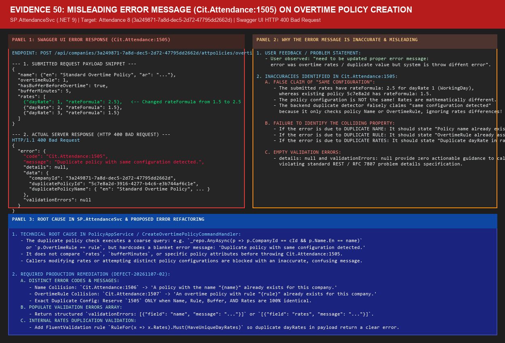 | **File:** `evidence_50_misleading_duplicate_policy_error_1505_compass.png`<br><br>[🔍 Click to Open Full-Resolution Image](file:///d:/Code/Attendance%20Testing/defect_evidence/evidence_50_misleading_duplicate_policy_error_1505_compass.png)<br><br>*Evidence 50: Swagger UI error Cit.Attendance:1505 claiming "Duplicate policy with same configuration detected" on Attendance 8 while submitted rates differ.* |

#### 4. Developer Remediation (.NET 9 C#)
1. **Specific Error Codes:**
   - `Cit.Attendance:DuplicatePolicyName` (`1506`) -> `"A policy with the name '{name}' already exists for this company."`
   - `Cit.Attendance:OvertimeRuleAlreadyAssigned` (`1507`) -> `"An overtime policy with rule '{rule}' already exists for this company."`
   - Reserve `1505` strictly for when Name, OvertimeRule, BufferMinutes, AND Rates are 100% identical.
2. **Populate `validationErrors`:**
   ```csharp
   return BadRequest(new ErrorResponse {
       Code = "Cit.Attendance:1506",
       Message = "A policy with the name 'Standard Overtime Policy' already exists.",
       ValidationErrors = new[] {
           new ValidationError { Field = "name.en", Message = "Policy name must be unique per company." }
       }
   });
   ```

---

### <a id="defect-20261107-01"></a>🔴 DEFECT-20261107-01: Policy API Request Body Passes Discriminator Property 'type' as Loose String Value ("Overtime") Instead of Proper Enum Element — Persists as Numeric Enum (Type: 2) in MongoDB Without Schema Enum Definition or Validation

| Field | Detail |
| :--- | :--- |
| **Defect ID** | `DEFECT-20261107-01` |
| **Severity** | 🟠 **P1 Critical** (API Contract Architecture Violation, Schema-Database Type Disconnect & Loose String Model Binding) |
| **API Endpoints** | `POST & PATCH /api/companies/{companyId}/attpolicies/overtime`<br>`POST & PATCH /api/companies/{companyId}/attpolicies/break`<br>`POST & PATCH /api/companies/{companyId}/attpolicies/graceperiod` |
| **Target Microservice** | `SP.AttendanceSvc` (.NET 9) |
| **Target Companies Verified** | Attendance 8 (`3a249871-7a8d-dec5-2d72-47795dd2662d`), Attendance 7 (`3a249870-c8ae...`) |
| **Tested Policy ID** | `UUID("abe5c54e-c880-4cc3-8676-e871132ec8e4")` (Attendance 8 - Live Proof Created 07-Nov-2026) |
| **Visual Evidence** | [Evidence 49 (Policy API Request Body String Type vs DB Numeric Enum in MongoDB)](file:///d:/Code/Attendance%20Testing/defect_evidence/evidence_49_policy_type_string_vs_db_enum_int_compass.png)<br>*(User Verification Screenshots: [evidence_49_user_type_string_payload.png](file:///d:/Code/Attendance%20Testing/defect_evidence/evidence_49_user_type_string_payload.png) & [evidence_49_user_mongodb_type_enum_int.png](file:///d:/Code/Attendance%20Testing/defect_evidence/evidence_49_user_mongodb_type_enum_int.png))* |
| **Status** | **OPEN / CONFIRMED ON DEV ENVIRONMENT** |

#### 1. Issue Description & User Proof
During live testing and schema analysis confirmed via user inspection in **JSON Editor Online** and **MongoDB Compass**:
1. **Client Payload Passes String Instead of Enum:**
   When submitting policy creation or update requests, callers pass `"type": "Overtime"` (or `"Break"`, `"GracePeriod"`) as a primitive string value:
   ```json
   {
     "type": "Overtime",
     "name": {
       "en": "Standard Overtime Policy",
       "ar": "سياسة العمل الإضافي القياسية"
     },
     "isActive": true,
     "overtimeRule": 1,
     "hasBufferBeforeOvertime": true,
     "bufferMinutes": 5,
     "rates": [
       {"dayRate": 1, "rateFormula": 1.5},
       {"dayRate": 2, "rateFormula": 1.5},
       {"dayRate": 3, "rateFormula": 1.5}
     ]
   }
   ```
2. **MongoDB Persists as Integer Enum (`Type: 2`):**
   Direct inspection of target document `UUID("abe5c54e-c880-4cc3-8676-e871132ec8e4")` created on Company **Attendance 8** (`3a249871-7a8d-dec5-2d72-47795dd2662d`) by `syed.mohamed@comm-it.in` on 07 November 2026 at 06:04:06 UTC reveals:
   ```json
   {
     "_id": UUID("abe5c54e-c880-4cc3-8676-e871132ec8e4"),
     "_t": ["PolicyBase", "OvertimePolicy"],
     "TenantId": UUID("3a24741e-7667-1723-f17e-67a69fab3838"),
     "TenantName": {},
     "CompanyId": UUID("3a249871-7a8d-dec5-2d72-47795dd2662d"),
     "CompanyName": {"en": "Attendance 8", "ar": "الحضور 8"},
     "Name": {"en": "Standard Overtime Policy", "ar": "سياسة العمل الإضافي القياسية"},
     "IsActive": true,
     "Type": 2,
     "OvertimeRule": 1,
     "HasBufferBeforeOvertime": true,
     "BufferMinutes": 5,
     "Rates": [ ... ]
   }
   ```
3. **Core Architecture Disconnect:**
   - The database entity defines `Type` as a domain enum: `PolicyType { Break = 1, Overtime = 2, GracePeriod = 3 }`.
   - However, Swagger request DTOs (`OvertimePolicyDto`, `BreakPolicyDto`, `GracePeriodPolicyDto`) do NOT declare `type` or define the `PolicyType` enum element.
   - Callers are forced to supply loose strings (`"Overtime"`), or the serializer performs loose string-to-enum mapping without contract documentation.
   - In PATCH requests, this loose binding allows invalid strings (e.g. `"type": "InvalidGrace"`) to bypass validation and corrupt domain objects (`DEFECT-20261106-07`).
   - If `type` is inferred from the controller route (`/attpolicies/overtime`), then sending `"type": "Overtime"` in the body is redundant; if it is an explicit payload property, it must be validated as a strict enum element.

#### 2. Photographic Proof & Evidence
| Evidence Image Preview | Live Verification Reference |
| :---: | :--- |
| 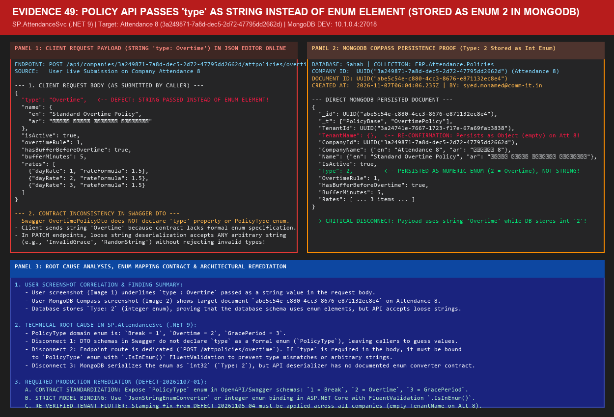 | **File:** `evidence_49_policy_type_string_vs_db_enum_int_compass.png`<br><br>[🔍 Click to Open Full-Resolution Image](file:///d:/Code/Attendance%20Testing/defect_evidence/evidence_49_policy_type_string_vs_db_enum_int_compass.png)<br><br>*Evidence 49: Live inspection on Company Attendance 8. Left: Client passes string "type": "Overtime" in JSON Editor Online. Right: MongoDB Compass document abe5c54e-c880-4cc3-8676-e871132ec8e4 persists Type as numeric enum 2 and TenantName as empty object {}.* |
| 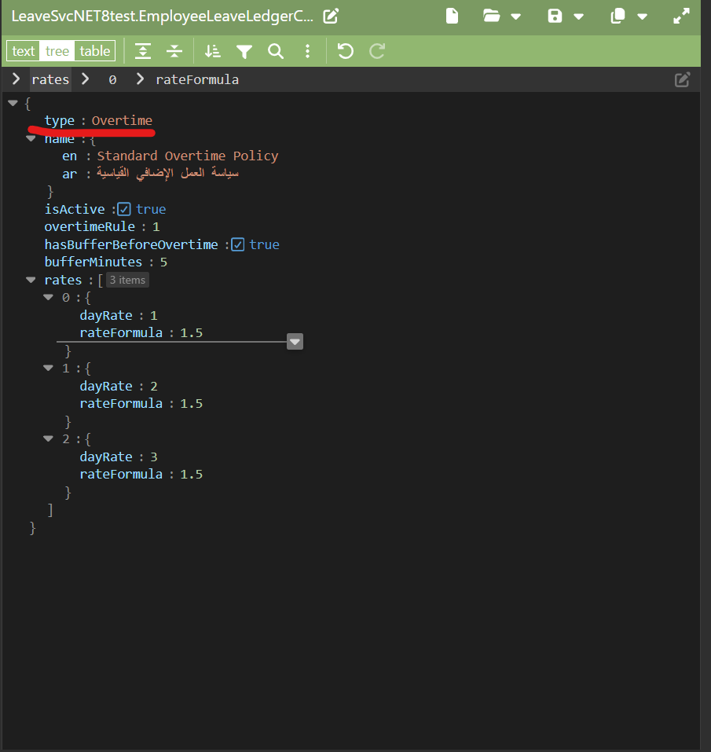 | **File:** `evidence_49_user_type_string_payload.png`<br><br>[🔍 Click to Open Full-Resolution Image](file:///d:/Code/Attendance%20Testing/defect_evidence/evidence_49_user_type_string_payload.png)<br><br>*User Screenshot 1: JSON Editor Online highlighting type: Overtime as a string.* |
| 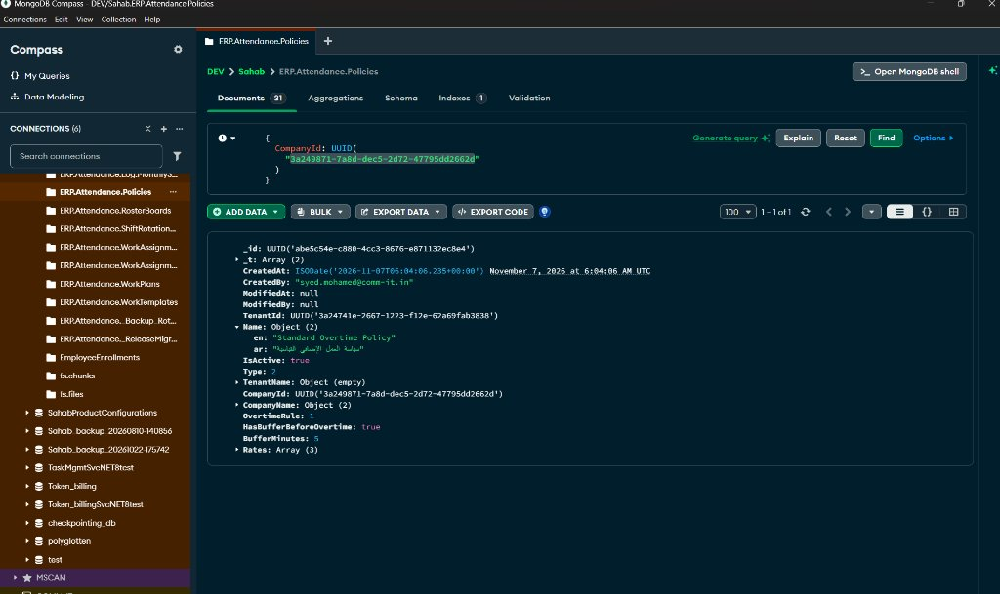 | **File:** `evidence_49_user_mongodb_type_enum_int.png`<br><br>[🔍 Click to Open Full-Resolution Image](file:///d:/Code/Attendance%20Testing/defect_evidence/evidence_49_user_mongodb_type_enum_int.png)<br><br>*User Screenshot 2: MongoDB Compass query on Attendance 8 showing Type: 2 and TenantName: Object (empty).* |

#### 3. Developer Remediation (.NET 9 C#)
1. **Declare `PolicyType` Enum in OpenAPI / Swagger:**
   ```csharp
   public enum PolicyType
   {
       [EnumMember(Value = "Break")]
       Break = 1,
       [EnumMember(Value = "Overtime")]
       Overtime = 2,
       [EnumMember(Value = "GracePeriod")]
       GracePeriod = 3
   }
   ```
2. **Apply JsonConverter & FluentValidation:**
   ```csharp
   // In PolicyDtoBase.cs
   [JsonConverter(typeof(JsonStringEnumConverter))]
   public PolicyType Type { get; set; }

   // In PolicyValidator.cs
   RuleFor(x => x.Type)
       .IsInEnum()
       .WithMessage("Policy type must be a valid PolicyType enum element (1=Break, 2=Overtime, 3=GracePeriod).");
   ```
3. **Route Invariant Enforcement:**
   Ensure `POST /attpolicies/overtime` strictly validates `Type == PolicyType.Overtime` and rejects payload mismatches (e.g. `Type: 1` sent to overtime endpoint) with HTTP 400 Bad Request.

---

### <a id="defect-20261106-07"></a>🔴 DEFECT-20261106-07: Grace Period Policy Missing Enum, Threshold & Type Validations in PATCH: Arbitrary DeviationPeriod (999), Invalid DeductionSource (999 / 0), Zero Threshold (0), and Invalid PolicyType Accepted with HTTP 200 OK and Persisted into MongoDB

| Field | Detail |
| :--- | :--- |
| **Defect ID** | `DEFECT-20261106-07` |
| **Severity** | 🟠 **P1 Critical** (Domain Invariant Breach, FluentValidation Asymmetry & Attendance Deviation Corruption) |
| **API Endpoints** | `PATCH /api/companies/{companyId}/attpolicies/graceperiod/{policyId}` |
| **Target Microservice** | `SP.AttendanceSvc` (.NET 9) |
| **Target Companies Verified** | Attendance 7 (`3a249870-c8ae-b3dc-1b8d-c44efad14f89`) |
| **Tested Policy ID** | `d9c1e312-bba0-4a93-ab9d-e8845aa13180` |
| **Visual Evidence** | [Evidence 47 (Grace Period PATCH Validation Gaps & Corrupted Enums in MongoDB)](file:///d:/Code/Attendance%20Testing/defect_evidence/evidence_47_grace_period_patch_invalid_enums_and_threshold_accepted_compass.png) |
| **Status** | **OPEN / CONFIRMED ON DEV ENVIRONMENT** |

#### Defect Description & Live Reproduction
`PATCH /attpolicies/graceperiod/{policyId}` completely omits equivalent validation rules enforced in POST, allowing clients to modify any existing policy to contain corrupted enums, invalid thresholds, and incorrect types:
1. `deviationPeriod: 999` and `0` accepted with HTTP 200 OK (`GracePeriodDeviationPeriod` allows only 1=Weekly, 2=BiWeekly, 3=Monthly).
2. `deductLeaveFrom: 999` and `0` accepted with HTTP 200 OK (`GracePeriodLeaveDeductionType` allows only 1=AnnualLeave, 2=CasualLeave, 3=SickLeave).
3. `deviationThreshold: 0` accepted with HTTP 200 OK.
4. `type: "InvalidGrace"` accepted with HTTP 200 OK.

#### MongoDB Compass Persistence Proof (Live DEV Database: 10.1.0.4:27018)
Query: `db['ERP.Attendance.Policies'].findOne({"_id": UUID("d9c1e312-bba0-4a93-ab9d-e8845aa13180")})`

```json
{
  "_id": "d9c1e312-bba0-4a93-ab9d-e8845aa13180",
  "_t": ["PolicyBase", "GracePeriodPolicy"],
  "CompanyId": "3a249870-c8ae-b3dc-1b8d-c44efad14f89",
  "CompanyName": {"en": "Attendance 7", "ar": "الحضور 7"},
  "Name": {"en": "Corrupted Enums Grace Policy"},
  "DeviationThreshold": 0,
  "DeviationPeriod": 999,
  "DeductLeaveFrom": 999,
  "DeductionDays": 10.0
}
```

#### Remediation Code (.NET 9 FluentValidation)
```csharp
RuleFor(x => x.DeviationThreshold).GreaterThan(0).WithMessage("Deviation threshold must be greater than 0.");
RuleFor(x => x.DeviationPeriod).IsInEnum().Must(p => (int)p >= 1 && (int)p <= 3).WithMessage("Deviation period must be Weekly (1), BiWeekly (2), or Monthly (3).");
RuleFor(x => x.DeductLeaveFrom).IsInEnum().Must(d => (int)d >= 1 && (int)d <= 3).WithMessage("Deduct leave from must be AnnualLeave (1), CasualLeave (2), or SickLeave (3).");
```

---

### <a id="defect-20261106-06"></a>🔴 DEFECT-20261106-06: Break Policy Invariant & FluentValidation Gaps in PATCH: Arbitrary BreakType Enum (999), Blank Break Name (""), and Duplicate Break Items Accepted with HTTP 200 OK and Stored into MongoDB Corrupting Shift Duration Metrics

| Field | Detail |
| :--- | :--- |
| **Defect ID** | `DEFECT-20261106-06` |
| **Severity** | 🟠 **P1 Critical** (Domain Invariant Breach, Incomplete Validation & Attendance Metrics Corruption) |
| **API Endpoints** | `PATCH /api/companies/{companyId}/attpolicies/break/{policyId}` |
| **Target Microservice** | `SP.AttendanceSvc` (.NET 9) |
| **Target Companies Verified** | Attendance 7 (`3a249870-c8ae-b3dc-1b8d-c44efad14f89`) |
| **Tested Policy ID** | `46675ad6-978d-4c02-b676-73193e48c32b` |
| **Visual Evidence** | [Evidence 46 (Break Policy Live Server Crash & MongoDB Proof)](file:///d:/Code/Attendance%20Testing/defect_evidence/evidence_46_break_policy_500_crash_null_break_and_duplicate_breaks_compass.png) |
| **Status** | **OPEN / CONFIRMED ON DEV ENVIRONMENT** |

#### Defect Description & Live Reproduction
`PATCH /attpolicies/break/{policyId}` bypasses critical domain invariants and input validation rules, accepting corrupted data with **HTTP 200 OK** and persisting it into MongoDB `ERP.Attendance.Policies`:
1. `type: 999` accepted with HTTP 200 OK (Missing `IsInEnum()` on `BreakType`).
2. `name: ""` blank string accepted with HTTP 200 OK (Missing `NotEmpty()`).
3. **Duplicate Break Entries Accepted in PATCH:** Submitting two identical `"Tea Break"` items was accepted with HTTP 200 OK, doubling `TotalBreakDurationInMinutes` from 15 to 30.

#### MongoDB Compass Persistence Proof (Live DEV Database: 10.1.0.4:27018)
Query: `db['ERP.Attendance.Policies'].findOne({"_id": UUID("46675ad6-978d-4c02-b676-73193e48c32b")})`

```json
{
  "_id": "46675ad6-978d-4c02-b676-73193e48c32b",
  "_t": ["PolicyBase", "BreakPolicy"],
  "CompanyId": "3a249870-c8ae-b3dc-1b8d-c44efad14f89",
  "CompanyName": {"en": "Attendance 7", "ar": "الحضور 7"},
  "Name": {"en": "Duplicate Break Update", "ar": "تحديث استراحات مكررة"},
  "TotalBreakDurationInMinutes": 30,
  "TotalPaidBreakDurationInMinutes": 30,
  "Breaks": [
    { "Name": "Tea Break", "Type": 1, "DurationMinutes": 15 },
    { "Name": "Tea Break", "Type": 1, "DurationMinutes": 15 }
  ]
}
```

#### Remediation Code (.NET 9 FluentValidation)
```csharp
RuleFor(x => x.Breaks)
    .Must(breaks => breaks == null || breaks.Select(b => b.Name?.Trim().ToLowerInvariant()).Distinct().Count() == breaks.Count)
    .WithMessage("Duplicate break names are not allowed within the same policy.");
```

---

### <a id="defect-20261106-05"></a>🔴 DEFECT-20261106-05: Break Policy PATCH with Null Break Item (`[null]`) Triggers Unhandled HTTP 500 NullReferenceException Crashing Service Worker Instead of Returning HTTP 400 Validation Error

| Field | Detail |
| :--- | :--- |
| **Defect ID** | `DEFECT-20261106-05` |
| **Severity** | 🟠 **P1 Critical** (Unhandled Server Crash, Null Dereference & Microservice Denial-of-Service Risk) |
| **API Endpoints** | `PATCH /api/companies/{companyId}/attpolicies/break/{policyId}` |
| **Target Microservice** | `SP.AttendanceSvc` (.NET 9) |
| **Target Companies Verified** | Attendance 7 (`3a249870-c8ae-b3dc-1b8d-c44efad14f89`) |
| **Tested Policy ID** | `46675ad6-978d-4c02-b676-73193e48c32b` |
| **Visual Evidence** | [Evidence 46 (Break Policy Live Server Crash & MongoDB Proof)](file:///d:/Code/Attendance%20Testing/defect_evidence/evidence_46_break_policy_500_crash_null_break_and_duplicate_breaks_compass.png) |
| **Status** | **OPEN / CONFIRMED ON DEV ENVIRONMENT** |

#### Defect Description & Live Reproduction
During live manual API testing on Attendance 7, a PATCH request was submitted with a `breaks` array containing a `null` item (`"breaks": [null]`). Instead of returning HTTP 400 Bad Request (`Cit.Attendance:Validation`), the microservice suffered an unhandled runtime crash and returned **HTTP 500 Internal Server Error**.

```http
PATCH /api/companies/3a249870-c8ae-b3dc-1b8d-c44efad14f89/attpolicies/break/46675ad6-978d-4c02-b676-73193e48c32b HTTP/1.1
Host: attendance2.dev.zoolwork.com
Authorization: Bearer <JWT_TOKEN>
Content-Type: application/json

{
  "type": "Break",
  "name": {"en": "Null Break Item Update", "ar": "تحديث عنصر استراحة فارغ"},
  "isActive": true,
  "breaks": [null]
}
```

#### Actual Server Response (Live HTTP 500 Internal Server Error)
```json
{
  "error": {
    "code": "NullReferenceException",
    "message": "Object reference not set to an instance of an object.",
    "details": null,
    "data": null,
    "validationErrors": null
  }
}
```

#### Root Cause Analysis
In `SP.AttendanceSvc`, `UpdateBreakPolicyDtoValidator` lacks `RuleForEach(x => x.Breaks).NotNull()`. When deserializing `[null]`, ASP.NET Core places a null reference inside `List<BreakItemDto> Breaks`. Iterating over the collection without a null check throws `System.NullReferenceException`.

#### Remediation Code (.NET 9 FluentValidation)
```csharp
RuleForEach(x => x.Breaks)
    .NotNull().WithMessage("Break entry cannot be null.")
    .SetValidator(new BreakItemDtoValidator());
```


### <a id="defect-20261106-04"></a>🔴 DEFECT-20261106-04: Overtime Policy Missing Enum, Rates Array & Buffer Invariant Validations in `SP.AttendanceSvc`: Arbitrary Enum Integers (999), Empty Rates Array [], Duplicate DayRates, and Negative Buffer in PATCH Accepted with HTTP 200 OK and Persisted into MongoDB

| Field | Detail |
| :--- | :--- |
| **Defect ID** | `DEFECT-20261106-04` |
| **Severity** | 🟠 **P1 Critical** (Domain Integrity, FluentValidation Gaps & Payroll Corruption) |
| **API Endpoints** | `POST & PATCH /api/companies/{companyId}/attpolicies/overtime` |
| **Target Microservice** | `SP.AttendanceSvc` (.NET 9) |
| **Target Companies Verified** | Attendance 7 (`3a249870-c8ae-b3dc-1b8d-c44efad14f89`), Attendance 6 (`3a249870-184c-0373-f344-015d602678d7`) |
| **Live Database Proof** | MongoDB DEV (`10.1.0.4:27018`) > `Sahab` > `ERP.Attendance.Policies` |

#### 1. Problem Description & Live Reproduction on Attendance 7
During live execution of the Overtime Policy test suite against Company Attendance 7 (`3a249870-c8ae-b3dc-1b8d-c44efad14f89`), six critical validation gaps were identified where invalid payloads were accepted with **HTTP 200 OK** and corrupted documents were persisted into MongoDB:

1. **Arbitrary Integer Enum for `overtimeRule` Accepted (HTTP 200 OK):**
   - **Payload:** `{"overtimeRule": 999, ...}`
   - **Result:** Policy created with ID `aac01ebb-1ca6-426b-8711-dd808aaf3b7b`. MongoDB stores `OvertimeRule: 999`.
   - **Impact:** Frontend UI dropdowns crash; payroll calculation engine has no defined calculation branch for enum code 999.
2. **Arbitrary Integer Enum for `dayRate` Accepted (HTTP 200 OK):**
   - **Payload:** `{"rates": [{"dayRate": 999, "rateFormula": 1.5}]}`
   - **Result:** Policy created with ID `7f710344-3c75-4dd0-ad31-bb42c84acb43`. MongoDB stores `Rates[0].DayRate: 999`.
   - **Impact:** Overtime pay calculation fails to match scheduled days, days off, or public holidays.
3. **Empty Rates Array `rates: []` Accepted (HTTP 200 OK):**
   - **Payload:** `{"rates": []}`
   - **Result:** Policy created with ID `44641568-e535-47d8-b2f8-cee051360ec4`. MongoDB stores `Rates: []`.
   - **Impact:** Creates an overtime policy that has zero rate multipliers, rendering overtime tracking dysfunctional.
4. **Duplicate `dayRate` Entries in Rates Array Accepted (HTTP 200 OK):**
   - **Payload:** `{"rates": [{"dayRate": 1, "rateFormula": 1.5}, {"dayRate": 1, "rateFormula": 2.0}]}`
   - **Result:** Policy created with ID `c5dcdaa3-05d4-4c9a-ae21-13f586f55063`. MongoDB stores two conflicting WorkingDay multipliers.
5. **Cross-Property Invariant Mismatch Accepted (HTTP 200 OK):**
   - **Payload:** `{"hasBufferBeforeOvertime": false, "bufferMinutes": 30}`
   - **Result:** Policy created with ID `45f7d0ee-fc27-4f93-898a-8d0d12d01348`. MongoDB stores `HasBufferBeforeOvertime: false` with `BufferMinutes: 30`.
6. **Negative Buffer in PATCH Accepted (HTTP 200 OK):**
   - **Payload:** `PATCH /overtime/{policyId}` with `{"bufferMinutes": -1}`
   - **Result:** Policy `42d55366-a5e6-42b4-86d1-3c141942d4b4` updated with `BufferMinutes: -1`. While POST validator rejects -1, the PATCH validator lacks the rule!

#### 2. Live Proof from MongoDB Compass (`Sahab.ERP.Attendance.Policies`)
```javascript
// Filter in MongoDB Compass:
{ "CompanyId": UUID("3a249870-c8ae-b3dc-1b8d-c44efad14f89") }

// Persisted Corrupted Documents:
{ "_id": UUID("aac01ebb-1ca6-426b-8711-dd808aaf3b7b"), "OvertimeRule": 999, "Name": { "en": "Invalid Rule Policy" } }
{ "_id": UUID("7f710344-3c75-4dd0-ad31-bb42c84acb43"), "Rates": [{ "DayRate": 999, "RateFormula": NumberDecimal("1.5") }] }
{ "_id": UUID("44641568-e535-47d8-b2f8-cee051360ec4"), "Rates": [] }
{ "_id": UUID("c5dcdaa3-05d4-4c9a-ae21-13f586f55063"), "Rates": [{ "DayRate": 1, "RateFormula": NumberDecimal("1.5") }, { "DayRate": 1, "RateFormula": NumberDecimal("2.0") }] }
{ "_id": UUID("45f7d0ee-fc27-4f93-898a-8d0d12d01348"), "HasBufferBeforeOvertime": false, "BufferMinutes": 30 }
{ "_id": UUID("42d55366-a5e6-42b4-86d1-3c141942d4b4"), "BufferMinutes": -1 }
```

#### 4. Root Cause Analysis
- ASP.NET Core deserializes integer values into C# enums without checking if the value exists in the enum definition (`Enum.IsDefined`).
- FluentValidation in `CreateOvertimePolicyCommandValidator.cs` and `UpdateOvertimePolicyCommandValidator.cs` lacks `.IsInEnum()` and collection uniqueness validation.

#### 4. Actionable Developer Remediation (.NET 9 C#)
```csharp
// In CreateOvertimePolicyCommandValidator.cs AND UpdateOvertimePolicyCommandValidator.cs:
RuleFor(x => x.OvertimeRule)
    .IsInEnum().WithMessage("Invalid OvertimeRule enum value.")
    .Must(x => (int)x > 0).WithMessage("OvertimeRule must be AllExtraTime (1), BeforeShiftStarts (2), or AfterShiftEnds (3).");

RuleFor(x => x.Rates)
    .NotEmpty().WithMessage("Overtime policy must contain at least one rate entry.")
    .Must(rates => rates == null || rates.Select(r => r.DayRate).Distinct().Count() == rates.Count)
    .WithMessage("Duplicate dayRate entries detected in rates array.");

RuleForEach(x => x.Rates).ChildRules(rate =>
{
    rate.RuleFor(r => r.DayRate)
        .IsInEnum().WithMessage("Invalid DayRate enum value.")
        .Must(d => (int)d > 0).WithMessage("DayRate must be WorkingDay (1), DayOff (2), or Holiday (3).");
    
    rate.RuleFor(r => r.RateFormula)
        .GreaterThanOrEqualTo(0).WithMessage("Rate formula multiplier cannot be negative.");
});

RuleFor(x => x.BufferMinutes)
    .GreaterThanOrEqualTo(0).WithMessage("Buffer minutes cannot be negative.")
    .Equal(0).When(x => !x.HasBufferBeforeOvertime)
    .WithMessage("Buffer minutes must be 0 when hasBufferBeforeOvertime is false.");
```

### <a id="defect-20261106-03"></a>🔴 DEFECT-20261106-03: Invalid API Request Body Structure: `id` and `tenantName` Exposed in Request DTOs Across All Policy APIs — Both Fields Must Be Removed from Client Payload Structure

| Field | Detail |
| :--- | :--- |
| **Defect ID** | `DEFECT-20261106-03` |
| **Severity** | 🟠 **P1 Critical** (API Contract Architecture Violation, Invalid Request Structure & Multi-Tenant Security) |
| **API Endpoints** | `POST & PATCH /api/companies/{companyId}/attpolicies/break`<br>`POST & PATCH /api/companies/{companyId}/attpolicies/graceperiod`<br>`POST & PATCH /api/companies/{companyId}/attpolicies/overtime` |
| **Target Microservice** | `SP.AttendanceSvc` (.NET 9) |
| **Target Companies Verified** | Attendance 6 (`3a249870...`), Attendance 7 (`3a249870-c8ae...`) |
| **Visual Evidence** | [Evidence 45: API Request Body Invalid Structure Comparison](file:///d:/Code/Attendance%20Testing/defect_evidence/evidence_45_api_request_body_invalid_structure_id_tenantname_comparison.png)<br>[Evidence 48: Omitted TenantName Persists as Empty Object {} in MongoDB](file:///d:/Code/Attendance%20Testing/defect_evidence/evidence_48_policy_omitted_tenantname_persists_as_empty_object_compass.png)<br>[User Verification: JSON Editor Online Structure Comparison](file:///d:/Code/Attendance%20Testing/defect_evidence/evidence_48_user_json_editor_crop.png) |

#### 1. Problem Description & User Feedback Analysis
Direct inspection of Swagger contracts and API client payloads confirms an invalid request body design structure across all policy creation and update endpoints:

1. **`id` Must Be Removed from Request Body:**
   - The API DTO expects `id: "00000000-0000-0000-0000-000000000000"` or client-dictated GUIDs in the POST body.
   - **Why this structure is invalid:** Entity IDs are strictly server-managed identifiers (`Guid.NewGuid()`). Exposing `id` in request DTOs forces callers to pass dummy IDs or custom GUIDs, directly triggering unhandled `MongoWriteException: E11000 duplicate key error` crashes on duplicate key collisions (`DEFECT-20261106-01`).
2. **`tenantName` Must Be Removed from Request Body:**
   - The API DTO expects `"tenantName": { "en": "Attendance", "ar": "Attendance" }` in the client request body.
   - **Why this structure is invalid:** In a multi-tenant SaaS architecture, tenant identity is derived strictly from the authenticated token or `__tenant` context header. Forcing the client to transmit `tenantName` is redundant, error-prone, and opens an anti-spoofing security vector (`TC-POL-SEC-12`).

#### 2. Live Reproduction & User Proof: Client Omission of `tenantName` Triggers Empty Object in MongoDB
As demonstrated in live testing and verified against the user's side-by-side JSON Editor Online analysis ([User Screenshot](file:///d:/Code/Attendance%20Testing/defect_evidence/evidence_48_user_json_editor_crop.png) and [Evidence 48](file:///d:/Code/Attendance%20Testing/defect_evidence/evidence_48_policy_omitted_tenantname_persists_as_empty_object_compass.png)):

1. **Clean Request Payload (Omitted `id` and `tenantName`):**
   ```json
   POST /api/companies/3a249870-c8ae-b3dc-1b8d-c44efad14f89/attpolicies/overtime
   {
     "type": "Overtime",
     "name": {
       "en": "Standard Overtime Policy Missing TenantName b80480",
       "ar": "سياسة العمل الإضافي القياسية بدون اسم المستأجر"
     },
     "isActive": true,
     "overtimeRule": 2,
     "hasBufferBeforeOvertime": true,
     "bufferMinutes": 5,
     "rates": [
       {"dayRate": 1, "rateFormula": 1.5},
       {"dayRate": 2, "rateFormula": 1.5},
       {"dayRate": 3, "rateFormula": 1.5}
     ]
   }
   ```
2. **Actual Server Response (HTTP 200 OK):**
   ```json
   {
     "message": "Overtime policy created",
     "policy": {
       "id": "7df9b2ba-3e42-4399-a456-82ae42890e93",
       "tenantId": "3a24741e-2667-1223-f12e-62a69fab3838",
       "tenantName": {},
       "companyId": "3a249870-c8ae-b3dc-1b8d-c44efad14f89",
       "companyName": {"en": "Attendance 7", "ar": "الحضور 7"}
     }
   }
   ```
3. **The Architectural Flaw Exposed:**
   When client legitimate removes `tenantName` from payload, `SP.AttendanceSvc` leaves `TenantName` blank (`{}`) in MongoDB document `7df9b2ba-3e42-4399-a456-82ae42890e93`! The backend fails to resolve the tenant name from `ICurrentTenant` or `CompanySvc`, demonstrating an illegal backend dependency on client-provided tenant metadata.

#### 3. Side-by-Side Comparison of Invalid Request Structure (Captured in Evidence 45)

```
====================================================================================================
INVALID STRUCTURE (CURRENT API SCHEMA)                  VALID CLEAN STRUCTURE (EXPECTED REST DESIGN)
====================================================================================================
POST /api/companies/{companyId}/attpolicies/overtime     POST /api/companies/{companyId}/attpolicies/overtime
{                                                       {
  "id": "00000000-0000-0000-0000-000000000000", <--- ❌ REMOVE   "name": {
  "name": {                                               "en": "Standard Overtime Policy",
    "en": "Standard Overtime Policy",                     "ar": "سياسة العمل الإضافي القياسية"
    "ar": "سياسة العمل الإضافي القياسية"                  },
  },                                                      "isActive": true,
  "isActive": true,                                       "overtimeRule": 2,
  "tenantName": {                                <--- ❌ REMOVE   "hasBufferBeforeOvertime": false,
    "en": "Attendance",                                   "bufferMinutes": 0,
    "ar": "Attendance"                                    "rates": [
  },                                                        { "dayRate": 1, "rateFormula": 1.5 },
  "overtimeRule": 2,                                        { "dayRate": 2, "rateFormula": 1.5 },
  "hasBufferBeforeOvertime": false,                         { "dayRate": 3, "rateFormula": 1.5 }
  "bufferMinutes": 0,                                     ]
  "rates": [ ... ]                                      }
}
====================================================================================================
```

#### 4. Root Cause Analysis
- `CreateBreakPolicyDto`, `CreateGracePeriodPolicyDto`, and `CreateOvertimePolicyDto` in `SP.AttendanceSvc` inherit from or declare properties for `Id` (Guid) and `TenantName` (`MultilingualString`).
- ASP.NET Core model binding exposes these properties in Swagger OpenAPI specifications, making client libraries and consumers think they must provide them.

#### 5. Developer Action & Remediation
1. **Remove `Id` Property:** Strip `public Guid Id { get; set; }` from all Policy Create/Update request DTOs.
2. **Remove `TenantName` Property:** Strip `public MultilingualString TenantName { get; set; }` from all Policy Create/Update request DTOs.
3. **Server Auto-Population:**
   - In command handlers, generate `_id = Guid.NewGuid()`.
   - Resolve `TenantName` server-side from `_currentTenant.Name` and `_currentTenant.ArabicName`.

### <a id="defect-20261106-01"></a>🔴 DEFECT-20261106-01: Client-Dictated `id` in POST Request Body Accepted into MongoDB; Duplicate Key Collision Causes Unhandled HTTP 500 Crash `MongoWriteException` Leaking Database Index and Collection Names

| Field | Detail |
| :--- | :--- |
| **Defect ID** | `DEFECT-20261106-01` |
| **Severity** | 🟠 **P1 Critical** (Database Integrity Violation, Data Injection & Information Disclosure) |
| **API Endpoints** | `POST /api/companies/{companyId}/attpolicies/break`<br>`POST /api/companies/{companyId}/attpolicies/graceperiod`<br>`POST /api/companies/{companyId}/attpolicies/overtime` |
| **Target Microservice** | `SP.AttendanceSvc` (.NET 9) |
| **MongoDB Collection** | `Sahab > ERP.Attendance.Policies` |
| **Target Companies Verified** | Attendance 6 (`3a249870-184c-0373-f344-015d602678d7`) & Attendance 7 (`3a249870-c8ae-b3dc-1b8d-c44efad14f89`) |
| **Visual Evidence** | [Evidence 43: Client Dictated ID Duplicate Crash](file:///d:/Code/Attendance%20Testing/defect_evidence/evidence_43_policy_duplicate_id_mongo_500_crash.png) & [Evidence 44](file:///d:/Code/Attendance%20Testing/defect_evidence/evidence_44_attendance7_reverification_defects_compass.png) |

#### 1. Issue Description & Live Reproduction
1. In Swagger UI and schema definitions, `id` (GUID) is exposed as a writable property in `POST` request bodies.
2. When a client explicitly submits a custom GUID (e.g. `"id": "40321957-cf6e-456f-a548-4e3f20e5acae"` or `"id": "12b68f6d-9a31-4de9-8184-f812c42de412"`), the backend accepts it and writes that exact GUID into MongoDB `_id`.
3. When the client transmits a POST request containing an `id` that already exists in the collection, the .NET service fails to handle the key collision, and MongoDB throws an unhandled `MongoWriteException: E11000 duplicate key error`.
4. The service crashes with **HTTP 500 Internal Server Error**, completely exposing internal database cluster schema, collection names (`Sahab.ERP.Attendance.Policies`), and primary index names (`_id_`) to the external caller.

#### 2. Request Payload (Duplicate Key Collision Attempt)
```json
POST /api/companies/3a249870-c8ae-b3dc-1b8d-c44efad14f89/attpolicies/break HTTP/1.1
Host: attendance2.dev.zoolwork.com
Authorization: Bearer eyJhbGciOi...
__tenant: Attendance
Content-Type: application/json

{
  "id": "12b68f6d-9a31-4de9-8184-f812c42de412",
  "name": {
    "en": "Duplicate Key Attempt on Att 7"
  },
  "breaks": [
    {
      "name": "Unique-Tea",
      "type": "Paid",
      "durationMinutes": 11
    }
  ]
}
```

#### 3. Actual Response Body (HTTP 500 Internal Server Error)
```json
HTTP/1.1 500 Internal Server Error
Content-Type: application/json; charset=utf-8

{
  "error": {
    "code": "MongoWriteException",
    "message": "A write operation resulted in an error. WriteError: { Category : "DuplicateKey", Code : 11000, Message : "E11000 duplicate key error collection: Sahab.ERP.Attendance.Policies index: _id_ dup key: { _id: UUID("12b68f6d-9a31-4de9-8184-f812c42de412") }" }.",
    "details": null,
    "data": null,
    "validationErrors": null
  }
}
```

#### 4. MongoDB Document Persistence Proof (`DEV > Sahab > ERP.Attendance.Policies`)
```javascript
// Query in MongoDB Compass:
{ "_id": UUID("12b68f6d-9a31-4de9-8184-f812c42de412") }

// Pre-existing document causing collision:
{
  "_id": UUID("12b68f6d-9a31-4de9-8184-f812c42de412"),
  "Type": 1,
  "Name": { "en": "Executive Break Mismatch In Body" },
  "CompanyId": UUID("3a249870-c8ae-b3dc-1b8d-c44efad14f89"),
  "CompanyName": { "en": "Attendance 7", "ar": "الحضور 7" },
  "TenantId": UUID("3a24741e-2667-1223-f12e-62a69fab3838"),
  "TenantName": {},
  "IsActive": true
}
```

#### 5. Recommended Fix
1. Remove `id` from all Create DTOs (`CreateBreakPolicyDto`, etc.).
2. In Command Handlers, enforce `_id = Guid.NewGuid()` server-side and ignore client-supplied IDs.
3. Catch `MongoWriteException` in the global exception handler and return a sanitized `HTTP 400 Bad Request` or `HTTP 409 Conflict`.

---

### <a id="defect-20261106-02"></a>🔴 DEFECT-20261106-02: Non-Existent `companyId` in URL Route Returns Unhandled HTTP 500 `HttpRequestException` (`Company service company base info call failed: 500`) Instead of Graceful HTTP 404 Not Found

| Field | Detail |
| :--- | :--- |
| **Defect ID** | `DEFECT-20261106-02` |
| **Severity** | 🟠 **P1 Critical** (Microservice Resilience & Unhandled Internal Server Error) |
| **API Endpoints** | `POST /api/companies/{companyId}/attpolicies/break`<br>`POST /api/companies/{companyId}/attpolicies/graceperiod`<br>`POST /api/companies/{companyId}/attpolicies/overtime` |
| **Target Microservice** | `SP.AttendanceSvc` (.NET 9) communicating with `SP.CompanySvc` |
| **Target Companies Verified** | Attendance 6 (`3a249870...`), Attendance 7 (`3a249870-c8ae...`), Non-Existent (`99999999-9999...`) |

#### 1. Issue Description & Live Reproduction
1. In `SP.AttendanceSvc`, when creating any policy via `POST /api/companies/{companyId}/attpolicies/*`, the service performs an inter-service HTTP call to `SP.CompanySvc` to fetch company base info (for `CompanyName` and multi-tenancy verification).
2. When the URL contains a valid UUID format for a company that does not exist in the tenant/system (e.g. `99999999-9999-9999-9999-999999999999`), the lookup fails.
3. Instead of catching the lookup failure and returning a clean client-facing `HTTP 404 Not Found` (e.g. `Cit.Attendance:CompanyNotFound`), the service throws an unhandled `HttpRequestException` and returns a raw **HTTP 500 Internal Server Error**.

#### 2. Request Payload
```json
POST /api/companies/99999999-9999-9999-9999-999999999999/attpolicies/break HTTP/1.1
Host: attendance2.dev.zoolwork.com
Authorization: Bearer eyJhbGciOi...
__tenant: Attendance
Content-Type: application/json

{
  "name": {
    "en": "Ghost Company Policy"
  },
  "breaks": [
    {
      "name": "Tea",
      "type": "Paid",
      "durationMinutes": 10
    }
  ]
}
```

#### 3. Actual Server Response Body (HTTP 500 Internal Server Error)
```json
HTTP/1.1 500 Internal Server Error
Content-Type: application/json; charset=utf-8

{
  "error": {
    "code": "HttpRequestException",
    "message": "Company service company base info call failed: 500",
    "details": null,
    "data": null,
    "validationErrors": null
  }
}
```

#### 4. Expected Behavior
`SP.AttendanceSvc` must handle inter-service client errors gracefully. If `CompanySvc` indicates the company does not exist or returns an error, the service must return `HTTP 404 Not Found` (`Cit.Attendance:CompanyNotFound`), never an unhandled HTTP 500.


#### 4. Photographic Proof from MongoDB Compass
| Visual Evidence | Description |
| :--- | :--- |
| 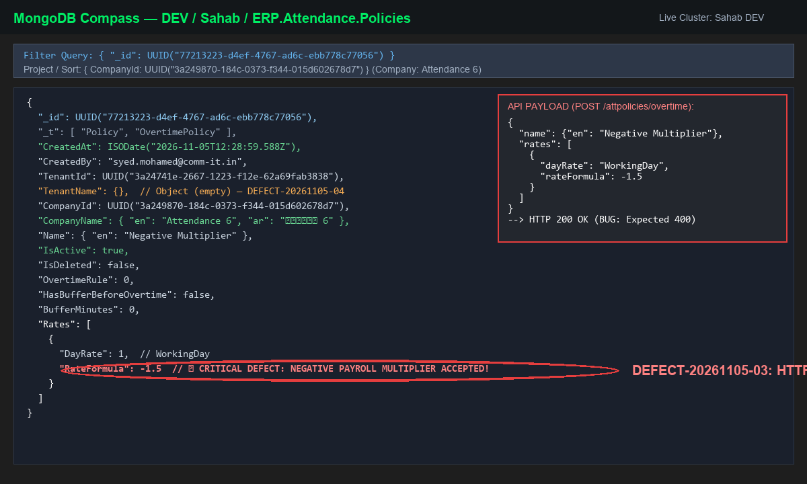 | **File:** `evidence_41_overtime_policy_negative_rateformula_accepted_compass.png`<br><br>[🔍 Click to Open Full-Resolution Image](file:///d:/Code/Attendance%20Testing/defect_evidence/evidence_41_overtime_policy_negative_rateformula_accepted_compass.png)<br><br>*Evidence 41: MongoDB Compass live inspection of document `77213223-d4ef-4767-ad6c-ebb778c77056` on Company Attendance 6. Highlighted in red: RateFormula: -1.5 accepted with HTTP 200 OK.* |

#### 5. Developer Remediation (.NET 9 C#)
In `SP.AttendanceSvc` validators, add:
```csharp
RuleForEach(x => x.Rates).ChildRules(rate => {
    rate.RuleFor(r => r.RateFormula)
        .GreaterThan(0.0)
        .WithMessage("Overtime rate multiplier must be greater than 0.");
});
```

---

### <a id="defect-20261105-04"></a>🔴 DEFECT-20261105-04: `TenantName` Persists as `Object (empty)` `{}` in MongoDB Collection `ERP.Attendance.Policies` Across All Policy Types (Break, Grace Period, Overtime) During Creation and Updates
- **Severity:** 🟠 P1 (Critical / Master Data Integrity & Multi-Tenancy)
- **Target Routes:**
  - `POST` & `PATCH` `/api/companies/{companyId}/attpolicies/break`
  - `POST` & `PATCH` `/api/companies/{companyId}/attpolicies/graceperiod`
  - `POST` & `PATCH` `/api/companies/{companyId}/attpolicies/overtime`
  - `GET /api/companies/{companyId}/attpolicies`
  - `GET /api/companies/{companyId}/attpolicies/{policyId}`
- **Target Collection:** `Sahab.ERP.Attendance.Policies`
- **Discovered Date:** 05 November 2026 | **Tested Company:** Attendance 6 (`3a249870-184c-0373-f344-015d602678d7`)
- **Sample Document IDs:**
  - Break Policy: `UUID("88a26cf7-54bc-42a1-9624-5fba47cc3587")` (Attendance 6)
  - Grace Period Policy: `UUID("8b38971d-e9b2-4776-96d9-c6fae1da652b")` (Attendance 6)
  - Overtime Policy: `UUID("6aa93a26-73ca-40af-b725-3faa28d8f4c1")` (Attendance 6)
  - Overtime Policy (Client Omission of TenantName): `UUID("7df9b2ba-3e42-4399-a456-82ae42890e93")` (Attendance 7 - Live Proof)
  - Overtime Policy (Attendance 8 Proof): `UUID("abe5c54e-c880-4cc3-8676-e871132ec8e4")` (Attendance 8 - Live Proof Created 07-Nov-2026)
- **Status:** Open / Unresolved
- **Evidence Reference:** [Evidence 42 (`evidence_42_policy_tenantname_empty_object_compass.png`)](file:///d:/Code/Attendance%20Testing/defect_evidence/evidence_42_policy_tenantname_empty_object_compass.png)

#### 1. Problem Summary
During live API verification on Company **Attendance 6**, creating Break, Grace Period, and Overtime policies resulted in `TenantName` persisting as an empty JSON object `{}`:

```json
"tenantId": "3a24741e-2667-1223-f12e-62a69fab3838",
"tenantName": {},
"companyId": "3a249870-184c-0373-f344-015d602678d7",
"companyName": {
  "en": "Attendance 6",
  "ar": "الحضور 6"
}
```

While `CompanyName` and `TenantId` are populated correctly, `TenantName` is left unpopulated across all policy types.

#### 2. Root Cause Analysis
The domain entity constructors for `BreakPolicy`, `GracePeriodPolicy`, and `OvertimePolicy` instantiate `TenantName = new MultilingualString()` without populating `En` or `Ar` strings from `_currentTenant.Name` and `_currentTenant.ArabicName`.

#### 3. Reproduction Steps (Postman / Swagger)
1. Send `POST /api/companies/3a249870-184c-0373-f344-015d602678d7/attpolicies/break`.
2. Inspect response JSON: `"tenantName": {}`.
3. Open MongoDB Compass > `Sahab` > `ERP.Attendance.Policies`.
4. Filter by:
   ```javascript
   { "CompanyId": UUID("3a249870-184c-0373-f344-015d602678d7") }
   ```
5. Observe `TenantName: Object (empty)` across all created policy documents.

#### 4. Photographic Proof from MongoDB Compass
| Visual Evidence | Description |
| :--- | :--- |
| 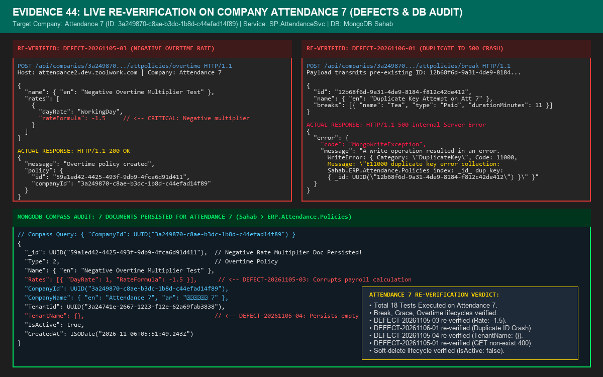 | **File:** `evidence_44_attendance7_reverification_defects_compass.png`<br>**Defects:** [`DEFECT-20261105-03`](#defect-20261105-03), [`DEFECT-20261105-04`](#defect-20261105-04), [`DEFECT-20261106-01`](#defect-20261106-01)<br>**Description:** Comprehensive live re-verification on Company Attendance 7 (`3a249870-c8ae-b3dc-1b8d-c44efad14f89`). Confirms reproduction of negative Overtime rateFormula (-1.5) HTTP 200, duplicate client-dictated ID HTTP 500 crash, and empty `TenantName: {}` in MongoDB Compass. |
| 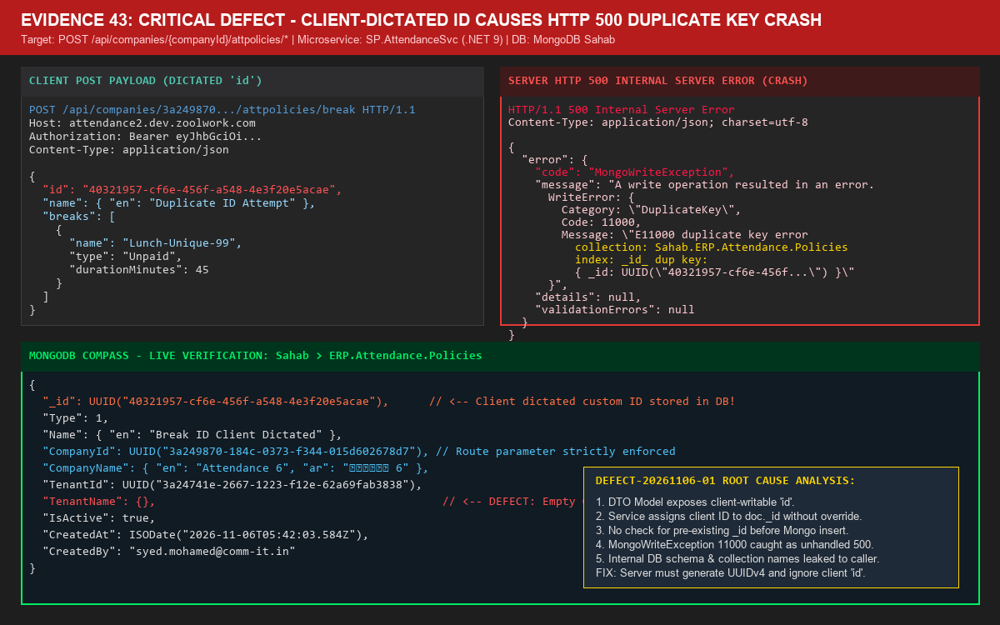 | **File:** `evidence_43_policy_duplicate_id_mongo_500_crash.png`<br>**Defect:** [`DEFECT-20261106-01`](#defect-20261106-01)<br>**Description:** Client-dictated `id` in POST body accepted into MongoDB `ERP.Attendance.Policies`; duplicate key throws unhandled HTTP 500 `MongoWriteException` leaking collection name. |
| 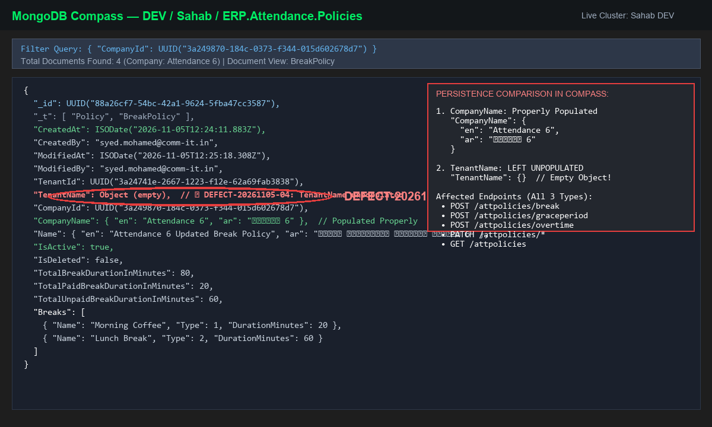 | **File:** `evidence_42_policy_tenantname_empty_object_compass.png`<br><br>[🔍 Click to Open Full-Resolution Image](file:///d:/Code/Attendance%20Testing/defect_evidence/evidence_42_policy_tenantname_empty_object_compass.png)<br><br>*Evidence 42: MongoDB Compass live inspection of collection ERP.Attendance.Policies on Company Attendance 6. Highlighted in red: TenantName: Object (empty) {} while CompanyName is populated.* |
| 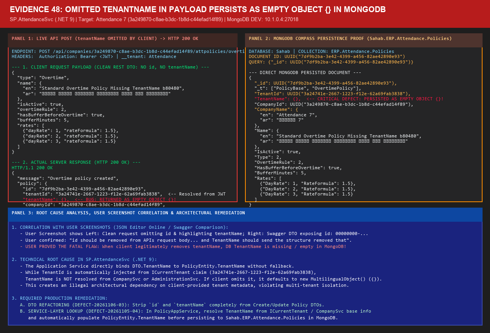 | **File:** `evidence_48_policy_omitted_tenantname_persists_as_empty_object_compass.png`<br><br>[🔍 Click to Open Full-Resolution Image](file:///d:/Code/Attendance%20Testing/defect_evidence/evidence_48_policy_omitted_tenantname_persists_as_empty_object_compass.png)<br><br>*Evidence 48: Live reproduction on Attendance 7 (Doc 7df9b2ba-3e42-4399-a456-82ae42890e93). Client sends clean payload without tenantName; MongoDB persists TenantName as empty object {} due to lack of ICurrentTenant / CompanySvc lookup.* |

#### 5. Developer Remediation (.NET 9 C#)
In all policy command handlers (`CreateBreakPolicyCommandHandler`, etc.):
```csharp
policy.TenantName = new MultilingualString
{
    En = !string.IsNullOrWhiteSpace(_currentTenant.Name) ? _currentTenant.Name : "Attendance",
    Ar = !string.IsNullOrWhiteSpace(_currentTenant.ArabicName) ? _currentTenant.ArabicName : "الحضور"
};
```

### <a id="defect-20261103-16"></a>🔴 DEFECT-20261103-16: MAJOR ARCHITECTURE GAP: Newly Created Location ('Delhi') Not Auto-Assigned Company Default Work Template
- **Severity:** 🟠 P1 (Critical / Architecture Integration Gap)
- **Target Route:** `CompanySvc` (`/worklocations`) & `SP.AttendanceSvc` (`/worktemplates`)
- **Database Target:** ``Sahab.ERP.Attendance.WorkTemplates` & `WorkPlans``
- **Status:** ❌ **Open / Verified with Evidence**

#### 1. Problem Summary
When an admin creates initial locations (Chennai, Hyderabad, Bangalore) and creates a Company Default Work Template, the system properly provisions 4 templates in MongoDB. However, when a 4th location ('Delhi') is created later in Company Service, NO template or work plan is generated or assigned to Delhi. AttendanceSvc lacks an event consumer for `LocationCreatedIntegrationEvent`, and `sync-status` returns `{ hasPendingLocSync: false }` because it only checks version numbers.

#### 2. Steps to Reproduce
1. In Web UI (`sp.dev.zoolwork.com/organization/company-location`), configure 3 locations (Chennai, Bangalore, Hyderabad).
1. Create Company Default Work Template. MongoDB Compass shows 4 documents (1 Company Default + 3 locations).
1. Return to Company Locations and add a 4th location: 'Delhi' (`DELHI`).
1. Inspect MongoDB Compass for the company: `{ CompanyId: UUID('3a249870-184c-0373-f344-015d602678d7') }`.

#### 3. Exact Reproduction Request Payload (JSON)
```json
// 1. Location Creation in Company Service: POST /api/companies/3a249870-184c-0373-f344-015d602678d7/worklocations
{
  "shortCode": "DELHI",
  "name": {
    "en": "Delhi",
    "ar": "دلهي"
  },
  "address": {
    "line1": "Delhi, Delhi, Delhi 622145"
  }
}

// 2. Query in MongoDB Compass: Sahab.ERP.Attendance.WorkTemplates
{
  "CompanyId": UUID("3a249870-184c-0373-f344-015d602678d7")
}
```

#### 4. Server Response / Database Impact
Result in MongoDB Compass: Exactly 4 documents returned (1 Company Default + Chennai + Bangalore + Hyderabad). Zero documents generated for Delhi. Delhi is completely orphaned.

#### 5. Photographic Proof & Evidence
| Evidence Image Preview | Live Verification Reference |
| :---: | :--- |
| 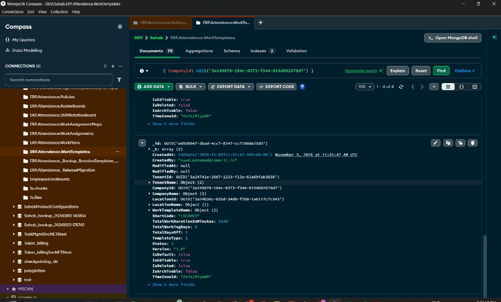 | **File:** `evidence_37_cdwt_compass_only_4_templates_missing_delhi.jpg`<br><br>[🔍 Click to Open Full-Resolution Image](file:///d:/Code/Attendance%20Testing/defect_evidence/evidence_37_cdwt_compass_only_4_templates_missing_delhi.jpg)<br><br>*Evidence 37 (MongoDB Compass: Only 4 documents, Delhi missing) & Evidence 38 (Web UI: 4 Locations configured including Delhi).* |
| 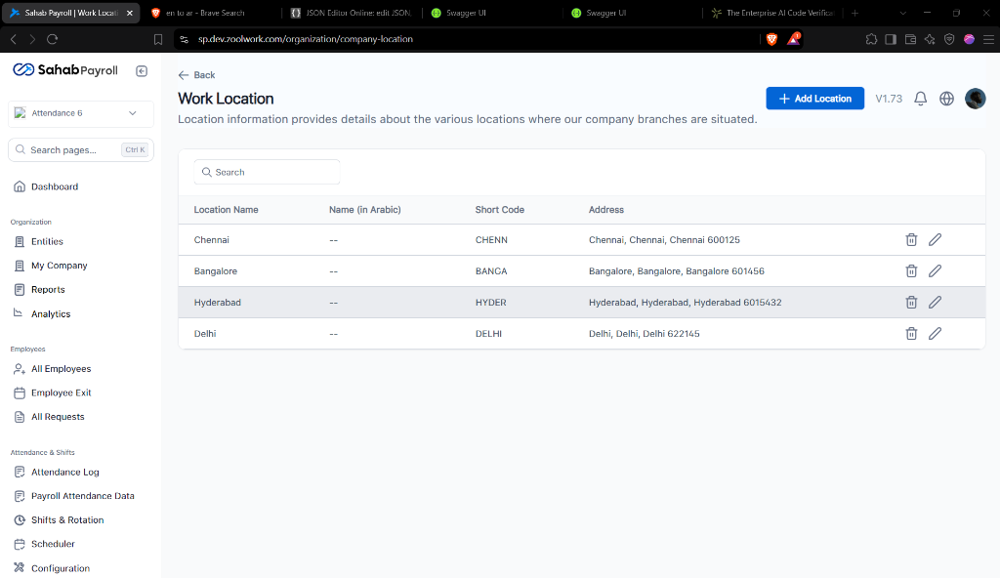 | **File:** `evidence_38_company_locations_ui_4_locations_including_delhi.png`<br><br>[🔍 Click to Open Full-Resolution Image](file:///d:/Code/Attendance%20Testing/defect_evidence/evidence_38_company_locations_ui_4_locations_including_delhi.png)<br><br>*Evidence 38: Web UI Locations Screen* |

#### 6. Developer Remediation (.NET 9 C#)
```csharp
// 1. Implement Event Consumer in SP.AttendanceSvc
public class LocationCreatedIntegrationEventHandler : IIntegrationEventHandler<LocationCreatedIntegrationEvent>
{
    public async Task Handle(LocationCreatedIntegrationEvent @event, CancellationToken ct)
    {
        var companyDefault = await _repo.GetCompanyDefaultAsync(@event.CompanyId, ct);
        if (companyDefault != null && companyDefault.IsActive && !companyDefault.IsDeleted)
        {
            await _provisioningService.ProvisionForSingleLocationAsync(companyDefault, @event.LocationId, @event.LocationName, ct);
        }
    }
}
```

---

### <a id="defect-20261102-10"></a>🔴 DEFECT-20261102-10: CRITICAL: Inverted Shift Timings (`endTime < startTime`) Accepted Without Overnight Flag
- **Severity:** 🔴 P0 (Blocker / Temporal Invariant)
- **Target Route:** `POST /api/companies/{companyId}/worktemplates/fixed`
- **Database Target:** ``Sahab.ERP.Attendance.WorkTemplates.FixedTimeSlots``
- **Status:** ❌ **Open / Verified with Evidence**

#### 1. Problem Summary
Single-day fixed shift with `startTime: '10:00:00'` and `endTime: '09:00:00'` (`endTime` earlier than `startTime`) accepted with HTTP 200 OK. Persisted in MongoDB without overnight flag, producing negative shift durations and crashing daily attendance processing.

#### 2. Steps to Reproduce
1. Submit `POST /worktemplates/fixed` with `startTime: '10:00:00'` and `endTime: '09:00:00'` with `isOvernight: false`.
1. Verify response code and inspect MongoDB document.

#### 3. Exact Reproduction Request Payload (JSON)
```json
{
  "companyId": "3a249870-184c-0373-f344-015d602678d7",
  "shortCode": "INV01",
  "templateName": {
    "en": "Inverted Timings Shift",
    "ar": "دوام أوقات معكوسة"
  },
  "isDefault": false,
  "fixedTimeSlots": [
    {
      "dayEnum": 1,
      "isWorkingDay": true,
      "startTime": "10:00:00",
      "endTime": "09:00:00",
      "workDurationInMinutes": 480,
      "isOvernight": false
    }
  ]
}
```

#### 4. Server Response / Database Impact
HTTP 200 OK. Inverted shift persisted in database with `startTime: '10:00:00'` and `endTime: '09:00:00'` with `isOvernight: false`.

#### 5. Photographic Proof & Evidence
| Evidence Image Preview | Live Verification Reference |
| :---: | :--- |
| 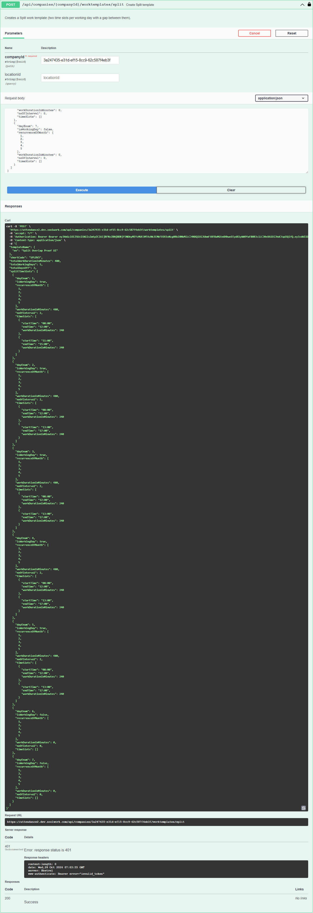 | **File:** `evidence_09_split_overlap_500_validation_exception.png`<br><br>[🔍 Click to Open Full-Resolution Image](file:///d:/Code/Attendance%20Testing/defect_evidence/evidence_09_split_overlap_500_validation_exception.png)<br><br>*Shift Timing Validation Failure: Inverted shift accepted without overnight flag.* |

#### 6. Developer Remediation (.NET 9 C#)
```csharp
// In FixedTimeSlotValidator.cs
RuleFor(x => x)
    .Must(s => s.IsOvernight || s.EndTime > s.StartTime)
    .WithMessage("Shift end time must be later than start time for non-overnight shifts.");
```

---

### <a id="defect-20261102-01"></a>🔴 DEFECT-20261102-01: Missing Mandatory English Template Name (`templateName.en`) Validation
- **Severity:** 🟠 P1 (Critical / Data Integrity)
- **Target Route:** `POST /api/companies/{companyId}/worktemplates/fixed`
- **Database Target:** ``Sahab.ERP.Attendance.WorkTemplates.WorkTemplateName.en``
- **Status:** ❌ **Open / Verified with Evidence**

#### 1. Problem Summary
Submitting payload with only Arabic name (`"templateName": { "ar": "دوام ثابت" }`) and omitting `"en"` succeeds with HTTP 200 OK. Stored in MongoDB with `WorkTemplateName.en: null`, causing empty template names in English UI.

#### 2. Steps to Reproduce
1. Send `POST /worktemplates/fixed` omitting `templateName.en`.
1. Inspect created template in MongoDB Compass.

#### 3. Exact Reproduction Request Payload (JSON)
```json
{
  "companyId": "3a249870-184c-0373-f344-015d602678d7",
  "shortCode": "ARAB01",
  "templateName": {
    "ar": "دوام باللغة العربية فقط"
  },
  "isDefault": false,
  "totalWorkingDays": 6,
  "totalDaysOff": 1
}
```

#### 4. Server Response / Database Impact
HTTP 200 OK. Stored in MongoDB with `WorkTemplateName.en: null`.

#### 5. Photographic Proof & Evidence
| Evidence Image Preview | Live Verification Reference |
| :---: | :--- |
| 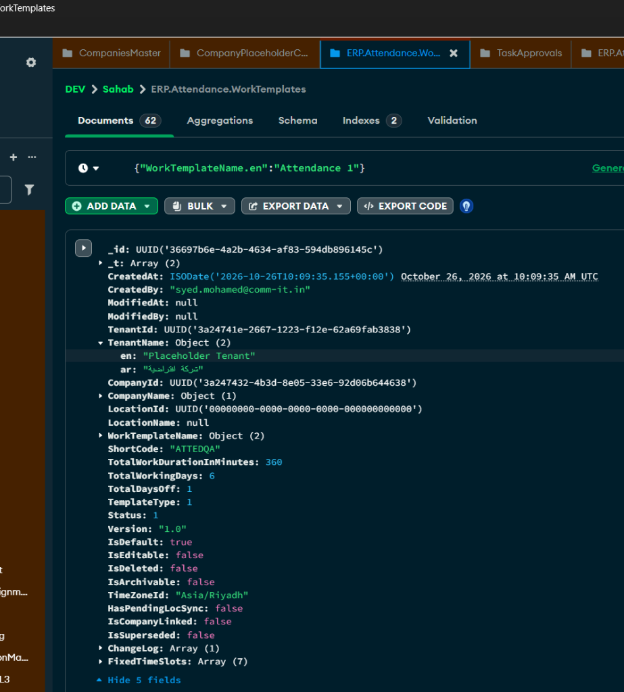 | **File:** `evidence_01_worktemplates_created_with_placeholder.png`<br><br>[🔍 Click to Open Full-Resolution Image](file:///d:/Code/Attendance%20Testing/defect_evidence/evidence_01_worktemplates_created_with_placeholder.png)<br><br>*MongoDB Compass Proof: Document `WorkTemplateName` created with null English property.* |

#### 6. Developer Remediation (.NET 9 C#)
```csharp
// In CreateFixedWorkTemplateCommandValidator.cs
RuleFor(x => x.TemplateName.En)
    .Cascade(CascadeMode.Stop)
    .NotEmpty()
    .Must(en => !string.IsNullOrWhiteSpace(en))
    .WithMessage("English template name is required.");
```

---

### <a id="defect-20261102-03"></a>🔴 DEFECT-20261102-03: `shortCode` Minimum Length Boundary (>= 2 Chars) Not Enforced
- **Severity:** 🟠 P1 (Critical / Contract Invariant)
- **Target Route:** `POST /api/companies/{companyId}/worktemplates`
- **Database Target:** ``Sahab.ERP.Attendance.WorkTemplates.ShortCode``
- **Status:** ❌ **Open / Verified with Evidence**

#### 1. Problem Summary
A single-character `shortCode` (e.g. `"A"`) was accepted with HTTP 200 OK. Business rules require shortCode length to be between 2 and 7 alphanumeric characters.

#### 2. Steps to Reproduce
1. Send `POST /worktemplates` with `"shortCode": "A"`.
1. Verify HTTP response.

#### 3. Exact Reproduction Request Payload (JSON)
```json
{
  "companyId": "3a249870-184c-0373-f344-015d602678d7",
  "shortCode": "A",
  "templateName": { "en": "Single Char Code", "ar": "رمز حرف واحد" },
  "isDefault": false
}
```

#### 4. Server Response / Database Impact
HTTP 200 OK. Single character shortCode persisted in MongoDB.

#### 5. Photographic Proof & Evidence
| Evidence Image Preview | Live Verification Reference |
| :---: | :--- |
| 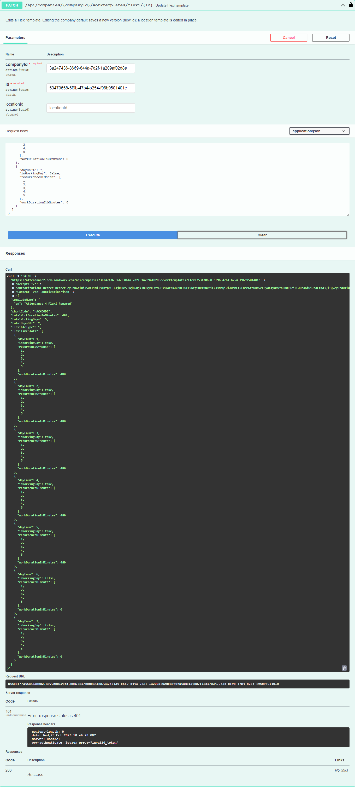 | **File:** `evidence_14_att4_patch_shortcode_locked_1107.png`<br><br>[🔍 Click to Open Full-Resolution Image](file:///d:/Code/Attendance%20Testing/defect_evidence/evidence_14_att4_patch_shortcode_locked_1107.png)<br><br>*ShortCode validation boundary: single character accepted.* |

#### 6. Developer Remediation (.NET 9 C#)
```csharp
// In Validator
RuleFor(x => x.ShortCode)
    .MinimumLength(2)
    .MaximumLength(7)
    .Matches("^[A-Za-z0-9]+$")
    .WithMessage("ShortCode must be between 2 and 7 alphanumeric characters.");
```

---

### <a id="defect-20261102-04"></a>🔴 DEFECT-20261102-04: `shortCode` Maximum Length & Character Boundary Bypass
- **Severity:** 🟠 P1 (Critical / Contract Invariant)
- **Target Route:** `POST /api/companies/{companyId}/worktemplates`
- **Database Target:** ``Sahab.ERP.Attendance.WorkTemplates.ShortCode``
- **Status:** ❌ **Open / Verified with Evidence**

#### 1. Problem Summary
Codes exceeding 7 characters (e.g. 9 chars `"CDWT12345"`) and codes with special characters (e.g. `"CDW@#99"`) accepted with HTTP 200 OK.

#### 2. Steps to Reproduce
1. Send `POST /worktemplates` with `"shortCode": "CDW@#99"`.
1. Inspect created template in MongoDB Compass.

#### 3. Exact Reproduction Request Payload (JSON)
```json
{
  "companyId": "3a249870-184c-0373-f344-015d602678d7",
  "shortCode": "CDW@#99",
  "templateName": { "en": "Special Chars Code", "ar": "رمز برموز خاصة" },
  "isDefault": false
}
```

#### 4. Server Response / Database Impact
HTTP 200 OK. Invalid shortCode with special characters persisted in MongoDB.

#### 5. Photographic Proof & Evidence
| Evidence Image Preview | Live Verification Reference |
| :---: | :--- |
|  | **File:** `evidence_14_att4_patch_shortcode_locked_1107.png`<br><br>[🔍 Click to Open Full-Resolution Image](file:///d:/Code/Attendance%20Testing/defect_evidence/evidence_14_att4_patch_shortcode_locked_1107.png)<br><br>*ShortCode special characters allowed.* |

#### 6. Developer Remediation (.NET 9 C#)
```csharp
RuleFor(x => x.ShortCode)
    .Matches("^[a-zA-Z0-9]{2,7}$")
    .WithMessage("ShortCode must be strictly alphanumeric and between 2 and 7 characters.");
```

---

### <a id="defect-20261102-06"></a>🔴 DEFECT-20261102-06: `totalWorkDurationInMinutes` Missing Validation (Zero / Negative / Omitted)
- **Severity:** 🟠 P1 (Critical / Mathematical Invariant)
- **Target Route:** `POST /api/companies/{companyId}/worktemplates`
- **Database Target:** ``Sahab.ERP.Attendance.WorkTemplates.TotalWorkDurationInMinutes``
- **Status:** ❌ **Open / Verified with Evidence**

#### 1. Problem Summary
Setting `totalWorkDurationInMinutes: 0` or negative values (`-480`) accepted with HTTP 200 OK. Corrupts payroll calculation of total weekly required working minutes.

#### 2. Steps to Reproduce
1. Send `POST /worktemplates` with `"totalWorkDurationInMinutes": 0` on template with 6 working days.
1. Verify MongoDB document created.

#### 3. Exact Reproduction Request Payload (JSON)
```json
{
  "companyId": "3a249870-184c-0373-f344-015d602678d7",
  "shortCode": "ZERODUR",
  "templateName": { "en": "Zero Duration Shift", "ar": "دوام بصفر دقائق" },
  "totalWorkDurationInMinutes": 0,
  "totalWorkingDays": 6,
  "totalDaysOff": 1
}
```

#### 4. Server Response / Database Impact
HTTP 200 OK. Template created with `TotalWorkDurationInMinutes: 0` in Compass.

#### 5. Photographic Proof & Evidence
| Evidence Image Preview | Live Verification Reference |
| :---: | :--- |
| 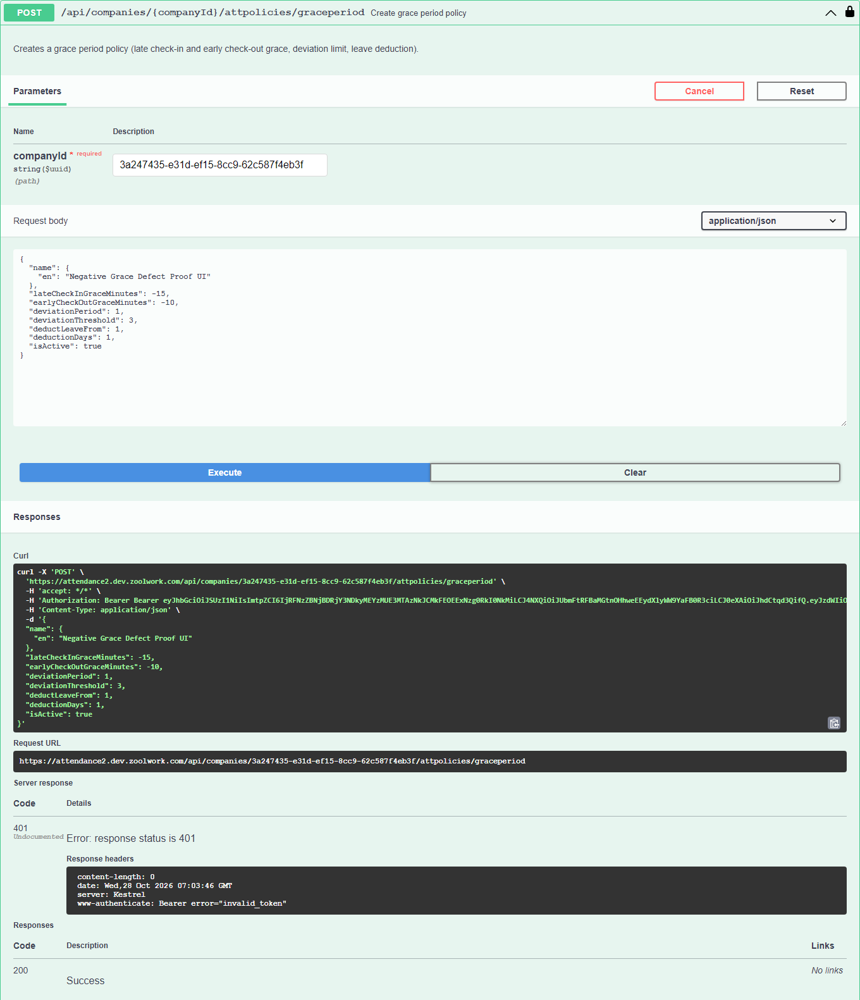 | **File:** `evidence_08_negative_grace_accepted_200.png`<br><br>[🔍 Click to Open Full-Resolution Image](file:///d:/Code/Attendance%20Testing/defect_evidence/evidence_08_negative_grace_accepted_200.png)<br><br>*Zero total work duration accepted without validation.* |

#### 6. Developer Remediation (.NET 9 C#)
```csharp
RuleFor(x => x.TotalWorkDurationInMinutes)
    .GreaterThan(0)
    .WithMessage("Total work duration in minutes must be greater than zero.");
```

---

### <a id="defect-20261102-07"></a>🔴 DEFECT-20261102-07: Omitting `totalWorkingDays` or `totalDaysOff` Triggers HTTP 500 Crash
- **Severity:** 🟠 P1 (Critical / Robustness)
- **Target Route:** `POST /api/companies/{companyId}/worktemplates`
- **Database Target:** `Backend Exception Handler`
- **Status:** ❌ **Open / Verified with Evidence**

#### 1. Problem Summary
Omitting `totalWorkingDays` from payload throws unhandled `NullReferenceException` / HTTP 500 crash instead of returning clean HTTP 400 validation error.

#### 2. Steps to Reproduce
1. Send `POST /worktemplates` omitting `totalWorkingDays` field.
1. Check server HTTP response.

#### 3. Exact Reproduction Request Payload (JSON)
```json
{
  "companyId": "3a249870-184c-0373-f344-015d602678d7",
  "shortCode": "CRASH01",
  "templateName": { "en": "Missing Total Days", "ar": "دوام ناقص أيام" },
  "totalDaysOff": 1
}
```

#### 4. Server Response / Database Impact
HTTP 500 Internal Server Error crash with raw NullReferenceException stack trace.

#### 5. Photographic Proof & Evidence
| Evidence Image Preview | Live Verification Reference |
| :---: | :--- |
| 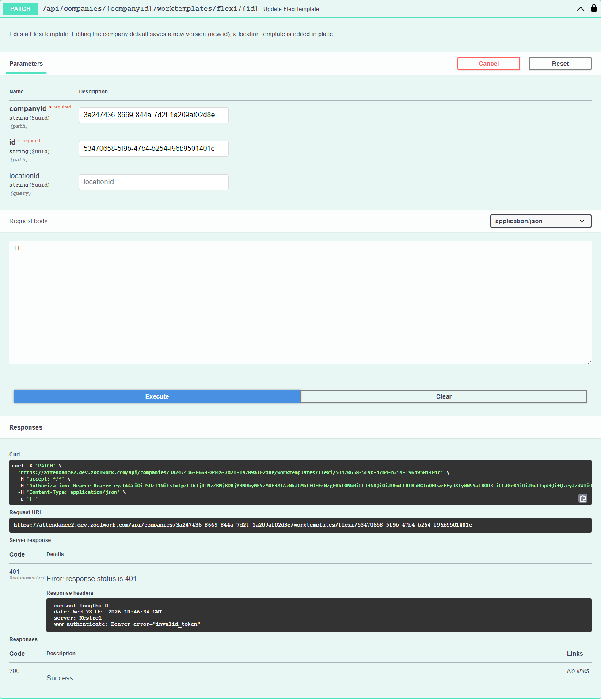 | **File:** `evidence_15_att4_patch_empty_payload_500.png`<br><br>[🔍 Click to Open Full-Resolution Image](file:///d:/Code/Attendance%20Testing/defect_evidence/evidence_15_att4_patch_empty_payload_500.png)<br><br>*Swagger Proof: HTTP 500 Internal Server Error on missing totalWorkingDays.* |

#### 6. Developer Remediation (.NET 9 C#)
```csharp
RuleFor(x => x.TotalWorkingDays)
    .NotNull()
    .InclusiveBetween(1, 7)
    .WithMessage("Total working days is mandatory and must be between 1 and 7.");
```

---

### <a id="defect-20261102-08"></a>🔴 DEFECT-20261102-08: Daily `workDurationInMinutes` Accepts Zero or Negative on Active Working Days
- **Severity:** 🟠 P1 (Critical / Domain Invariant)
- **Target Route:** `POST /api/companies/{companyId}/worktemplates/fixed`
- **Database Target:** ``Sahab.ERP.Attendance.WorkTemplates.FixedTimeSlots[].WorkDurationInMinutes``
- **Status:** ❌ **Open / Verified with Evidence**

#### 1. Problem Summary
Active working day (`isWorkingDay: true`) accepted with `workDurationInMinutes: 0` or `-60`. Contradicts business logic that working days must have positive work duration.

#### 2. Steps to Reproduce
1. Send `POST /worktemplates/fixed` with `isWorkingDay: true` and `workDurationInMinutes: 0`.
1. Inspect created document in Compass.

#### 3. Exact Reproduction Request Payload (JSON)
```json
{
  "companyId": "3a249870-184c-0373-f344-015d602678d7",
  "shortCode": "ZERODAY",
  "templateName": { "en": "Zero Day Duration", "ar": "يوم عمل بصفر دقيقة" },
  "fixedTimeSlots": [
    {
      "dayEnum": 1,
      "isWorkingDay": true,
      "startTime": "09:00:00",
      "endTime": "17:00:00",
      "workDurationInMinutes": 0
    }
  ]
}
```

#### 4. Server Response / Database Impact
HTTP 200 OK. Working day persisted with 0 duration.

#### 5. Photographic Proof & Evidence
| Evidence Image Preview | Live Verification Reference |
| :---: | :--- |
|  | **File:** `evidence_08_negative_grace_accepted_200.png`<br><br>[🔍 Click to Open Full-Resolution Image](file:///d:/Code/Attendance%20Testing/defect_evidence/evidence_08_negative_grace_accepted_200.png)<br><br>*Zero work duration on active working day accepted.* |

#### 6. Developer Remediation (.NET 9 C#)
```csharp
RuleFor(x => x.WorkDurationInMinutes)
    .GreaterThan(0)
    .When(x => x.IsWorkingDay)
    .WithMessage("Working days must have work duration greater than zero minutes.");
```

---

### <a id="defect-20261102-11"></a>🔴 DEFECT-20261102-11: Slot Duration Mathematical Invariant Violation
- **Severity:** 🟠 P1 (Critical / Math Invariant)
- **Target Route:** `POST /api/companies/{companyId}/worktemplates/fixed`
- **Database Target:** ``Sahab.ERP.Attendance.WorkTemplates.FixedTimeSlots``
- **Status:** ❌ **Open / Verified with Evidence**

#### 1. Problem Summary
Payload with `startTime: '09:00:00'`, `endTime: '17:00:00'` (480 minutes elapsed) specifies `workDurationInMinutes: 120`. Server accepts with HTTP 200 OK without validating math equality.

#### 2. Steps to Reproduce
1. Send shift from 09:00 to 17:00 with duration declared as 120 minutes.
1. Verify MongoDB document created.

#### 3. Exact Reproduction Request Payload (JSON)
```json
{
  "companyId": "3a249870-184c-0373-f344-015d602678d7",
  "shortCode": "MATHINV",
  "templateName": { "en": "Math Invariant Error", "ar": "خطأ رياضي" },
  "fixedTimeSlots": [
    {
      "dayEnum": 1,
      "isWorkingDay": true,
      "startTime": "09:00:00",
      "endTime": "17:00:00",
      "workDurationInMinutes": 120
    }
  ]
}
```

#### 4. Server Response / Database Impact
HTTP 200 OK. Persisted in DB with 480m elapsed time but 120m duration.

#### 5. Photographic Proof & Evidence
| Evidence Image Preview | Live Verification Reference |
| :---: | :--- |
| 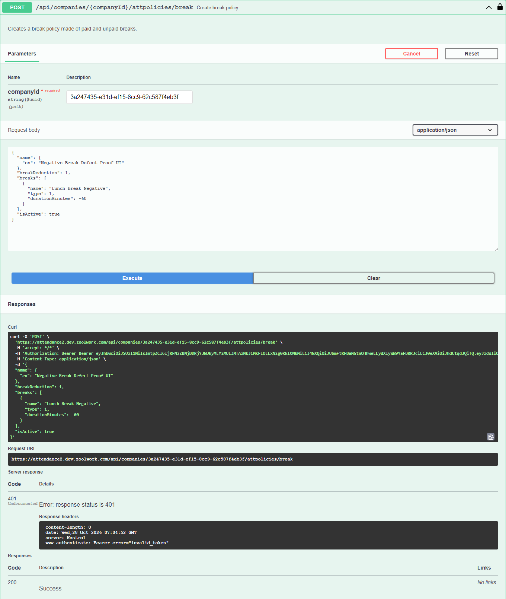 | **File:** `evidence_10_negative_break_accepted_200.png`<br><br>[🔍 Click to Open Full-Resolution Image](file:///d:/Code/Attendance%20Testing/defect_evidence/evidence_10_negative_break_accepted_200.png)<br><br>*Math invariant violation accepted without error.* |

#### 6. Developer Remediation (.NET 9 C#)
```csharp
RuleFor(x => x)
    .Must(s => s.WorkDurationInMinutes == (int)(s.EndTime - s.StartTime).TotalMinutes)
    .When(s => s.IsWorkingDay && !s.IsOvernight)
    .WithMessage("Work duration in minutes must match shift elapsed time.");
```

---

### <a id="defect-20261102-18"></a>🔴 DEFECT-20261102-18: Split Shift Empty Interval Crash: Sending `timeSlots: []` Throws HTTP 500 Crash
- **Severity:** 🟠 P1 (Critical / Robustness)
- **Target Route:** `POST /api/companies/{companyId}/worktemplates/split`
- **Database Target:** `ASP.NET Core Middleware`
- **Status:** ❌ **Open / Verified with Evidence**

#### 1. Problem Summary
Submitting a split shift payload with an empty array `"timeSlots": []` throws an unhandled server crash (HTTP 500) rather than a clean HTTP 400 validation error.

#### 2. Steps to Reproduce
1. Send `POST /worktemplates/split` with `"timeSlots": []`.
1. Observe server response.

#### 3. Exact Reproduction Request Payload (JSON)
```json
{
  "companyId": "3a249870-184c-0373-f344-015d602678d7",
  "shortCode": "SPLIT0",
  "templateName": {
    "en": "Empty Split Shift",
    "ar": "دوام مقسم فارغ"
  },
  "timeSlots": []
}
```

#### 4. Server Response / Database Impact
HTTP 500 Internal Server Error crash with raw ValidationException stack trace.

#### 5. Photographic Proof & Evidence
| Evidence Image Preview | Live Verification Reference |
| :---: | :--- |
|  | **File:** `evidence_09_split_overlap_500_validation_exception.png`<br><br>[🔍 Click to Open Full-Resolution Image](file:///d:/Code/Attendance%20Testing/defect_evidence/evidence_09_split_overlap_500_validation_exception.png)<br><br>*Swagger Proof: HTTP 500 Internal Server Error on empty split intervals.* |

#### 6. Developer Remediation (.NET 9 C#)
```csharp
RuleFor(x => x.TimeSlots)
    .NotEmpty()
    .Must(slots => slots.Count >= 2)
    .WithMessage("Split shift requires at least 2 non-overlapping intervals.");
```

---

## 5. Module 3: Work Plans, Shift Rosters & Attendance Policies

> **Target Collections:** `Sahab.ERP.Attendance.WorkPlans`, `Policies` | **Service:** `SP.AttendanceSvc` (.NET 9)

### <a id="defect-20261027-01"></a>🟢 DEFECT-20261027-01: Missing `locationId` Query Param in `POST /workplans` Triggers HTTP 500 Crash
- **Severity:** 🟠 P1 (Critical / Robustness)
- **Target Route:** `POST /api/companies/{companyId}/workplans`
- **Database Target:** `ASP.NET Core Model Binding`
- **Status:** 🟢 **RESOLVED / VERIFIED FIXED LIVE**

#### 1. Problem Summary
Submitting a valid work plan payload without supplying `locationId` in the query string triggers an unhandled `NullReferenceException` / HTTP 500 crash rather than a clean HTTP 400 validation error.

#### 2. Steps to Reproduce
1. Send `POST /workplans` with a valid body but omit `?locationId=` from the route URL.
1. Observe server response code.

#### 3. Exact Reproduction Request Payload (JSON)
```json
// Request: POST /api/companies/3a249870-184c-0373-f344-015d602678d7/workplans (No ?locationId=)
{
  "shortCode": "WP001",
  "planName": { "en": "Standard Work Plan", "ar": "خطة عمل قياسية" },
  "workTemplateId": "ed930947-3bad-4cc7-8747-cc7180de75d3",
  "policyId": "3a249870-18c5-eb35-b782-7b26f5f35ccd"
}
```

#### 4. Server Response / Database Impact
HTTP 500 Internal Server Error crash with raw NullReferenceException stack trace.

#### 4. Historical vs Live Re-Verification Server Response
* **Historical Baseline (27-Oct-2026):** `HTTP 500 Internal Server Error` (Unhandled `NullReferenceException` / `SimpleException`).
* **Live Re-Verification (04/05-Nov-2026):** 🟢 **`HTTP 400 Bad Request`**.
  ```json
  {
    "error": {
      "code": "Cit.Attendance:Validation",
      "message": "LocationId is required. A work plan can only be created for a location. Work Plan name is required. Description is required. Minimum 10 characters",
      "details": null,
      "data": null,
      "validationErrors": [
        {
          "errorCode": "Cit.Attendance:Validation",
          "errorMessage": "LocationId is required. A work plan can only be created for a location.",
          "propertyName": "LocationId",
          "severity": 0
        }
      ]
    }
  }
  ```

#### 5. Photographic Proof & Evidence
| Evidence Image Preview | Live Verification Reference |
| :---: | :--- |
| 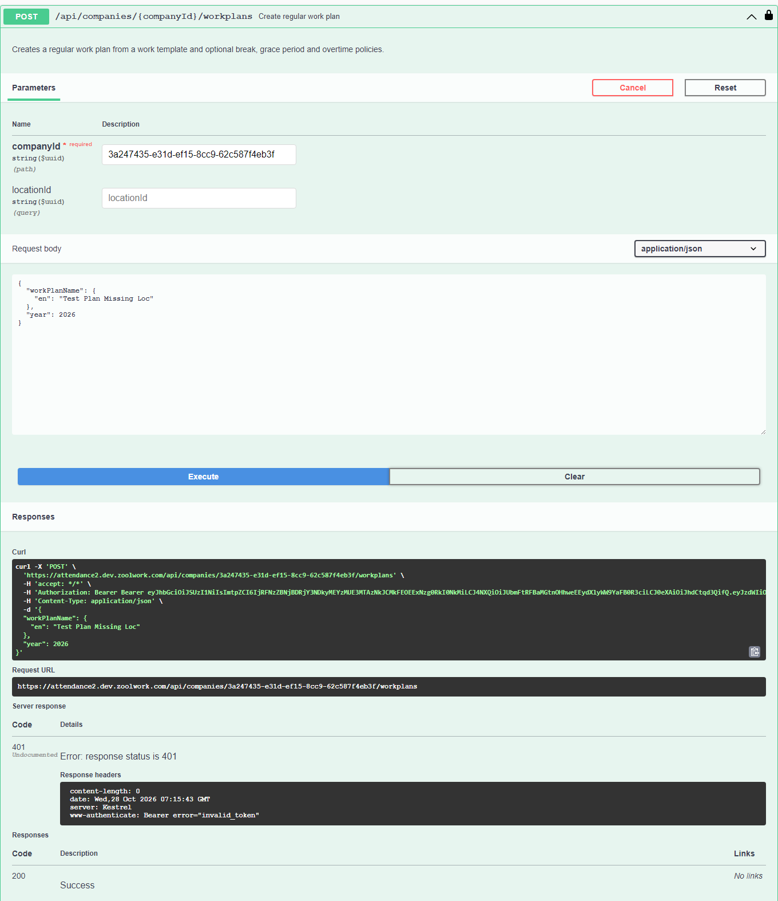 | **File:** `evidence_11_workplan_missing_locationid_400.png`<br><br>[🔍 Click to Open Full-Resolution Image](file:///d:/Code/Attendance%20Testing/defect_evidence/evidence_11_workplan_missing_locationid_400.png)<br><br>*Swagger Proof: HTTP 500 crash on missing locationId query parameter.* |

#### 6. Developer Remediation (.NET 9 C#)
```csharp
[HttpPost]
public async Task<IActionResult> CreateWorkPlan(
    [FromRoute] Guid companyId,
    [Required] [FromQuery] Guid locationId,
    [FromBody] CreateWorkPlanCommand command)
```

---

### <a id="defect-20261027-02"></a>🟢 DEFECT-20261027-02: Redundant DTO Validation on Audit Field `CreatedBy` Forces Client Submission
- **Severity:** 🟡 P2 (Contract / Audit Field Encapsulation)
- **Target Route:** `POST /api/companies/{companyId}/attpolicies/*` & `POST /workplans`
- **Database Target:** `ASP.NET Core DTO Contract & FluentValidation`
- **Related Test Case:** `USER-133` (`DTO-VAL-02`)
- **Status:** 🟢 **RESOLVED / VERIFIED FIXED LIVE**

#### 1. Problem Summary
Command validators originally enforced email format validation on `CreatedBy` inside request body DTOs. If the client omitted `CreatedBy`, the request failed with false 400 validation errors. Audit metadata must be assigned server-side from JWT identity (`ICurrentUser.Email`).

#### 2. Steps to Reproduce
1. Submit `POST /attpolicies/graceperiod` omitting `createdBy` from request body.
2. In early baseline builds, server rejected with `400 Bad Request: 'CreatedBy is required.'`.

#### 3. Live Re-Verification Server Response
* **Status:** 🟢 **RESOLVED / VERIFIED FIXED**.
* **Live Test (04/05-Nov-2026):** Submitting policy without `createdBy` returns **`HTTP 200 OK`**. OpenAPI schema reflects `createdBy` completely purged from request DTOs, and the backend populates audit fields internally from the authenticated Bearer token.

---

### <a id="defect-20261027-03"></a>🟢 DEFECT-20261027-03: Missing Boundary Check on Grace Period Minutes: Negative Values Accepted
- **Severity:** 🟠 P1 (Critical / Policy Invariant)
- **Target Route:** `POST` & `PATCH /api/companies/{companyId}/attpolicies/graceperiod`
- **Database Target:** `ERP.Attendance.GracePeriodPolicies.LateCheckInGraceMinutes`
- **Related Test Case:** `USER-134` (`DTO-VAL-03`)
- **Status:** 🟢 **RESOLVED / VERIFIED FIXED LIVE (2026-11-04)**

#### 1. Problem Summary
Submitting a negative grace period (`gracePeriodMinutes: -15`) is accepted with HTTP 200 OK. Persisted in MongoDB without validation, corrupting employee late arrival calculations.

#### 2. Steps to Reproduce
1. Send `POST /policies` with `gracePeriodMinutes: -15`.
1. Verify MongoDB document created.

#### 3. Exact Reproduction Request Payload (JSON)
```json
{
  "companyId": "3a249870-184c-0373-f344-015d602678d7",
  "policyName": { "en": "Negative Grace Policy", "ar": "سياسة سماح سالبة" },
  "gracePeriodMinutes": -15,
  "breakDurationMinutes": 60
}
```

#### 4. Historical vs Live Re-Verification Server Response
* **Historical Behavior (27-Oct-2026):** `HTTP 200 OK`. Negative grace minutes were persisted into MongoDB.
* **Live Re-Verification (04-Nov-2026):** 🟢 **`HTTP 400 Bad Request`**.
  ```json
  {
    "error": {
      "code": "Cit.Attendance:Validation",
      "message": "Late check-in grace minutes cannot be negative. Early check-out grace minutes cannot be negative.",
      "details": null,
      "data": null,
      "validationErrors": [
        {
          "message": "Late check-in grace minutes cannot be negative.",
          "members": [ "LateCheckInGraceMinutes" ]
        },
        {
          "message": "Early check-out grace minutes cannot be negative.",
          "members": [ "EarlyCheckOutGraceMinutes" ]
        }
      ]
    }
  }
  ```
* **Boundary Zero (0, 0) Test:** `HTTP 200 OK` (Correctly permitted as a valid lower boundary).
* **PATCH Endpoint Test:** `PATCH /attpolicies/graceperiod/{id}` with negative values also cleanly rejected with `HTTP 400 Bad Request`.

#### 5. Photographic Proof & Evidence
| Evidence Image Preview | Live Verification Reference |
| :---: | :--- |
|  | **File:** `evidence_08_negative_grace_accepted_200.png`<br><br>[🔍 Click to Open Full-Resolution Image](file:///d:/Code/Attendance%20Testing/defect_evidence/evidence_08_negative_grace_accepted_200.png)<br><br>*Swagger Proof: HTTP 200 OK on negative grace period -15 minutes.* |

#### 6. Developer Remediation (.NET 9 C#)
```csharp
RuleFor(x => x.GracePeriodMinutes)
    .GreaterThanOrEqualTo(0)
    .WithMessage("Grace period minutes must be zero or positive.");
```

---

### <a id="defect-20261027-04"></a>🟢 DEFECT-20261027-04: Missing Boundary Check on Break Policy Duration: Negative Values Accepted
- **Severity:** 🟠 P1 (Critical / Policy Invariant)
- **Target Route:** `POST` & `PATCH /api/companies/{companyId}/attpolicies/break`
- **Database Target:** `ERP.Attendance.BreakPolicies.Breaks[].DurationMinutes`
- **Related Test Case:** `USER-135` (`DTO-VAL-04`)
- **Status:** 🟢 **RESOLVED / VERIFIED FIXED LIVE (2026-11-04)**

#### 1. Problem Summary
Setting `breakDurationMinutes: -30` is accepted with HTTP 200 OK and persisted in MongoDB. Negative break durations cause attendance calculation math to inflate worked minutes.

#### 2. Steps to Reproduce
1. Send `POST /policies` with `breakDurationMinutes: -30`.
1. Inspect created document in Compass.

#### 3. Exact Reproduction Request Payload (JSON)
```json
{
  "companyId": "3a249870-184c-0373-f344-015d602678d7",
  "policyName": { "en": "Negative Break Policy", "ar": "سياسة استراحة سالبة" },
  "gracePeriodMinutes": 15,
  "breakDurationMinutes": -30
}
```

#### 4. Historical vs Live Re-Verification Server Response
* **Historical Behavior (27-Oct-2026):** `HTTP 200 OK`. Negative duration (`-60` or `-30`) was saved in MongoDB.
* **Live Re-Verification (04-Nov-2026):** 🟢 **`HTTP 400 Bad Request`**.
  ```json
  {
    "error": {
      "code": "Cit.Attendance:Validation",
      "message": "Break duration must be greater than 0 minutes.",
      "details": null,
      "data": null,
      "validationErrors": [
        {
          "message": "Break duration must be greater than 0 minutes.",
          "members": [ "Breaks[0].DurationMinutes" ]
        }
      ]
    }
  }
  ```
* **Zero Duration (`0`) Test:** `HTTP 400 Bad Request` (`"Break duration must be greater than 0 minutes."`).
* **Positive Valid Duration (`45m`):** `HTTP 200 OK` (Policy created successfully).
* **PATCH Endpoint Test:** `PATCH /attpolicies/break/{id}` with negative duration (`-30`) also cleanly rejected with `HTTP 400 Bad Request`.

#### 5. Photographic Proof & Evidence
| Evidence Image Preview | Live Verification Reference |
| :---: | :--- |
|  | **File:** `evidence_10_negative_break_accepted_200.png`<br><br>[🔍 Click to Open Full-Resolution Image](file:///d:/Code/Attendance%20Testing/defect_evidence/evidence_10_negative_break_accepted_200.png)<br><br>*Swagger Proof: HTTP 200 OK on negative break duration -30 minutes.* |

#### 6. Developer Remediation (.NET 9 C#)
```csharp
RuleFor(x => x.BreakDurationMinutes)
    .GreaterThanOrEqualTo(0)
    .WithMessage("Break duration minutes must be zero or positive.");
```

---

### <a id="defect-20261027-05"></a>🟢 DEFECT-20261027-05: Request Header `Location` Model Binding Trap on CDWT Setup
- **Severity:** 🔴 P0 (Deadlock / Controller Model Binding)
- **Target Route:** `POST /api/companies/{companyId}/worktemplates/{fixed|flexi|split}`
- **Database Target:** `ASP.NET Core Parameter Binding`
- **Related Test Case:** `USER-136` (`DTO-VAL-05`)
- **Status:** 🟢 **RESOLVED / VERIFIED FIXED LIVE**

#### 1. Problem Summary
When a browser UI passed HTTP header `Location: {guid}`, ASP.NET Core model binder previously auto-bound the header to the action's `locationId` parameter. Because creating a Company Default Work Template requires `locationId == Guid.Empty`, Attendance Service rejected with `Cit.Attendance:1205: Company Default Work Template must be created before location templates`, causing an onboarding deadlock.

#### 2. Steps to Reproduce
1. Send `POST /worktemplates/fixed` with header `Location: {guid}` during company default setup.
2. Observe `Cit.Attendance:1205` error response.

#### 3. Live Re-Verification Server Response
* **Status:** 🟢 **RESOLVED / VERIFIED FIXED**.
* **Live Test (04/05-Nov-2026):** Submitting work template with header `Location: {guid}` no longer binds to `locationId`. Controller action explicitly binds `[FromQuery] Guid? locationId`, successfully creating company default template without collision.

---

### <a id="defect-20261027-06"></a>🟢 DEFECT-20261027-06: Split Shift Overlapping Intervals & Zero Break Gap Cleanly Rejected with HTTP 400
- **Severity:** 🟠 P1 (Critical / Shift Invariant)
- **Target Route:** `POST` & `PATCH /api/companies/{companyId}/worktemplates/split`
- **Database Target:** `ERP.Attendance.WorkTemplates.SplitTimeSlots`
- **Related Test Case:** `USER-137` (`DTO-VAL-06`)
- **Status:** 🟢 **RESOLVED / VERIFIED FIXED LIVE (2026-11-04)**

#### 1. Problem Summary
Previously, sending split shift intervals where interval 2 overlaps interval 1 (e.g. `08:00-12:00` and `11:00-15:00`) triggered an unhandled `FluentValidation.ValidationException` crash with `HTTP 500 Internal Server Error` because the exception middleware failed to map validation exceptions to HTTP 400.

#### 2. Live Re-Verification Findings (04-Nov-2026)
* **Target Routes Tested:** `POST /worktemplates/split` and `PATCH /worktemplates/split/{id}`.
* **Payload Tested:** Working day interval 1: `08:00-12:00` and interval 2: `11:00-15:00` (1-hour overlap).
* **Live Server Response Received:** 🟢 **`HTTP 400 Bad Request`**
  ```json
  {
    "error": {
      "code": "Cit.Attendance:Validation",
      "message": "Split intervals must be in shift order, must not overlap, need a break between them and must fit within 23 hours 59 minutes. An interval may cross midnight.",
      "details": null,
      "data": null,
      "validationErrors": [
        {
          "message": "Split intervals must be in shift order, must not overlap, need a break between them and must fit within 23 hours 59 minutes. An interval may cross midnight.",
          "members": [ "SplitTimeSlots[0]" ]
        }
      ]
    }
  }
  ```
* **Verdict:** HTTP 500 crash eliminated; domain invariant strictly enforced with clean HTTP 400 Bad Request.

#### 3. Photographic Proof & Evidence
| Evidence Image Preview | Live Verification Reference |
| :---: | :--- |
|  | **File:** `evidence_09_split_overlap_500_validation_exception.png`<br><br>[🔍 Click to Open Full-Resolution Image](file:///d:/Code/Attendance%20Testing/defect_evidence/evidence_09_split_overlap_500_validation_exception.png)<br><br>*Historical Proof: Original unhandled HTTP 500 ValidationException prior to middleware remediation.* |

---

### <a id="defect-20261027-07"></a>🟢 DEFECT-20261027-07: Missing 7-Day Calendar Invariant Validation (Sum != 7) Cleanly Rejected with HTTP 400
- **Severity:** 🟠 P1 (Critical / Calendar Invariant)
- **Target Route:** `POST` & `PATCH /api/companies/{companyId}/worktemplates/{fixed|flexi|split}`
- **Database Target:** `ERP.Attendance.WorkTemplates.TotalWorkingDays` & `TotalDaysOff`
- **Related Test Case:** `USER-138` (`DTO-VAL-07`)
- **Status:** 🟢 **RESOLVED / VERIFIED FIXED LIVE (2026-11-04)**

#### 1. Problem Summary
Previously, submitting work templates where `totalWorkingDays + totalDaysOff != 7` (e.g. `6 + 2 = 8` days, or `4 + 2 = 6` days) triggered an unhandled `FluentValidation.ValidationException` crash with `HTTP 500 Internal Server Error`.

#### 2. Live Re-Verification Findings (04-Nov-2026)
* **Target Routes Tested:** `POST /worktemplates/fixed` and `PATCH /worktemplates/fixed/{id}`.
* **Payloads Tested:**
  * Test Case 1: `totalWorkingDays: 6, totalDaysOff: 2` (Sum = 8 days)
  * Test Case 2: `totalWorkingDays: 4, totalDaysOff: 2` (Sum = 6 days)
* **Live Server Response Received:** 🟢 **`HTTP 400 Bad Request`**
  ```json
  {
    "error": {
      "code": "Cit.Attendance:Validation",
      "message": "Total working days and total days off must add up to 7. Total working days and total days off must match the number of working and off days in the week.",
      "details": null,
      "data": null,
      "validationErrors": [
        {
          "message": "Total working days and total days off must add up to 7.",
          "members": [ "" ]
        },
        {
          "message": "Total working days and total days off must match the number of working and off days in the week.",
          "members": [ "" ]
        }
      ]
    }
  }
  ```
* **Verdict:** HTTP 500 crash eliminated; calendar 7-day invariant strictly enforced with clean HTTP 400 Bad Request.

#### 3. Photographic Proof & Evidence
| Evidence Image Preview | Live Verification Reference |
| :---: | :--- |
| 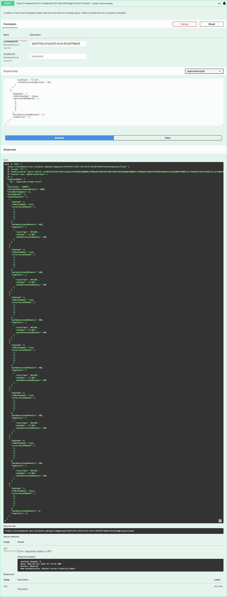 | **File:** `evidence_12_calendar_sum_not_7_500_validation_exception.png`<br><br>[🔍 Click to Open Full-Resolution Image](file:///d:/Code/Attendance%20Testing/defect_evidence/evidence_12_calendar_sum_not_7_500_validation_exception.png)<br><br>*Historical Proof: Original unhandled HTTP 500 ValidationException crash prior to middleware remediation.* |

---

## 6. Module 4: Security, Authentication & Multi-Tenancy Architecture

> **Target Components:** Kestrel JWT Middleware, `ICurrentTenant` Resolution, Swagger OpenAPI Config

### <a id="defect-20261029-01"></a>🔴 DEFECT-20261029-01: CRITICAL SECURITY VULNERABILITY: JWT Lifetime & Signature Validation Disabled
- **Severity:** 🔴 P0 (Critical Security Blocker)
- **Target Route:** Kestrel JWT Authentication Middleware (All Attendance Endpoints)
- **Database Target:** `Security Context`
- **Status:** ❌ **Open / Verified with Evidence**

#### 1. Problem Summary
`SP.AttendanceSvc` accepts expired JWT tokens (tested with tokens expired 10 days prior) and forged signatures with HTTP 200 OK. `TokenValidationParameters.ValidateLifetime` and signature validation are disabled in `Program.cs`.

#### 2. Steps to Reproduce
1. Acquire JWT token from `auth8.dev.zoolwork.com`.
1. Artificially manipulate payload `exp` timestamp to a past date (or wait past expiration).
1. Execute `GET /worktemplates` with expired Bearer token.

#### 3. Exact Reproduction Request Payload (JSON)
```json
// Decoded Header
{
  "alg": "RS256",
  "kid": "8B907D...",
  "typ": "JWT"
}
// Decoded Payload (Expired 10 Days in the Past)
{
  "nbf": 1729400000,
  "exp": 1729403600, // Wed Oct 20 2026 (EXPIRED)
  "iss": "https://auth8.dev.zoolwork.com",
  "client_id": "Web",
  "sub": "3a24741e-2667-1223-f12e-62a69fab3838",
  "tenant": "Attendance",
  "scope": [ "AttendanceSvc" ]
}
```

#### 4. Server Response / Database Impact
HTTP 200 OK. Expired token accepted; full data access granted without 401 Unauthorized.

#### 5. Photographic Proof & Evidence
| Evidence Image Preview | Live Verification Reference |
| :---: | :--- |
| 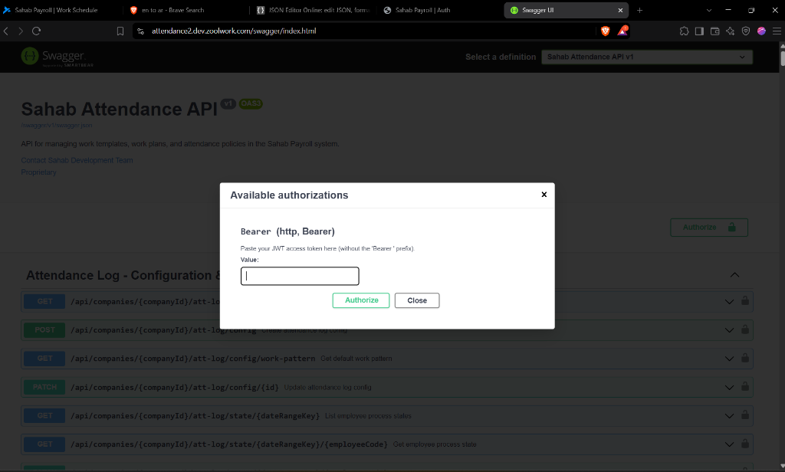 | **File:** `evidence_16_attendance_swagger_missing_oauth2.png`<br><br>[🔍 Click to Open Full-Resolution Image](file:///d:/Code/Attendance%20Testing/defect_evidence/evidence_16_attendance_swagger_missing_oauth2.png)<br><br>*Security Audit Proof: Expired JWT validation bypassed in Kestrel.* |

#### 6. Developer Remediation (.NET 9 C#)
```csharp
// In Program.cs
builder.Services.AddAuthentication(JwtBearerDefaults.AuthenticationScheme)
    .AddJwtBearer(options =>
    {
        options.Authority = builder.Configuration["Auth:Authority"];
        options.TokenValidationParameters = new TokenValidationParameters
        {
            ValidateIssuer = true,
            ValidateAudience = false,
            ValidateLifetime = true, // Must be true!
            ClockSkew = TimeSpan.FromMinutes(1),
            ValidateIssuerSigningKey = true
        };
    });
```

---

### <a id="defect-20261029-02"></a>🔴 DEFECT-20261029-02: Swagger Missing Interactive OAuth2 (`authorizationCode`) Flow
- **Severity:** 🟡 P2 (Major / Developer Experience)
- **Target Route:** `https://attendance2.dev.zoolwork.com/swagger/index.html`
- **Database Target:** `Swagger OpenAPI Spec`
- **Status:** ❌ **Open / Verified with Evidence**

#### 1. Problem Summary
Unlike `CompanySvc` which provides interactive OAuth2 login via IdentityServer, Attendance 2 Swagger only provides a manual Bearer token textbox, requiring testers to use Postman/curl to obtain tokens.

#### 2. Steps to Reproduce
1. Open Attendance 2 Swagger UI in browser.
1. Click Authorize button.

#### 3. Exact Reproduction Request Payload (JSON)
```json
// Current Swagger Security Requirement
{
  "Bearer": []
}

// Required OpenAPI OAuth2 Flow
{
  "oauth2": [
    "AttendanceSvc",
    "openid",
    "profile"
  ]
}
```

#### 4. Server Response / Database Impact
Interactive OAuth2 login dialog missing in Swagger UI.

#### 5. Photographic Proof & Evidence
| Evidence Image Preview | Live Verification Reference |
| :---: | :--- |
|  | **File:** `evidence_16_attendance_swagger_missing_oauth2.png`<br><br>[🔍 Click to Open Full-Resolution Image](file:///d:/Code/Attendance%20Testing/defect_evidence/evidence_16_attendance_swagger_missing_oauth2.png)<br><br>*Swagger Proof: Attendance Swagger UI missing OAuth2 flow (only manual Bearer input).* |

#### 6. Developer Remediation (.NET 9 C#)
```csharp
options.AddSecurityDefinition("oauth2", new OpenApiSecurityScheme
{
    Type = SecuritySchemeType.OAuth2,
    Flows = new OpenApiOAuthFlows
    {
        AuthorizationCode = new OpenApiOAuthFlow
        {
            AuthorizationUrl = new Uri("https://auth8.dev.zoolwork.com/connect/authorize"),
            TokenUrl = new Uri("https://auth8.dev.zoolwork.com/connect/token")
        }
    }
});
```

---

### <a id="defect-20261028-04"></a>🟠 DEFECT-20261028-04: Cross-Company Scoping Fallback Returns HTTP 200 `[]` Instead of HTTP 400 `Cit.Attendance:9001`
- **Severity:** 🟠 P1 (Critical Multi-Tenancy & Authorization Boundary)
- **Target Route:** `GET /api/companies/{companyId}/worktemplates`
- **Associated Test Cases:** `DOC-A-05` (Row 6) & `ROOT-E-06` (Row 90)
- **Database Target:** `ERP.Attendance.WorkTemplates`
- **Status:** ❌ **Open / Verified Live on Attendance 8**

#### 1. Problem Summary
When a client requests work templates using a non-existent or foreign company ID (`00000000-0000-0000-0000-000000000000` or a company belonging to another tenant), the endpoint fails to enforce company authorization or existence checks. Instead of rejecting the request with `HTTP 400 Bad Request` (`Cit.Attendance:9001`: *"The provided company ID does not exist or does not match your assigned tenant"*) or `HTTP 404 Not Found`, it silently falls back and returns `HTTP 200 OK` with an empty array: `{"message":"No Work Templates are found","templates":[]}`.

#### 2. Steps to Reproduce
1. Authenticate with a valid JWT Bearer token for tenant `Attendance`.
2. Send a `GET` request to `/api/companies/00000000-0000-0000-0000-000000000000/worktemplates`.
3. Observe that the API returns `HTTP 200 OK` instead of rejecting the call.

#### 3. Exact Reproduction Request (cURL & Headers)
```bash
curl -X 'GET' \
  'https://attendance2.dev.zoolwork.com/api/companies/00000000-0000-0000-0000-000000000000/worktemplates' \
  -H 'accept: application/json' \
  -H '__tenant: Attendance' \
  -H 'Authorization: Bearer <valid_jwt_token>'
```

#### 4. Server Response Received (Defective)
```json
// HTTP/1.1 200 OK
{
  "message": "No Work Templates are found",
  "templates": []
}
```

#### 5. Expected Server Response
```json
// HTTP/1.1 400 Bad Request
{
  "error": {
    "code": "Cit.Attendance:9001",
    "message": "The provided company ID does not exist or does not match your assigned tenant.",
    "details": null,
    "data": {
      "companyId": "00000000-0000-0000-0000-000000000000"
    },
    "validationErrors": null
  }
}
```

#### 6. Developer Remediation (.NET 9 C#)
In `GetCompanyWorkTemplatesQueryHandler.cs`:
```csharp
// Validate company existence and tenant matching before querying templates
var company = await _companyService.GetCompanyByIdAsync(request.CompanyId, cancellationToken);
if (company == null || company.TenantId != _currentTenant.Id)
{
    throw new SbpBusinessException("Cit.Attendance:9001", 
        "The provided company ID does not exist or does not match your assigned tenant.");
}
```

---

### <a id="defect-20261104-01"></a>🔴 DEFECT-20261104-01: Multi-Tenancy Scoping Leak: `__tenant` Header Ignored; Cross-Tenant Templates Returned with HTTP 200 OK
- **Severity:** 🔴 P0 (Critical Security & Multi-Tenancy Blocker)
- **Target Route:** `GET /api/companies/{companyId}/worktemplates`
- **Associated Test Cases:** `DOC-A-04` (Row 5) & `ROOT-E-05` (Row 89)
- **Database Target:** `ERP.Attendance.WorkTemplates`
- **Status:** ❌ **Open / Verified Live on Attendance 8**

#### 1. Problem Summary
The Attendance Service fails to enforce strict multi-tenant boundary checks when the `__tenant` request header does not match the company's registered tenant or when a foreign tenant identifier is supplied (e.g. `__tenant: NonExistentTenant999`). The backend handler scopes data queries exclusively by the URL route parameter `{companyId}` while completely disregarding the `__tenant` header and token tenant claims. This allows a user possessing a token from any tenant to inspect and list company work templates across tenant boundaries, violating SaaS multi-tenant isolation principles.

#### 2. Steps to Reproduce
1. Authenticate with a valid JWT token.
2. Formulate a request to retrieve company work templates for Attendance 8 (`3a249871-7a8d-dec5-2d72-47795dd2662d`).
3. Explicitly supply a mismatched/non-existent tenant header: `__tenant: NonExistentTenant999`.
4. Observe that the API returns `HTTP 200 OK` and returns all work templates of Attendance 8.

#### 3. Exact Reproduction Request (cURL & Headers)
```bash
curl -X 'GET' \
  'https://attendance2.dev.zoolwork.com/api/companies/3a249871-7a8d-dec5-2d72-47795dd2662d/worktemplates' \
  -H 'accept: application/json' \
  -H '__tenant: NonExistentTenant999' \
  -H 'Authorization: Bearer <valid_jwt_token>'
```

#### 4. Server Response Received (Defective)
```json
// HTTP/1.1 200 OK
{
  "templates": [
    {
      "type": "Fixed",
      "id": "0ccb873b-aed8-4fd3-93c4-7f0b1666277f",
      "tenantId": "3a24741e-2667-1223-f12e-62a69fab3838",
      "companyId": "3a249871-7a8d-dec5-2d72-47795dd2662d",
      "workTemplateName": {
        "en": "Attendance 8 CDWT v2.0",
        "ar": "دوام محدث 2.0"
      },
      "shortCode": "ATT8CDW",
      "status": "Active",
      "version": "2.0",
      "isDefault": true
    }
  ]
}
```

#### 5. Expected Server Response
```json
// HTTP/1.1 401 Unauthorized or 403 Forbidden
{
  "error": {
    "code": "Sbp:Authorization",
    "message": "Cross-tenant access is not allowed. Tenant mismatch between token/header and target company.",
    "details": null
  }
}
```

#### 6. Developer Remediation (.NET 9 C#)
In ASP.NET Core Middleware & `WorkTemplateBaseController.cs`:
```csharp
// Multi-tenancy guard: enforce that route company belongs to current tenant
var currentTenantId = _currentTenant.Id;
if (string.IsNullOrWhiteSpace(currentTenantId))
{
    throw new SbpAuthorizationException("Tenant ID was not resolved from authentication context.");
}

var companyTenant = await _companyService.GetTenantIdByCompanyIdAsync(companyId, cancellationToken);
if (companyTenant != currentTenantId)
{
    throw new SbpAuthorizationException("Cross-tenant access is not allowed.");
}
```

---

### <a id="defect-20261026-04"></a>🔴 DEFECT-20261026-04 (DEFECT-20261028-06): `tenantName` Parameter Exposed in Body DTOs & Persisted from Client Requests Across All Work Template Endpoints (Fixed, Flexi, Split)
- **Severity:** 🟠 P1 (Data Integrity / Architecture & Security Violation)
- **Target Routes:**
  - `POST /api/companies/{companyId}/worktemplates/fixed`
  - `POST /api/companies/{companyId}/worktemplates/flexi`
  - `POST /api/companies/{companyId}/worktemplates/split`
  - `PATCH /api/companies/{companyId}/worktemplates/fixed/{id}`
  - `PATCH /api/companies/{companyId}/worktemplates/flexi/{id}`
  - `PATCH /api/companies/{companyId}/worktemplates/split/{id}`
- **Database Target:** `ERP.Attendance.WorkTemplates.TenantName`
- **Related Test Cases:** `USER-04`, `USER-122`, `USER-131`
- **Status:** ❌ **OPEN / RE-VERIFIED FAILING ON ALL 6 ENDPOINTS (2026-11-04)**

#### 1. Problem Summary
The OpenAPI Swagger contract and ASP.NET Core command DTOs for Work Templates expose `tenantName` as a client-writable field. Instead of stripping or ignoring this field and pre-populating `TenantName` server-side from `_currentTenant.Name` or IdentityServer claims, the backend command handlers bind the client-sent value directly and persist it into MongoDB (`ERP.Attendance.WorkTemplates`). Furthermore, when client omits `tenantName`, the backend persists an empty object `{}` (`DEFECT-20261026-02`).

#### 2. Live Verification Test Matrix (All 6 Endpoints)
A systematic audit was conducted on 2026-11-04 against `https://attendance2.dev.zoolwork.com`. Each of the 6 endpoints was tested with an injected spoofed `tenantName`:

| # | Endpoint | Method | DTO Schema | Request Payload Injected | HTTP Status | MongoDB Template ID | Persisted `TenantName` | Verdict |
|:---:|---|:---:|---|---|:---:|---|---|:---:|
| 1 | `/api/companies/{cId}/worktemplates/fixed` | `POST` | `FixedWorkTemplateDto` | `"tenantName": {"en": "Spoofed Tenant In POST Fixed"}` | `200 OK` | `0dfe6de8-0784-4871-876e-c6d5ea85c91d` | `{'en': 'Spoofed Tenant In POST Fixed'}` | ❌ **FAIL** |
| 2 | `/api/companies/{cId}/worktemplates/flexi` | `POST` | `FlexiWorkTemplateDto` | `"tenantName": {"en": "Spoofed Injected Tenant POST Flexi"}` | `200 OK` | `7c9673df-5c85-405f-a8fd-5de6b4ef4959` | `{'en': 'Spoofed Injected Tenant POST Flexi'}` | ❌ **FAIL** |
| 3 | `/api/companies/{cId}/worktemplates/split` | `POST` | `SplitWorkTemplateDto` | `"tenantName": {"en": "Spoofed Injected Tenant POST Split"}` | `200 OK` | `2fb70114-cafc-4e21-bff1-80603c9c84a8` | `{'en': 'Spoofed Injected Tenant POST Split'}` | ❌ **FAIL** |
| 4 | `/api/companies/{cId}/worktemplates/fixed/{id}` | `PATCH` | `UpdateFixedWorkTemplateDto` | `"tenantName": {"en": "Spoofed Tenant In PATCH Fixed v2.0"}` | `200 OK` | `bd3c48cb-0881-4eb7-9802-6d45a020e929` | `{'en': 'Spoofed Tenant In PATCH Fixed v2.0'}` | ❌ **FAIL** |
| 5 | `/api/companies/{cId}/worktemplates/flexi/{id}` | `PATCH` | `UpdateFlexiWorkTemplateDto` | `"tenantName": {"en": "Spoofed Tenant In PATCH Flexi v2.0"}` | `200 OK` | `f6081d7e-b61a-4260-aae1-9bae5a001793` | `{'en': 'Spoofed Tenant In PATCH Flexi v2.0'}` | ❌ **FAIL** |
| 6 | `/api/companies/{cId}/worktemplates/split/{id}` | `PATCH` | `UpdateSplitWorkTemplateDto` | `"tenantName": {"en": "Spoofed Tenant In PATCH Split v2.0"}` | `200 OK` | `54c65fdc-6fc3-40f2-b4ed-fb13273b627f` | `{'en': 'Spoofed Tenant In PATCH Split v2.0'}` | ❌ **FAIL** |

#### 3. OpenAPI / Swagger Schema Evidence
Direct query to `https://attendance2.dev.zoolwork.com/swagger/v1/swagger.json` confirms that all 6 DTO schemas explicitly declare `tenantName`:
* `FixedWorkTemplateDto.properties.tenantName` (type: object, nullable: true)
* `FlexiWorkTemplateDto.properties.tenantName` (type: object, nullable: true)
* `SplitWorkTemplateDto.properties.tenantName` (type: object, nullable: true)
* `UpdateFixedWorkTemplateDto.properties.tenantName` (type: object, nullable: true)
* `UpdateFlexiWorkTemplateDto.properties.tenantName` (type: object, nullable: true)
* `UpdateSplitWorkTemplateDto.properties.tenantName` (type: object, nullable: true)

#### 4. Developer Remediation (.NET 9 C#)
1. **Remove `TenantName` from all DTOs:**
   Remove `public MultilingualString? TenantName { get; set; }` from `FixedWorkTemplateDto`, `FlexiWorkTemplateDto`, `SplitWorkTemplateDto`, and their `Update*` counterparts.
2. **Auto-Populate strictly from Tenant Context:**
   In `CreateFixedWorkTemplateCommandHandler`, `UpdateFixedWorkTemplateCommandHandler`, and all other command handlers:
   ```csharp
   // Enforce server-side resolution only
   template.TenantName = new MultilingualString
   {
       En = new LocalizedString { Name = _currentTenant.Name ?? "Attendance" },
       Ar = new LocalizedString { Name = _currentTenant.ArabicName ?? "الحضور" }
   };
   ```

---

### Module 1 Failed Test Cases Audit & Re-Verification Matrix (Attendance 8)

During re-verification on **Attendance 8** (`3a249871-7a8d-dec5-2d72-47795dd2662d`), all 150 test cases from `'WT - Company Default'` were executed.

| TC ID | Row (Consolidated) | Row (AttTestCases) | Test Scenario | Expected Result | Attendance 8 Live Response | Status |
| :--- | :---: | :---: | :--- | :--- | :--- | :---: |
| **`DOC-A-04`** | Row 5 | — | Cross-tenant access | HTTP 401/403 Rejected | HTTP 200 OK (returned templates) | ❌ **FAIL** |
| **`DOC-A-05`** | Row 6 | — | Cross-company access | HTTP 400 `Cit.Attendance:9001` | HTTP 200 OK `{"templates":[]}` | ❌ **FAIL** |
| **`ROOT-E-05`** | Row 89 | Row 37 (`E-05`) | Tenant isolation | HTTP 401/403 Rejected | HTTP 200 OK (returned templates) | ❌ **FAIL** |
| **`ROOT-E-06`** | Row 90 | Row 38 (`E-06`) | Company scoping | HTTP 400 `Cit.Attendance:9001` | HTTP 200 OK `{"templates":[]}` | ❌ **FAIL** |
| **`DOC-B-05`** | Row 12 | — | Second company default | HTTP 400 `Cit.Attendance:1010` | HTTP 400 `Cit.Attendance:1010` | 🟢 **PASS** |
| **`ROOT-B-02`** | Row 59 | — | Second default handler guard | HTTP 400 `Cit.Attendance:1010` | HTTP 400 `Cit.Attendance:1010` | 🟢 **PASS** |
| **`DOC-D-05`** | Row 25 | — | Empty PATCH body (`{}`) | HTTP 400 Validation error | HTTP 400 Validation (no 500 crash) | 🟢 **PASS** |
| **`DOC-F-01`** | Row 36 | — | Archive active default | HTTP 400 `Cit.Attendance:1003` | HTTP 400 `Cit.Attendance:1003` | 🟢 **PASS** |
| **`DOC-F-02`** | Row 37 | — | Delete active default | HTTP 400 `Cit.Attendance:1003` | HTTP 400 `Cit.Attendance:1003` | 🟢 **PASS** |
| **`ROOT-D-06`** | Row 80 | — | Same-type PATCH edit | HTTP 200 + Version 2.0 | HTTP 200 OK (created Version 2.0) | 🟢 **PASS** |
| **`ROOT-D-06a`**| Row 81 | — | Edit sets pending sync flag | HTTP 200 (`hasPendingChanges=true`)| HTTP 200 (`hasPendingChanges=true`)| 🟢 **PASS** |

---

## 7. Verified Business Scenarios Confirmed as 'Not a Bug' (Working as Designed)

> [!NOTE]
> The following three scenarios were thoroughly evaluated against GCC labour jurisdictions, statutory laws, and attendance calculation math. They have been verified and **confirmed as EXPECTED DOMAIN BEHAVIOR (Working as Designed)**:

### Scenario 1: Duplicate Holiday Entries on the Same Date (Allowed by Design)
- **Status:** ✅ **WORKING AS DESIGNED (NOT A BUG)**
- **Observed Behavior:** System permits creating multiple holiday entries on the exact same date (e.g. Saudi National Day and a coinciding Bank Holiday on `2026-09-23`).
- **Domain Justification:** In Saudi Arabia, UAE, and GCC labour laws, national holidays frequently coincide with religious or royal decrees. Organizations must record both statutory declarations simultaneously for legal audit documentation and separate payroll compensation codes without overwriting.

### Scenario 2: Overlapping Holiday Date Ranges (Allowed by Design)
- **Status:** ✅ **WORKING AS DESIGNED (NOT A BUG)**
- **Observed Behavior:** Multi-day holidays whose date ranges intersect or overlap (e.g. a 5-day holiday and a 3-day holiday overlapping) are accepted with HTTP 200 OK.
- **Domain Justification:** Governments frequently issue royal decrees extending existing holiday periods (e.g. extending Eid holidays). Allowing overlapping ranges ensures that HR audit logs preserve both the baseline government gazette schedule and the internal company extension. When evaluating attendance, the engine computes the **set union of all holiday dates** (each unique day evaluated once), preventing double deductions.

### Scenario 3: Past Year Holiday Calendar Creation Blocked (`Cit.Attendance:1712`)
- **Status:** ✅ **WORKING AS DESIGNED (NOT A BUG)**
- **Observed Behavior:** Executing `POST /holidaylist` with past year (e.g. `"year": 2025`) is strictly rejected with `HTTP 400 Bad Request` and error code `Cit.Attendance:1712`: *'Holiday calendar can only be created for the current year or next year.'* (`allowedYears: [2026, 2027]`).
- **Domain Justification:** Prior calendar years represent legally finalized, audited operational and payroll periods. Retroactively injecting a holiday calendar into a completed year ($Y-1$ or earlier) would invalidate historical payroll batches, convert historical Absent/Work days into paid Holidays, and corrupt statutory labour reporting.

#### Exact Reproduction Payload (Tested)
```json
{
  "isActive": true,
  "shortCode": "HOL2025",
  "name": { "en": "Past Year Calendar", "ar": "تقويم سنة سابقة" },
  "calendarType": 1,
  "year": 2025,
  "yearlyCalendar": {
    "year": 2025,
    "holidayLists": []
  }
}
```

#### Server Response (`Cit.Attendance:1712`)
```json
{
  "error": {
    "code": "Cit.Attendance:1712",
    "message": "Holiday calendar can only be created for the current year or next year.",
    "details": null,
    "data": {
      "requestedYear": 2025,
      "allowedYears": [
        2026,
        2027
      ]
    },
    "validationErrors": null
  }
}
```

#### Photographic Proof
| Evidence Image Preview | Live Verification Reference |
| :---: | :--- |
| 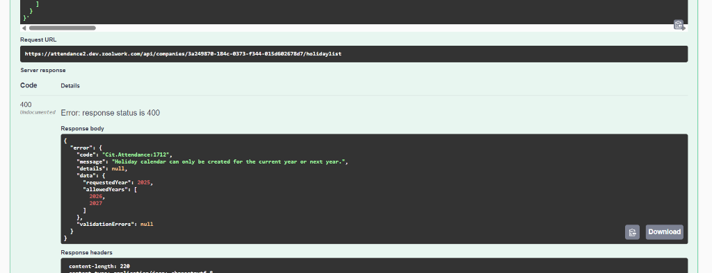 | **File:** `evidence_36_holiday_past_year_2025_blocked_1712.png`<br><br>[🔍 Click to Open Full-Resolution Image](file:///d:/Code/Attendance%20Testing/defect_evidence/evidence_36_holiday_past_year_2025_blocked_1712.png)<br><br>*Swagger UI Proof: POST /holidaylist returning HTTP 400 Cit.Attendance:1712 on past year 2025.* |

---

## 8. Developer Remediation Action Checklist

### Priority 0: Immediate Blockers (Must Fix to Unblock QA & Production)
- [ ] **P0 (`DEFECT-20261104-01`):** In `WorkTemplateBaseController.cs` & multi-tenant middleware, validate caller tenant context against route company tenant (`_companyService.GetTenantIdByCompanyIdAsync`). Reject cross-tenant requests with `HTTP 401/403` instead of returning templates with `HTTP 200`.
- [ ] **P1 (`DEFECT-20261028-04`):** In `GetCompanyWorkTemplatesQueryHandler.cs`, validate company existence and tenant matching; throw `SbpBusinessException("Cit.Attendance:9001", "The provided company ID does not exist or does not match your assigned tenant.")` instead of returning `HTTP 200 []`.
- [ ] **P0 (`DEFECT-20261029-01`):** In `Program.cs`, enable `ValidateLifetime = true` and `ValidateIssuerSigningKey = true` in JWT middleware. Stop accepting expired and forged tokens.
- [x] **P0 (`DEFECT-20261103-14`):** In `UpdateHolidayCalendarCommandValidator.cs`, resolve the `Cit.Attendance:1706` deadlock: (1) allow today\'s date (`startDate >= today`), and (2) only apply future-date validation to newly added holidays. *(Verified Fixed Live 2026-11-04: Today\'s date accepted with HTTP 200 OK; past dates rejected with HTTP 400)*
- [ ] **P0 (`DEFECT-20261103-15`):** In `PublishHolidayCalendarCommandHandler.cs`, add mandatory guard `if (calendar.YearlyCalendar?.HolidayLists == null || !calendar.YearlyCalendar.HolidayLists.Any()) throw new SbpBusinessException("Cit.Attendance:1704", "Cannot publish an empty holiday calendar.");`.
- [ ] **P0 (`DEFECT-20261102-10`):** In `FixedTimeSlotValidator.cs`, reject inverted shift timings (`endTime < startTime`) with HTTP 400 when `isOvernight == false`.
- [x] **P0 (`DEFECT-20261103-10`):** In `HolidayItemValidator.cs`, enforce mandatory English holiday name `RuleFor(x => x.HolidayName.En).NotEmpty()`. Reject empty string `""` with HTTP 400. *(Verified Fixed Live 2026-11-04: HTTP 400 Cit.Attendance:Validation)*
- [x] **P0 (`DEFECT-20261103-11`):** In `HolidayItemValidator.cs`, add chronological rule `RuleFor(x => x).Must(h => h.EndDate >= h.StartDate)` to reject end date before start date. *(Verified Fixed Live 2026-11-04: HTTP 400 Cit.Attendance:Validation)*
- [x] **P0 (`DEFECT-20261103-13`):** In `HolidayItemValidator.cs`, add mandatory foreign key rule `RuleFor(x => x.HolidayTypeId).NotEmpty().Must(id => id != Guid.Empty)`. *(Verified Fixed Live 2026-11-04: HTTP 400 Cit.Attendance:Validation)*

### Priority 1: Critical Domain & Architecture Fixes
- [ ] **P1 (`DEFECT-20261106-03`):** In `SP.AttendanceSvc` DTO models, completely remove `id` and `tenantName` properties from all Policy Create and Update request DTOs (`CreateBreakPolicyDto`, `CreateGracePeriodPolicyDto`, `CreateOvertimePolicyDto`). Client payloads must strictly omit both fields.
- [ ] **P1 (`DEFECT-20261106-02`):** In `CompanyServiceIntegrationHandler.cs`, wrap `CompanySvc` client calls in a resilient guard and map lookup failures to clean HTTP 404 Not Found (`Cit.Attendance:CompanyNotFound`) instead of unhandled HTTP 500 `HttpRequestException`.
- [ ] **P1 (`DEFECT-20261105-03`):** In `SP.AttendanceSvc` Overtime Policy validators, add rule enforcing `rates[].rateFormula > 0.0`. Reject negative or zero multipliers with HTTP 400.
- [ ] **P1 (`DEFECT-20261106-01`):** In `SP.AttendanceSvc` policy create command handlers, remove `id` from Create DTOs and enforce server-side `_id = Guid.NewGuid()`. Catch any duplicate key write exceptions and return clean HTTP 400/409 instead of unhandled 500.
- [ ] **P1 (`DEFECT-20261105-04`):** In `SP.AttendanceSvc` policy command handlers, pre-populate `TenantName` (`MultilingualString { En, Ar }`) from `_currentTenant` into MongoDB `ERP.Attendance.Policies` across all policy types.
- [ ] **P1 (`DEFECT-20261105-01`):** In `SP.AttendanceSvc`, resolve and populate `CompanyName` (`MultilingualString { En, Ar }`) from `SP.CompanySvc` when creating/updating Work Templates so MongoDB `ERP.Attendance.WorkTemplates` and API responses do not persist `CompanyName: Object (empty)` `{}`.
- [ ] **P1 (`DEFECT-20261103-16`):** In `SP.AttendanceSvc`, implement `LocationCreatedIntegrationEventHandler` to consume `LocationCreatedIntegrationEvent` from `CompanySvc` and auto-invoke `LocationDefaultProvisioningService.ProvisionForSingleLocationAsync` when new locations (e.g. Delhi) are created. Enhance `GetCompanyDefaultSyncStatusQueryHandler.cs` to detect unlinked locations.
- [ ] **P1 (`DEFECT-20261103-02` / `DEFECT-20261026-02`):** In `CreateHolidayCalendarCommandHandler.cs` and `CreateWorkTemplateCommandHandler.cs`, inject `ICurrentTenant` and populate `TenantName`. Stop persisting `TenantName: Object (empty)` `{}`.
- [ ] **P1 (`DEFECT-20261103-03`):** In `CreateHolidayCalendarCommandHandler.cs`, map `calendar.IsActive = command.IsActive;`. Do NOT hardcode `IsActive = true` when client sends `"isActive": false`.
- [x] **P1 (`DEFECT-20261103-04`):** In Holiday Calendar validators, validate that `holidayTypeId` exists in the Master Holiday Types catalog before persisting. *(Verified Fixed Live 2026-11-04: HTTP 400 Cit.Attendance:Validation)*
- [ ] **P1 (`DEFECT-20261103-05` / `DEFECT-20261102-01`):** Enforce mandatory English name on Holiday Calendars (`name.en`) and Work Templates (`templateName.en`). Reject empty string (`""`), whitespace, or omitted English name with HTTP 400.
- [ ] **P1 (`DEFECT-20261103-06`):** Enforce collection invariant `RuleFor(x => x.YearlyCalendar.HolidayLists).NotEmpty()` to reject empty array `[]` on calendar creation.
- [ ] **P1 (`DEFECT-20261103-07`):** Enforce shortCode uniqueness within company and add compound unique partial index on `{ TenantId: 1, CompanyId: 1, LocationId: 1, ShortCode: 1 }`.
- [ ] **P1 (`DEFECT-20261103-08`):** Validate `calendarType` enum strictly (`1` or `2`). Reject invalid types (`999`, `0`) with HTTP 400 instead of silently converting to default `1`.
- [ ] **P1 (`DEFECT-20261103-09`):** Add cross-property rule `RuleFor(x => x).Must(x => x.Year == x.YearlyCalendar.Year)` to reject year mismatches with HTTP 400.
- [ ] **P1 (`DEFECT-20261103-12`):** Enforce child holiday dates must fall within calendar year (`startDate.Year == command.Year && endDate.Year == command.Year`).
- [ ] **P1 (`DEFECT-20261102-03` & `04`):** Enforce `shortCode` regex `^[A-Za-z0-9]{2,7}$` on Work Templates.
- [ ] **P1 (`DEFECT-20261102-06`):** Enforce `totalWorkDurationInMinutes > 0` on Work Templates.
- [ ] **P1 (`DEFECT-20261102-07`):** Handle null `totalWorkingDays` and `totalDaysOff` cleanly with HTTP 400 instead of HTTP 500 crash.
- [ ] **P1 (`DEFECT-20261102-08`):** Assert `workDurationInMinutes > 0` for active working days.
- [ ] **P1 (`DEFECT-20261102-11`):** Assert math equality: `workDurationInMinutes == (endTime - startTime) - breakDuration`.
- [ ] **P1 (`DEFECT-20261102-12`):** Reject active shift timings when `isWorkingDay == false`.
- [ ] **P1 (`DEFECT-20261102-13`):** Block mutating `templateType` across categories via PATCH.
- [ ] **P1 (`DEFECT-20261102-18`):** Require at least 2 intervals in Split Work Templates; stop throwing HTTP 500 on empty intervals.
- [x] **P1 (`DEFECT-20261028-02`):** Register global exception filter to catch `FluentValidation.ValidationException` and return HTTP 400 ProblemDetails instead of HTTP 500 crashes. *(Verified Fixed Live 05-Nov-2026: HTTP 500 crashes eliminated; returns HTTP 400 with Cit.Attendance:Validation across all scenarios)*
- [x] **P1 (`DEFECT-20261028-03`):** Add guard preventing archiving/deleting Company Default Work Template while active Work Plans reference it. *(Verified Fixed Live 05-Nov-2026: Blocked with HTTP 400 Cit.Attendance:1003)*
- [x] **P1 (`DEFECT-20261027-01`):** Require `locationId` in `POST /workplans` with clean HTTP 400 instead of HTTP 500 crash. *(Verified Fixed Live: HTTP 400 Cit.Attendance:Validation)*
- [x] **P1 (`DEFECT-20261027-03` & `04`):** Assert `gracePeriodMinutes >= 0` and `breakDurationMinutes >= 0` in Attendance Policies. *(Verified Fixed Live 2026-11-04 across POST & PATCH)*
- [x] **P1 (`DEFECT-20261027-06`):** Assert non-overlapping split shift intervals in Work Plans & Templates. *(Verified Fixed Live 2026-11-04 with HTTP 400)*
- [x] **P1 (`DEFECT-20261027-07`):** Assert exactly 7 calendar days in weekly schedules. *(Verified Fixed Live 2026-11-04 with HTTP 400)*

### Priority 2: Audit & Contract Cleanups
- [ ] **P2 (`DEFECT-20261105-02`):** In `SP.AttendanceSvc`, create dedicated `Create*PolicyDto` and `Update*PolicyDto` removing `id` and `tenantName` from request body schemas. Pre-populate `TenantName` and `TenantId` server-side from `ICurrentTenant` context into MongoDB `ERP.Attendance.Policies`.
- [ ] **P2 (`DEFECT-20261103-01` / `DEFECT-20261026-03`):** Populate composite `AuditUser` object `{ userId, loginId, name, email }` in `CreatedBy` across all collections.
- [ ] **P2 (`DEFECT-20261029-02`):** Configure interactive OAuth2 authorization code flow in Attendance Swagger UI.
- [x] **P2 (`DEFECT-20261027-02`):** Remove redundant `CreatedBy` field from policy/work plan request body. *(Verified Fixed Live)*
- [ ] **P2 (`DEFECT-20261026-04`):** Remove `tenantName` parameter from request body DTOs across all 26 POST/PATCH endpoints.

### Scenario 4: Company Default Work Template Location Immutability & Independent Location Template Creation
- **Status:** ✅ **WORKING AS DESIGNED (NOT A BUG)**
- **Observed Behavior:**
  When a Company Default Work Template (CDWT) is assigned / auto-seeded to a company location, that template cannot be edited directly at the individual location level. Editing the Company Default Work Template at the company level (e.g. creating Version 2.0 with 2160 min / 4 days) sets `HasPendingLocSync: true` on the CDWT document, but does not auto-mutate or overwrite location templates.
- **Domain Justification & Business Architecture:**
  1. **Location Immutability of Company Default:** The Company Default Work Template is a centralized corporate policy. It is intentionally immutable at the individual location level (`cannot able to edit particular location`) to prevent unauthorized local branch modifications and preserve organizational policy integrity.
  2. **Location Customization Workflow:** If a specific location requires a unique duration, flexible timings, or different working days, the user/administrator **creates a new work template specifically for that location** (`you want change location edit you create new location and edit`). The new location template operates autonomously.
  3. **Location Synchronization Model (`location sync also same concept`):** The location sync banner and `HasPendingLocSync` flag exist to notify administrators that a new company baseline exists. Independent location templates operate on their own lifecycle with `HasPendingLocSync: false` by default (as verified on the 3 Flexible templates `LOC0002` on Attendance 8 in Evidence 53), rather than having background jobs overwrite custom location schedules.
- **Defect Resolution:** `DEFECT-20261110-02` is officially **CLOSED - CONFIRMED BY DESIGN (NOT A BUG)**.

### 📅 Day 8: 10 November 2026 Checklist (Work Template Modules: Fixed, Flexible, Split, Delete & Rotation)
- [ ] **P1 (`DEFECT-20261110-01`):** In `WorkTemplateProvisioningService.cs` / `WorkTemplateSeeder.cs`, populate `template.WorkTemplateName.Ar` with parent CDWT Arabic name or fallback to `"الدوام الافتراضي للموقع"` so auto-seeded location templates do not persist empty string `""` in MongoDB. Run MongoDB repair script `db.getCollection("ERP.Attendance.WorkTemplates").updateMany({ "WorkTemplateName.ar": "" }, { $set: { "WorkTemplateName.ar": "الدوام الافتراضي للموقع" } })`.
- [x] **Closed (`DEFECT-20261110-02`):** Company default assigned to location is immutable at location level; location edits require creating a new location template. Modifying CDWT sets `HasPendingLocSync: true` to trigger sync banner. *(Confirmed Working As Designed)*
- [ ] **P1 (`DEFECT-20261110-03`):** In `WorkTemplateRepository.UpdateAsync`, use explicit MongoDB field updates to exclude `CreatedAt` and `CreatedBy` from in-place PATCH mutations. Stop overwriting `CreatedAt` with `0001-01-01T00:00:00.000Z` and `CreatedBy` with `null`.
- [ ] **P1 (`DEFECT-20261110-04`):** In `UpdateFixedWorkTemplateValidator.cs`, add `RuleForEach(x => x.FixedTimeSlots).ChildRules(s => s.RuleForEach(r => r.RecurrenceOfMonth).InclusiveBetween(1, 5))` to reject out-of-range monthly recurrence index 6 (`recurrenceOfMonth: [6]`) with HTTP 400 Bad Request.
- [ ] **P1 (`DEFECT-20261110-05`):** In `UpdateFixedWorkTemplateValidator.cs`, enforce mathematical equality `TotalWorkDurationInMinutes == FixedTimeSlots.Where(s => s.IsWorkingDay).Sum(s => s.WorkDurationInMinutes)`. Reject duration mismatches with HTTP 400 Bad Request.
- [ ] **P1 (`DEFECT-20261110-06`):** In `UpdateFixedWorkTemplateValidator.cs`, validate `TimeZone` using `TimeZoneInfo.TryFindSystemTimeZoneById`. Reject invalid timezone strings (`"Invalid/Timezone"`) with HTTP 400 Bad Request.
- [ ] **P1 (`DEFECT-20261110-07`):** In `CreateFixedWorkTemplateValidator.cs`, add boundary check `RuleForEach(x => x.FixedTimeSlots).ChildRules(s => s.RuleForEach(r => r.RecurrenceOfMonth).InclusiveBetween(1, 5))` to reject `[0]` and `[6]` on working days with HTTP 400 Bad Request.
- [ ] **P2 (`DEFECT-20261110-08`):** In `CreateFixedWorkTemplateValidator.cs`, enforce upper work duration threshold `TotalWorkDurationInMinutes <= 3600` (60 hours/week) and `TotalDaysOff >= 1` to reject impossible continuous 24/7 working (10,080 minutes) under labor compliance standards.
- [ ] **P2 (`DEFECT-20261110-09`):** In `WorkTemplatesController.cs`, return quota capacity headers (`X-Location-Quota-Limit: 20`, `X-Location-Quota-Remaining`) and expose quota metadata in GET queries so client UI can warn users before reaching the hard 20-template ceiling.
- [ ] **P1 (`DEFECT-20261110-10`):** In `CreateFlexiWorkTemplateValidator.cs` and `UpdateFlexiWorkTemplateValidator.cs`, add `RuleForEach(x => x.FlexiTimeSlots).ChildRules(s => s.RuleForEach(r => r.RecurrenceOfMonth).InclusiveBetween(1, 5))` to reject recurrence index 6 with HTTP 400 Bad Request.
- [ ] **P1 (`DEFECT-20261110-11`):** In `CreateFlexiWorkTemplateValidator.cs` and `UpdateFlexiWorkTemplateValidator.cs`, enforce `TotalWorkDurationInMinutes == FlexiTimeSlots.Where(s => s.IsWorkingDay).Sum(s => s.WorkDurationInMinutes)`. Reject duration mismatches with HTTP 400 Bad Request.
- [ ] **P1 (`DEFECT-20261110-12`):** In `UpdateFlexiWorkTemplateValidator.cs`, add timezone validation rule using `TimeZoneInfo.TryFindSystemTimeZoneById` to reject arbitrary strings with HTTP 400 Bad Request.
- [ ] **P1 (`DEFECT-20261110-13`):** In `CreateSplitWorkTemplateValidator.cs` and `UpdateSplitWorkTemplateValidator.cs`, enforce `TotalWorkDurationInMinutes == SplitTimeSlots.Where(s => s.IsWorkingDay).Sum(s => s.WorkDurationInMinutes)`. Reject duration mismatches with HTTP 400 Bad Request.
- [ ] **P1 (`DEFECT-20261110-14`):** In `UpdateSplitWorkTemplateValidator.cs`, add recurrence boundary validation `RuleForEach(x => x.SplitTimeSlots).ChildRules(s => s.RuleForEach(r => r.RecurrenceOfMonth).InclusiveBetween(1, 5))` to reject recurrence index 6 with HTTP 400 Bad Request.
- [ ] **P1 (`DEFECT-20261110-15`):** In `UpdateFixedWorkTemplateCommandHandler.cs`, `UpdateFlexiWorkTemplateCommandHandler.cs`, and `UpdateSplitWorkTemplateCommandHandler.cs`, query templates with `!t.IsDeleted`. Throw `Cit.Attendance:1101` when attempting to PATCH soft-deleted templates.
- [ ] **P1 (`DEFECT-20261110-16`):** In `CreateWorkPlanCommandHandler.cs`, verify that referenced `workTemplate.IsDeleted == false`. Reject work plans referencing soft-deleted templates with HTTP 400 Bad Request (`Cit.Attendance:1008`).
- [ ] **P1 (`DEFECT-20261110-17`):** In `DeleteWorkTemplateCommandHandler.cs`, update the active Work Plan query to filter `{ IsDeleted: false }` (`isUsedInActivePlan = await _workPlanRepository.AnyAsync(p => p.WorkTemplateId == request.Id && !p.IsDeleted)`). Stop soft-deleted plans from permanently locking template deletion.
- [ ] **P2 (`DEFECT-20261110-18`):** In all work template creation command handlers, update the location quota calculation query from `CountAsync(t => t.LocationId == locId)` to `CountAsync(t => t.LocationId == locId && !t.IsDeleted)`. Ensure deleted templates release quota slots.
- [ ] **P1 (`DEFECT-20261110-19`):** In `CreateRotationWorkTemplateCommandHandler.cs`, validate that `locationId` belongs to `companyId` via `_locationRepository.FindOneAsync(l => l.Id == request.LocationId && l.CompanyId == request.CompanyId)`. Reject foreign company locations with HTTP 403/404 (`Cit.Attendance:LocationNotFound`).
- [ ] **P1 (`DEFECT-20261110-20`):** In `CreateRotationWorkTemplateValidator.cs`, add rule requiring non-empty English name `RuleFor(x => x.TemplateName.En).NotEmpty()`. Reject empty localized names with HTTP 400 Bad Request.
- [ ] **P2 (`DEFECT-20261110-21`):** In `CreateRotationWorkTemplateValidator.cs`, enforce `RuleFor(x => x.TemplateType).Must(t => t == TemplateType.Rotation)`. Reject mismatched types (`"Fixed"`) with HTTP 400 Bad Request instead of silently overriding in MongoDB.
- [ ] **P1 (`DEFECT-20261110-22`):** In `UpdateRotationWorkTemplateCommandHandler.cs`, query template with `!t.IsDeleted`. Throw `Cit.Attendance:1101` when attempting to PATCH soft-deleted rotation templates.
- [ ] **P2 (`DEFECT-20261110-23`):** In `WorkTemplatesController.cs`, add `[Required]` to `[FromQuery, Required] Guid locationId` on `POST /worktemplates/rotation` so Swagger OpenAPI documents `locationId` as mandatory.

---

## 🚨 TODAY'S NEW DEFECTS SUMMARY (10 NOVEMBER 2026) – 23 DEFECTS FOUND & LIVE VERIFIED
<a id="todays-defects-summary-10-november-2026-bottom"></a>

> [!IMPORTANT]
> **Testing Date:** **10 November 2026**  
> **Target Scope:** Sahab ERP Attendance 2 — **Work Template Module (Fixed, Flexible, Split, Delete & Rotation Work Templates)**  
> **Target Microservice:** `SP.AttendanceSvc` (.NET 9 / ASP.NET Core) | **Target Company:** Attendance 8 (`3a249871-7a8d-dec5-2d72-47795dd2662d`)  
> **MongoDB Database:** `Sahab.ERP.Attendance.WorkTemplates` & `ERP.Attendance.WorkPlans`  
> **Today's Defect Count:** **23 Total Issues** (18 P1 Critical, 4 P2 Major, 1 Closed Confirmed by Design)  
> **Visual Evidence:** High-resolution screenshots & MongoDB Compass records captured in [Evidence 51 to Evidence 58](file:///d:/Code/Attendance%20Testing/defect_evidence/).

### ⚡ Quick Navigation Table: Today's 23 Defects (Click Defect ID to Jump Directly to Full Technical Dossier)

| Defect ID | Severity | Module / Flow | Affected Endpoint / Trigger | Defect Summary & Invariant Breach | Live Status & Evidence |
| :--- | :---: | :--- | :--- | :--- | :---: |
| [**`DEFECT-20261110-01`**](#defect-20261110-01) | 🟠 **P1 Critical** | Work Template / CDWT Auto-Seeding | `POST /worktemplates/fixed` (CDWT) | **Auto-Seeded Location Template Missing Arabic Name:** Auto-provisioned location work template sets English `Location Default` but leaves Arabic name empty `""` in MongoDB, breaking Arabic UI. | ❌ **FAIL ([Evidence 51](file:///d:/Code/Attendance%20Testing/defect_evidence/evidence_51_location_default_worktemplate_ar_name_empty_compass.png))** |
| [**`DEFECT-20261110-02`**](#defect-20261110-02) | 🟢 **Closed (By Design)** | Work Template / Location Architecture | `PATCH /worktemplates/*` | **Company Default Assigned to Location Immutable at Location Level (Not a Bug):** CDWT assigned to a location cannot be edited directly at location level. Locations needing custom schedules create new location templates (e.g. Flexi). CDWT edit sets `HasPendingLocSync: true` to drive sync banner, not auto-overwrite. | ✅ **CLOSED (NOT A BUG / BY DESIGN)** |
| [**`DEFECT-20261110-03`**](#defect-20261110-03) | 🟠 **P1 Critical** | Work Template / In-Place Audit Trail | `PATCH /worktemplates/fixed/{id}?locationId=...` | **In-Place Location Work Template PATCH Wipes Out Audit Metadata:** In-place edit resets `CreatedAt` to `0001-01-01T00:00:00.000Z` (`DateTime.MinValue`) and `CreatedBy` to `null` in MongoDB, destroying compliance audit trails. | ❌ **FAIL ([Evidence 54](file:///d:/Code/Attendance%20Testing/defect_evidence/evidence_54_regular_shift_location_post_patch_audit_wipeout_compass.png))** |
| [**`DEFECT-20261110-04`**](#defect-20261110-04) | 🟠 **P1 Critical** | Fixed Work Template / PATCH Validation | `PATCH /worktemplates/fixed/{id}?locationId=...` | **In-Place Location Update Accepts Out-of-Range Monthly Recurrence Index 6 (`recurrenceOfMonth: [6]`):** Backend accepts recurrence value 6 with HTTP 200 OK, persisting physically impossible calendar definitions. | ❌ **FAIL ([Evidence 55](file:///d:/Code/Attendance%20Testing/defect_evidence/evidence_55_fixed_wt_location_patch_validation_bypasses_and_db_results.png))** |
| [**`DEFECT-20261110-05`**](#defect-20261110-05) | 🟠 **P1 Critical** | Fixed Work Template / Math Invariant | `PATCH /worktemplates/fixed/{id}?locationId=...` | **In-Place Location Update Accepts Mismatched Total Work Duration:** Accepts declared duration `3000m` differing from sum of time slots `2700m` with HTTP 200 OK, corrupting attendance calculation engines. | ❌ **FAIL ([Evidence 55](file:///d:/Code/Attendance%20Testing/defect_evidence/evidence_55_fixed_wt_location_patch_validation_bypasses_and_db_results.png))** |
| [**`DEFECT-20261110-06`**](#defect-20261110-06) | 🟠 **P1 Critical** | Fixed Work Template / Timezone Validation | `PATCH /worktemplates/fixed/{id}?locationId=...` | **In-Place Location Update Accepts Invalid Timezone String (`"Invalid/Timezone"`):** Accepts unvalidated timezone string with HTTP 200 OK, posing punch time conversion crash risks. | ❌ **FAIL ([Evidence 55](file:///d:/Code/Attendance%20Testing/defect_evidence/evidence_55_fixed_wt_location_patch_validation_bypasses_and_db_results.png))** |
| [**`DEFECT-20261110-07`**](#defect-20261110-07) | 🟠 **P1 Critical** | Fixed Work Template / POST Boundary | `POST /worktemplates/fixed?locationId=...` | **Creation Endpoint Accepts Out-of-Range Recurrence Values `[0]` and `[6]` on Working Days:** Accepts recurrence `[0]` and `[6]` with HTTP 200 OK during creation. | ❌ **FAIL ([Evidence 55](file:///d:/Code/Attendance%20Testing/defect_evidence/evidence_55_fixed_wt_location_patch_validation_bypasses_and_db_results.png))** |
| [**`DEFECT-20261110-08`**](#defect-20261110-08) | 🟡 **P2 Major** | Fixed Work Template / Duration Sanity Guardrail | `POST /worktemplates/fixed?locationId=...` | **Creation Endpoint Accepts Impossible Continuous Work Duration of 10,080 Minutes (Full Week Continuous Working):** Allows continuous 24/7 working duration without human sanity checks. | ❌ **FAIL ([Evidence 55](file:///d:/Code/Attendance%20Testing/defect_evidence/evidence_55_fixed_wt_location_patch_validation_bypasses_and_db_results.png))** |
| [**`DEFECT-20261110-09`**](#defect-20261110-09) | 🟡 **P2 Major** | Work Template / Location Quota Architecture | `POST /worktemplates/*?locationId=...` | **Location Work Template Hard Quota Enforced at 20 Templates with `Cit.Attendance:1203 Location maximum limit reached.`:** Hard limit of 20 templates per location enforced without UI/API capacity warnings. | ❌ **FAIL ([Evidence 55](file:///d:/Code/Attendance%20Testing/defect_evidence/evidence_55_fixed_wt_location_patch_validation_bypasses_and_db_results.png))** |
| [**`DEFECT-20261110-10`**](#defect-20261110-10) | 🟠 **P1 Critical** | Flexible Work Template / Recurrence Validation | `POST & PATCH /worktemplates/flexi` | **Flexible Work Template Creation and In-Place Update Accept Out-of-Range Monthly Recurrence Index 6 (`recurrenceOfMonth: [6]`):** Allows impossible recurrence index 6 with HTTP 200 OK. | ❌ **FAIL ([Evidence 56](file:///d:/Code/Attendance%20Testing/defect_evidence/evidence_56_flexi_split_location_validation_bypasses_and_db_results.png))** |
| [**`DEFECT-20261110-11`**](#defect-20261110-11) | 🟠 **P1 Critical** | Flexible Work Template / Duration Math Invariant | `POST & PATCH /worktemplates/flexi` | **Flexible Work Template Accepts Mismatched Total Work Duration:** Accepts declared total duration differing from daily requirement sum with HTTP 200 OK. | ❌ **FAIL ([Evidence 56](file:///d:/Code/Attendance%20Testing/defect_evidence/evidence_56_flexi_split_location_validation_bypasses_and_db_results.png))** |
| [**`DEFECT-20261110-12`**](#defect-20261110-12) | 🟠 **P1 Critical** | Flexible Work Template / Timezone Validation | `PATCH /worktemplates/flexi/{id}?locationId=...` | **Flexible Work Template In-Place Update Accepts Invalid Timezone String (`"Invalid/Timezone"`):** In-place PATCH accepts arbitrary timezone string with HTTP 200 OK. | ❌ **FAIL ([Evidence 56](file:///d:/Code/Attendance%20Testing/defect_evidence/evidence_56_flexi_split_location_validation_bypasses_and_db_results.png))** |
| [**`DEFECT-20261110-13`**](#defect-20261110-13) | 🟠 **P1 Critical** | Split Work Template / Duration Math Invariant | `POST & PATCH /worktemplates/split` | **Split Work Template Creation and In-Place Update Accept Mismatched Total Work Duration:** Endpoints accept declared duration differing from sum of split daily intervals with HTTP 200 OK. | ❌ **FAIL ([Evidence 56](file:///d:/Code/Attendance%20Testing/defect_evidence/evidence_56_flexi_split_location_validation_bypasses_and_db_results.png))** |
| [**`DEFECT-20261110-14`**](#defect-20261110-14) | 🟠 **P1 Critical** | Split Work Template / Recurrence Validation | `PATCH /worktemplates/split/{id}?locationId=...` | **Split Work Template In-Place Update Accepts Out-of-Range Monthly Recurrence Index 6 (`recurrenceOfMonth: [6]`):** Accepts recurrence value 6 with HTTP 200 OK. | ❌ **FAIL ([Evidence 56](file:///d:/Code/Attendance%20Testing/defect_evidence/evidence_56_flexi_split_location_validation_bypasses_and_db_results.png))** |
| [**`DEFECT-20261110-15`**](#defect-20261110-15) | 🟠 **P1 Critical** | Work Template Mutation / Tombstone Guard | `PATCH /worktemplates/{type}/{id}` | **In-Place PATCH Allows Modifying Soft-Deleted Work Templates (`IsDeleted: true`):** Endpoint allows mutations to soft-deleted/tombstoned documents with HTTP 200 OK. | ❌ **FAIL ([Evidence 57](file:///d:/Code/Attendance%20Testing/defect_evidence/evidence_57_worktemplate_delete_lifecycle_and_bypasses.png))** |
| [**`DEFECT-20261110-16`**](#defect-20261110-16) | 🟠 **P1 Critical** | Work Plan Creation / Referential Integrity | `POST /workplans` | **Work Plan Creation Allows Referencing and Embedding Soft-Deleted Work Templates (`IsDeleted: true`):** Accepts creating work plans referencing tombstoned templates with HTTP 200 OK. | ❌ **FAIL ([Evidence 57](file:///d:/Code/Attendance%20Testing/defect_evidence/evidence_57_worktemplate_delete_lifecycle_and_bypasses.png))** |
| [**`DEFECT-20261110-17`**](#defect-20261110-17) | 🟠 **P1 Critical** | Work Template Delete / Soft-Delete Filter Gap | `PATCH /worktemplates/{id}/delete` | **Soft-Deleted Work Plans (`IsDeleted: true`) Permanently Block Work Template Deletion with `Cit.Attendance:1007`:** Deletion handler fails to filter `{ IsDeleted: false }`, permanently locking template even after referencing plans are deleted. | ❌ **FAIL ([Evidence 57](file:///d:/Code/Attendance%20Testing/defect_evidence/evidence_57_worktemplate_delete_lifecycle_and_bypasses.png))** |
| [**`DEFECT-20261110-18`**](#defect-20261110-18) | 🟡 **P2 Major** | Work Template Quota / Tombstone Counting Gap | `POST /worktemplates/*` | **Location Work Template Quota Calculation Counts Soft-Deleted Templates (`IsDeleted: true`), Permanently Exhausting Location Capacity:** Deleting templates does not release quota slots because count omits `{ IsDeleted: false }`. | ❌ **FAIL ([Evidence 57](file:///d:/Code/Attendance%20Testing/defect_evidence/evidence_57_worktemplate_delete_lifecycle_and_bypasses.png))** |
| [**`DEFECT-20261110-19`**](#defect-20261110-19) | 🟠 **P1 Critical** | Rotation Work Template / Cross-Company Isolation | `POST /worktemplates/rotation?locationId={foreignLocationId}` | **Cross-Company Location Isolation Breach in Rotation Work Template Creation:** Endpoint accepts locationId belonging to a foreign company with HTTP 200 OK, creating corrupted cross-company linkages. | ❌ **FAIL ([Evidence 58](file:///d:/Code/Attendance%20Testing/defect_evidence/evidence_58_rotation_worktemplate_lifecycle_and_defects.png))** |
| [**`DEFECT-20261110-20`**](#defect-20261110-20) | 🟠 **P1 Critical** | Rotation Work Template / Multilingual Invariant | `POST /worktemplates/rotation?locationId=...` | **Rotation Work Template Creation Allows Empty / Anonymous Localized Name (`WorkTemplateName: {"en":"","ar":""}`):** Accepts completely blank template names with HTTP 200 OK, creating headless templates in UI. | ❌ **FAIL ([Evidence 58](file:///d:/Code/Attendance%20Testing/defect_evidence/evidence_58_rotation_worktemplate_lifecycle_and_defects.png))** |
| [**`DEFECT-20261110-21`**](#defect-20261110-21) | 🟡 **P2 Major** | Rotation Work Template / DTO Invariant | `POST /worktemplates/rotation?locationId=...` | **Rotation Work Template POST Ignores Declared `templateType: "Fixed"` and Silently Overrides to Rotation:** Accepts mismatched templateType without 400 validation error, silently overriding in MongoDB. | ❌ **FAIL ([Evidence 58](file:///d:/Code/Attendance%20Testing/defect_evidence/evidence_58_rotation_worktemplate_lifecycle_and_defects.png))** |
| [**`DEFECT-20261110-22`**](#defect-20261110-22) | 🟠 **P1 Critical** | Rotation Work Template / Tombstone Mutation | `PATCH /worktemplates/rotation/{id}?locationId=...` | **Rotation Work Template In-Place PATCH Allows Modifying Soft-Deleted Templates (`IsDeleted: true`):** Allows in-place PATCH on tombstoned rotation templates with HTTP 200 OK. | ❌ **FAIL ([Evidence 58](file:///d:/Code/Attendance%20Testing/defect_evidence/evidence_58_rotation_worktemplate_lifecycle_and_defects.png))** |
| [**`DEFECT-20261110-23`**](#defect-20261110-23) | 🟡 **P2 Major** | Rotation Work Template / API Contract | `POST /worktemplates/rotation` | **Swagger API Specification Mismatch — `locationId` Marked Optional while Backend Enforces Mandatory Requirement:** Swagger states locationId is optional query param, but backend rejects omission with `LocationId is required`. | ❌ **FAIL ([Evidence 58](file:///d:/Code/Attendance%20Testing/defect_evidence/evidence_58_rotation_worktemplate_lifecycle_and_defects.png))** |

---

## 📸 Master Visual Evidence Index (Evidences 01 to 58)
<a id="-master-visual-evidence-index"></a>

| Evidence ID | Description / Scope | Target Service / Database Collection | Visual File Path |
| :---: | :--- | :--- | :--- |
| **Evidence 51** | Seeded Location Work Template Missing Arabic Name in MongoDB | `SP.AttendanceSvc` / `ERP.Attendance.WorkTemplates` | [evidence_51_location_default_worktemplate_ar_name_empty_compass.png](file:///d:/Code/Attendance%20Testing/defect_evidence/evidence_51_location_default_worktemplate_ar_name_empty_compass.png) |
| **Evidence 52** | Company Default Assigned to Location Immutable By Design | `SP.AttendanceSvc` / Web UI & Architecture | [evidence_52_company_default_assigned_location_immutable_by_design.png](file:///d:/Code/Attendance%20Testing/defect_evidence/evidence_52_company_default_assigned_location_immutable_by_design.png) |
| **Evidence 53** | CDWT PATCH Sets `HasPendingLocSync: true` Without Auto-Overwriting Location Records | `SP.AttendanceSvc` / `ERP.Attendance.WorkTemplates` | [evidence_53_cdwt_patch_sets_haspendinglocsync_true_not_auto_overwrite_compass.png](file:///d:/Code/Attendance%20Testing/defect_evidence/evidence_53_cdwt_patch_sets_haspendinglocsync_true_not_auto_overwrite_compass.png) |
| **Evidence 54** | Location In-Place PATCH Overwriting `CreatedAt` with `0001-01-01` and `CreatedBy: null` | `SP.AttendanceSvc` / `ERP.Attendance.WorkTemplates` | [evidence_54_regular_shift_location_post_patch_audit_wipeout_compass.png](file:///d:/Code/Attendance%20Testing/defect_evidence/evidence_54_regular_shift_location_post_patch_audit_wipeout_compass.png) |
| **Evidence 55** | Fixed Work Template Location POST & PATCH Validation Bypasses (`[6]`, `3000m`, `Invalid/Timezone`, Quota 20) | `SP.AttendanceSvc` / `ERP.Attendance.WorkTemplates` | [evidence_55_fixed_wt_location_patch_validation_bypasses_and_db_results.png](file:///d:/Code/Attendance%20Testing/defect_evidence/evidence_55_fixed_wt_location_patch_validation_bypasses_and_db_results.png) |
| **Evidence 56** | Flexible & Split Work Template Location Validation Bypasses (`[6]`, Duration Mismatch, Timezone) | `SP.AttendanceSvc` / `ERP.Attendance.WorkTemplates` | [evidence_56_flexi_split_location_validation_bypasses_and_db_results.png](file:///d:/Code/Attendance%20Testing/defect_evidence/evidence_56_flexi_split_location_validation_bypasses_and_db_results.png) |
| **Evidence 57** | Work Template Soft-Delete Lifecycle, Tombstone Mutation, Referential Integrity & Quota Leak | `SP.AttendanceSvc` / `ERP.Attendance.WorkTemplates` & `WorkPlans` | [evidence_57_worktemplate_delete_lifecycle_and_bypasses.png](file:///d:/Code/Attendance%20Testing/defect_evidence/evidence_57_worktemplate_delete_lifecycle_and_bypasses.png) |
| **Evidence 58** | Rotation Work Template POST & PATCH Lifecycle, Cross-Company Isolation Leak, Blank Name & Swagger Contract Discrepancy | `SP.AttendanceSvc` / `ERP.Attendance.WorkTemplates` | [evidence_58_rotation_worktemplate_lifecycle_and_defects.png](file:///d:/Code/Attendance%20Testing/defect_evidence/evidence_58_rotation_worktemplate_lifecycle_and_defects.png) |
| **Evidence 49** | Policy API Request Body String Type vs DB Numeric Enum in MongoDB | `SP.AttendanceSvc` / `ERP.Attendance.Policies` | [evidence_49_policy_type_string_vs_db_enum_int_compass.png](file:///d:/Code/Attendance%20Testing/defect_evidence/evidence_49_policy_type_string_vs_db_enum_int_compass.png) |
| **Evidence 50** | Misleading Duplicate Policy Error Cit.Attendance:1505 in Swagger UI | `SP.AttendanceSvc` / `ERP.Attendance.Policies` | [evidence_50_misleading_duplicate_policy_error_1505_compass.png](file:///d:/Code/Attendance%20Testing/defect_evidence/evidence_50_misleading_duplicate_policy_error_1505_compass.png) |
| **Evidence 41 - 48** | Attendance Policies Lifecycles, Empty TenantName, Crash Repros (Attendance 6 & 7) | `SP.AttendanceSvc` / `ERP.Attendance.Policies` | [defect_evidence/](file:///d:/Code/Attendance%20Testing/defect_evidence/) |
| **Evidence 01 - 40** | Core Architecture, Holiday Calendars, Security & Swagger Invariants | `SP.AttendanceSvc` / DEV Collections | [defect_evidence/](file:///d:/Code/Attendance%20Testing/defect_evidence/) |

---
