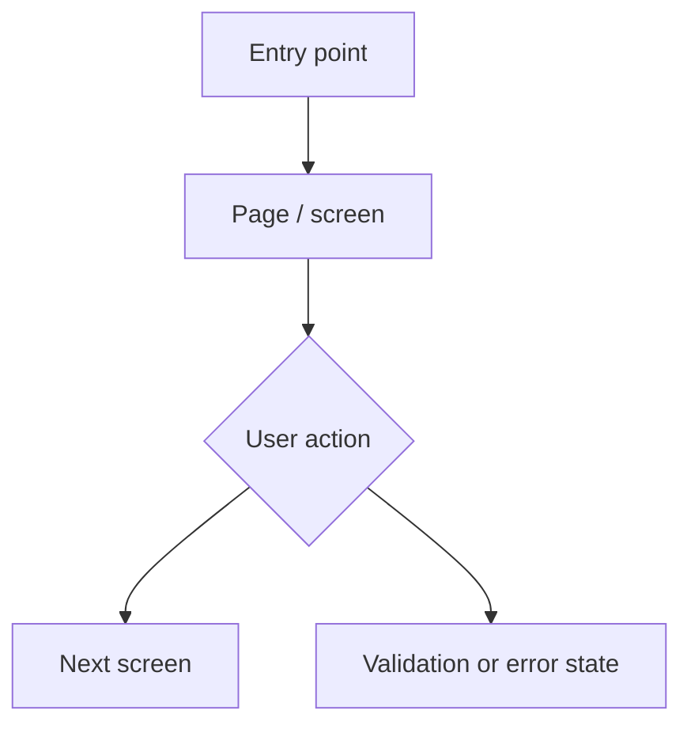

# Design KT Documentation

> **Source:** Uploaded KT recordings
>
> **Status:** Documentation structure prepared. The recording audio has not yet been transcribed, so the design details below are intentionally left for evidence-based completion. Do not treat placeholders or generic examples as the application's confirmed design.

## 1. KT Session Details

| Field | Details |
|---|---|
| KT topic | Application / UI / system design |
| Recording(s) | Attendance KT – 26 Oct 2026; Call with Shivam – 20 Oct 2026 |
| Design owner / presenter | To be confirmed |
| Date | To be confirmed from recording |
| Related module(s) | To be confirmed |
| Document status | Pending transcript-based analysis |

## 2. Design Overview

### 2.1 Purpose
Describe the feature or module, the user problem it solves, and the intended outcome.

### 2.2 Scope
- **In scope:**
- **Out of scope:**
- **User roles:**
- **Supported platforms / devices:**
- **Dependencies:**

### 2.3 Design principles and constraints
| Principle / constraint | Description | Evidence / timestamp |
|---|---|---|
| | | |

## 3. Application Structure and Navigation

### 3.1 Page / screen inventory
| Screen / page | Route / URL | Purpose | User role | Entry point | Evidence / timestamp |
|---|---|---|---|---|---|
| | | | | | |

### 3.2 Navigation flow
Document how a user reaches each screen, moves between screens, and returns or exits.

> Replace this generic illustration with the actual navigation flow shown in the KT.

## 4. UI / UX Design Specifications

### 4.1 Component inventory
| Component | Screen | Behaviour | States | Validation / rules | Evidence / timestamp |
|---|---|---|---|---|---|
| | | | | | |

### 4.2 Field-level specifications
| Screen | Field / control | Type | Required? | Default value | Allowed values / format | Validation message |
|---|---|---|---|---|---|---|
| | | | | | | |

### 4.3 UI states
For each screen, document:
- Initial / loading state
- Empty state
- Normal / populated state
- Disabled / read-only state
- Validation error state
- API / server error state
- Success / confirmation state
- Permission-restricted state

### 4.4 Responsive and accessibility behaviour
| Area | Expected behaviour | Evidence / timestamp |
|---|---|---|
| Desktop layout | | |
| Tablet / mobile layout | | |
| Keyboard navigation | | |
| Labels and accessible names | | |
| Focus and error announcement | | |
| Colour / contrast | | |

## 5. User Workflows

For each workflow, record the actor, preconditions, actions, system response, and alternate paths.

### 5.1 Primary workflow
1. **Actor:**
2. **Preconditions:**
3. **Starting screen:**
4. **User actions:**
5. **System response:**
6. **Success outcome:**
7. **Alternate / failure paths:**
8. **Evidence / timestamp:**

### 5.2 Alternate workflows
| Scenario | User action | Expected UI behaviour | Expected system outcome | Evidence / timestamp |
|---|---|---|---|---|
| | | | | |

## 6. Frontend Design and Integration

### 6.1 Frontend structure
| Area | Framework / component / module | Responsibility | Evidence / timestamp |
|---|---|---|---|
| Application shell | | | |
| Pages / routes | | | |
| Reusable components | | | |
| State management | | | |
| Form handling | | | |
| Localization | | | |
| Styling / design system | | | |

### 6.2 Frontend-to-backend interaction
| User action | UI component | API method and endpoint | Request data | Response handling | UI update |
|---|---|---|---|---|---|
| | | | | | |

### 6.3 Data and state behaviour
Document:
- Where screen data is loaded from.
- When data is refreshed.
- Whether state is local, shared, cached, or persisted.
- How unsaved changes are handled.
- What happens after success, failure, navigation, or refresh.

## 7. Design Rules and Business Behaviour

| Rule ID | Screen / component | Condition | Expected behaviour | Error / helper text | Evidence / timestamp |
|---|---|---|---|---|---|
| UI-BR-01 | | | | | |

## 8. Permissions and Visibility

| Role / permission | Screen access | View | Create | Edit | Delete / approve | Evidence / timestamp |
|---|---|---|---|---|---|---|
| | | | | | | |

Record any field-level restrictions, conditional visibility, and read-only behaviour.

## 9. Error Handling and Feedback

| Condition | UI response | Message shown | Recovery action | Evidence / timestamp |
|---|---|---|---|---|
| Required field missing | | | | |
| Invalid input | | | | |
| API validation failure | | | | |
| Network / server failure | | | | |
| No records found | | | | |
| Access denied | | | | |

## 10. QA Design Review Checklist

- [ ] Every screen and route is documented.
- [ ] Navigation paths and entry points are covered.
- [ ] Required, optional, disabled, and read-only controls are identified.
- [ ] Field formats, limits, and validation messages are recorded.
- [ ] Loading, empty, success, and error states are documented.
- [ ] Role-based visibility and permissions are covered.
- [ ] UI actions are mapped to backend APIs.
- [ ] Responsive behaviour is recorded.
- [ ] Localization and date / number formatting are considered.
- [ ] Keyboard and accessibility behaviour is reviewed.
- [ ] Positive, negative, boundary, and permission tests are identified.
- [ ] Each important design decision has a recording timestamp or other evidence.

## 11. Design Decisions and Open Questions

### 11.1 Confirmed decisions
| Decision | Rationale | Owner | Evidence / timestamp |
|---|---|---|---|
| | | | |

### 11.2 Open questions
| Question | Why clarification is needed | Owner | Status |
|---|---|---|---|
| | | | Open |

## 12. Evidence and Confidence

Use the following labels throughout this document:

- **Confirmed:** Explicitly stated or visibly demonstrated in the KT.
- **Inferred:** Reasonable interpretation, clearly marked as inference.
- **Needs confirmation:** Ambiguous or conflicting information.
- **Not covered:** Not discussed or demonstrated.

Attach a timestamp to every important screen, field rule, workflow, permission, and design decision. Do not assume that a generic UI pattern is part of the product.

## 13. Completion Requirements

To complete this document with the actual design from the recordings, a timestamped transcript or accessible recording transcription is required. The transcript should preserve speaker turns where possible. Then replace the generic sections and example flow with the actual screens, navigation, component behaviour, validations, API mappings, and design decisions discussed in the KT.
