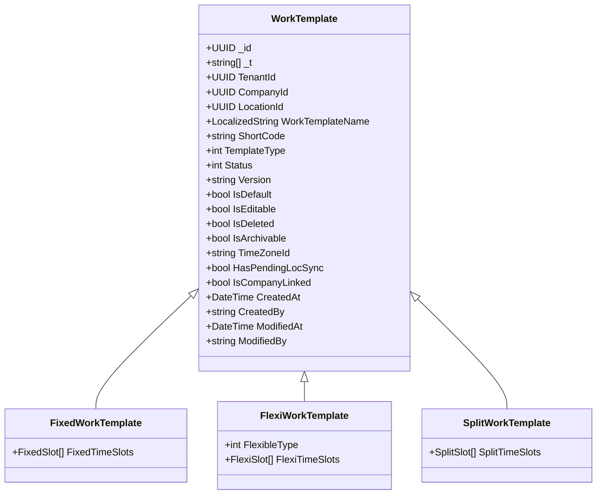

# Sahab ERP Attendance – MongoDB Persistence & Document Model Validation Report

**Document Version:** `1.0`  
**Execution Date:** `2026-11-10`  
**Target Host:** `10.1.0.4:27018`  
**Database:** `Sahab`  
**Collection:** `ERP.Attendance.WorkTemplates`  
**Target Company:** `Attendance 8 (3a249871-7a8d-dec5-2d72-47795dd2662d)`  
**Target Locations:** Location 1 (`3a24d629...`) & Location 2 (`3a24d646...`)  
**Visual Evidence Artifacts:**  
- [Evidence 54: Regular Shift Location POST/PATCH Audit Wipeout](file:///d:/Code/Attendance%20Testing/defect_evidence/evidence_54_regular_shift_location_post_patch_audit_wipeout_compass.png)  
- [Evidence 55: Fixed Work Template Location PATCH Validation Bypasses & DB Results](file:///d:/Code/Attendance%20Testing/defect_evidence/evidence_55_fixed_wt_location_patch_validation_bypasses_and_db_results.png)  
- [Evidence 56: Flexible & Split Template Validation Bypasses & Transitions](file:///d:/Code/Attendance%20Testing/defect_evidence/evidence_56_flexi_split_location_validation_bypasses_and_db_results.png)  

---

## 1. MongoDB Document Model & Polymorphic Hierarchy

The `Sahab.ERP.Attendance.WorkTemplates` collection implements a single-collection polymorphic document model powered by the MongoDB C# driver discriminator `_t`:



### Polymorphic Discriminator Values (`_t`):
- **Fixed Work Template:** `_t: ["WorkTemplate", "FixedWorkTemplate"]` | `TemplateType: 1`
- **Flexible Work Template:** `_t: ["WorkTemplate", "FlexiWorkTemplate"]` | `TemplateType: 2`
- **Split Work Template:** `_t: ["WorkTemplate", "SplitWorkTemplate"]` | `TemplateType: 3`

---

## 2. In-Place Polymorphic Mutation Verification

During testing of Cross-Type Transitions (`TRANS-01` to `TRANS-06`), documents were updated across types in-place via `PATCH /worktemplates/{targetType}/{id}`. MongoDB Compass verification confirmed:

| Document ID | ShortCode | Original Type | Mutated Target Type | Stored `TemplateType` | Stored `_t` Array in MongoDB |
| :--- | :--- | :--- | :--- | :---: | :--- |
| `7ecfbe95-8d3c-4612-a0cc-1454e9093a53` | `FXD0001` | Flexi | Fixed | `1` | `['WorkTemplate', 'FixedWorkTemplate']` |
| `68dab14c-9355-4f19-b553-118b5a70212b` | `FXD0002` | Flexi | Split | `3` | `['WorkTemplate', 'SplitWorkTemplate']` |
| `ab6bb972-24e9-4b3c-9c23-55ef8770f6e5` | `SPD0001` | Split | Fixed | `1` | `['WorkTemplate', 'FixedWorkTemplate']` |
| `5766c9f3-8632-4359-b9a6-3796b14d355c` | `SPD0002` | Split | Flexi | `2` | `['WorkTemplate', 'FlexiWorkTemplate']` |

### In-Place Mutation Findings:
1. **Identity Retention:** The MongoDB `_id` remains constant during cross-type transitions.
2. **Version Invariance:** `Version` remains `"1.0"` throughout the transition lifecycle.
3. **Discriminator Replacement:** The MongoDB driver correctly replaces the subclass discriminator in `_t`.
4. **Schema Cleanup:** Properties unique to the previous type (e.g., `flexiTimeSlots`) are replaced by the target type property (e.g., `fixedTimeSlots`).

---

## 3. MongoDB Persistence Defects & Data Inconsistencies

### 3.1 Audit Metadata Wipeout (`DEFECT-20261110-03`)
- In document `0ba519c8-c2e2-4bce-8a70-23b1616ed5f7` (Location 1):
```json
{
  "CreatedAt": "0001-01-01T00:00:00.000Z",
  "CreatedBy": null,
  "ModifiedAt": "2026-11-10T06:55:26.818Z",
  "ModifiedBy": "syed.mohamed@comm-it.in"
}
```
`CreatedAt` was wiped to `DateTime.MinValue` and `CreatedBy` was set to `null` by the in-place PATCH operation.

### 3.2 Corrupt Recurrence Array Persistence (`DEFECT-20261110-04`, `07`, `10`, `14`)
- Document `9605711d-dc54-405c-a73b-e45a79cc22c9` (`BVBVA16`): `RecurrenceOfMonth: [0]`
- Document `6382798d-ed99-461d-a7df-c5add6896170` (`BVBVA17`): `RecurrenceOfMonth: [6]`
- Document `0ee23f7d-aa83-493b-af79-93c99c2f7c9d` (`FXDNEG9`): `RecurrenceOfMonth: [6]`
- Document `ab6bb972-24e9-4b3c-9c23-55ef8770f6e5` (`SPD0001`): `RecurrenceOfMonth: [6]`
MongoDB contains schedule documents with recurrence indices `0` and `6` that will never match a real calendar day.

### 3.3 Mathematically Inconsistent Duration Persistence (`DEFECT-20261110-05`, `11`, `13`)
- Document `c9e00652-eae5-429a-bef0-4d4ddf9e0a0f` (`FXL0101`): `TotalWorkDurationInMinutes: 3000.0` (sum of slots = 2,700m).
- Document `96a20f25-47fb-496a-b595-0259aedba8c5` (`FXDNE10`): `TotalWorkDurationInMinutes: 3000.0` (sum of slots = 2,400m).
- Document `31f4a4df-1c71-464a-95c0-aa5198031d2d` (`SPDNE10`): `TotalWorkDurationInMinutes: 3000.0` (sum of intervals = 2,400m).