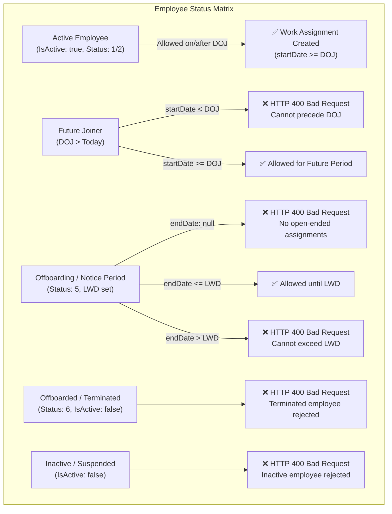

# 🏢 Work Assignments Module — Business & Overlap Invariant Validation Dossier

> **Target Microservices:** `SP.AttendanceSvc` (.NET 9) & `SP.CompanySvc` (.NET 8)  
> **Target Database:** MongoDB `Sahab` (`ERP.Attendance.WorkAssignments`, `ERP.Attendance.WorkAssignmentMaps`, `ERP.Attendance.WorkPlans`)  
> **Environment:** DEV (`sp.dev.zoolwork.com` / `gw8.dev.zoolwork.com`)  
> **QA Level:** Senior Staff QA Automation & Microservice Specialist  

---

## 📑 Table of Contents
1. [Core Business Architecture: The "Copies, Not Links" Model](#1-core-business-architecture-the-copies-not-links-model)
2. [Conflict Detection & Categorization Engine](#2-conflict-detection--categorization-engine)
3. [The 4 Overlap Cutting Behaviors (Detailed Date Walkthroughs)](#3-the-4-overlap-cutting-behaviors-detailed-date-walkthroughs)
4. [Cross-Schedule Move Transitions (Polymorphic Move Engine)](#4-cross-schedule-move-transitions-polymorphic-move-engine)
5. [Effective Period Lifecycle & Immutability Rules](#5-effective-period-lifecycle--immutability-rules)
6. [Temporal Evaluation Rules for GET /current-plans](#6-temporal-evaluation-rules-for-get-current-plans)
7. [MongoDB Audit & Cross-Collection Consistency Verification](#7-mongodb-audit--cross-collection-consistency-verification)
8. [Test Data Prerequisites & Execution Checklist](#8-test-data-prerequisites--execution-checklist)
9. [End-to-End POST & PATCH API Execution Protocol & Flow State Machines](#9-end-to-end-post--patch-api-execution-protocol--flow-state-machines)
10. [Employee Master Prerequisites & Employment Lifecycle Rules (Active, Offboarding, DOJ & Location Integrity)](#10-employee-master-prerequisites--employment-lifecycle-rules-active-offboarding-doj--location-integrity)

---

## 1. Core Business Architecture: The "Copies, Not Links" Model

The Sahab Attendance platform operates on a strict **snapshot / denormalized copy model**:

```
[Template] ──embedded copy──► [WorkPlan] ──embedded copy──► [WorkAssignmentMaps] ◄── [WorkAssignments]
                                                              (Single Source of Truth)  (Cohort Header)
```

1. **Why Copies?**
   - Payroll, overtime, and punctuality calculations are historical facts. An employee working an 8-hour shift on October 1st cannot have their historical calculation altered because HR changed the underlying Work Template or Break Policy on November 15th.
2. **Where Does the Snapshot Live?**
   - The snapshot lives in `ERP.Attendance.WorkAssignmentMaps.WorkPlanData`.
   - It captures the template name, short code, daily schedule duration, fixed time slots, break windows, and embedded policy rules (Overtime, Grace Period, Breaks).
3. **Immutability of In-Use Plans:**
   - Once a Work Plan is referenced by an assignment map, it cannot be deleted (`DELETE /workplans/{id}` returns `400 Cit.Attendance:1304`).
   - If a Work Plan is updated via `PATCH`, only template swaps propagate to assignment maps; name and policy edits do **not** propagate (documented as `DEFECT-20261112-08`).

---

## 2. Conflict Detection & Categorization Engine

Whenever an assignment action (create, edit, or move) is initiated, the engine executes a preflight collision check against `ERP.Attendance.WorkAssignmentMaps` for the target employee at the specified location.

| Collision Category | Source of Overlap | Allowed to Proceed? | Can be Adjusted? | System Action / Error Code |
| :--- | :--- | :---: | :---: | :--- |
| 🟢 **Allowed (Clean)** | None (no active rows in range) | **YES** | N/A | Assignment created immediately. |
| 🟡 **Adjustable** | Existing **Regular Work Plan** at the same location | **YES** (with confirmation) | **YES** | Old regular row is cut/split via `/adjust`. New row created. |
| 🔴 **Blocked** | **Roster Board** shift or **Shift Rotation** step | **NO** | **NO** | Preflight returns `canProceed: false`. Adjust/Move rejected with **`Cit.Attendance:1408`**! |

> [!IMPORTANT]
> **Strict Atomic Rejection on Batch Adjust:**
> If a batch of 10 employees is submitted to `POST /workassignments/adjust`, and **even 1 employee** has a Blocked overlap (Roster or Rotation), the microservice must reject the **entire request** with HTTP 400 `Cit.Attendance:1408`. It must never perform a partial adjust!

---

## 3. The 4 Overlap Cutting Behaviors (Detailed Date Walkthroughs)

When an overlap with an existing Regular Work Plan is confirmed for adjustment, `POST /workassignments/adjust` applies one of four deterministic geometric cutting algorithms to the existing `WorkAssignmentMaps` row:

### Strategy 1: Ends Early
- **Condition:** Old assignment starts before the new period and ends inside it.
- **Formula:** `OldRow.EndDate = NewStart - 1 day`
- **Example:**
  - Existing Assignment: `2026-10-01` → `2026-12-15` (General Shift)
  - New Assignment: `2026-12-01` → `2026-12-31` (Night Shift)
  - **Result in DB:**
    - Modified Old Row: `2026-10-01` → `2026-11-30` (General Shift)
    - New Row Created: `2026-12-01` → `2026-12-31` (Night Shift)

### Strategy 2: Split (Cut & Resume)
- **Condition:** Old assignment starts before the new period and runs past its end date.
- **Formula:**
  - Segment 1: `OldRow.EndDate = NewStart - 1 day`
  - Middle: New Assignment Created `NewStart` → `NewEnd`
  - Segment 2: New Resumed Row Created `OldRow_Resumed.StartDate = NewEnd + 1 day`, `EndDate = OldEnd`
- **Example:**
  - Existing Assignment: `2026-10-01` → `2027-03-31` (General Shift)
  - New Assignment: `2026-12-01` → `2026-12-31` (Night Shift)
  - **Result in DB:**
    - Truncated Old Row: `2026-10-01` → `2026-11-30` (General Shift)
    - New Row: `2026-12-01` → `2026-12-31` (Night Shift)
    - Resumed Old Row: `2027-01-01` → `2027-03-31` (General Shift)

### Strategy 3: Starts Later
- **Condition:** Old assignment starts inside a closed new period and runs past its end.
- **Formula:** `OldRow.StartDate = NewEnd + 1 day`
- **Example:**
  - Existing Assignment: `2026-12-15` → `2027-03-31` (General Shift)
  - New Assignment: `2026-12-01` → `2026-12-31` (Night Shift)
  - **Result in DB:**
    - Modified Old Row: `2027-01-01` → `2027-03-31` (General Shift)
    - New Row: `2026-12-01` → `2026-12-31` (Night Shift)

### Strategy 4: Completely Encompassed (Deactivated)
- **Condition:** Old assignment lies completely inside the new assignment window.
- **Formula:** `OldRow.IsActive = false`, `Status = Inactive` (Kept for audit trail)
- **Example:**
  - Existing Assignment: `2026-12-05` → `2026-12-20` (General Shift)
  - New Assignment: `2026-12-01` → `2026-12-31` (Night Shift)
  - **Result in DB:**
    - Old Row: Marked `IsActive: false`
    - New Row: `2026-12-01` → `2026-12-31` (Night Shift)

---

## 4. Cross-Schedule Move Transitions (Polymorphic Move Engine)

The Move Employee API (`PATCH /workassignments/details/{id}/move`) is a polymorphic transition engine that can move an employee off their current regular plan into one of three target schedule types:

```
                          ┌──────────────────────────┐
                          │ Current Regular Detail   │
                          │   (WorkAssignmentMap)    │
                          └─────────────┬────────────┘
                                        │
           ┌────────────────────────────┼────────────────────────────┐
           ▼                            ▼                            ▼
[TargetType: 2 WorkPlan]      [TargetType: 1 Board]       [TargetType: 3 Rotation]
- Source row ends E-1 day     - Source row ends E-1 day    - Source row ends E-1 day
- Creates new Regular Map     - Adds employee to Board     - Enrolls in Rotation Team
- Returns createdAssignmentId - Returns targetMembershipId - Returns targetMembershipId
```

### Move Invariants:
1. **Effective Date Floor:** `effectiveFrom` cannot be earlier than **tomorrow** (`effectiveFrom > today`).
2. **Unstarted Move:** If the current assignment has not started yet (`startDate > today`), moving the employee permanently deactivates the source row (`IsActive: false`) instead of shortening it.
3. **Location Scoping:** The move target must belong to the **same location** as the source assignment. Cross-location moves must be rejected.
4. **Target Compatibility:** `targetType: "WorkPlan"` accepts only Regular Work Plans (`PlanType=1`). If the caller supplies a Rotation or Roster plan ID, the request must fail with `Cit.Attendance:1104`.

---

## 5. Effective Period Lifecycle & Immutability Rules

Modifying an employee's assignment dates via `PATCH /details/{id}/effective-period` follows strict temporal state guards:

| Current Row Status | Start Date Modifiable? | End Date Modifiable? | Date Constraints | Target Error if Violated |
| :--- | :---: | :---: | :--- | :--- |
| **Upcoming** (`startDate > today`) | **YES** | **YES** | `startDate >= today`<br>`endDate >= startDate` | `400 Cit.Attendance:1405` |
| **Active / Ongoing** (`startDate <= today`) | ❌ **LOCKED** | **YES** | `startDate` must remain unchanged.<br>`endDate >= today` | `400 Cit.Attendance:1406` |
| **Past / Expired** (`endDate < today`) | ❌ **LOCKED** | ❌ **LOCKED** | Cannot edit historical completed periods. | `400 Cit.Attendance:1406` |
| **Deactivated** (`IsActive == false`) | ❌ **LOCKED** | ❌ **LOCKED** | Cannot edit deactivated rows. | `400 Bad Request` |

---

## 6. Temporal Evaluation Rules for GET /current-plans

The endpoint `GET /api/companies/{companyId}/workassignments/current-plans` is the core query powering employee pickers across the UI:
1. **Resolution Hierarchy:**
   - On date `D`, if an employee has multiple active maps (e.g. during an ongoing transition), the system returns the active map covering `D` with the **latest start date**.
2. **Plan Type Tagging:**
   - The response returns the active plan with its underlying type: `"Regular"`, `"Roster"`, or `"Rotation"`.
3. **Defaulting:**
   - If `asOf` is omitted, the system evaluates against the current UTC date.
   - If the employee has no assignment on `D`, the response returns a clean null entry for that employee, never a 404 error.

---

## 7. MongoDB Audit & Cross-Collection Consistency Verification

When running automated test suites, verify the following database invariants in MongoDB `Sahab`:

```javascript
// 1. Verify Header Record
db.getSiblingDB("Sahab").getCollection("ERP.Attendance.WorkAssignments").findOne({
  "_id": UUID("..."),
  "CompanyId": UUID("..."),
  "LocationId": UUID("..."),
  "WorkPlanId": UUID("..."),
  "IsDeleted": false
});

// 2. Verify Employee Detail Maps (Points back via WorkAssignmentId)
db.getSiblingDB("Sahab").getCollection("ERP.Attendance.WorkAssignmentMaps").find({
  "WorkAssignmentId": UUID("..."),
  "AssignmentType": 1,
  "IsActive": true
});

// 3. Verify Embedded WorkPlanData Snapshot
var map = db.getSiblingDB("Sahab").getCollection("ERP.Attendance.WorkAssignmentMaps").findOne({
  "EmployeeId": UUID("...")
});
assert(map.WorkPlanData != null, "WorkPlanData snapshot must be embedded!");
assert(map.WorkPlanData.WorkTemplate != null, "WorkTemplate snapshot must be embedded!");
assert(map.WorkPlanData.Policies != null, "Policies snapshot must be embedded!");
```

---


### Live Verified Sample Pair (Attendance 11 — 13-Nov-2026):
1. **Header Record in `ERP.Attendance.WorkAssignments` (`f9e467c6-fd79-4066-87f6-b4262419c5f8`):**
   - `CompanyId`: `3a24e5e5-302e-91bd-feaa-b07979766dfe` (`Attendance 11`)
   - `LocationId`: `3a24e666-df63-3dc7-0ea7-02ec8be341e7` (`Dammam` / `الدمام`)
   - `WorkPlanId`: `a1ae96cd-587b-4145-8859-3b42877ea4a5` (`Default Work Plan`)
   - `StartDate`: `2026-11-13T00:00:00Z`
   - `EndDate`: `9999-12-31T00:00:00Z` (Open-ended null serialization)
   - `Status`: `1` (Active), `IsActive`: `true`
   - Holds **NO employee array**.

2. **Detail Map Record in `ERP.Attendance.WorkAssignmentMaps` (`b9e30791-da83-4d65-8c3f-25faa251360a`):**
   - `_t`: `["WorkAssignmentMap", "RegularWorkAssignmentMap"]`, `AssignmentType`: `1`
   - `WorkAssignmentId`: `f9e467c6-fd79-4066-87f6-b4262419c5f8` (Matches header above 100%)
   - `EmployeeId`: `f9e1a6d5-6bd5-7d46-ae85-38b81dc80887`
   - `EmployeeCode`: `"SA-EMP-0001"`, `EmployeeName`: `"Faisal Al-Qahtani Al-Qahtani"`
   - `Department`: `GENW` ("Gen Engineer"), `Designation`: `AIENG` ("AI Engineer")
   - `WorkPlanData`: Embeds full snapshot copy of template `LOC0002` (3,240 min, 7 FixedTimeSlots).


---

## 8. Test Data Prerequisites & Execution Checklist

Before executing the Work Assignment test cases:
1. Ensure a valid Company exists (e.g. `Attendance 10` `3a249872-e23c-a401-7d8b-4a8049ac8c9b`).
2. Ensure active Locations exist under the Company.
3. Ensure at least one Regular Work Plan exists with an embedded Fixed Work Template.
4. Ensure active Employees exist in the Employee Hierarchy for the target location.
5. Store the active Bearer token in `scratch/current_token.json`.

---

## 9. End-to-End POST & PATCH API Execution Protocol & Flow State Machines

### A. The 3-Step POST Workflow (Creation & Conflict Resolution)
Every Work Assignment creation follows an atomic 3-step sequence:

```
[UI Selection] 
       │
       ▼
[Step 1: POST /workassignments/check-conflicts]
       │
       ├─► 🔴 Blocked (Roster / Rotation) ────► UI disables 'Add' (Must deselect)
       │
       ├─► 🟢 All Clean (No overlaps) ────────► [Step 2: POST /workassignments] ──► Done (Header + Maps created)
       │
       └─► 🟡 Adjustable (Regular overlap) ──► [Step 2: POST /workassignments]
                                                        │ (Assigns Clean, returns conflictedEmployeeIds)
                                                        ▼
                                               [Step 3: POST /workassignments/adjust]
                                                  (Cuts old rows, assigns conflicted to Header)
```

1. **Step 1: `POST /check-conflicts?locationId=`**
   - **Mode:** Read-only simulation (Zero DB mutations).
   - **Validation:** Enforces `startDate >= today` (unless `enforceFutureStart=false`), `endDate >= startDate`, and non-empty employee array.
2. **Step 2: `POST /workassignments?locationId=`**
   - **Mode:** Partial commit.
   - **Execution:** Writes `ERP.Attendance.WorkAssignments` header. Creates `WorkAssignmentMaps` **only for clean employees**. Returns conflicted IDs.
3. **Step 3: `POST /workassignments/adjust?locationId=`**
   - **Mode:** Transactional adjustment.
   - **Precondition:** Requires valid `workAssignmentId` returned from Step 2.
   - **Execution:** Cuts old overlapping regular rows and creates new maps attached to the header. Rejects entire request with `Cit.Attendance:1408` if any employee is on Roster/Rotation.

---

### B. The 3 PATCH Lifecycle Flows (Maintenance & Transitions)

```
[Active Assignment Row (WorkAssignmentMap)]
       │
       ├─► Edit Dates: 
       │     1. POST /check-conflicts?skipAssignmentId={id}&enforceFutureStart=false
       │     2. PATCH /details/{id}/effective-period?locationId=...
       │        (Locked start date if started; adjustConflicts cuts overlaps)
       │
       ├─► Move Employee: 
       │     1. POST /details/{id}/move/check-conflicts?locationId=...
       │     2. PATCH /details/{id}/move?locationId=...
       │        (Old row ends effectiveFrom-1 day; Target Regular/Board/Rotation created)
       │
       └─► Remove Employee:
             1. PATCH /details/{id}/remove?locationId=...
                (Sets IsActive: false; preserves audit history)
```

| Flow Type | Preflight API | Primary Execution API | Core Invariant Enforced |
| :--- | :--- | :--- | :--- |
| **Edit Effective Period** | `POST /check-conflicts` with `skipAssignmentId={id}` | `PATCH /details/{id}/effective-period` | If `startDate <= today`, start date is **LOCKED** (`Cit.Attendance:1406`). Only `endDate` can be changed. |
| **Move Employee** | `POST /details/{id}/move/check-conflicts` | `PATCH /details/{id}/move` | `effectiveFrom` must be **tomorrow or later**. Old row terminates the day before. |
| **Remove Employee** | None (direct) | `PATCH /details/{id}/remove` | Sets `IsActive: false`. Does not delete historical document. |

---

## 10. Employee Master Prerequisites & Employment Lifecycle Rules (Active, Offboarding, DOJ & Location Integrity)

> **Inter-Service Integration:** `SP.AttendanceSvc` (.NET 9) queries `SP.EmployeeSvc` / `EmployeeSvcNET8test.Employee` via gRPC / Internal HTTP.  
> **Key Database:** MongoDB `EmployeeSvcNET8test.Employee` (2,502 employees in DEV).

### 10.1 The Employee Lifecycle State Rules for Work Assignment



| Employee State | Source Collection Field | Work Assignment Allowed? | Permitted Assignment Period | Target Error if Violated |
| :--- | :--- | :---: | :--- | :--- |
| **Active Employee** | `IsActive: true`, `EmployeeStatus: 1/2` | **YES** | `startDate >= DateOfJoining`<br>`endDate`: Open-ended or closed | `400 Cit.Attendance:1405` (if past start) |
| **Future Hire (DOJ in future)** | `WorkInformation.DateOfJoining > today` | **CONDITIONAL** | Allowed **ONLY IF** `startDate >= DateOfJoining` | `400 Cit.Attendance:Validation` ("Cannot assign before DOJ") |
| **Offboarding / Notice Period** | `EmployeeStatus: 5`, `Separation.LWD` | **RESTRICTED** | Allowed **ONLY IF** `endDate != null` AND `endDate <= Separation.LWD` | `400 Cit.Attendance:Validation` ("Cannot exceed LWD") |
| **Terminated / Offboarded** | `EmployeeStatus: 6`, `IsActive: false` | ❌ **STRICT NO** | None. Completely blocked from new assignments. | `400 Cit.Attendance:Validation` ("Terminated employee") |
| **Inactive / Suspended** | `IsActive: false` | ❌ **STRICT NO** | None. Completely blocked. | `400 Cit.Attendance:Validation` ("Inactive employee") |
| **Cross-Location Employee** | `WorkInformation.WorkLocation._id != locationId` | ❌ **STRICT NO** | Employee cannot be assigned to another location's plan. | `400 Cit.Attendance:Validation` ("Location mismatch") |

---

### 10.2 Prerequisite Setup Protocol in `EmployeeSvcNET8test.Employee`

Before executing manual or automated Work Assignment tests:
1. **Query Target Employee:** Ensure employee document exists in `EmployeeSvcNET8test.Employee`:
   ```javascript
   db.getSiblingDB("EmployeeSvcNET8test").getCollection("Employee").findOne({
     "_id": UUID("f9e1a6d5-6bd5-7d46-ae85-38b81dc80887")
   }, {
     "EmployeeCode": 1,
     "IsActive": 1,
     "EmployeeStatus": 1,
     "BasicInformation.Company.CompanyId": 1,
     "WorkInformation.WorkLocation._id": 1,
     "WorkInformation.DateOfJoining": 1,
     "Separation": 1
   });
   ```
2. **Verify Mandatory Preconditions:**
   - `IsActive` must equal `true`.
   - `EmployeeStatus` must equal `1` or `2`.
   - `BasicInformation.Company.CompanyId` must match route `{companyId}`.
   - `WorkInformation.WorkLocation._id` must match query `{locationId}`.
   - `WorkInformation.DateOfJoining` must be on or before assignment `startDate` (`DOJ <= 2026-11-13`).
3. **Automated Teardown:** Delete test `WorkAssignments` and `WorkAssignmentMaps` after execution to restore the employee's active schedule to baseline.
